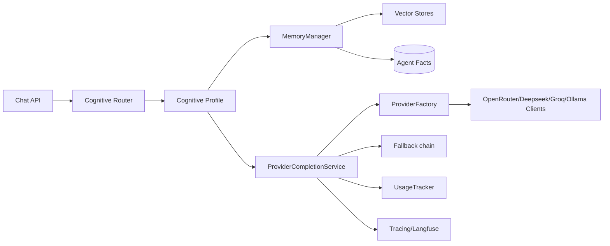

# Cross-Cutting Concerns

The patterns that span every API domain: auth, streaming, and the
pipeline chain.

## Auth model

**There are no user accounts.** The app is a local-first,
single-operator system. Access control is:

- **CORS middleware** — restricts browser origins (configurable
  via `CORS_ORIGINS` in `.env`)
- **External-access toggle** (`middleware.py` in agent_chat) —
  checks the `system_flags` table for `external_access_enabled`
  on every request to the agent-chat API; returns **403** when
  disabled. The flag is request-cached.
- API keys never leave the server — `.env` (EnvKeyStore), the API
  reports key *presence* only.

## Streaming (SSE)

| Path | Source | Streams |
|------|--------|---------|
| `POST /api/v1/chat/stream` | `chat/router.py` | Chat token stream (user chat) — the cognitive TRACE also rides the messaging bus (the migration, see [[atlas/api/routers/messaging|Messaging]]) |
| `POST /api/v1/agent-chat/...` | `agent_chat/router.py` | Agent chat events |
| `GET /api/v1/logs/stream` | `logs/router.py` | Live log feed |
| `GET /api/v1/messaging/stream` | `messaging/router.py` | **The event bus** (2026-08-24) — the generic pub-sub stream; any topic; see [[atlas/api/routers/messaging|Messaging]] |

## WebSockets

| Path | Purpose |
|------|---------|
| `/api/v1/agent-chat/ws` | Agent chat (live messages) |
| `/api/v1/agent-chat/ws/ui` | UI state bridge (frontend sync) |

## The cognitive pipeline chain

The LLM-call chain that every chat/agent message flows through:

- **Router** picks the cognitive profile (per agent or default)
- **Profile** configures memory depth, summarization, retrieval
- **MemoryManager** reads/writes agent facts + session context
- **Vectors** provide semantic recall (doc + code stores)
- **Completion** goes through the provider factory with an
  optional fallback chain (openrouter → deepseek → ollama; opt-in
  per agent)
- **UsageTracker** records every call; **Tracing** (Langfuse)
  captures traces

## Key stores

| Store | Purpose |
|-------|---------|
| `cogitate.db` | Primary SQLite (agents, providers, sessions, logs, curated models) |
| `provider_model_cache` | Cached model catalogs per provider |
| `usage_logs` | LLM call history (health source) |
| Vector DBs | `system_docs_vector.db` (RAG), `system_code_vector.db` (code recall) |
| `.env` | API keys (never committed) |

## Status

**ACTIVE** — these patterns are the app's architecture.

## Related

- [[atlas/api/routers/chat|Chat API]]
- [[atlas/api/routers/agent-chat|Agent Chat API]]
- [[atlas/services/providers|Providers Services]]
- [[dev-notes/tracing/tracing-architecture|Tracing Architecture]]

## Path resolution — the Paths locator (2026-08-17)

The backend resolves its canonical paths through ONE locator:
`Paths.from_settings()` (core/config.py) — the shared DB (derived
from `settings.database_url`), data/monitor, agents/, logs/. Every
module that opens the shared DB imports the locator; hand-computed
path arithmetic (`__file__` parent-crawls, `BASE_DIR / name`,
cwd-dependent paths) is banned — it produced a phantom empty DB
(workflow routers, Aug 9) and the TestAgent production-write
(provisioning router). The health endpoint reports each path's
resolution. See
[[dev-notes/architecture/Paths and Path Resolution]].
