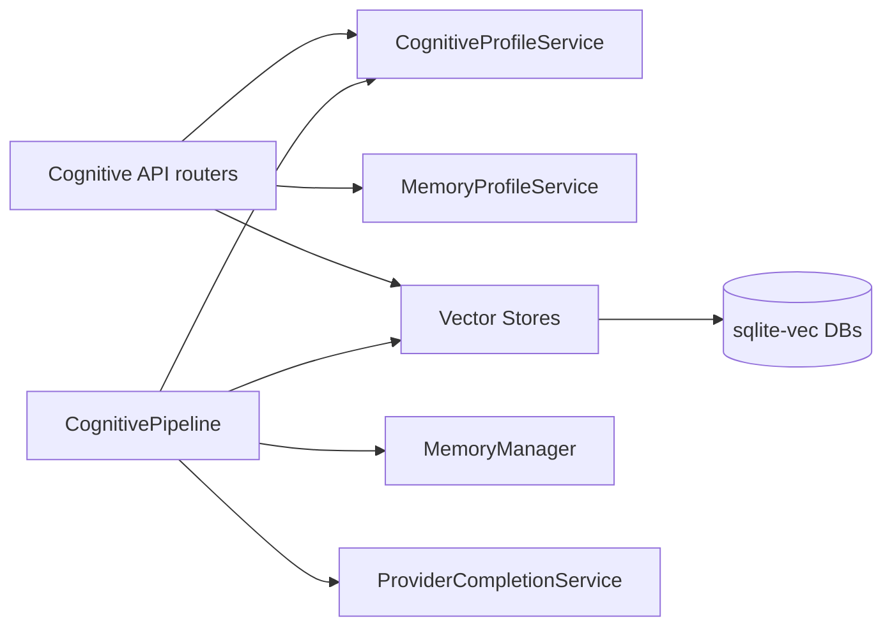

# Cognitive Services

The cognitive domain owns the pipeline behind agent behavior:
profiles (configuration), memory (facts/state), and vectors
(recall).

## Services

| Service | Responsibility |
|---------|---------------|
| CognitiveProfileService | Pipeline behavior profiles (memory depth, summarization, retrieval) |
| MemoryProfileService | Per-agent memory settings |
| MemoryManager (base + impls) | Agent fact/memory storage (see memory-isolation bugs in todo) |
| Vector stores | `DocVectorStore` + `CodeVectorStore` (sqlite-vec) for RAG + code recall |
| CognitivePipeline | The pipeline runner (profiles → memory → vectors → response) |

## Dependencies (mermaid)

## Status

**ACTIVE** — the memory/recall backbone. Memory isolation bugs
(facts key, session bleed) tracked in todo.

## Related

- [[atlas/api/routers/cognitive|Cognitive API]]
- [[dev-notes/agents/cognitive-hub|Cognitive Hub]]
