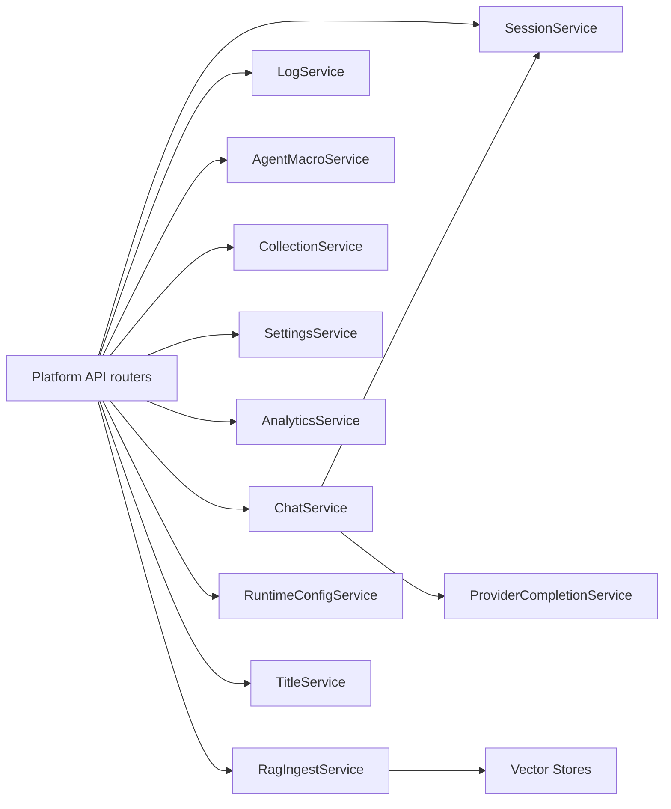

# Platform Services

The platform domain owns the everyday services: sessions, chat,
logs, macros, collections, settings, analytics, rag, runtime
config, titles.

## Services

| Service | Responsibility |
|---------|---------------|
| `SessionService` | Chat session lifecycle |
| `ChatService` | Chat business logic (stream, delegate, completions) |
| `TitleService` | Auto session-title generation |
| `LogService` | Log DB operations + stats |
| `AgentMacroService` | Macro sets + meta-topics |
| `MacroExportService` / `MacroBackupService` | Export/import/backup |
| `CollectionService` | Collections + items |
| `SettingsService` | User settings |
| `AnalyticsService` | Cost/performance/usage analytics |
| `RagIngestService` | Wiki/entities + dev-notes ingestion |
| `RuntimeConfigService` | Per-session runtime config |
| `CmnResolver` | Resolves CMN addresses to DB ids |

## Dependencies (mermaid)

## Status

**ACTIVE** — everyday services.

## Related

- [[atlas/api/routers/sessions|Sessions API]]
- [[atlas/api/routers/chat|Chat API]]
- [[atlas/api/routers/rag|RAG API]]
