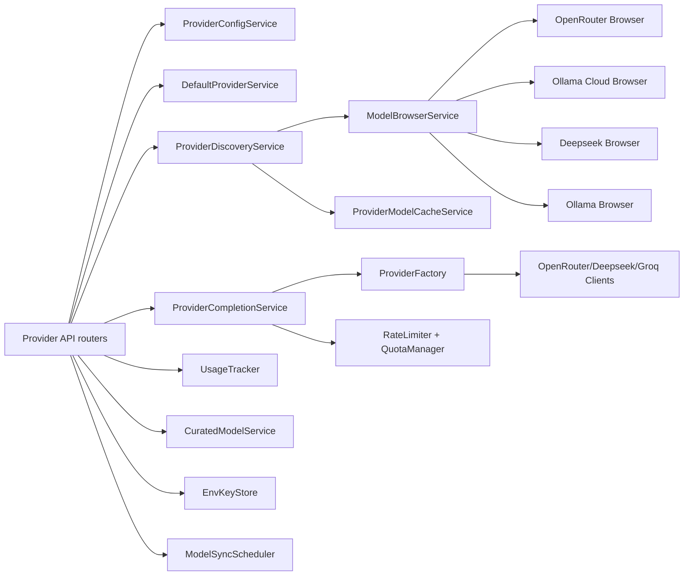

# Providers Services

The provider domain owns everything about LLM providers: config,
keys, model discovery, caching, completion, usage, quota.

## Services

| Service | Responsibility |
|---------|---------------|
| `ProviderConfigService` | Provider config CRUD (base URLs, models, fallback prefs) |
| `DefaultProviderService` | Default provider selection + readiness |
| `ProviderService` | Main coordinator — multiple providers via LiteLLM |
| `ProviderCompletionService` | Unified completion with provider abstraction |
| `ProviderDiscoveryService` | Discover models from live provider catalogs |
| `ModelBrowserService` | Generic model-browsing interface (per-provider impls: Ollama, OllamaCloud, Deepseek, OpenRouter) |
| `ProviderModelCacheService` | Caches discovered models (`provider_model_cache`) |
| `CuratedModelService` | Human-curated model list CRUD (verified flag) |
| `UsageTracker` | Usage aggregation (usage_logs: per-provider/per-model) |
| `ModelSyncScheduler` | Periodic model-cache refresh |
| `RateLimiter` + `QuotaManager` | Rate limiting + quota enforcement |
| `ProviderHealthMonitor` | Provider health/availability tracking |
| `EnvKeyStore` | API keys in `.env` (read/write, atomic) |
| `EncryptionService` | (legacy) encrypted key storage — see issues.md bug |
| `OllamaService` | Ollama-specific business logic |
| Clients | `OpenRouterClient`, `DeepseekClient`, `GroqClient` |

## Dependencies (mermaid)

## Cross-service calls

- **Chat/agent-chat** → `ProviderCompletionService` (via `/complete`)
- **Agents** → `ProviderConfigService` (model resolution),
  `ProviderModelCacheService` (model existence check)
- **Curated models** → `CuratedModelService` (the human list)
- **Health scan** → `ProviderHealthMonitor` + `UsageTracker`

## Status

**ACTIVE** — core infrastructure.

## Related

- [[atlas/api/routers/providers|Providers API]]
- [[dev-notes/configuration/adding-a-provider|Adding a Provider]]
