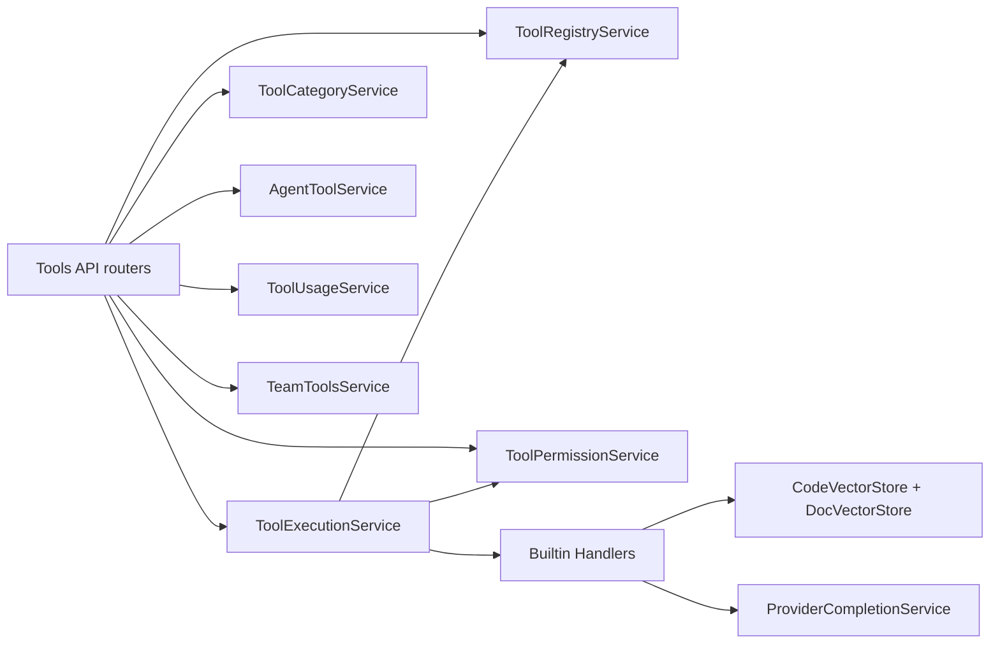

# Tools Services

The tools domain owns the tool system: registry, execution,
permissions, categories, and 30+ builtin tool handlers (agents use
these via the tools API).

## Services

| Service | Responsibility |
|---------|---------------|
| `ToolRegistry` | Central registry for tool definitions (builtin + custom) |
| `BuiltinToolRegistrar` | Registers the builtin tool handlers |
| `ToolExecutionService` | Executes a tool (permission-checked) |
| `ToolCategoryService` | Hierarchical tool categories |
| `ToolRegistryService` | Tool definition CRUD |
| `AgentToolService` | Agent-tool associations (enable/disable) |
| `ToolUsageService` | Tool usage logging + stats |
| `TeamToolsService` | Team-tool assignments + toolboxes |
| `ToolPermissionService` | Tool-collection permissions (levels) |
| Builtin handlers (30+) | AgentManager, DocumentManager, FileManager, SqliteManager, MacroManager, ProviderManager, WorkflowManager, Wikipedia, DuckDuckGo, Tavily, JinaReader, Clipboard, DateTime, LineEditor, LogReader, DocIndex, CodeVectorStore, DocVectorStore, SequentialThinking, ToolCrib, RunPost, StateDumper, SummarizeLlm, TodoList, TextTools, SqliteQuery, SystemDiagnostics, FileInfo, DelegationLogging |

## Dependencies (mermaid)

## Cross-service calls

- **Tools → Providers**: builtin LLM tools (SummarizeLlm)
  call the completion service
- **Tools → Agents**: permission checks (agent-tool bindings)
- **Agents → Tools**: agents execute tools through the tools API

## Status

**ACTIVE** — core (agent tool usage is a primary capability).

## Related

- [[atlas/api/routers/tools|Tools API]]
- [[atlas/ui/components/Tools/Tools Index|Tools UI]]
- [[dev-notes/tools/tools-architecture|Tools Architecture]]
