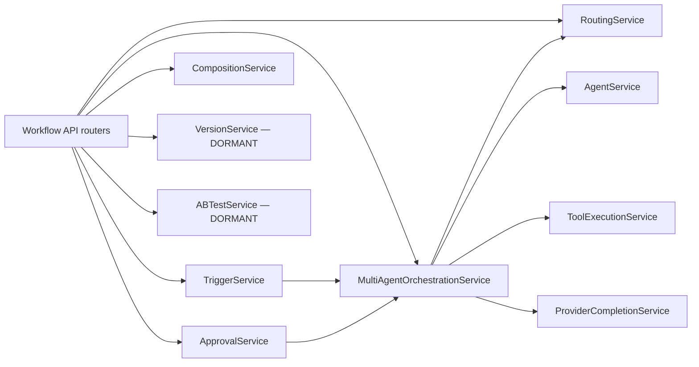

# Workflows Services

The workflows domain owns workflow design + experimentation —
Cogitate's core purpose. Execution, routing, triggers, approvals,
compositions, multi-agent orchestration, versioning, and ab-testing.

## Services

| Service | Responsibility | Status |
|---------|---------------|--------|
| `MultiAgentOrchestrationService` | Multi-agent workflow execution | ACTIVE |
| `RoutingService` | Dynamic agent routing (classification → agent) | ACTIVE |
| `TriggerService` | Workflow triggers (schedules, webhooks, DB events) | ACTIVE |
| `ApprovalService` | Human-in-the-loop approvals | ACTIVE |
| `CompositionService` | Workflow compositions | ACTIVE |
| `VersionService` | Versioned workflow configs | **DORMANT** |
| `ABTestService` | A/B experimentation | **DORMANT** |

## Dependencies (mermaid)

## Cross-service calls

- **Workflows → Agents**: orchestration delegates to agents
- **Workflows → Tools**: workflow steps execute tools
- **Workflows → Providers**: LLM calls (classification, content gen)
- **Versioning/ab-testing**: DORMANT — core purpose, un-expanded;
  demo data kept as test material (user decision 2026-08-07)

## Status

**ACTIVE** (execution/routing/triggers/approvals) with a
**DORMANT** sub-family (versioning/ab-testing) — the state map's
clearest verdict, documented for the pruning picture.

## Related

- [[atlas/api/routers/workflows|Workflows API]]
- [[atlas/api/routers/ab-tests|A/B Tests API]]
- [[dev-notes/workflows/workflow-architecture|Workflow Architecture]]
