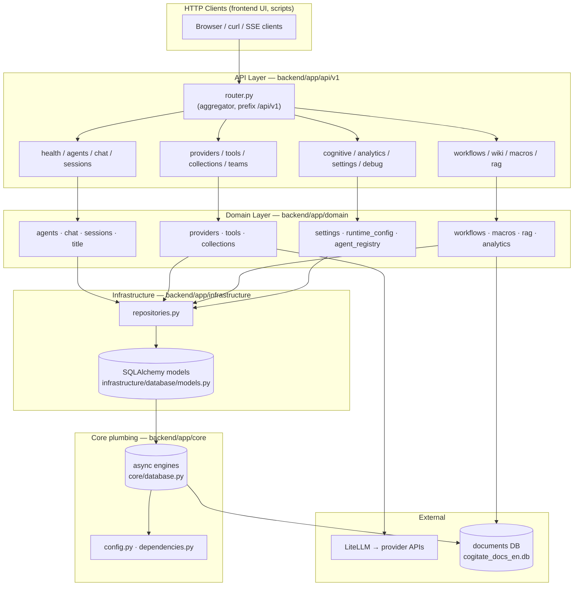
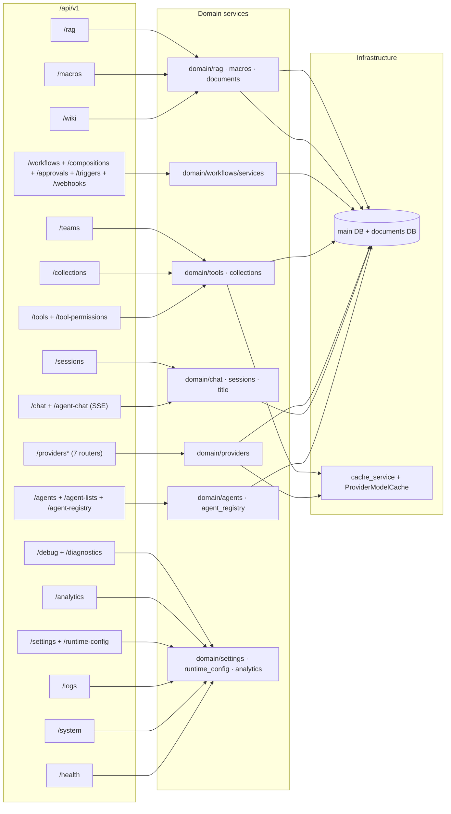
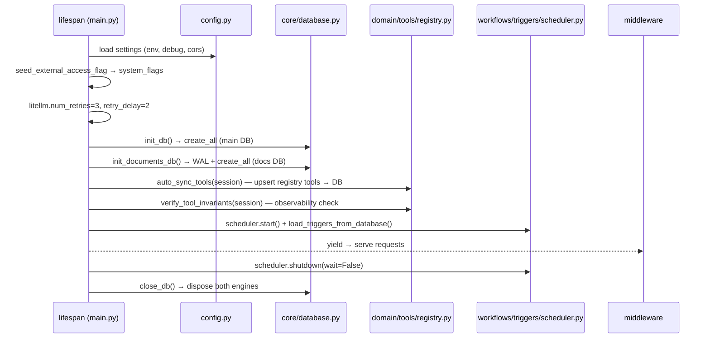

# Backend API Layers

**Path**: `backend/app/api/v1/` (HTTP layer) + `backend/app/domain/` (business logic) + `backend/app/infrastructure/` (data access)
**Type**: architecture

## Overview

The Cogitate backend is a FastAPI application (Python 3.14, async throughout)
whose entry point is `backend/app/main.py`. Every feature follows the same
three-layer shape:

1. **API layer** — `backend/app/api/v1/` holds thin routers that parse
   requests, validate payloads against Pydantic schemas, and delegate to
   domain services. Routers contain no business logic.
2. **Domain layer** — `backend/app/domain/` holds the actual business logic:
   services, Pydantic schemas, and (where needed) their own ORM models. Each
   feature area (agents, chat, providers, tools, workflows, …) is a package.
3. **Infrastructure layer** — `backend/app/infrastructure/` holds the data
   access surface: SQLAlchemy ORM models and repositories. The async engines
   and session factories live in `backend/app/core/database.py`.

The API surface is a single versioned router: `backend/app/api/v1/router.py`
aggregates ~50 routers under the `/api/v1` prefix and mounts them on the app
in `main.py` via `app.include_router(api_v1_router)`.



## Layer map

### API layer (`backend/app/api/v1/`)

The aggregator `router.py` is the skeleton of the whole API. It imports every
feature router, then includes them in a deliberate order — **specific routes
are always registered before dynamic routes** so that, e.g.,
`/providers/config/*` is matched before `/providers/{provider_id}` and
`/workflows/templates/*` before `/workflows/{workflow_id}/...`. The file
annotates this ordering requirement inline at each include call.

Notably, routers for the workflow feature do **not** live under
`api/v1/` — they are split across `backend/app/workflows/api/`
(workflow, templates, multi-agent, compositions, approvals, triggers,
webhooks) and `backend/app/api/v1/versions_router.py` /
`ab_tests_router.py` (versioning & A/B testing), then aggregated into the
same `/api/v1` router. The workflows package also contains the execution
engine (`graphs/`, `nodes/`, `dispatcher.py`) and trigger scheduler
(`triggers/scheduler.py`).

### Domain layer (`backend/app/domain/`)

Each feature area is a package with a consistent shape:

- `services.py` (or `service.py`) — the business logic: orchestrating reads,
  writes, and cross-entity rules.
- `schemas.py` — Pydantic v2 request/response models shared by routers and
  services.
- Feature-specific extras: `export_service.py` / `backup_service.py` for
  macros, `completion_service.py` / `discovery_service.py` / `scheduler.py`
  for providers, `orchestration_service.py` / `routing_service.py` /
  `composition_service.py` for workflows, `registry.py` +
  `execution_service.py` + `builtin/` handlers for tools.

### Infrastructure layer (`backend/app/infrastructure/`)

- `database/models.py` — every SQLAlchemy ORM model, in one file, split
  between `Base` (main app tables) and `DocumentsBase` (docs tables).
- `database/repositories.py` — thin data-access classes (e.g.
  `AgentRepository`) used where queries are reused across services.
- `llm/` — reserved package for LLM plumbing (currently an empty namespace;
  provider access is handled by `domain/providers/`).

The async engines and session factories themselves live in
`backend/app/core/database.py`, which manages **two** databases: the main app
DB (SQLite `cogitate.db` in dev, PostgreSQL in prod) and the documents DB
(`cogitate_docs_en.db`).

## Request lifecycle

A request flows: middleware → router → Pydantic validation → domain service →
ORM/repository → database → serialized response. Database sessions are
injected via FastAPI dependencies (`Depends(get_db_session)`), and the
session dependency commits on success and rolls back on failure.

```mermaid
sequenceDiagram
    participant C as HTTP client
    participant M as Middleware (CORS, external-access toggle)
    participant R as Router (api/v1/...)
    participant S as Pydantic schemas (domain/*/schemas.py)
    participant D as Domain service (domain/*/services.py)
    participant RY as Repository / ORM (infrastructure)
    participant DB as Async DB engine (core/database.py)

    C->>M: HTTP request (e.g. GET /api/v1/agents/42)
    M->>M: CORS check; external-access gate (system_flags)
    M->>R: routed to matching endpoint
    R->>S: parse + validate body/query/path params
    S-->>R: validated models (or 422)
    R->>D: call service method
    D->>RY: query / mutate (AsyncSession)
    RY->>DB: execute SQL via async engine
    DB-->>RY: rows
    RY-->>D: ORM instances
    D-->>R: result (business objects)
    R->>S: serialize to response schema
    S-->>R: response model
    R-->>M: HTTP response (JSON / SSE stream)
    M-->>C: 2xx response
```

Key mechanics:

- **Session injection** — `get_db_session()` in
  `backend/app/core/database.py` is the standard dependency: it opens a
  session from `AsyncSessionLocal`, yields it to the endpoint, commits on
  clean return, and rolls back + re-raises on exception. It logs transaction
  state for diagnosis (`_session_state_str`) on commit/rollback paths.
- **Validation boundary** — every router imports request/response models from
  its domain package's `schemas.py`. Invalid input is rejected with FastAPI's
  standard 422 before any service code runs.
- **SSE chat** — the `/agent-chat` router (`api/v1/agent_chat/router.py`)
  is the one streaming surface: the executor pipeline emits
  `cognitive_*` / `message` / `done` events over Server-Sent Events instead
  of a single JSON response.
- **Error propagation** — services raise `HTTPException` (or let
  infrastructure exceptions surface); the session dependency guarantees
  rollback, and FastAPI's default handlers map them to JSON error bodies.

## Router inventory

All routers are aggregated in `backend/app/api/v1/router.py` under the
`/api/v1` prefix. Prefixes below are the **effective** paths (as declared in
each router file, plus the `/api/v1` prefix added by the aggregator). The
inventory exposes roughly 240 endpoints across the ~50 routers.

### Core platform

| Router module | Prefix | Purpose |
|---|---|---|
| `api/v1/health/router.py` | `/health` | Liveness/readiness probes (no prefix of its own; tags `health`) |
| `api/v1/system/router.py` | `/system` | System info, environment, runtime state |
| `api/v1/settings/router.py` | `/settings` | User settings read/update |
| `api/v1/runtime_config/router.py` | `/runtime-config` | Runtime-tunable configuration |
| `api/v1/logs/router.py` | `/logs` | Log browsing/retrieval (18 endpoints) |
| `api/v1/debug/router.py` | `/debug` | Debug endpoints |
| `api/v1/diagnostics/router.py` | `/diagnostics` | Diagnostics tools & reports |
| `api/v1/dashboard/router.py` | `/dashboard` | Dashboard summary stats |

### Agents & chat

| Router module | Prefix | Purpose |
|---|---|---|
| `api/v1/agents/router.py` | `/agents` | Agent CRUD (15 endpoints) |
| `api/v1/agents/provisioning_router.py` | `/agents` | Agent provisioning (`/agents/{name}/provision`) |
| `api/v1/agent_lists/router.py` | `/agent-lists` | Curated agent lists (included *before* `/agents`) |
| `api/v1/agent_registry/router.py` | `/agent-registry` | Agent registry (Phase 3) |
| `api/v1/agent_chat/router.py` | `/agent-chat` | SSE agent chat (19 endpoints + stream) |
| `api/v1/chat/router.py` | `/chat` | Chat messages & stream control |
| `api/v1/chat/title_router.py` | `/chat` | Title-service endpoints |
| `api/v1/chat/attachments_router.py` | `/chat/{session_id}/attachments` | Attachment upload/listing |
| `api/v1/sessions/router.py` | `/sessions` | Session CRUD (10 endpoints) |

### Providers

| Router module | Prefix | Purpose |
|---|---|---|
| `api/v1/providers/config_router.py` | `/providers/config` | Provider configuration (included *first*) |
| `api/v1/providers/usage_router.py` | `/providers/usage` | Usage tracking |
| `api/v1/providers/scheduler_router.py` | `/providers/sync-schedule` | Provider model sync scheduling |
| `api/v1/providers/management_router.py` | `/providers` | Managed-provider endpoints |
| `api/v1/providers/completion_router.py` | `/providers` | Abstraction layer: health, `/complete` |
| `api/v1/providers/models_router.py` | `/providers` | Model listing per provider |
| `api/v1/providers/router.py` | `/providers` | Generic provider routes incl. `/{provider_id}` — **must be last** |

### Tools, collections & teams

| Router module | Prefix | Purpose |
|---|---|---|
| `api/v1/tools/router.py` | `/tools` | Tool registry CRUD + execution (24 endpoints) |
| `api/v1/tool_permissions/router.py` | `/tools` | Tool permission grants (also under `/tools`) |
| `api/v1/collections/router.py` | `/collections` | Collections (tagged entity groups) |
| `api/v1/teams/router.py` | `/teams` | Teams (collections of `entity_type='agent'`) + team-tool assignments |
| `api/v1/workflow_lists/router.py` | `/workflow-lists` | Curated workflow lists |

### Workflows (Phase 2/4 routers, aggregated into `/api/v1`)

| Router module | Prefix | Purpose |
|---|---|---|
| `workflows/api/template_router.py` | `/workflows/templates` | Workflow templates (specific — included first) |
| `workflows/api/multi_agent_router.py` | `/multi-agent` | Multi-agent workflow execution (specific) |
| `workflows/api/workflow_router.py` | `/workflows` | Generic workflow CRUD/execution — **must be last** under `/workflows` |
| `workflows/agent_versioning/api/router.py` | `/agents` | Agent versioning routes |
| `workflows/api/composition_router.py` | `/compositions` | Workflow compositions (Phase 4A) |
| `workflows/api/approval_router.py` | `/approvals` | Human-in-the-loop approvals (Phase 4A) |
| `workflows/api/triggers_router.py` | `/triggers` | Workflow triggers (Phase 4B) |
| `workflows/api/webhooks_router.py` | `/webhooks` | Inbound webhook dispatch (Phase 4B) |
| `api/v1/versions_router.py` | `/workflows` | Workflow versions (`{template_id}/versions`) |
| `api/v1/ab_tests_router.py` | `/ab-tests` | A/B test configs & results |

### Knowledge & cognitive

| Router module | Prefix | Purpose |
|---|---|---|
| `api/v1/wiki/router.py` | `/wiki` | Wiki/help pages (serves the docs DB) |
| `api/v1/macros/router.py` | `/macros` | Macro sets, F1–F5 dispatch, export/backup (16 endpoints) |
| `api/v1/rag/router.py` | `/rag` | Retrieval-augmented generation queries |
| `api/v1/cognitive_pipeline/memory_profiles.py` | `/memory-profiles` | Memory profiles |
| `api/v1/cognitive_pipeline/cognitive_profiles.py` | `/cognitive-profiles` | Cognitive profiles |
| `api/v1/cognitive_memory/router.py` | `/cognitive/memory` | Cognitive memory management |
| `api/v1/cognitive_vectors/router.py` | `/cognitive/vectors` | Cognitive vector store |
| `api/v1/analytics/router.py` | `/analytics` | Analytics endpoints |

### Router map (subset)



## Domain services overview

### Agents (`domain/agents/`)
- `services.py` — agent CRUD, execution-mode handling (`llm` / `simulated` /
  `hybrid`), provider/model wiring.
- `export_service.py` — agent export/import.
- `dependencies.py` — shared FastAPI dependencies for agent routes.
- `schemas.py` — request/response models.

### Chat & sessions (`domain/chat/`, `domain/sessions/`, `domain/title/`)
- `chat/services.py` — message persistence and stream support;
  `chat/token_budget.py` — per-conversation token accounting.
- `sessions/services.py` — session lifecycle (create/load/delete).
- `title/services.py` — auto-generated conversation titles.

### Providers (`domain/providers/`)
The largest service area. `services.py` + `config_service.py` +
`completion_service.py` manage provider CRUD, model discovery, and
completion abstraction. Supporting pieces: `discovery_service.py` +
`model_browser_service.py` + per-provider clients/browsers (`openrouter_*`,
`groq_client.py`, `deepseek_*`, `ollama_browser.py`), `factory.py` /
`llm_factory.py` for client construction, `scheduler.py` for model sync,
`rate_limiter.py`, `usage_tracker.py`, and `cache_service.py` (in-memory +
`ProviderModelCache` table).

### Tools (`domain/tools/`)
- `registry.py` — the in-memory `ToolRegistry`, single source of truth for
  tool schemas; `init_default_registry()` seeds built-in handlers.
- `execution_service.py` — runs tool calls; `validators.py` + `llm_schema.py`
  for schema shaping.
- `builtin/` — the built-in tool handlers (doc reader, vector stores,
  file/dir management, search, macro manager, sequential thinking, mode
  catalog, …).
- `team_tools*.py`, `tool_permission*.py` — team toolboxes and permission
  grants (consumed by the teams router).

### Workflows (`domain/workflows/` + `backend/app/workflows/`)
- `domain/workflows/services/` — `orchestration_service.py` (multi-agent
  orchestration), `routing_service.py`, `composition_service.py`,
  `approval_service.py`, `trigger_service.py`, `version_service.py`,
  `ab_test_service.py`; schemas in `domain/workflows/schemas/`.
- `workflows/` (engine) — graph definitions (`graphs/`), node primitives
  (`nodes/`), `dispatcher.py`, checkpointing, error handling (retry/rollback/
  recovery), observability (Langfuse tracing), and the trigger scheduler
  (`triggers/scheduler.py`) with webhook dispatch (`triggers/webhook_handler.py`).

### Knowledge (`domain/macros/`, `domain/rag/`, `domain/documents/`)
- `macros/services.py` — macro-set CRUD; `cmn_resolver.py` resolves
  `{{cmn:...}}` placeholders; `export_service.py` + `backup_service.py`
  handle macro export/restore (with `db_retry_utils.py`).
- `rag/service.py` + `rag/schemas.py` — retrieval over the documents DB.
- `documents/` — docs-domain support for the wiki/help system
  (`Document`, `DocumentRelation`, `DocumentAnalytics` models).

### Platform (`domain/settings/`, `domain/runtime_config/`, `domain/analytics/`, `domain/logs/`)
- `settings/services.py`, `runtime_config/services.py` — persisted
  user/runtime configuration.
- `analytics/services.py` — aggregation queries for the dashboard/analytics
  endpoints.
- `logs/services.py` + `schemas.py` — structured log retrieval.
- Thin packages: `agent_lists/`, `workflow_lists/` (mostly schema-only).

## Infrastructure

### Database (`backend/app/core/database.py`, `backend/app/infrastructure/database/`)

Two async SQLAlchemy engines run side by side:

1. **Main app DB** — `engine` + `AsyncSessionLocal`. Holds agents, sessions,
   messages, providers, tools, collections, macros, workflows, cognitive
   traces, system flags, etc. SQLite (`sqlite+aiosqlite`) with
   `check_same_thread=False`, a 30s lock timeout, `pool_pre_ping`, and
   `pool_recycle=3600` in dev; PostgreSQL in production.
2. **Documents DB** — `documents_engine` + `DocumentsSessionLocal`,
   backing the wiki/help system. Opened with WAL journal mode.

Session factories use `expire_on_commit=False` and explicit commit/rollback
in the `get_db_session()` / `get_documents_session()` dependencies.

All ORM models are declared in `infrastructure/database/models.py` —
~40 tables on `Base` (including `Agent`, `ChatSession`, `ChatMessage`,
`ChatAttachment`, `RuntimeConfig`, `Provider`, `UsageLog`, `Log`,
`ProviderModelCache`, `ProviderSyncSchedule`, `UserSettings`, `MacroSet`,
`AgentList`, `WorkflowList`, `WorkflowTrigger`, `WorkflowVersion`,
`ABTestConfig`, `ABTestResult`, `CheatSheet`, `CognitiveTrace`, `SystemFlag`,
`CognitivePreset`, `MemoryProfile`, `CognitiveProfile`,
`FrontendAgentPackage`, …) plus the `DocumentsBase` tables (`Document`,
`DocumentRelation`, `DocumentAnalytics`). `core/database.py` imports the
models into `init_db()` / `init_documents_db()` so every model is registered
on `Base.metadata` before `create_all` runs.

### Caching

There is no separate caching package under `infrastructure/`; caching is
implemented in the domain layer:
- `domain/providers/cache_service.py` — provider/model response caching.
- `core/dependencies.py` — a lightweight `CacheService` (TTL 300s default)
  exposed as a FastAPI dependency (`get_cache_service()`).
- `ProviderModelCache` table — persisted provider model listings refreshed
  by the provider sync scheduler.

### Data access

`infrastructure/database/repositories.py` provides small repository classes
(e.g. `AgentRepository`) for queries shared across services. Services
generally query the ORM directly; repositories are used where a query has
multiple consumers.

## Startup sequence

`create_app()` in `backend/app/main.py` builds the app, then the
`lifespan` context manager runs boot-time work:



Step by step:

1. **Logging** — `setup_logging()` configures file-based logging before the
   app exists.
2. **Settings** — `get_settings()` (from `app.core.config`) is evaluated at
   import time and reused throughout.
3. **Middleware & static** — `CORSMiddleware` from settings; `/static`
   mounted for profile images.
4. **Router mounting** — `app.include_router(api_v1_router)`; then
   `add_external_access_middleware(app)` registers the external-access
   toggle (checked against the `system_flags` table) *after* routers.
5. **Lifespan startup**:
   - `seed_external_access_flag()` — ensures the external-access flag row
     exists.
   - Centralized LiteLLM retry defaults (`num_retries=3`, `retry_delay=2`).
   - `init_db()` / `init_documents_db()` — create/verify tables in both DBs.
   - `auto_sync_tools(session)` — **still runs**: initializes the in-memory
     `ToolRegistry` with built-in handlers, then upserts each registry tool
     definition into the DB so `resolve_tools()` finds populated schema
     records. (`seed_system_agents` was removed 2026-08-01 — agents are no
     longer seeded at boot.)
   - `verify_tool_invariants(session)` — warns (non-blocking) about
     tool slugs missing DB records or null `arguments_schema`.
   - Workflow trigger scheduler starts and loads persisted triggers.
6. **Shutdown** — scheduler shutdown, then `close_db()` disposes both
   engines.

## Conventions

- **Thin routers, fat services** — endpoints only validate + delegate; all
  business rules live in `domain/*/services.py`.
- **Pydantic at the boundary** — every router imports its schemas from the
  matching `domain/*/schemas.py`; responses are serialized through response
  models, never raw ORM objects.
- **Async everywhere** — `async def` endpoints, async SQLAlchemy sessions,
  `async with` session scoping.
- **Injection, not singletons** — DB sessions via
  `Depends(get_db_session)` / `Depends(get_documents_session)`;
  settings via `get_app_settings()`; cache via `get_cache_service()`.
- **Order matters in the aggregator** — specific prefixes (`/providers/config`,
  `/providers/usage`, `/providers/sync-schedule`, `/workflows/templates`,
  `/multi-agent`, `/agent-lists`) are included before their generic
  counterparts (`/providers/{provider_id}`, `/workflows/{workflow_id}/...`,
  `/agents/...`). The comments in `router.py` document each ordering
  constraint.
- **Two databases, two bases** — main tables inherit `Base`;
  docs tables inherit `DocumentsBase`; sessions never cross databases.
- **Commit/rollback owned by the dependency** — endpoints do not call
  `commit()`; the session dependency commits on success and rolls back +
  re-raises on failure.
- **Startup sync keeps code truth** — the tool registry (code) is the single
  source of truth for tool schemas; `auto_sync_tools` pushes it into the DB
  at boot, and `verify_tool_invariants` surfaces drift.
- **Workflow API split** — workflow routers live in `backend/app/workflows/api/`
  rather than `api/v1/`, but are aggregated into the same `/api/v1` tree.

## Related

- `backend/app/main.py` — app factory, middleware, lifespan
- `backend/app/api/v1/router.py` — the full router inventory (this doc's skeleton)
- `backend/app/core/database.py` — engines, session factories, dependencies
- `backend/app/infrastructure/database/models.py` — all ORM models
- `backend/app/domain/` — service layer by feature area
- `backend/app/workflows/` — workflow engine + trigger scheduler + Phase 2/4 routers
- `wiki/atlas/ui/architecture/chat-architecture.md` — the SSE chat contract in detail
