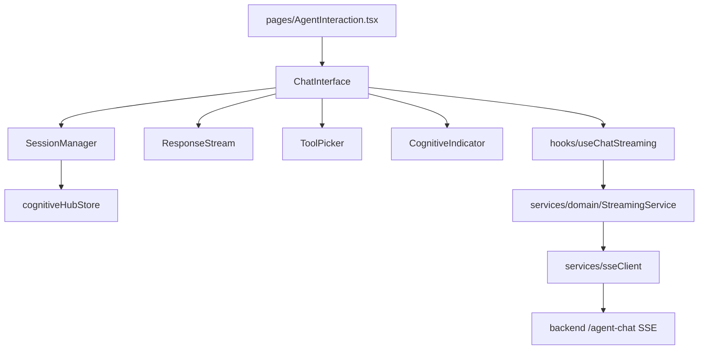
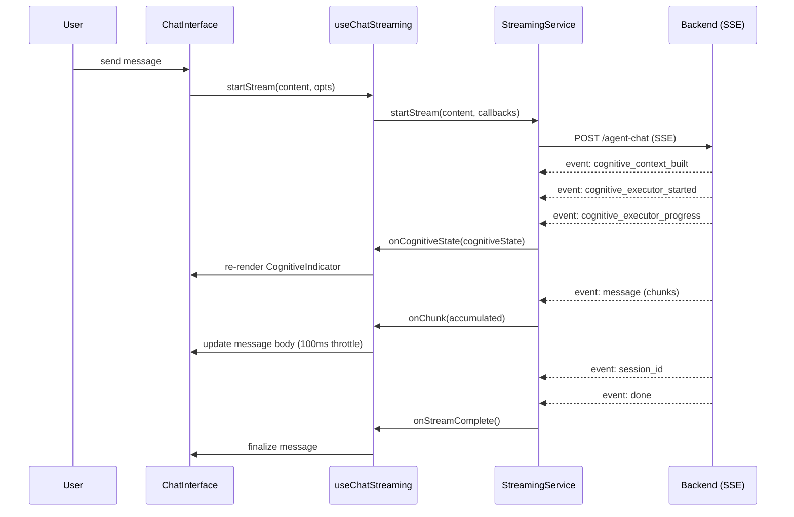

# Chat Architecture

**Path**: `frontend/src/components/features/agentInteraction/` + `frontend/src/services/domain/StreamingService.ts`
**Type**: architecture

## Overview

The chat system is the core interaction surface: a user sends a message, the
backend runs the agent pipeline (context building → executor → memory →
response formatting), and results stream back to the UI as **Server-Sent
Events (SSE)**. The frontend layers this into a composable stack:

## The SSE Contract

The backend streams events with named event types. The frontend
`StreamingService` parses each `event:` line and dispatches to callbacks.

### Event types

| Event | Meaning |
|---|---|
| `message` | A content chunk (accumulated into the message body) |
| `session_id` | The session identifier for the ongoing conversation |
| `cognitive_context_built` | Pipeline phase: context assembled |
| `cognitive_executor_started` | Pipeline phase: executor begins |
| `cognitive_executor_progress` | Pipeline phase: executor progress update |
| `cognitive_executor_completed` | Pipeline phase: executor finished |
| `cognitive_memory_updated` | Pipeline phase: memory written |
| `cognitive_response_formatted` | Pipeline phase: final response formatted |
| `cognitive_trace_complete` | Pipeline phase: full trace available |
| `done` | Stream complete |
| `error` | Stream terminated with an error |

> **Cognitive events** (`cognitive_*`) power the `CognitiveIndicator` UI
> component — a 4-phase pipeline visualization
> (context-built → executor → memory → response-formatted). The
> `CognitiveState` object tracks `events[]`, `latestTrace`, `isActive`, and
> `executorStage`.

## Component Flow

### ChatInterface (386L)
Composition root for the chat experience. Owns the message list, input area,
tool picker, and cognitive indicator. Coordinates the session manager and
stream lifecycle.

### SessionManager (550L)
Session CRUD + store wiring: creates/loads sessions, persists via
`sessionSyncService`, and keeps the active session in the `cognitiveHubStore`
agent/stream slices.

### ResponseStream (408L)
Renders the streamed message with:
- markdown + GFM (via `react-markdown` + `remark-gfm`)
- Mermaid diagram blocks (rendered by the wiki-style mermaid renderer)
- auto-scroll as content arrives
- tool-result badges (collapsible tool output)
- copy + delete message actions

### CognitiveIndicator
Subscribes to `StreamingService.getCognitiveState()` (polled/event-driven)
and renders the 4-phase pipeline indicator with stage transitions.

### ToolPicker (402L)
Optimistic enable/disable of tools with revert-on-error. Persists tool
selections per session/agent.

## Streaming Lifecycle

## Throttling & State Sync

- `StreamingService` throttles UI updates to ~100ms (`lastUpdateTime` +
  `pendingUpdate` + `updateTimer`) so rapid SSE chunks batch into smooth
  renders.
- `useChatStreaming` (188L) is a thin hook wrapper: it exposes
  `startStream`/`stopStream`/`getState` and syncs `cognitiveState` into the
  `cognitiveHubStore` stream slice at the same 100ms cadence.
- `AbortController` manages cancellation — `stopStream()` aborts the fetch
  and resets stream state.

## Message & Session Persistence

- Messages are persisted via `MessageService` (wired into StreamingService
  internally — the service records messages as they stream).
- Sessions are persisted via `sessionSyncService` (sessions endpoints) and
  managed by `SessionManager`.
- `useChatPersistence` (66L) additionally saves/restores chat state to
  `sessionStorage` for tab-reload recovery.

## Tool Integration

Agent tools execute server-side via the backend tool registry
(tool-gating per agent is configured on the agent profiles / tool
management — the frontend `ToolPicker` modal was REMOVED). The
frontend renders tool results as collapsible badges in
`ResponseStream` (tool-result badges). Macro dispatch lives in
`useSystemMacrosStore` (`macroSetsStore.ts`) + `MacroKeyboard`
(F/M/A keys + the bank selectors) — the legacy `chatMacroService`
and `useChatMacros` are deleted.

## Related

- `pages/AgentInteraction.tsx` — the page hosting the chat
- `services/domain/StreamingService.ts` — SSE engine (this doc's subject)
- `services/sseClient.ts` — SSEClient + SSEClientFactory (low-level SSE)
- `hooks/useChatStreaming.ts`, `hooks/useAgentInteraction.ts` (854L)
- `components/features/agentInteraction/*` — ChatInterface, SessionManager,
  ResponseStream, ToolPicker, CognitiveIndicator, CognitiveTraceDebugOverlay
- `stores/cognitiveHubStore.ts` — stream slice holds live chat state
