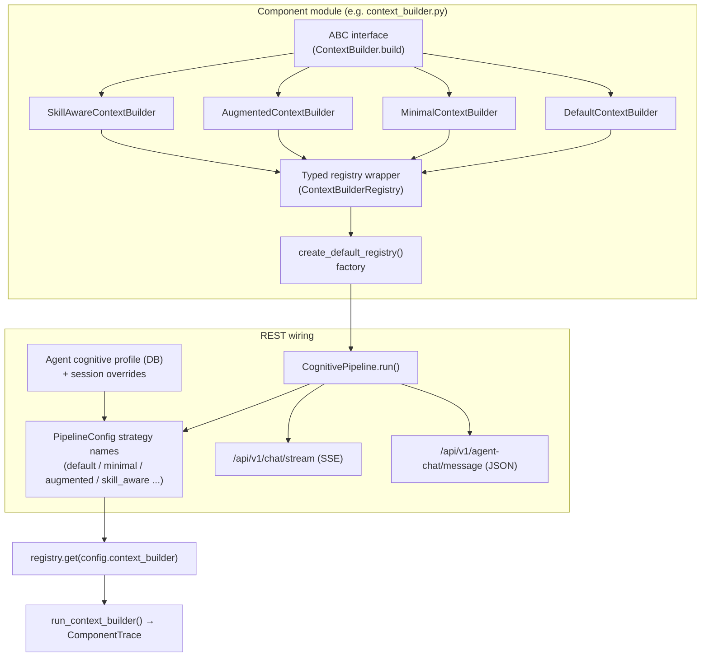
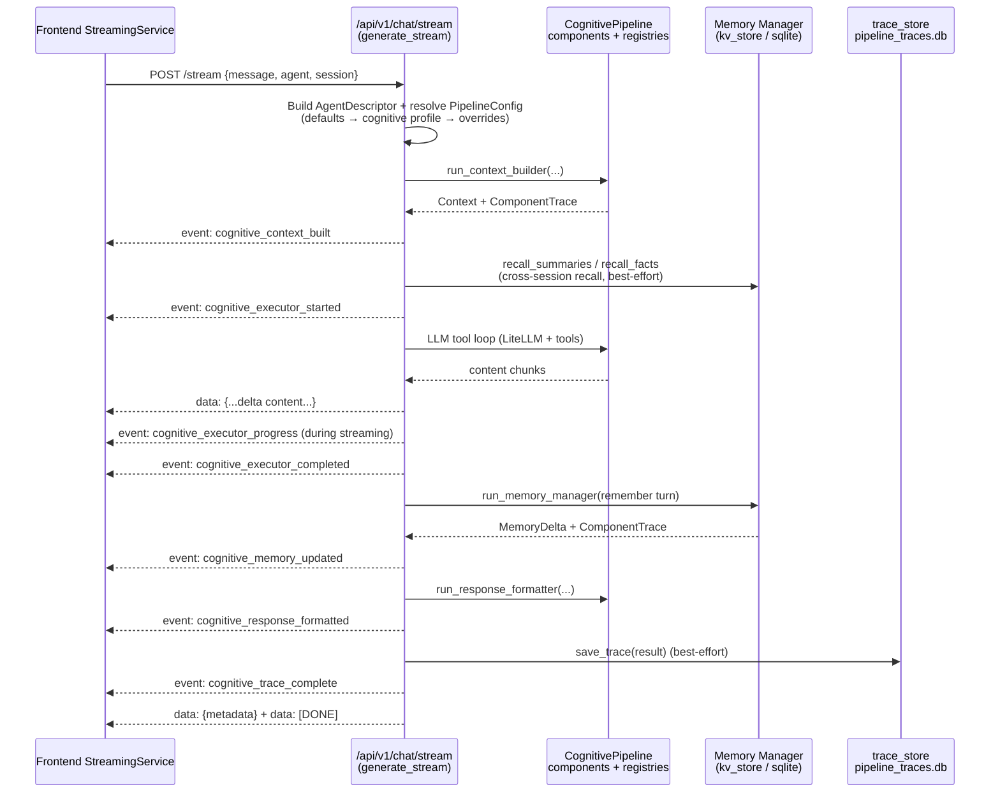

# Cognitive Pipeline

**Path**: `backend/app/services/cognitive_pipeline/`
**Type**: architecture

## Overview

The cognitive pipeline is the backend's pluggable execution engine for agent
conversations. Every agent turn — whether it arrives from the human chat UI or
from an agent-to-agent API call — is run through a pipeline of four composable
components:

1. **Context Builder** — assembles the execution context (system prompt,
   session history, user message, memory recall).
2. **Agent Executor** — runs the agent's core logic (LLM call, tool loop,
   fast/hybrid/stub strategies).
3. **Memory Manager** — stores the turn, compacts history, and recalls
   cross-session summaries and user facts.
4. **Response Formatter** — transforms the raw response into the final output.

The pipeline is fully strategy-driven: each component is resolved at runtime by
name from a typed registry, and the names come from a `PipelineConfig`. The
same orchestration serves two output adapters:

- **SSE adapter** (`backend/app/api/v1/chat/router.py`) — streams content chunks
  plus named `cognitive_*` events to the human UI. The frontend
  `StreamingService` consumes these events to drive the `CognitiveIndicator`.
- **JSON adapter** (`backend/app/api/v1/agent_chat/router.py`) — runs the
  pipeline synchronously and returns the response, trace, metrics, and memory
  delta in a single JSON payload for agents and scripts.

### Module map

| Module | Responsibility |
|---|---|
| `pipeline.py` | `CognitivePipeline` orchestrator — runs the four phases in sequence |
| `registry.py` | Generic typed `Registry[T]` shared by every component module |
| `models.py` | Dataclasses: `Context`, `AgentDescriptor`, `PipelineConfig`, `CognitiveResult`, `CognitiveTrace`, `ComponentTrace`, `CognitiveMetrics`, `MemoryDelta`, `Timer` |
| `context_builder.py` | `ContextBuilder` ABC + 4 strategies + registry + `run_context_builder()` |
| `executor.py` | `AgentExecutor` ABC + 4 strategies (LiteLLM, stub, fast, hybrid) + registry + `run_executor()` |
| `memory_manager.py` | `MemoryManager` ABC + 3 strategies (sliding window, noop, kv_store) + fact/summary recall + registry |
| `response_formatter.py` | `ResponseFormatter` ABC + 3 strategies + registry + `run_response_formatter()` |
| `vector_store.py` | `VectorStore` ABC + `TurnVectorStore` (sqlite-vec + Ollama embeddings) + registry |
| `trace_store.py` | Persists per-request traces to a dedicated `pipeline_traces.db` (30-day TTL) |
| `conduit.py` | `conduit_route()` shallow/hybrid/delegate route decision (the HYBRID deep pass itself is inline in `chat/router.py`) |
| `conversation_compactor.py` | Rolling LLM summarization when history exceeds token thresholds |
| `preset_service.py` | CRUD for named pipeline-config presets |
| `cognitive_profile_service.py` / `memory_profile_service.py` | Agent-level pipeline configuration |

## Phase model

A pipeline run is observable as a sequence of named milestones. Each milestone
maps to one or more SSE event names emitted to the frontend. The six milestone
phases are:

```mermaid
flowchart LR
    A["Context Built<br/><code>cognitive_context_built</code>"] -->
    B["Executor Started<br/><code>cognitive_executor_started</code>"] -->
    C["Executor Progress<br/><code>cognitive_executor_progress</code>"] -->
    D["Memory Updated<br/><code>cognitive_memory_updated</code>"] -->
    E["Response Formatted<br/><code>cognitive_response_formatted</code>"] -->
    F["Trace Complete<br/><code>cognitive_trace_complete</code>"]

    style A fill:#4F46E5,color:#fff
    style B fill:#0EA5E9,color:#fff
    style C fill:#0EA5E9,color:#fff
    style D fill:#10B981,color:#fff
    style E fill:#F59E0B,color:#fff
    style F fill:#8B5CF6,color:#fff
```

| # | Phase | Component | SSE event(s) | Payload highlights |
|---|---|---|---|---|
| 1 | Context built | Context Builder | `cognitive_context_built` | `strategy`, `duration_ms`, `tokens_used`, `sources`, `error` |
| 2 | Executor started | Executor | `cognitive_executor_started` | `strategy` |
| 3 | Executor progress | Executor | `cognitive_executor_progress` | `token_count`, `tool_calls`, `stage` |
| 4 | Executor completed | Executor | `cognitive_executor_completed` | `strategy`, `duration_ms`, `tokens_used`, `error` |
| 5 | Memory updated | Memory Manager | `cognitive_memory_updated` | `strategy`, `compaction_triggered`, `stored_keys`, `error` |
| 6 | Response formatted | Response Formatter | `cognitive_response_formatted` | `strategy`, `duration_ms`, `error` |
| 7 | Trace complete | (aggregated) | `cognitive_trace_complete` | full `trace`, `metrics`, `memory_delta`, `error` |

`cognitive_trace_complete` is the terminal event: it carries the aggregated
per-component trace (`CognitiveTrace.to_dict()`), aggregate metrics
(`CognitiveMetrics`), and the `MemoryDelta`. It is emitted **before** the final
`done`/metadata chunk so the frontend can process the trace while the stream is
still open. On hard errors, `generate_stream` still emits a
`cognitive_trace_complete` with `error` set so the UI's cognitive indicators
terminate cleanly (`chat/router.py`).

## Interface / Registry pattern

The project convention for pluggable pipeline components is a three-layer
pattern repeated identically in every component module:

1. **ABC interface** — an abstract base class declaring the component's
   contract (e.g. `ContextBuilder.build()`, `AgentExecutor.execute()`).
2. **Typed registry** — a thin wrapper around the generic `Registry[T]`
   (`registry.py`) mapping strategy names to instances.
3. **`create_default_registry()` factory** — pre-populates the registry with
   the built-in strategies.

The generic `Registry[T]` in `registry.py` is deliberately small:

- `register(name, instance, overwrite=False)` — raises `KeyError` on duplicate
  names unless `overwrite=True`
- `get(name)` — raises `KeyError` with a sorted list of available names
- `list()`, `unregister()`, `__contains__`, `__len__`

Each component module then wraps it in a typed registry
(`ContextBuilderRegistry`, `ExecutorRegistry`, `MemoryManagerRegistry`,
`ResponseFormatterRegistry`) and exposes a module-level `run_*` convenience
wrapper (`run_context_builder`, `run_executor`, `run_memory_manager`,
`run_response_formatter`) that executes the strategy inside a `Timer` and
returns a `(result, ComponentTrace)` pair. The trace records `strategy`,
`duration_ms`, `tokens_used`, `input_tokens`, `output_tokens`, `metadata`, and
`error` — this is the observability contract the SSE events and the JSON adapter
both serialize.

`CognitivePipeline.__init__` accepts optional registries for all four components
and falls back to each module's `create_default_registry()` factory when none is
given — so a caller can inject a fully custom registry set without touching the
pipeline. `run()` resolves every component by name from `PipelineConfig`
(`context_builder`, `executor`, `memory_manager`, `response_formatter`) and
returns a `CognitiveResult` carrying `response`, `trace`, `metrics`,
`memory_delta`, and an optional `error`. Component failures are contained:
each phase returns an error-bearing `CognitiveResult` instead of raising, so
partial results (e.g. response without memory) still reach the caller.

### Built-in strategies

| Component | Registry names | Implementations |
|---|---|---|
| Context Builder | `default`, `minimal`, `augmented`, `skill_aware` | Default (20-turn history), Minimal (no history), Augmented (RAG/web/tool flags), SkillAware (injects `skills/*.skill.md` into the system prompt) |
| Executor | `default`, `stub`, `fast`, `hybrid` | LiteLLM `acompletion`, simulated stub, fast single-pass, hybrid fast-then-deep two-pass |
| Memory Manager | `default`, `noop`, `kv_store` | In-memory sliding window, stateless, persistent SQLite KV (`cognitive_memory.db`) |
| Response Formatter | `default`, `direct_yield`, `structured` | Pass-through, pass-through with trace, JSON validation/pretty-print |

## Pipeline execution flow

The SSE path in `backend/app/api/v1/chat/router.py` (`POST /api/v1/chat/stream`
→ `chat_stream` → `generate_stream`) runs the pipeline phases inline in the
streaming generator, yielding content chunks and `cognitive_*` events as they
complete. The synchronous JSON path in `backend/app/api/v1/agent_chat/router.py`
(`POST /api/v1/agent-chat/message`) instead calls `CognitivePipeline().run()`
directly for the whole run.

The synchronous JSON adapter (`agent_chat/router.py`) performs the same phases
inside `CognitivePipeline.run()`: context building, best-effort cross-session
memory recall (summaries + user facts injected into the system prompt),
best-effort vector recall, executor, memory manager (with per-agent
`cognitive_memory.db` re-pointing when `memory_profile_persistence == "sqlite"`),
and response formatting. The result is persisted to the `cognitive_traces` table
and to `pipeline_traces.db` via `trace_store.save_trace()`.

## SSE emission

All `cognitive_*` events are formatted by `backend/app/api/v1/chat/cognitive_sse.py`.
The shared helper `_sse_event(event, data)` produces the wire format
`event: <name>\ndata: <json>\n\n`. Seven emitter functions mirror the phase
table, and `emit_all_cognitive_events()` is a replay generator that re-emits a
completed `CognitiveResult` (used by the JSON adapter and trace replay).

Emission points inside `generate_stream` (`chat/router.py`):

| Event | Emitted at | Notes |
|---|---|---|
| `cognitive_context_built` | after `run_context_builder()` | before memory recall |
| `cognitive_executor_started` | before the LLM/tool loop | carries the resolved executor strategy |
| `cognitive_executor_progress` | during streaming | token/tool counters, stage |
| `cognitive_executor_completed` | after the tool loop (or stub path) | synthetic `ComponentTrace` built from stream metrics |
| `cognitive_memory_updated` | after `run_memory_manager()` | compaction + stored keys |
| `cognitive_response_formatted` | after formatting | |
| `cognitive_trace_complete` | before final metadata chunk, and on error | aggregated trace + metrics + memory delta |

### Frontend consumption

`frontend/src/services/domain/StreamingService.ts` parses the SSE byte stream
line-by-line in `processSSELine()`. When an `event: cognitive_*` line arrives it
is stashed in `currentEventType`; the next `data:` line's JSON is dispatched
through `buildCognitiveEvent()` into a typed `CognitiveEvent` union, then
`updateCognitiveState()` folds it into the service-level `CognitiveState`
(`events[]`, `latestTrace`, `isActive`, `executorStage`) and
`onCognitiveEvent` is invoked. The `useChatStreaming` hook surfaces this state
to the `CognitiveIndicator` component. Unknown `cognitive_*` types are logged
and ignored, so the frontend tolerates new backend events without breaking.

### Trace persistence and replay

- `trace_store.save_trace()` writes each run to `pipeline_traces.db`
  (`cognitive_traces` table, WAL mode, 30-day TTL cleanup per write) — a
  dedicated database kept separate from `cogitate.db` to avoid contention.
- The JSON adapter additionally persists trace/metrics/memory-delta JSON onto
  the `CognitiveTrace` ORM rows it manages.
- `GET /api/v1/agent-chat/trace-stream` (agent_chat router) polls the
  `cognitive_traces` table every second and re-emits each new row as a
  `cognitive_trace_complete` event — a replay/live-monitoring stream for
  dashboards and the `BackendTraceViewer`.

## Tool integration

Executors (and the chat tool loop) call tools through the **tools domain
registry**, which is a separate registry from the pipeline's component
registries:

- Registry: `backend/app/domain/tools/registry.py` — `ToolRegistry` (singleton)
  with `register()` / `register_builtin()` and `ToolDefinition` records.
- Built-in tools live in `backend/app/domain/tools/builtin/` and are seeded by
  `register_builtin_tools()` in the tools registry.

**Jina Reader** is the web-read tool: `backend/app/domain/tools/builtin/jina_reader_handler.py`
defines `JinaReaderTool` (slug `jina_reader`, tags `op:read`/`op:fetch`/
`purpose:research`/`source:web`, icon `globe`). It fetches WEB URLs
(http/https) through the free `https://r.jina.ai/` endpoint (no API key) and
returns LLM-friendly markdown or plain text. The scheme guard rejects local
`file://` paths loudly — local files belong to the file tools. It is registered in `backend/app/domain/tools/registry.py`
via `registrar.register_builtin(...)` with its `name`, `slug`, `description`,
`handler` (`JinaReaderTool.execute`), `config_schema` (`format`:
markdown|text), `arguments_schema`, `icon`, `color`, and `tags`. Once
registered, the tool definition is available to the executor's tool loop, which
is what lets agents read web pages mid-conversation.

The pipeline also has its own **vector store** component
(`vector_store.py`): `TurnVectorStore` indexes conversation turns into
sqlite-vec with embeddings from the install's `embeddings` capability —
the store takes the resolved *address, model and width* as a constructor
argument (`EmbeddingService`) and refuses to work without them, so no
model or endpoint is written down in the pipeline — stored per agent at
`agents/{folder}/vector_index/chunks.db`. It follows the same
interface → registry (`VectorStoreRegistry`) → `create_default_vector_store_registry()`
factory pattern and is exposed via `backend/app/api/v1/cognitive_vectors/router.py`
(`/api/v1/cognitive/vectors/{agent_folder}/search|index|...`). Inside the
orchestrator, vector recall is a best-effort step guarded by `try/except`.

## Extension points

### Add a new strategy to an existing component

1. Subclass the component ABC in its module (e.g. `class ResearchExecutor(AgentExecutor)`).
2. Register it in the module's `create_default_registry()` under a new name
   (e.g. `registry.register("research", ResearchExecutor())`).
3. Select it by name via `PipelineConfig` — per agent through a cognitive
   profile, per request through `cognitive_config` overrides, or in code via
   `PipelineConfig(executor="research")`.
4. No SSE changes needed: `cognitive_executor_started`/`completed` already
   carry the strategy name.

### Add a new pipeline stage

1. Create a module following the convention: ABC interface, typed registry
   wrapper over `Registry[T]`, `create_default_registry()` factory, and a
   `run_<stage>()` helper returning `(result, ComponentTrace)`.
2. Wire it into `CognitivePipeline.run()` at the appropriate point, resolving
   it from `PipelineConfig` by name and returning an error-bearing
   `CognitiveResult` on failure.
3. If the stage should be visible in the UI, add an emitter in
   `cognitive_sse.py` (name it `cognitive_<stage>_...`), yield it from
   `generate_stream` at the right point, extend the `CognitiveEvent` union and
   `buildCognitiveEvent()` switch in `StreamingService.ts`, and render it in
   `CognitiveIndicator`.

### Inject a custom registry set

`CognitivePipeline(context_builders=..., executors=..., memory_managers=...,
response_formatters=...)` accepts fully custom registries; when omitted, each
slot defaults to its module's `create_default_registry()` factory. This is the
supported path for tests and for deployments that need a different strategy set
without editing the built-ins.

## Conventions

- **One ABC per component module**, named after the component (`ContextBuilder`,
  `AgentExecutor`, `MemoryManager`, `ResponseFormatter`, `VectorStore`).
- **Typed registry wrapper + `create_default_registry()` factory** in every
  component module; runtime resolution by name from `PipelineConfig`.
- **Every stage returns a `ComponentTrace`** (strategy, duration, tokens,
  metadata, error) via a `run_*` helper — this is the single observability
  contract shared by SSE events, the JSON adapter, and trace persistence.
- **Non-critical work is best-effort**: cross-session recall, fact extraction,
  vector recall, and trace persistence are wrapped in `try/except` and must
  never fail the turn.
- **`PipelineConfig` is the interface** between agents and the pipeline:
  strategy names are chosen by the agent's cognitive profile (DB) with
  session/request overrides taking precedence over profile values.
- **SSE event names follow `cognitive_<stage>`** and are defined in exactly one
  place (`cognitive_sse.py`); the frontend dispatches on the same names.
- **Failure containment**: a failing phase returns an error-bearing
  `CognitiveResult` rather than raising out of the pipeline, and
  `generate_stream` always terminates with a `cognitive_trace_complete` event
  (success or error).
- **Data separation**: conversation memory lives in per-agent
  `cognitive_memory.db`, vector indexes in per-agent `vector_index/chunks.db`,
  and pipeline traces in the dedicated `pipeline_traces.db` — never mixed into
  the shared application database.
