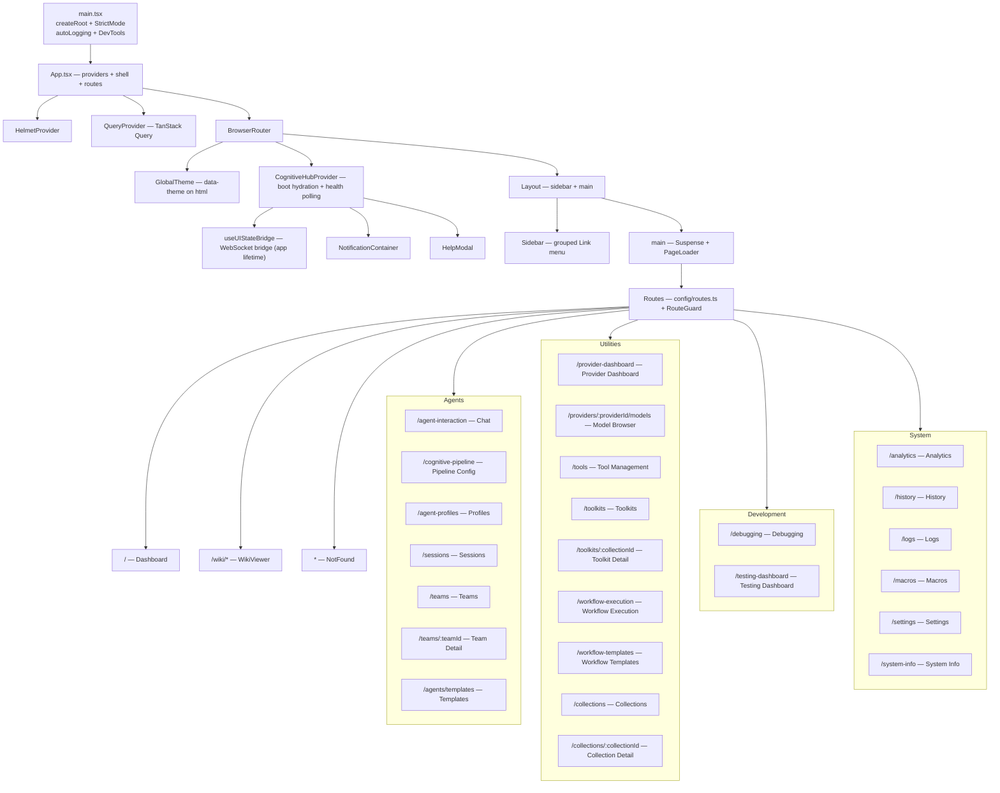
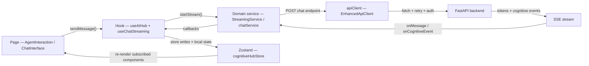
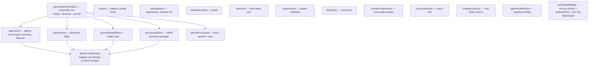
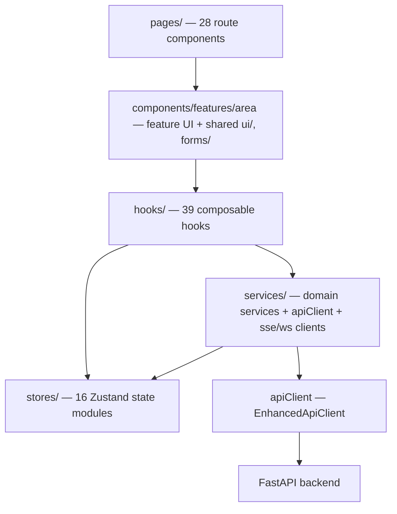

# Frontend Overview

**Path**: `frontend/src`
**Type**: architecture (phase 4 deep-dive)
**Last Updated**: 2026-08-01

This document explains how the Cogitate frontend is put together: how the app boots,
how the component tree and route table are wired, how data flows from a user action
to the FastAPI backend and back, how state is distributed across the Zustand stores,
and where the module boundaries sit. It complements the per-file atlas entries in
`wiki/atlas/ui/{pages,components,hooks,services,stores}` — this page is the map, those
pages are the legend entries.

The frontend is a React 19 + TypeScript single-page application. Every route component
is code-split with `React.lazy`, conversational/agent state lives in Zustand stores
(rather than React context), server data is cached with TanStack Query, and real-time
channels use Server-Sent Events for streaming and a WebSocket for UI state bridging.
The entry point is `frontend/src/main.tsx`, and the whole tree hangs off
`frontend/src/App.tsx`.

## Bootstrap and entry

`frontend/src/main.tsx` is minimal by design:

1. Imports `./index.css` and `App`.
2. Side-effect imports `./utils/autoLogging` — a module-level initializer that wires
   automatic logging (errors, navigation, performance) into `frontendLoggingService`
   before any component renders.
3. Side-effect imports `./utils/cogitateDevTools` — exposes a `window.__cogitate__`
   debug handle for browser DevTools sessions.
4. `createRoot(...).render(<StrictMode><App /></StrictMode>)`.

Nothing else happens at module scope; all initialization is component-driven inside
`App.tsx`.

## Provider stack and application shell

`frontend/src/App.tsx` composes the app in a strict order (outermost first):

| Layer | File | Responsibility |
|---|---|---|
| `HelmetProvider` | `react-helmet-async` | Per-page document head (titles via `usePageTitle`, meta) |
| `QueryProvider` | `frontend/src/providers/QueryProvider.tsx` | TanStack Query client: 5 min staleTime, 10 min gcTime, retry 3× (never on 4xx), devtools in dev |
| `BrowserRouter` | `react-router-dom` | Client-side routing |
| `GlobalTheme` | inline in `App.tsx` | Applies `data-theme` (light/dark) to `<html>`; theme source of truth is `useTheme` reading localStorage |
| `CognitiveHubProvider` | `frontend/src/providers/CognitiveHubProvider.tsx` | Boot component — **not** a React context provider; hydrates the hub store from persisted `cogitate-hub-storage`, starts/stops the offline retry processor, polls provider health |
| `Layout` | inline in `App.tsx` | Sidebar + main content shell (plain flexbox, replaced DaisyUI drawer in 2026-06-15) |
| `Suspense` | `react` | Fallback `PageLoader` while lazy route chunks load |
| `Routes` | from `frontend/src/config/routes.ts` | Route table, each element wrapped in `RouteGuard` |

Three floating overlays render beside the routed content, all inside the
`CognitiveHubProvider` scope: `NotificationContainer` (toast stack backed by
`notificationStore`), and `HelpModal` (`frontend/src/components/help/`).

`Layout` also mounts `useUIStateBridge()` for the lifetime of the app — see
[Real-time channels](#real-time-channels). The WebSocket bridge connection state is
rendered as a small status dot in the sidebar header.

### Component tree and route structure



## Routing model

Routing is **data-driven**. `frontend/src/config/routes.ts` defines a
`RouteConfig[]` where every entry declares `path`, `component`, `title`,
`description`, optional `permissions`, `icon`, and `breadcrumb`. `App.tsx` maps
that array straight into `<Route>` elements — there is no hand-written route tree
to keep in sync. Route config also powers breadcrumb generation
(`generateBreadcrumbs`), navigation filtering (`getNavigationRoutes`), and the
permission check (`hasRoutePermission`).

Key mechanics:

- **Code splitting**: every page is imported via `React.lazy(...)`. The
  `Suspense`/`PageLoader` boundary means an individual route chunk only downloads
  when first visited.
- **Guarding**: each element renders inside `<RouteGuard route={route} ... />`
  (`frontend/src/components/RouteGuard`), which enforces `requiresAuth` and
  `permissions`. Today the app has no auth backend, so `App.tsx` passes a
  hardcoded `userPermissions = ['admin', 'config_manager', 'developer']` with
  `isAuthenticated = true`; the guard infrastructure is real and the values are
  the stub.
- **Redirects and aliases**: `/providers` is a `<Navigate>` redirect to
  `/provider-dashboard`; `/tool-collections/:collectionId` is an alias of
  `/toolkits/:collectionId` (both render `ToolCollectionDetail`).
- **Detail routes** carry URL params (`/teams/:teamId`, `/collections/:collectionId`,
  `/providers/:providerId/models`) resolved by the page via `useParams`.
- **Catch-alls**: `/wiki/*` renders the in-app wiki viewer (`WikiViewer.tsx`,
  the atlas itself), and `*` renders `NotFound`.

The sidebar in `Layout` mirrors the same feature areas as a hand-authored menu —
Dashboard, then collapsible groups **Agents**, **Utilities**, **Development**,
**System**, plus the Wiki link. The menu and the route table are separate sources
of truth (menu is static JSX), which is fine because routes are also reachable via
URL and the wiki viewer.

## Page layer

All 28 pages live in `frontend/src/pages/` and follow one shape: they are
route components that (a) pull URL params, (b) compose feature components from
`components/features/<area>/`, and (c) delegate data work to hooks — they almost
never touch services or `fetch` directly. Representative examples:

- `AgentInteraction.tsx` — the chat page; composes `ChatInterface`,
  `SessionManager`, `ResponseStream`, `ToolPicker`, `MacroModeRow`, and
  `CognitiveIndicator` from `components/features/agentInteraction/`, driven by
  `useAIHub` + `useChatStreaming` + `useSessionManagement`.
- `ProviderDashboard.tsx` — provider management; uses `useProviders`,
  `useProviderHealth`, `useUsage` and the `providerService` facade.
- `WorkflowExecution.tsx` — uses `useWorkflowExecution` and
  `components/features/workflowExecution/` (`WorkflowRunner`, `ProgressTracker`,
  `ResultViewer`).
- `WikiViewer.tsx` — renders the LLM wiki (this atlas) inside the app.
- `Dashboard.tsx` — overview cards; `useDashboardData` + `useSystemHealth` +
  `components/dashboard/` (`QuickStats`, `NavigationCards`).

## Component organization

Components are grouped by feature area under `frontend/src/components/features/<area>/`
(agentInteraction, agentProfiles, agentTemplates, analytics, cognitive, collections,
configuration, dashboard, debugging, logs, macros, monitoring, providers, sessions,
settings, teams, testing, tools, workflows, workflowExecution, wiki, help). A
feature area owns everything that area renders — e.g. `features/agentInteraction/`
holds the chat surface plus its cognitive debugging overlay and macro keyboard;
`features/debugging/` holds `LogViewer`, `TraceAnalysis`, `SystemDiagnostics`,
`ErrorAnalysis`, `BackendTraceViewer`, `CognitiveTraceViewer`.

Shared, area-agnostic primitives live outside `features/`:

- `components/ui/` — generic building blocks (`tables/DataTable`,
  `settings/SettingsForm`, `search/SearchHistory`, `BackendStatusIndicator`).
- `components/forms/` — `FormInput`, `FormSelect`, `FormCheckbox`.
- `components/help/` — `HelpModal`, `HelpButton`.
- Top-level shell pieces — `NotificationContainer`, `RouteGuard`,
  `PageLoader` (`components/Loading/`), `CacheBuster`.

Within `features/<area>/`, subdirectories are used for compound widgets
(`features/agentTools/ToolBrowser/`, `features/agentTools/AgentToolManager/`), and
an `index.ts` barrel re-exports the area's public surface.

## Hook layer

`frontend/src/hooks/` (39 hooks) is the composition layer between components and
the service/store layers. Hooks are where UI events become service calls and where
service callbacks become state. They cluster into:

- **Hub / composition** — `useAIHub` is the single entry point for agent/session
  context: it reads `useCognitiveHubStore` and composes `useChatStreaming` +
  `useAgentSelection`, exposing a `'full'` scope (all actions, chat page) or a
  `'status-only'` scope (read-only state for other pages).
- **Chat & streaming** — `useChatStreaming` (thin React wrapper around
  `StreamingService`), `useSessionManagement`, `useChatPersistence`,
  `useAgentInteraction`, `useSSE`.
- **Data fetching** — `useAgents`, `useLogs`, `useSystemInfo`, `useSystemHealth`,
  `useHistory`, `useDashboardData`, `useWorkflowTemplates`, `useWorkflowLists`,
  `useWorkflowExecution`, `useWorkflowValidation`, `useProviders`,
  `useProviderConfig`, `useProviderTesting`, `useProviderHealth`, `useUsage`,
  `useConfiguration`, `useSettings` — the query-driven ones (`useLogs`,
  `useSystemInfo`, `useAgents`, `useSystemHealth`, `useHistory`) use TanStack
  Query for cache + retry.
- **UI state & utilities** — `useTheme`, `useUIStateBridge`, `useNotifications`,
  `usePageTitle`, `useDebounce`, `useLocalStorage`, `useFiltering`,
  `useGlobalSearch`, `useSearchHistory`, `useLogsFilters`, `useRoutePermissions`.
- **Macros & cognitive** — `useChatMacros`, `useModeMacros`, `useSyncSchedule`.

The rule of thumb: a page picks a hook, the hook owns the wiring. `useChatStreaming`
is the canonical example — it wraps `StreamingService` callbacks (`onMessageComplete`,
`onCognitiveEvent`, `onStreamError`) into React state and forwards writes into the
hub store.

## Service layer

`frontend/src/services/` (67 files) is the only layer that talks to the outside
world. It is organized as:

- **Root services** — cross-cutting infrastructure: `apiClient.ts` and
  `apiClient.ts` (HTTP client, see below), `sseClient.ts`
  (reconnecting EventSource wrapper), `uiStateBridge.ts` (WebSocket client),
  `frontendLoggingService.ts` (structured frontend logging), `sessionSyncService.ts`
  (pure HTTP client for sessions/messages + backend/frontend format conversion),
  `offlineSyncQueue.ts` (retry processor for queued mutations),
  `logStoreInstance.ts` (in-memory log ring buffer), `configService.ts`,
  `runtimeConfigService.ts`, `userSettingsService.ts`, plus domain utilities such as
  `ragService.ts`, `metaTopicsService.ts`, `macroSetsService.ts`,
  `macroBackupService.ts`, `macroExportService.ts`.
- **`domains/llm/`** — the chat pipeline: `chatService.ts`, `sessionService.ts`,
  `agentService.ts`, `workflowService.ts`, `workflowListsService.ts`.
- **`domains/providers/`** — `providerService.ts` is the **facade**; it switches on
  `import.meta.env.VITE_USE_PROVIDER_MOCKS === 'true'` between
  `realProviderService.ts` and `mockProviderService.ts`, backed by
  `defaultProviderService.ts`, `providerConfigService.ts`, `modelBrowserService.ts`,
  `schedulerService.ts`, `usageService.ts`. Setting the env var to `true` swaps the
  whole provider domain to mock data with a logged warning.
- **`domains/system/`** — `healthService.ts`, `logsService.ts`.
- **`domains/shared/`** — REMOVED (2026-09-04, the _34 consolidation):
  the apiClient duplicate that lived here was DELETED — the ONE
  client is `services/apiClient.ts` (see the HTTP client below).
- **`domain/`** — the older flat domain directory (e.g. `StreamingService.ts`,
  `SessionsService.ts`, `AgentService.ts`, `MessageService.ts`, `IdService.ts`,
  `TraceService.ts`, `HistoryService.ts`, diagnostics/tracking services). Still
  actively used; new code lands under `domains/<area>/`. `StreamingService` here is
  the orchestrator of the SSE chat stream (token deltas + cognitive events).

**HTTP client.** THE ONE `EnhancedApiClient` (`services/apiClient.ts` — the
_34 consolidation merged the deleted `domains/shared` duplicate's machinery
into this file) wraps `fetch`: base URL from `VITE_API_URL` (default
`http://localhost:8000`), auth token from localStorage, per-request timeout
and retry counts, the real query-`params` support, and the outage machinery
(a 3rd-consecutive-failure "Backend Unavailable" toast + a recovery toast,
rate-limited; the failure edges fire through `services/notifyBus.ts` — the
client sits at the bottom of the notification + logging stacks and can never
import them directly). Services call `apiClient.get/post/...`; nothing else
performs raw `fetch`.

## Data flow

The canonical path for any user-initiated, backend-backed action is
**page → hook → domain service → apiClient → FastAPI → (stream) → back up the same
chain**, with store writes fanning out to subscribed components. The chat message
flow is the richest example and exercises every layer:

1. `AgentInteraction` (page) renders `ChatInterface`, which calls
   `sendMessage()` from `useAIHub`/`useChatStreaming`.
2. `useChatStreaming` (`frontend/src/hooks/useChatStreaming.ts`) calls
   `StreamingService.startStream(...)` (`services/domain/StreamingService.ts`),
   wiring callbacks for message completion, token updates, and cognitive events.
3. `StreamingService` POSTs to the backend through `apiClient`, then holds the
   resulting SSE connection open (via `sseClient`).
4. The FastAPI backend streams token deltas and cognitive-pipeline events.
5. `StreamingService` parses events and invokes the hook callbacks;
   `onMessageComplete` persists the finished message via `sessionSyncService` and
   writes it into `useCognitiveHubStore`.
6. `streamStore`'s `isStreaming` flag flips during the run, so `ResponseStream`
   and the streaming indicators re-render without the page orchestrating anything.



Non-streaming pages follow the same shape with fewer hops: a query hook
(`useLogs`, `useSystemInfo`, `useAgents`) calls its domain service, which calls
`apiClient`; TanStack Query caches the result keyed by query, and stores are only
involved when the result should be shared app-wide (e.g. agent list lands in the
hub store so every page sees the same selection).

## State and stores

State lives in 16 Zustand store modules in `frontend/src/stores/` — 15 focused
stores plus the composite root. The centerpiece is **`cognitiveHubStore.ts`, the
composite root store**: it composes four slices via the Zustand slices pattern and
wraps them in `devtools` (dev only) + `persist`.



Design decisions worth knowing:

- **The hub store is the single source of truth for agent/session state.** It is a
  module-level singleton (not a React context), so it survives navigation —
  this replaced the old `useState`-in-hook approach in `useSessionManagement` and
  `useChatPersistence`.
- **Slices are files.** Each slice (`agentStore.ts`, `streamStore.ts`,
  `providerHealthStore.ts`, `syncQueueStore.ts`) exports a `createXSlice(set, get,
  store)` factory plus its interface; `cognitiveHubStore.ts` only composes and
  configures persistence.
- **Scoped persistence.** A custom storage routes the persisted snapshot
  (`cogitate-hub-storage`) between `localStorage`, `sessionStorage`, or none,
  driven by `persistenceScope`. `partialize` persists agents, sessions, active
  agent/session IDs and the scope — full objects only where needed (sessions carry
  messages for offline access).
- **Boot hydration.** `CognitiveHubProvider` reads `cogitate-hub-storage` once on
  mount, restores active agent/session, and starts the `offlineSyncQueue` retry
  processor — plus periodic provider health polling.
- **Satellite stores** stay independent: UI chrome (`uiStore`, `settingsStore`,
  `notificationStore`), identity (`userStore`), system meta (`systemStore`), and
  domain caches (`topicStore`, `sharedContextStore`, `macroSetsStore`,
  `chatMacrosStore`, `agentProfilesStore`). `stores/index.ts` re-exports the
  general-purpose ones.

## Real-time channels

Two independent real-time channels exist:

- **SSE (server → client streaming)** — `sseClient.ts` wraps `EventSource` with
  reconnect/backoff; consumed by `StreamingService` (chat tokens + cognitive
  events), `useSSE`, and log live-tailing. HTTP-based, one-way.
- **WebSocket (UI state bridge)** — `services/uiStateBridge.ts` + the
  `useUIStateBridge` hook maintain a two-way connection to the backend. The hook
  (mounted once in `Layout`) pushes route, sidebar collapse, theater mode, active
  agent/session, and theme on change (deduplicated against a previous snapshot,
  with a 30 s ping keepalive), and handles **incoming navigation requests** from
  external agents/scripts by calling `navigate(route)`. Connection state feeds the
  sidebar status dot.

## Module boundaries

Dependency direction is strictly layered:

```
pages → components/features → hooks → services → apiClient → FastAPI backend
                          ↘          ↘
                           stores  (state, read/written by hooks and services)
```

- **`pages/`** import feature components and hooks only. They never import services,
  never call `fetch`, and never touch `apiClient`.
- **`components/features/<area>/`** import hooks, stores, and sibling/shared UI
  components. They render state; they don't own data access.
- **`hooks/`** are the adapter layer: they call domain services, subscribe to
  stores, and expose plain props/callbacks to components. Hooks are the only place
  allowed to couple service callbacks to React state.
- **`services/`** implement the domain logic and the only network access
  (`apiClient`, `sseClient`, `uiStateBridge`). Services may read/write stores for
  cross-cutting concerns (notifications, user token) but never import components
  or hooks.
- **`stores/`** are leaf state containers: Zustand `create()` factories that
  import types, logging, and at most other stores/services. Nothing imports a
  page or component from a store.
- **`apiClient`** is the single HTTP choke point; the backend is only reachable
  through it (plus the SSE/WebSocket clients).

The one deliberate exception: `apiClient` imports `userStore` and
`notificationStore` to attach auth and surface backend-down toasts — infrastructure
state crossing upward, which is acceptable because those stores are pure state and
the import is one-directional.



## Key architectural patterns

1. **Data-driven routing** — one `routes.ts` array feeds `<Routes>`, breadcrumbs,
   navigation helpers, and permission checks; pages are lazy-loaded behind a
   single `Suspense` boundary.
2. **Composite root store** — four slice files composed into one persisted,
   devtools-enabled singleton; the hub store replaces React context for all
   agent/session state and survives navigation.
3. **Facade over env switch** — `providerService` swaps real/mock implementations
   on `VITE_USE_PROVIDER_MOCKS`, keeping the providers domain testable without a
   backend.
4. **Two-tier state** — TanStack Query for server cache (refetch-on-reconnect,
   no-window-focus refetch), Zustand for shared UI/domain state, local state for
   ephemeral component concerns.
5. **One-way data flow** — pages render from hooks and stores; writes always flow
   down through services and back up as store updates or callbacks, which keeps
   the debugger overlay and trace tooling effective.
6. **Dual real-time channels** — SSE for one-way streaming, WebSocket for
   bidirectional UI state bridging (including remote navigation).
