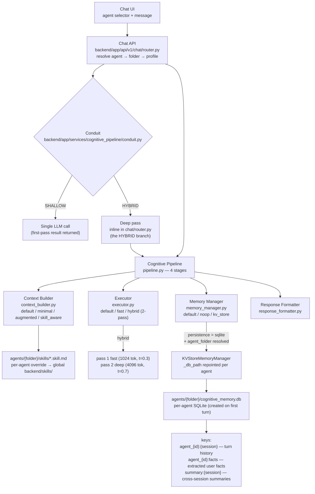
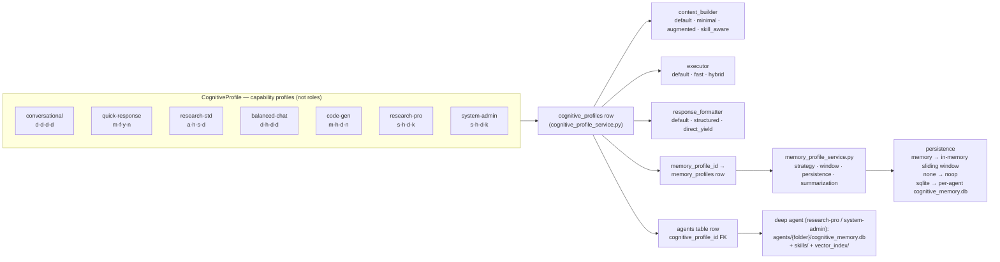
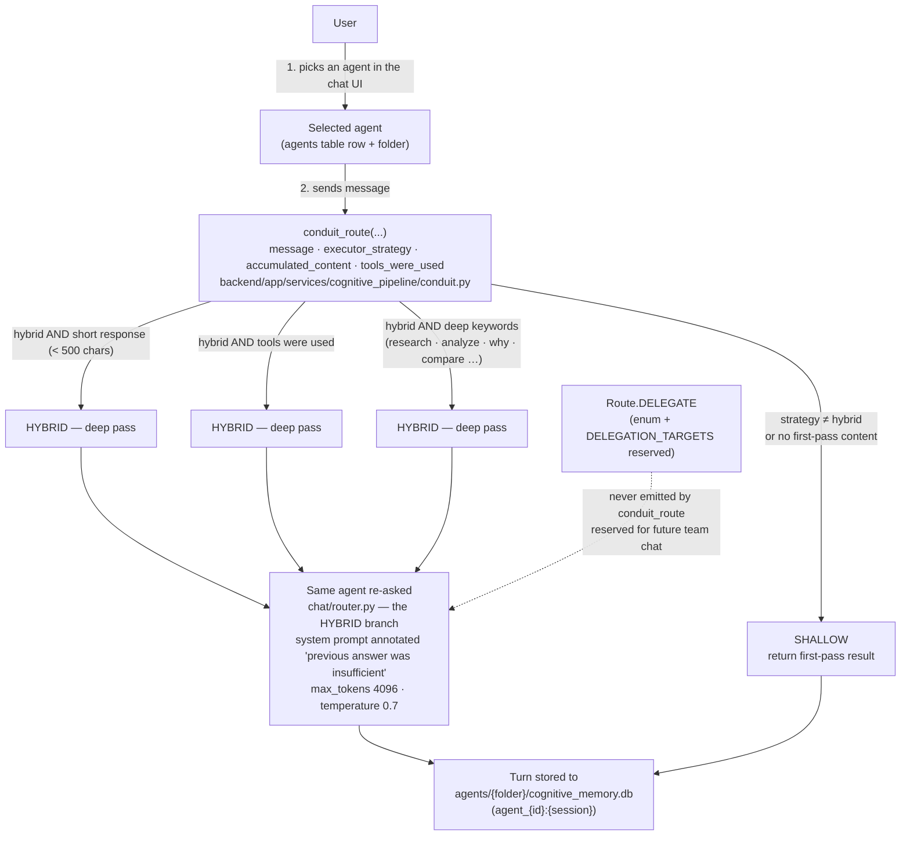

# Per-Agent Architecture

**Paths**: `agents/` (provisioned agent folders) · `backend/app/domain/agents/` (agent domain + templates + export) · `backend/app/services/cognitive_pipeline/` (pipeline, memory, conduit, profiles) · `backend/app/core/system_manager.py` (system manager config)
**Type**: architecture (phase 4 deep-dive)
**Last Updated**: 2026-08-01

This document explains how Cogitate models agents as individual, self-contained
units — each with its own identity, configuration, memory database, skills, and
cognitive behavior. It is the companion map to the per-file atlas entries under
`wiki/atlas/ui/{components,pages,services}`; those pages describe individual
screens and services, this page describes the architecture that ties an agent
together end to end: what makes an agent "deep", where its memory lives, how its
cognitive profile shapes its pipeline behavior, how agents are registered and
provisioned, and how the conduit decides which execution path a message takes.

> **Source map** — the conceptual layout `backend/app/agents/` +
> `backend/app/domain/cognitive_profiles/` maps onto the implemented layout as
> follows:

| Concept | Implemented location |
|---|---|
| Provisioned agent folders | `<repo>/agents/{name}/` (e.g. `agents/researcher/`) |
| Agent domain (schemas, services, templates, export/import) | `backend/app/domain/agents/` |
| DB-backed agent package registry + Nucleus harness | `backend/app/domain/agent_registry/` |
| Cognitive + memory profile services | `backend/app/services/cognitive_pipeline/cognitive_profile_service.py`, `memory_profile_service.py` |
| Profile REST API | `backend/app/api/v1/cognitive_pipeline/cognitive_profiles.py` (`/api/v1/cognitive-profiles`) |
| Agent provisioning API | `backend/app/api/v1/agents/provisioning_router.py` |
| Chat + conduit integration | `backend/app/api/v1/chat/router.py`, `backend/app/services/cognitive_pipeline/conduit.py` |
| System manager (config-only) | `backend/app/core/system_manager.py` |

## Deep-agent model

Not every row in the `agents` table is a "deep agent". A deep agent is one that
has been *provisioned* — it owns a folder under the top-level `agents/`
directory, and that folder gives it durable state that ordinary LLM-only agents
do not have.

### What makes an agent "deep"

A deep agent is defined by its folder, not by its database row. Provisioning
(`POST /api/v1/agents/{name}/provision` in
`backend/app/api/v1/agents/provisioning_router.py`) creates:

```
agents/{name}/
├── agent.json            # identity + config (format_version, provider, model,
│                         #   system_prompt, cognitive_profile_id, skills, db_id)
├── cognitive_memory.db   # per-agent SQLite memory (created lazily on first use)
├── skills/               # per-agent skill overrides (*.skill.md)
└── vector_index/         # per-agent vector store
    └── chunks.db         #   (created lazily, see vector_store.py)
```

The `agent.json` is the agent's contract with the runtime. It carries the
`folder` name, the display `name`, provider/model, `system_prompt`,
`cognitive_profile_id`, the `skills` list, and — critically — `db_id`, the agent's
row id in the shared `cogitate.db` `agents` table. The runtime resolves the
folder from a database agent id by scanning `agents/*/agent.json` for a matching
`db_id` (`backend/app/api/v1/chat/router.py`).

Three properties combine to make an agent deep:

1. **A cognitive profile with a hybrid executor** — the profile selects the
   `hybrid` executor, giving the agent two-pass reasoning (fast shallow pass,
   then a deeper pass when the query warrants it).
2. **Persistent per-agent memory** — the profile references a memory profile
   with `persistence = sqlite`, so the pipeline swaps the memory manager onto
   `agents/{name}/cognitive_memory.db` instead of the shared
   `backend/data/cognitive_memory.db`.
3. **Agent-scoped skills** — the profile's `skill_aware` context builder loads
   skill files from `agents/{name}/skills/` before falling back to the global
   `backend/skills/` directory, so each deep agent carries its own operating
   knowledge.

The provisioned deep agent in the default install is **Researcher**
(`db_id` 45, profile `research-pro`). The **System Manager** agent
(`db_id` 48, profile `system-admin`) was RETIRED 2026-08-19 — Exa
(the external agent) is the system agent now; the System Manager
agent is soft-deleted (recoverable) and its workspace archived.
The `SystemManagerConfig` class (the embedding/system settings)
is unrelated to the agent and remains.

### The pipeline an agent runs

Every agent message flows through the same four-stage cognitive pipeline
(`backend/app/services/cognitive_pipeline/pipeline.py`):
**context builder → executor → memory manager → response formatter**. What
*differs per agent* is which implementation each stage resolves to — and that
selection comes from the agent's cognitive profile.



## Per-agent memory

### Layout

Per-agent memory is a single SQLite database per deep agent, stored at
`agents/{name}/cognitive_memory.db`. It is *not* the shared app database — it is
a dedicated key-value store with one table:

```sql
CREATE TABLE cognitive_memory (
    key         TEXT PRIMARY KEY,
    value       TEXT NOT NULL,
    turn_count  INTEGER NOT NULL DEFAULT 0,
    created_at  TEXT NOT NULL DEFAULT (datetime('now')),
    updated_at  TEXT NOT NULL DEFAULT (datetime('now'))
);
```

The table is created lazily by `KVStoreMemoryManager._init_db()`
(`backend/app/services/cognitive_pipeline/memory_manager.py`). The manager is a
singleton in the pipeline registry; when a run's pipeline config has
`memory_profile_persistence = "sqlite"` and an `agent_folder` is resolved, the
chat router / pipeline repoints `memory_manager._db_path` at the agent's file
and flips `_is_deep = True` before re-initializing the connection
(`backend/app/api/v1/chat/router.py`, `pipeline.py`).

### Key conventions

Memory entries are keyed by namespace so one agent's memory never collides with
another's, even when a shared database is used:

| Key pattern | Content | Writer |
|---|---|---|
| `agent_{id}:{session_id}` (default session: `agent_{id}:default`) | JSON array of user/assistant turns with timestamps | `remember()` |
| `agent_{id}:facts` | JSON array of extracted user facts (deduplicated, merged) | `extract_facts()` |
| `summary:{session_id}` (deep) / `agent_{id}:summary:{session_id}` (shared) | JSON `{"summary": ..., "turn_count": ...}` | summarization at compaction threshold |

Facts are extracted best-effort by an LLM call over the last 10 turns whenever
summarization runs; extraction failures are swallowed (fact retention is a
quality-of-life feature, never a correctness requirement). Summaries are recalled
across *all* past sessions via `recall_summaries()` — deep agents scan
`summary:%`, shared agents scan `agent_{id}:summary:%` — and are injected into
the system prompt as cross-session context.

Three memory manager strategies exist (`memory_manager.py`,
`create_default_registry()`):

| Strategy | Behavior | Used by |
|---|---|---|
| `default` | In-memory sliding window (50 turns), lost on restart | conversational, research-std, balanced-chat |
| `noop` | Stateless — nothing stored, everything starts fresh | quick-response, code-gen |
| `kv_store` | SQLite persistence with compaction, summarization, fact extraction | research-pro, system-admin (deep agents) |

### Part codes

Profiles are summarized by a four-part code, `{context}-{executor}-{format}-{memory}`,
shown as badges (CB/EX/MM/RF) in the frontend profile picker
(`frontend/src/components/features/cognitive/CognitiveProfileSelector.tsx`):

| Position | d | m | a | s | f | h | y | k | n |
|---|---|---|---|---|---|---|---|---|---|
| context | default | minimal | augmented | skill_aware | — | — | — | — | — |
| executor | default | — | — | — | fast | hybrid | — | — | — |
| format | default | — | — | — | — | — | direct_yield | — | — |
| memory | in-memory | — | — | — | — | — | — | kv_store (sqlite) | none |

## Agent registry

Agents are tracked in three complementary places, each with a different job.

### 1. The `agents/` directory (provisioned deep agents)

The filesystem registry described in the [deep-agent model](#deep-agent-model).
`backend/app/api/v1/agents/provisioning_router.py` owns it:

- `POST /agents/{name}/provision` — create the folder (agent.json +
  skills; no per-agent DB copy — the app DB is shared), and register
  the agent in the shared
  `cogitate.db` `agents` table (the new row's id is stored back into
  `agent.json` as `db_id`).
- `GET /agents/{name}/status` — folder stats: database sizes, skill count,
  vector-index presence and turn count.
- `DELETE /agents/{name}/archive` — move the folder onto the trash's
  agents shelf (`trash/agents/`).

The two shipping deep agents:

| Folder | Agent | db_id | Cognitive profile | Skills |
|---|---|---|---|---|
| `agents/researcher/` | Researcher | 45 | `research-pro` (6) | web-research, how-to-report-problems, cogitate-system-map, cogitate-api-surface |
| `trash/agents/system-manager-*` (was `agents/.archived/`; snapshot archived, then purged) | System Manager (RETIRED — Exa is the system agent) | 48 | `system-admin` (7) | system-administration, agent-provisioning, troubleshooting |

The Researcher's `agent.json` is the reference shape: `format_version: "1.0"`,
provider `openrouter`, model `deepseek/deepseek-v4-flash`,
`cognitive_profile_id: 6`, `skills: [...]`, `db_id: 45`, plus `created_at` /
`updated_at` / `is_active`. Its `cognitive_memory.db` already exists on disk with
turn-history rows keyed `agent_45:{session}`.

### 2. The shared `agents` table (identity + chat surface)

The `agents` table in the shared `cogitate.db` is the source of truth the chat
UI lists and selects from. It stores name, description, provider/model,
`system_prompt`, `parameters`, `execution_mode`, `template_id`,
`cognitive_profile_id`, and flags (`is_active`, `is_builtin`, `allow_delegation`,
`fallback_enabled`). Provisioning writes here; ordinary agent CRUD
(`backend/app/domain/agents/services.py`, `schemas.py`) manages rows here. The
`db_id` in `agent.json` is the join key back to this table.

### 3. The DB-backed package registry (versioned, code-carrying packages)

`backend/app/domain/agent_registry/` is a separate, DB-backed registry for agent
*packages* stored in the `frontend_agent_packages` table:

- `service.py` — CRUD with lifecycle statuses
  (`experimental → active → archived → deprecated`) and version lineage via
  `parent_version_id` (`AgentPackageLineageResponse` returns ancestors and
  descendants of any package).
- `nucleus.py` — the **Nucleus** harness: a minimal `exec()` loader that looks up
  an active package by name or id, executes its `code` string in a restricted
  namespace (`_SAFE_BUILTINS` only), and calls the package's `run(context)`.
  Package code lives in DB rows rather than files, which enables versioning,
  rollback, and A/B testing without deploying code.

This registry is the path to *programmatic* agents (agent code as data). The
filesystem `agents/` directory and the package registry are complementary: a
deep agent is a provisioned folder; a package is a versioned code bundle that
Nucleus can execute.

### Agent export / import

`backend/app/domain/agents/export_service.py` bundles an agent's full state —
DB config row, `agent.json`, every `cognitive_memory.db` entry, and its skill
files — into a single JSON document, and can re-import that bundle to recreate
the agent (including memory and skills). The folder for a given `agent_id` is
located by scanning `agents/*/agent.json` for a matching `db_id`.

## Cognitive profiles

Cognitive profiles are the *behavioral* layer of an agent. A profile bundles
four strategy selectors — `context_builder`, `executor`, `response_formatter`,
and a reference to a `memory_profile` — into one named, reusable configuration
(`backend/app/services/cognitive_pipeline/cognitive_profile_service.py`).
Profiles are stored in the `cognitive_profiles` table; built-in profiles
(`is_builtin = True`) are seeded by migration and cannot be modified or deleted,
while user-created profiles are fully editable.

The profile API lives at `/api/v1/cognitive-profiles`
(`backend/app/api/v1/cognitive_pipeline/cognitive_profiles.py`) with
list / get / create / update / delete endpoints, backed by the frontend
`CognitiveProfileService` (list, get, create, update, delete) and the table-based
picker UI. Agent-level JSON import/export is handled by the agent export service,
not the profile router.

### The profile set — capabilities, not roles

There are seven built-in profiles. The naming rule is deliberate: **a profile
describes a capability, never an agent role**. `research-pro` is a profile; the
*Researcher* is an agent that uses it. `system-admin` is a profile; the *System
Manager* is an agent that uses it. This keeps profiles reusable — any agent can
be pointed at any capability profile.

| id | Name | Part code | Context | Executor | Format | Memory | Persistence |
|---|---|---|---|---|---|---|---|
| 1 | conversational | `d-d-d-d` | default | default | default | in-memory | memory |
| 2 | quick-response | `m-f-y-n` | minimal | fast | direct_yield | none | none |
| 3 | research-std | `a-h-s-d` | augmented | hybrid | structured | in-memory | memory |
| 4 | balanced-chat | `d-h-d-d` | default | hybrid | default | in-memory | memory |
| 5 | code-gen | `m-h-d-n` | minimal | hybrid | default | none | none |
| 6 | research-pro | `s-h-d-k` | skill_aware | hybrid | default | kv_store | sqlite |
| 7 | system-admin | `s-h-d-k` | skill_aware | hybrid | default | kv_store | sqlite |

The `s-h-d-k` pair (research-pro, system-admin) is the "deep agent" capability:
skill-aware context + hybrid two-pass reasoning + persistent SQLite memory with
fact extraction and summarization. Agents assigned either of these profiles are
the ones that get a per-agent `cognitive_memory.db`.



## Templates

Agent templates (`backend/app/domain/agents/schemas.py`,
`AgentTemplateCreate`/`AgentTemplateUpdate`) are saved agent configurations that
can be applied to spin up new agents. Two fields make templates carry the
cognitive architecture forward:

- **`cognitive_profile_id`** — the template pins the capability profile the
  new agent will use (e.g. `research-pro`, `system-admin`).
- **`execution_mode`** — `hybrid` or `shallow`. This is the template-level
  counterpart of the agent-level `execution_mode` on `AgentBase` (`llm` /
  `simulated` / `hybrid`) and is copied onto the created agent.

When a template is applied (`backend/app/domain/agents/services.py`,
`create_agent_from_template`), the created agent inherits the template's
`cognitive_profile_id` and `execution_mode`, so provisioning from a template
yields an agent whose pipeline behavior is already fully specified. Templates
also carry provider/model, `system_prompt`, `parameters`, `behavior_config`,
`preferred_providers`, `fallback_enabled`, `allow_delegation`, `is_public`,
`tags`, and `usage_count`, and can be derived from an existing agent
(`save_agent_as_template`).

## Agent selection & switching

Agent selection is **manual and user-driven**. The chat UI presents the agent
list (from the shared `agents` table); the user picks which agent to talk to, and
the session runs as that agent — its system prompt, its profile, its tools, its
memory database. There is no automatic hand-off between agents, and there is no
routing layer that silently redirects a message to a "better suited" agent.

The only intra-request escalation is the conduit's **HYBRID** deep pass, which
re-asks the *same* agent with a higher token budget — it never changes agents.
Conduit delegation targets (`DELEGATION_TARGETS = {"researcher": 45,
"system-manager": 48}` in `conduit.py`) and the `DELEGATE` route enum are
preserved as scaffolding for a future team-chat feature, but
`conduit_route()` never emits `DELEGATE` today.



## Conduit contract

`conduit_route()` (`backend/app/services/cognitive_pipeline/conduit.py`) is the
single decision point between a shallow reply and a deep pass. Its contract:

**Inputs**

- `message` — the user's message.
- `executor_strategy` — the agent's executor selection (from its cognitive
  profile); only `"hybrid"` can trigger a deep pass.
- `accumulated_content` — the first-pass response text.
- `tools_were_used` — whether the first pass invoked tools.

**Outputs**

- `Route.SHALLOW` — respond directly with the first-pass result (default).
- `Route.HYBRID` — run the deep pass on the *current* agent: the chat router
  (`backend/app/api/v1/chat/router.py`) rebuilds the LLM request with
  `max_tokens=4096`, `temperature=0.7`, appends the first-pass content, annotates
  the system prompt with *"The previous answer was insufficient. Please provide a
  thorough, well-reasoned response"*, and streams the second pass. The first-pass
  content and the deep content are concatenated as the final accumulated output.
- `Route.DELEGATE` — defined in the enum and exercised by an old branch in the
  chat router (which would POST to `/api/v1/chat/delegate`), but **unreachable**
  through `conduit_route()`: the function returns only SHALLOW or HYBRID.

**Deep-pass triggers** (any of):

1. First-pass response is short — under 500 characters
   (the `< 500` check in the HYBRID branch of `chat/router.py`).
2. Tools were used during the first pass.
3. The message matches a deep keyword (`research`, `analyze`, `explain`,
   `compare`, `contrast`, `why`, `how`, `difference`, `pros and cons`,
   `evaluate`, `summarize`, `investigate`, `deep dive`, `literature review`,
   `synthesize`, …).

**Invariants**

- A HYBRID pass never switches agents — it re-asks the current one.
- No message is ever auto-delegated to another agent.
- A shallow query costs one LLM call; a hybrid query costs two, with the second
  carrying the higher budget.

## Extension — adding a new agent

Adding a deep agent end to end:

1. **Provision the folder** — `POST /api/v1/agents/{name}/provision` with
   `{name, description, provider, model, system_prompt, cognitive_profile_id,
   tools, tags}`. This creates `agents/{name}/` (agent.json + `cogitate.db` from
   template + `skills/`), registers the agent in the shared `agents` table, and
   stores the new `db_id` into `agent.json`. Folder names must match
   `^[a-z][a-z0-9-]{0,63}$` (lowercase, hyphens, ≤ 64 chars); underscores are
   normalized to hyphens.
2. **Assign the capability profile** — set `cognitive_profile_id` to one of the
   seven built-ins (or a user-created profile). `research-pro` /
   `system-admin` give the agent persistent per-agent memory; `research-std` /
   `balanced-chat` give two-pass reasoning without persistence.
3. **Attach skills** — place `*.skill.md` files in `agents/{name}/skills/` and
   list them in `agent.json` `skills`. The `skill_aware` context builder loads
   them (agent-local first, global `backend/skills/` fallback).
4. **Link tools** — provision with `tools` names; the router maps names to tool
   ids in the shared DB and writes `agent_tools` rows for the new `db_id`.
5. **Verify** — `GET /api/v1/agents/{name}/status` reports database sizes,
   skill count, and vector-index state. The first chat turn lazily creates
   `cognitive_memory.db`.
6. **Optionally template it** — save the agent as a template
   (`save_agent_as_template`) to clone the configuration, or export it as a JSON
   bundle (`export_agent`) to move configuration + memory + skills elsewhere.
7. **Optionally package it** — for versioned, code-carrying agents, create a
   package via the agent registry (`frontend_agent_packages`) and execute it
   through the Nucleus harness.

The system manager is the one agent that is deliberately *not* provisioned
through the normal agent path: it is a rudimentary config-only agent defined in
`backend/app/core/system_manager.py` — a `SystemManagerConfig` dataclass (name,
provider, model, `SYSTEM_MANAGER_PROMPT`, parameters) that may be loaded from the
database at runtime via `from_db()`, with no silent fallback to a default LLM
(unreachable configured LLM ⇒ HTTP 503). It is not visible in agent listings,
not selectable for normal agent chat, and not modifiable via agent CRUD; it
operates purely from config + mode registry + tool table. The provisioned
`agents/system-manager/` folder (db_id 48, profile `system-admin`, with
`system-administration`, `agent-provisioning`, and `troubleshooting` skills) is
the deep-agent counterpart that will eventually supersede it — a full deep-agent
system manager is pending.

## Conventions

- **Profiles describe capabilities, not roles.** `research-pro` and
  `system-admin` are capability profiles; agents like Researcher and System
  Manager *use* them. Never name a profile after a specific agent.
- **One folder, one deep agent.** Everything durable about a deep agent lives
  under `agents/{name}/`; the `db_id` in `agent.json` is the join key to the
  shared `agents` table. Never store agent state outside the folder.
- **Folder names**: lowercase, hyphens, `^[a-z][a-z0-9-]{0,63}$`.
- **Memory keys** are namespaced `agent_{id}:*`; facts always live at
  `agent_{id}:facts`; sessions at `agent_{id}:{session_id}`. Deep agents keep
  summaries under `summary:{session_id}`, shared agents under
  `agent_{id}:summary:{session_id}`.
- **Part codes** (`ctx-exe-fmt-mem`) are the compact way to compare profiles;
  keep them in sync with the badge renderers in
  `frontend/src/components/features/cognitive/`.
- **Built-in profiles are immutable** — creation/update/delete reject
  `is_builtin` rows; user profiles are fully editable. Same rule for memory
  profiles.
- **Conduit never delegates.** `conduit_route()` returns SHALLOW or HYBRID only;
  `DELEGATE` and `DELEGATION_TARGETS` are reserved scaffolding. Agent switching
  is a user action in the chat UI.
- **Lifecycle statuses** for registry packages: `experimental → active →
  archived → deprecated` (deprecated can only be archived, never reactivated).
- **Export/import is the migration path** — the agent export bundle
  (`export_service.py`) carries configuration, memory, and skills together, so
  an agent is portable as one JSON document.

## Related

- `wiki/atlas/ui/architecture/chat-architecture.md` — chat flow and SSE streaming
- `wiki/atlas/ui/architecture/routing.md` — API routing layers
- `wiki/atlas/ui/services/domain/CognitiveProfileService.md` — profile service on the frontend
- `wiki/atlas/ui/components/features/cognitive/CognitiveProfileSelector.md` — profile part-code picker
- `wiki/atlas/ui/components/features/cognitive/CognitiveProfilesTab.md` — profile management tab
- `wiki/atlas/ui/components/features/cognitive/MemoryProfilesTab.md` — memory profile management
- `wiki/concepts/cognitive-profiles.md` — part-code system and profile catalogue
- `wiki/help/agent-profiles.md` — user-facing agent profile guide
