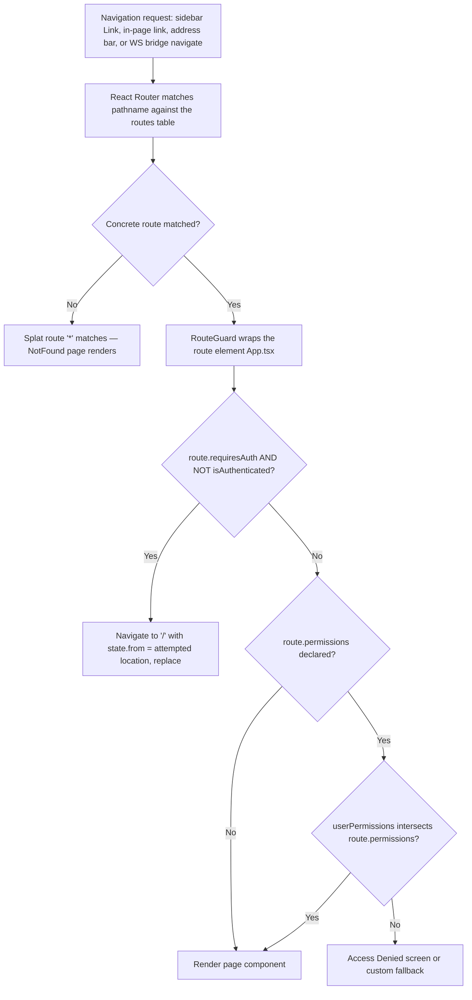

# Routing & Route Permissions

**Path**: `frontend/src/App.tsx`, `frontend/src/config/routes.ts`, `frontend/src/components/RouteGuard/`, `frontend/src/hooks/useRoutePermissions.ts`
**Type**: architecture
**Last Updated**: 2026-08-01

## Purpose

Routing in the Cogitate frontend is a single, flat, data-driven route table. Every
page is declared in `frontend/src/config/routes.ts` as a `RouteConfig` entry
(lazy-loaded component + title + auth/permission metadata), and `App.tsx` maps that
table straight into React Router (`react-router-dom` v7, declarative
`<BrowserRouter>` mode) with one `<Route>` per entry — each wrapped in a
`RouteGuard` that enforces authentication and permission requirements before the
page renders.

There is no nested-route layout tree: the shell (sidebar + main content area) is a
plain `Layout` component rendered around the `<Routes>` block, and every route is a
flat sibling. The design keeps three concerns cleanly separated:

1. **Route table** (`config/routes.ts`) — the single source of truth for what
   paths exist, which component renders, and what access each route requires.
2. **Shell & rendering** (`App.tsx`) — providers, layout, scroll restoration,
   global overlays, and the `routes.map()` that turns config into `<Route>`s.
3. **Enforcement** (`components/RouteGuard/` + `hooks/useRoutePermissions.ts`) —
   the declarative guard wrapper and the programmatic permission helpers.

## App shell & provider stack

`App.tsx` composes the application in a strict nesting order (`<App />` is mounted
by `src/main.tsx`):

```
HelmetProvider            (react-helmet-async — per-page <title>/meta)
└─ QueryProvider          (react-query client for all data fetching)
   └─ BrowserRouter       (react-router-dom v7)
      └─ GlobalTheme      (applies theme class to <html> from useTheme)
         └─ CognitiveHubProvider   (agent/session context)
            ├─ ScrollToTop         (window.scrollTo(0,0) on pathname change)
            ├─ Layout              (sidebar + main content area)
            │  └─ Suspense (fallback: <PageLoader />)
            │     └─ Routes        (one <Route> per config/routes.ts entry)
            ├─ NotificationContainer  (global toast/notification overlay)
                        └─ HelpModal             (right-drawer wiki help overlay)
```

Two structural details matter for routing:

- **`Layout` owns the chrome.** It renders the fixed sidebar and the scrollable
  main area, and it hosts `useUIStateBridge()` for the lifetime of the app (see
  [Navigation](#navigation)). It was rewritten on 2026-06-15 from a DaisyUI
  drawer to a plain flexbox layout because the drawer's CSS Grid + `@layer`
  cascade prevented sidebar-width overrides (see
  `local/issues/2026-06-15-navigation-drawer-toggle-not-working.md`).
- **Global overlays live outside `<Routes>`.** `NotificationContainer`,
  `HelpModal` is mounted once, next to `Layout`, so it
  persist across route changes. `HelpModal` is therefore not a route at all —
  see [The /help route](#the-help-route-context-sensitive-help).

## Route tree

The route tree is rendered exactly as configured: `App.tsx` iterates
`routes.map()` and produces one flat `<Route>` per entry:

```tsx
{routes.map((route) => (
  <Route
    key={route.path}
    path={route.path}
    element={
      <RouteGuard route={route} userPermissions={userPermissions} isAuthenticated={isAuthenticated}>
        <route.component />
      </RouteGuard>
    }
  />
))}
```

There are 31 entries: **28 lazy-loaded page bundles**, **1 inline redirect**
(`/providers`), **1 metadata-only entry with no path** (never matches), and the
**`*` catch-all** (404). The diagram groups them by sidebar section and marks
auth/permission requirements.

```mermaid
flowchart TD
  BR["BrowserRouter"] --> LAY["Layout — sidebar + main"]
  LAY --> SUSP["Suspense — PageLoader fallback"]
  SUSP --> ROUTES["Routes — flat siblings mapped from config/routes.ts"]

  subgraph G_TOP["Top level and public"]
    ROUTES --> R1["/ — Dashboard — auth"]
    ROUTES --> R2["/providers — Navigate redirect to /provider-dashboard — auth"]
    ROUTES --> R3["/wiki/* — WikiViewer — public"]
    ROUTES --> R4["* — NotFound — public catch-all"]
  end

  subgraph G_AGENTS["Sidebar group — Agents"]
    ROUTES --> R5["/agent-interaction — Chat — auth"]
    ROUTES --> R6["/cognitive-pipeline — CognitivePipeline — auth + permissions"]
    ROUTES --> R7["/agent-profiles — AgentProfiles — auth"]
    ROUTES --> R8["/sessions — Sessions — auth"]
    ROUTES --> R9["/teams — TeamsManagement — auth"]
    ROUTES --> R10["/teams/:teamId — TeamDetail — auth — in-page links only"]
    ROUTES --> R11["/agents/templates — AgentTemplates — auth"]
  end

  subgraph G_UTIL["Sidebar group — Utilities"]
    ROUTES --> R12["/provider-dashboard — ProviderDashboard — auth"]
    ROUTES --> R13["/providers/:providerId/models — ProviderModelsBrowser — auth — in-page links only"]
    ROUTES --> R14["/tools — ToolManagement — auth"]
    ROUTES --> R15["/toolkits — ToolkitsManagement — auth"]
    ROUTES --> R16["/toolkits/:collectionId — ToolkitDetail — auth — in-page links only"]
    ROUTES --> R17["/toolboxes/:collectionId — redirect to /toolkits — auth — legacy"]
    ROUTES --> R17b["/tool-collections/:collectionId — redirect to /toolkits — auth — legacy"]
    ROUTES --> R18["/workflow-execution — WorkflowExecution — auth"]
    ROUTES --> R19["/workflow-templates — WorkflowTemplates — auth"]
  end

  subgraph G_DEV["Sidebar group — Development"]
    ROUTES --> R20["/debugging — Debugging — auth"]
    ROUTES --> R21["/testing-dashboard — TestingDashboard — auth"]
  end

  subgraph G_SYS["Sidebar group — System"]
    ROUTES --> R22["/analytics — Analytics — auth"]
    ROUTES --> R24["/history — SystemHistory — auth"]
    ROUTES --> R25["/logs — Logs — auth"]
    ROUTES --> R26["/macros — Macros — auth"]
    ROUTES --> R27["/settings — Settings — auth"]
    ROUTES --> R28["/system-info — SystemInfo — auth"]
  end

  subgraph G_META["Metadata only"]
    ROUTES --> R29["entry with no path and no component — never matches"]
  end
```



### Full route table

| Path | Component | Auth | Permissions | Sidebar | Notes |
|------|-----------|------|-------------|---------|-------|
| `/` | `Dashboard` | yes | — | top-level | `exact: true` (no-op in v7 ranking) |
| `/logs` | `Logs` | yes | — | System | |
| `/history` | `SystemHistory` | yes | — | System | |
| `/system-info` | `SystemInfo` | yes | — | System | |
| `/settings` | `Settings` | yes | — | System | |
| `/macros` | `Macros` | yes | — | System | |
| `/agents/templates` | `AgentTemplates` | yes | — | Agents | |
| `/analytics` | `Analytics` | yes | — | System | |
| `/sessions` | `Sessions` | yes | — | Agents | |
| `/providers/:providerId/models` | `ProviderModelsBrowser` | yes | — | (in-page links) | detail route |
| `/workflow-templates` | `WorkflowTemplates` | yes | — | Utilities | |
| `/providers` | inline `Navigate` → `/provider-dashboard` | yes | — | (none) | redirect, `replace: true` |
| `/provider-dashboard` | `ProviderDashboard` | yes | — | Utilities | |
| `/agent-interaction` | `Chat` (`AgentInteraction`) | yes | — | Agents | |
| `/workflow-execution` | `WorkflowExecution` | yes | — | Utilities | |
| `/testing-dashboard` | `TestingDashboard` | yes | — | Development | |
| `/debugging` | `Debugging` | yes | — | Development | |
| `/tools` | `ToolManagement` | yes | — | Utilities | |
| `/collections` | `CollectionsManagement` | yes | — | (not linked) | reachable via cross-links |
| `/collections/:collectionId` | `CollectionDetail` | yes | — | (in-page links) | detail route |
| `/toolkits` | `ToolkitsManagement` | yes | — | Utilities | |
| `/toolkits/:collectionId` | `ToolkitDetail` | yes | — | (in-page links) | detail route |
| `/toolboxes` | redirect → `/toolkits` | yes | — | (legacy) | the pre-2026-09-04 path |
| `/toolboxes/:collectionId` + `/tool-collections/:collectionId` | redirect → `/toolkits/:collectionId` | yes | — | (legacy) | the pre-2026-09-04 paths |
| `/teams` | `TeamsManagement` | yes | — | Agents | |
| `/teams/:teamId` | `TeamDetail` | yes | — | (in-page links) | detail route |
| *(no path)* | *(none)* | no | — | (none) | "Application Atlas" metadata entry, inert |
| `/cognitive-pipeline` | `CognitivePipeline` | yes | `admin`, `config_manager`, `developer` | Agents | permission-gated |
| `/agent-profiles` | `AgentProfiles` | yes | — | Agents | |
| `/wiki/*` | `WikiViewer` | no | — | top-level | public, splat match |
| `*` | `NotFound` | no | — | (none) | public catch-all |

## Navigation

### Sidebar mapping

The sidebar is **hard-coded inside `Layout`** in `App.tsx` — it is not generated
from the route table. It renders a `Link` per entry, grouped into collapsible
`<details>` sections:

| Sidebar section | Routes |
|-----------------|--------|
| (top-level) | `/` Dashboard, `/wiki` Wiki |
| **Agents** | `/agent-interaction` (Chat), `/cognitive-pipeline` (Pipeline Config), `/agent-profiles` (Profiles), `/sessions` (Sessions), `/teams` (Teams), `/agents/templates` (Templates) |
| **Utilities** | `/provider-dashboard`, `/tools` (Tool Management), `/toolkits` (Toolkits), `/workflow-execution`, `/workflow-templates` |
| **Development** | `/debugging`, `/testing-dashboard` |
| **System** | `/analytics`, `/history`, `/logs`, `/macros`, `/settings`, `/system-info` |

Active-state detection is exact equality (`location.pathname === path`), except
the Wiki link, which uses `location.pathname.startsWith('/wiki')` so wiki subpages
stay highlighted. The collapsible groups only render when the sidebar is expanded
(`!sidebarCollapsed`), so collapsed mode shows icons only.

Several routes are deliberately absent from the sidebar and are reached through
in-page links or redirects instead: `/providers` (redirect), `/teams/:teamId`,
`/providers/:providerId/models`, `/collections`, `/collections/:collectionId`,
`/toolkits/:collectionId`, and the legacy `/toolboxes/:collectionId` +
`/tool-collections/:collectionId` redirects.

### Sidebar layout behavior

- Widths: `16rem` expanded (`w-64`), `5rem` collapsed (`w-20`), applied via
  inline style — this is why the flexbox rewrite was needed (cascade-layer
  override failures under DaisyUI's drawer).
- Mobile: the sidebar is `fixed` and translated off-canvas when collapsed; a
  `lg:hidden` backdrop overlay closes it on tap; a hamburger button in the main
  column toggles it.
- State lives in `uiStore` (`sidebarCollapsed`, `toggleSidebar`), so collapse
  state survives remounts.

### Route awareness beyond the sidebar

- **Scroll restoration**: `ScrollToTop` watches `useLocation().pathname` and
  resets `window.scrollTo(0, 0)` on every path change.
- **WebSocket-driven navigation**: `useUIStateBridge()` (hosted in `Layout`)
  pushes `current_route` to the backend whenever the pathname changes, and
  subscribes to incoming navigation requests via
  `uiStateBridge.onNavigation((route, replace) => ...)` which calls
  `useNavigate()` — external agents/scripts can drive the UI to any route.
- **Breadcrumb helper**: `generateBreadcrumbs(currentPath)` in `config/routes.ts`
  accumulates path segments and looks each up with `getRouteByPath` (exact,
  literal match). Because the lookup is literal, parameterized detail routes
  (`/teams/:teamId`, `/collections/:collectionId`, ...) never produce a leaf
  crumb — only their static parent does. The helper has no call sites today.
- **Unused route helpers**: `getPublicRoutes`, `getProtectedRoutes`, and
  `getNavigationRoutes` are exported from `config/routes.ts` but have zero
  consumers in `frontend/src` (definition-only).

## Route permissions

### Permission model

Every `RouteConfig` can declare two access fields:

```typescript
interface RouteConfig {
  path: string;
  component: React.ComponentType;
  title: string;
  description?: string;
  requiresAuth?: boolean;   // undefined is falsy → treated as public by RouteGuard and the hook
  permissions?: string[];   // roles required; any-of match
  icon?: string;
  breadcrumb?: string;
  exact?: boolean;
}
```

One route declares `permissions` today:

- `/cognitive-pipeline` → `['admin', 'config_manager', 'developer']`

Every other page sets `requiresAuth: true` with no permission list. Only
`/wiki/*`, `*`, and the inert metadata entry set `requiresAuth: false`.

The current "user" is hard-coded in `App()`:

```tsx
// For now, we'll use default values since we don't have auth system
const userPermissions = ['admin', 'config_manager', 'developer'];
const isAuthenticated = true;
```

Because the default permission set contains every permission any route demands,
both gated routes are reachable in practice; the wiring is in place but no real
identity or session layer feeds it yet. Enforcement is client-side only — the
backend remains the authority for any server-side checks.

### RouteGuard (declarative enforcement)

`frontend/src/components/RouteGuard/index.tsx` wraps every route element in
`App.tsx`. Its logic:

1. If `route.requiresAuth && !isAuthenticated` → render
   `<Navigate to="/" state={{ from: location }} replace />` — a redirect home
   carrying the attempted location in `state.from` for a future post-login
   return.
2. If `route.permissions` is non-empty and none of its entries appear in
   `userPermissions` → render the caller's `fallback` prop, or a built-in
   **Access Denied** screen: warning icon, "Access Denied" heading, the required
   permission list, and a "Go Back" button that calls `window.history.back()`.
3. Otherwise render `children` (the page).

The permission check is an **any-of** (OR) intersection — a user with any one of
the listed roles passes:

```typescript
route.permissions.some(permission => userPermissions.includes(permission));
```

### hasRoutePermission helper

`config/routes.ts` exports the same predicate used by the hook:

```typescript
export const hasRoutePermission = (route: RouteConfig, userPermissions: string[] = []): boolean => {
  if (!route.permissions || route.permissions.length === 0) {
    return true; // no permission list → open to any authenticated user
  }
  return route.permissions.some(permission => userPermissions.includes(permission));
};
```

### useRoutePermissions hook (programmatic API)

`frontend/src/hooks/useRoutePermissions.ts` provides the programmatic view of the
same policy:

```typescript
const {
  accessibleRoutes,   // routes filtered by auth + permissions (splat '*' excluded)
  navigationRoutes,   // alias of accessibleRoutes
  canAccessRoute,     // (path: string) => boolean — exact path lookup + checks
  hasRoutePermission, // predicate re-exported from config/routes
} = useRoutePermissions({ userPermissions = [], isAuthenticated = true });
```

Notes:

- `canAccessRoute(path)` resolves via `getRouteByPath` (literal match), so it
  answers `/teams` but not `/teams/123`; parameterized paths need the route
  pattern itself.
- The hook currently has **no component consumers** — its only usage is
  `hooks/__tests__/useRoutePermissions.test.ts`. The sidebar is static rather
  than derived from `navigationRoutes`, so the hook is the ready-made API for
  future permission-aware navigation rather than the active mechanism.
- `isAuthenticated` defaults to `true` in both the hook and `RouteGuard`,
  matching the no-auth-system state of the app.

### Guard flow



### NavigationGuard (unsaved-changes guard)

`frontend/src/components/RouteGuard/NavigationGuard.tsx` is a sibling utility,
not part of the permission flow: when `when` is true it intercepts
`beforeunload` and `popstate` to warn about unsaved changes (blocking back/forward
via `history.pushState`). It currently has no production consumers — it is
exercised only by its own unit tests and is available for form-heavy pages.

## Lazy loading

Every page bundle is code-split with `React.lazy`. `config/routes.ts` imports all
28 page components lazily:

```typescript
const Dashboard = lazy(() => import('../pages/Dashboard'));
const Logs = lazy(() => import('../pages/Logs'));
// ... one lazy() per page, including NotFound and WikiViewer
```

`App.tsx` wraps the entire `<Routes>` block in a single `<Suspense fallback={<PageLoader />}>`,
so any lazy chunk that is still loading renders the shared `PageLoader`
(`components/Loading/PageLoader`) instead of a blank screen. Exceptions to
laziness:

- `/providers` uses an **inline** `() => React.createElement(Navigate, { to: '/provider-dashboard', replace: true })`
  component — no bundle, instant redirect.
- The pathless "Application Atlas" entry declares no component at all.

Because each page file is a separate chunk, the initial payload only includes the
shell plus the first route's bundle; visiting a route fetches its chunk on demand.

## Unknown / 404 handling

The final entry in the route table is the catch-all:

```typescript
{
  path: '*',
  component: NotFound,
  title: 'Not Found',
  requiresAuth: false,
}
```

Any pathname that matches no concrete route falls through to `*` and renders
`pages/NotFound.tsx`. The catch-all is public (`requiresAuth: false`) so 404s
render even for unauthenticated visitors. `NotFound` is itself lazy-loaded, so it
appears under the `PageLoader` fallback on first visit.

Two edge cases worth knowing:

- **The pathless metadata entry** (the "Application Atlas" entry between
  `/teams/:teamId` and `/cognitive-pipeline`) has neither `path` nor
  `component`. It renders as a pathless `<Route>`; verified via
  `matchRoutes()` against the real route list, a pathless route in this flat
  `<Routes>` tree never matches any URL — the entry is inert metadata (title,
  description, icon, breadcrumb) and the `*` catch-all handles unmatched paths.
- **Splat precedence**: `/wiki/*` wins for everything under `/wiki/`, including
  `/wiki/atlas/ui/...`; anything else unmatched goes to `*`.

## The /help route (context-sensitive help)

There is **no `/help` frontend route** in the route table — the static Help page
was removed and the feature now lives entirely in the globally mounted
`HelpModal` overlay (`components/help/HelpModal.tsx`). The "help route" that
appears in logs and API calls is the **backend wiki endpoint**
`/api/v1/wiki/help?context=<slug>`, not a client route.

The flow:

1. Pages embed `<HelpButton context="...">` (e.g. `Dashboard`, `Logs`,
   `Settings`, `Sessions`, `AgentInteraction`). On click it dispatches a window
   `CustomEvent('open-help-modal', { detail: { context, documentTitle, timestamp } })`.
2. `HelpModal` (mounted once in `App.tsx`, outside `<Routes>`) listens for the
   event, opens a right-drawer overlay, and fetches
   `/api/v1/wiki/help?context=<context>` — the backend matches the context slug
   against `wiki/help/` markdown frontmatter.
3. The modal renders the returned page (Markdown + Mermaid via `react-markdown`
   with a custom `mermaid` code component), a categorized help index (built from
   `/api/v1/wiki` tree → `help/` directory), related-topic links, and a back
   stack (Backspace / Alt+Left supported).

Because the modal is mounted beside `Layout` rather than inside `<Routes>`, it
survives route changes and needs no route entry. Help content is addressed by
context slug, not URL. The main wiki content itself is a real route: `/wiki/*`
renders `pages/WikiViewer.tsx` (public).

## Conventions

- **One flat, data-driven route table.** Add a page by adding a `RouteConfig` in
  `config/routes.ts`; `App.tsx` picks it up automatically. There are no nested
  routes and no per-page `<Route>` declarations scattered through the app.
- **Every page is lazy.** New pages must be `React.lazy(() => import(...))`
  imports; the single `Suspense` in `App.tsx` provides the `PageLoader`
  fallback.
- **`requiresAuth: true` by default for real pages.** Only genuinely public
  surfaces (`/wiki/*`, the `*` catch-all) opt out. `permissions` is an any-of
  role list; omit it for any-authenticated-user access.
- **Guard, don't pre-filter.** Access is enforced by wrapping each route element
  in `RouteGuard` at render time. The sidebar is static (not derived from the
  permission hook), so restricted routes can still be linked; the guard is the
  gate.
- **Redirects are routes.** `/providers` is a real entry whose component is an
  inline `<Navigate to="/provider-dashboard" replace />`, keeping redirect
  targets visible in the route table.
- **Redirects are routes.** The renamed surface kept its legacy paths
  working: `/toolboxes` and `/toolboxes/:collectionId` +
  `/tool-collections/:collectionId` are redirect entries pointing at the
  `/toolkits` canonical paths (2026-09-04, the agent-kits build P4).
- **Breadcrumbs use literal matching.** `getRouteByPath` compares exact strings,
  so parameterized detail routes never produce leaf crumbs; only static parents
  appear. `generateBreadcrumbs` currently has no call sites.
- **Auth is stubbed by design.** `App.tsx` hard-codes
  `isAuthenticated = true` and `userPermissions = ['admin', 'config_manager', 'developer']`
  pending a real auth system; `RouteGuard` and `useRoutePermissions` both default
  `isAuthenticated` to `true` to match.
- **Don't put overlays in the route table.** Global chrome that must survive
  navigation (`NotificationContainer`, `HelpModal`) is mounted
  beside `Layout`, outside `<Routes>`.

## Related

- `frontend/src/config/routes.ts` — route table, `RouteConfig` type, helpers
  (`getRouteByPath`, `hasRoutePermission`, `generateBreadcrumbs`, ...)
- `frontend/src/App.tsx` — shell, `Layout` (sidebar), `routes.map()` rendering
- `frontend/src/components/RouteGuard/index.tsx` — `RouteGuard` (auth +
  permission gate) — atlas: `wiki/atlas/ui/components/RouteGuard/index.md`
- `frontend/src/components/RouteGuard/NavigationGuard.tsx` — unsaved-changes
  guard — atlas: `wiki/atlas/ui/components/RouteGuard/NavigationGuard.md`
- `frontend/src/hooks/useRoutePermissions.ts` — programmatic permission API —
  atlas: `wiki/atlas/ui/hooks/useRoutePermissions.md`
- `frontend/src/hooks/useUIStateBridge.ts` — WebSocket route push + incoming
  navigation — atlas: `wiki/atlas/ui/hooks/useUIStateBridge.md`
- `frontend/src/components/help/HelpModal.tsx`, `HelpButton.tsx` — help overlay
  and event dispatch — atlas: `wiki/atlas/ui/components/help/README.md`
- `frontend/src/pages/NotFound.tsx` — 404 page — atlas:
  `wiki/atlas/ui/pages/NotFound.md`
- `frontend/src/pages/WikiViewer.tsx` — `/wiki/*` viewer — atlas:
  `wiki/atlas/ui/pages/WikiViewer.md`
- `frontend/src/stores/uiStore.ts` — sidebar collapse state — atlas:
  `wiki/atlas/ui/stores/uiStore.md`
