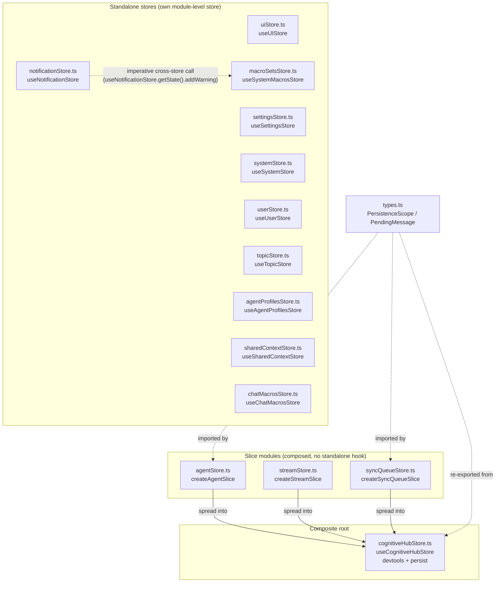
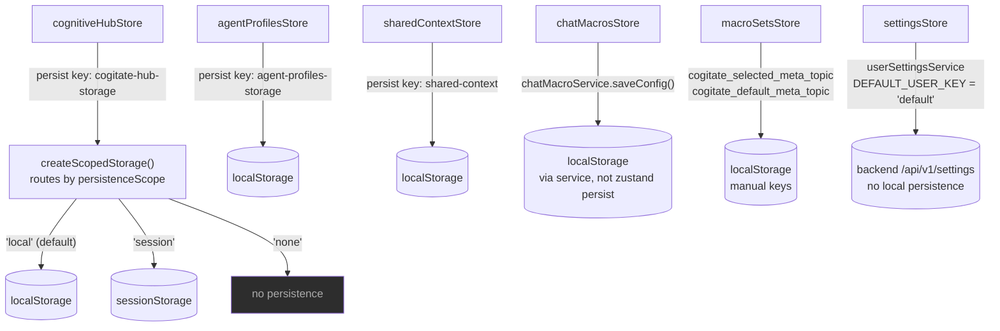
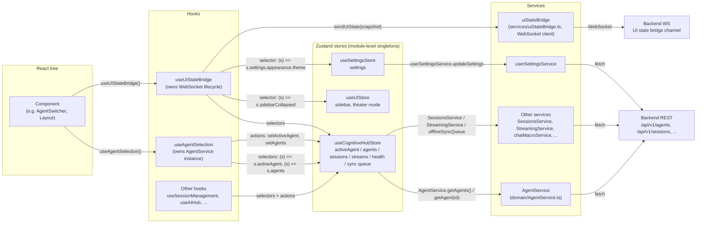

# State Management

**Scope**: `frontend/src/stores/` (16 files) + `frontend/src/hooks/useUIStateBridge.ts`
**Stack**: React 19 + TypeScript, [Zustand](https://github.com/pmndrs/zustand) with `devtools` and `persist` middleware
**Last Updated**: 2026-08-01

## Overview

The frontend uses **Zustand exclusively** for global/client state — there is no Redux, no MobX, and no React Context provider for state distribution. All stores are **module-level singletons** created with `create()` at import time, which means they survive navigation: a store is not mounted in the React tree and is never unmounted when a page changes.

The architecture separates state into two tiers:

1. **The composite root** — `cognitiveHubStore.ts` composes three focused slice modules (`agentStore`, `streamStore`, `syncQueueStore`) into one store, and wraps the result in `devtools` + `persist`. It is the single source of truth for AI-context state: agent list/selection, chat sessions, streaming flags, and the offline sync queue.
2. **Standalone stores** — ten additional stores, each owning one domain (UI chrome, notifications, settings, system health, user identity, topics, agent-profile page state, shared context, macro sets, chat macros). They do not compose anything and generally do not read from the hub.

A third mechanism, the **`useUIStateBridge` hook**, does not introduce a store: it *reads* from existing stores (`uiStore`, `cognitiveHubStore`, `settingsStore`) plus `useLocation`, and pushes a derived snapshot to the backend over a WebSocket. It is the boundary between React state and the backend's UI-state channel — not a general-purpose state container.

Per-store details live in the per-file atlas docs (`wiki/atlas/ui/stores/*.md`); this document explains how the pieces fit together.

## Store Topology

All 16 files in `frontend/src/stores/`:

| File | Exported hook | Role | Middleware |
|---|---|---|---|
| `cognitiveHubStore.ts` | `useCognitiveHubStore` | **Composite root** — composes the 3 slices + `persistenceScope` | `devtools` (DEV) + `persist` |
| `agentStore.ts` | `createAgentSlice` (no hook) | Slice — agents, active agent, sessions, lifecycle | none (composed into hub) |
| `streamStore.ts` | `createStreamSlice` (no hook) | Slice — streaming flags | none (composed into hub) |
| `syncQueueStore.ts` | `createSyncQueueSlice` (no hook) | Slice — offline sync queue | none (composed into hub) |
| `uiStore.ts` | `useUIStore` | Standalone — sidebar, theater mode | none |
| `notificationStore.ts` | `useNotificationStore` | Standalone — toasts/alerts | none |
| `settingsStore.ts` | `useSettingsStore` | Standalone — user settings (backend-synced) | `devtools` |
| `systemStore.ts` | `useSystemStore` | Standalone — system health, active sessions, agent configs | `devtools` (DEV) |
| `userStore.ts` | `useUserStore` | Standalone — current user + permissions | `devtools` (DEV) |
| `topicStore.ts` | `useTopicStore` | Standalone — subject areas / selected topic | `devtools` |
| `agentProfilesStore.ts` | `useAgentProfilesStore` | Standalone — profiles-page UI state | `devtools` (DEV) + `persist` |
| `sharedContextStore.ts` | `useSharedContextStore` | Standalone — pinned messages / shared snippets | `devtools` + `persist` |
| `macroSetsStore.ts` | `useSystemMacrosStore` | Standalone — macro sets, meta-topics, topic selection | none (manual localStorage) |
| `chatMacrosStore.ts` | `useChatMacrosStore` | Standalone — chat macro slots/config | none (manual localStorage via service) |
| `types.ts` | — (shared types) | `PersistenceScope`, `PendingMessage` | — |

### Topology diagram



The barrel file `stores/index.ts` re-exports only the standalone stores (`userStore`, `systemStore`, `uiStore`, `notificationStore`, `macroSetsStore`) for convenient import. The hub and its slice modules are imported directly by path — `cognitiveHubStore.ts` is *not* re-exported from the barrel, which keeps the composite root's dependency graph explicit.

## The Composite-Root Pattern (`cognitiveHubStore`)

The hub is the app's shared AI-context state. It uses the Zustand **slices pattern**: each slice is a `StateCreator` factory function living in its own file, and the root store spreads their returned state/actions into a single store instance.

### Slice contract

Every slice module exports an interface (`AgentSlice`, `StreamSlice`, `SyncQueueSlice`) and a factory `createXSlice` typed as a `StateCreator<CombinedState, [], [], XSlice>` where:

```typescript
type CombinedState = AgentSlice & StreamSlice & SyncQueueSlice
```

Because `set`/`get` are typed against the *combined* state, any slice can read any other slice's fields; no action in the current slices writes another slice's state.

### Composition

`cognitiveHubStore.ts` builds the store in one expression:

```typescript
export const useCognitiveHubStore = create<CognitiveHubState>()(
  devtools(
    persist(
      (set, get, store) => ({
        ...createAgentSlice(set, get, store),
        ...createStreamSlice(set, get, store),
        ...createSyncQueueSlice(set, get, store),

        // Own state, kept in the composing layer:
        persistenceScope: 'local',
        setPersistenceScope: (scope) => {
          scopedStorage.setScope(scope)
          set({ persistenceScope: scope })
        },
      }),
      { /* persist options — see Persistence */ },
    ),
    { name: 'CognitiveHubStore', enabled: import.meta.env.DEV },
  ),
)
```

Key properties of the pattern:

- **Own state stays in the composing layer.** `persistenceScope` and `setPersistenceScope` are defined in `CognitiveHubState` itself (which `extends` the three slice interfaces) rather than in a slice, because the scope is tightly coupled to the `persist` configuration — `setPersistenceScope` must reach into the `scopedStorage` wrapper that the persist middleware uses.
- **Slice factories are pure composition units.** `createAgentSlice` receives `(set, get, store)` and returns a plain object; it has no knowledge of the persist/devtools wrapper. Slices are unit-testable in isolation (see `stores/__tests__/notificationStore.test.ts` for the standalone-store testing pattern).
- **Single source of truth is enforced by consumers.** `useAgentSelection` (`frontend/src/hooks/useAgentSelection.ts`) reads `activeAgent`, `agents`, `isLoadingAgents`, and `agentError` exclusively through `useCognitiveHubStore` selectors — its code comment states "Use cognitive hub store for shared state (single source of truth)". Agent selection never forks into a second store.

### State shape

`CognitiveHubState` = `AgentSlice` + `StreamSlice` + `SyncQueueSlice` + own `persistenceScope`/`setPersistenceScope`. Highlights:

- **AgentSlice** — `agents: Agent[]`, `activeAgent: Agent | null`, `activeSession`, `sessions`, `pendingSession`, plus CRUD/lifecycle actions (`upsertSession`, `replaceSessionById`, `renameSessionById`, `addSessionMessage`, `updateSessionMessage`, `unloadInactiveSessions`, …). Message mutation actions share the *same object reference* between `sessions` and `activeSession` to prevent the two from diverging.
- **StreamSlice** — `isStreaming: boolean`, `streamingFor: string | null`.
- **SyncQueueSlice** — `pendingMessages: PendingMessage[]`, `pendingSyncCount`, queue actions with `retryCount`/`lastAttemptAt` tracking.

## Persistence

Persistence is deliberately **selective**. Three stores use Zustand's `persist` middleware; two persist manually to `localStorage`; one persists to the backend; the rest keep state in memory only.

### Persistence graph



### Zustand `persist` stores

| Store | Storage key | Storage target | What is persisted (`partialize`) |
|---|---|---|---|
| `cognitiveHubStore` | `cogitate-hub-storage` | scoped (local/session/none) | `agents`, `activeAgentId` (id only), `activeSessionId`, `activeSession`, `sessions`, `persistenceScope` |
| `agentProfilesStore` | `agent-profiles-storage` | localStorage | `sidebarCollapsed`, `viewMode`, `selectedTeamId`, `selectedProfileId`, `action` |
| `sharedContextStore` | `shared-context` | localStorage | `pinnedMessages` |

**The hub's scoped storage.** `cognitiveHubStore.ts` defines `createScopedStorage()`, a wrapper around `localStorage`/`sessionStorage` that consults the *current* `persistenceScope` on every `getItem`/`setItem`/`removeItem`. The user preference `persistenceScope: 'local' | 'session' | 'none'` is itself persisted, so the routing survives reloads:

- `'local'` (default) → `localStorage`
- `'session'` → `sessionStorage`
- `'none'` → reads return `null`, writes are no-ops

`onRehydrateStorage` re-applies the persisted scope (`scopedStorage.setScope(state.persistenceScope)`) and logs a rehydration summary (agent count, session count, active names). On rehydration error it logs and falls back to defaults.

**ID-not-object persistence.** The hub's `partialize` persists `activeAgentId: state.activeAgent?.id ?? null` rather than the full agent object, explicitly "to avoid stale data". Reconstructing the `activeAgent` object from the ID is left to consumers: `useAgentSelection.restoreAgentSelection()` validates the persisted ID against the freshly loaded `agents` list, clears it if the agent no longer exists, then falls back to `AgentService.getSelectedAgent(agents)` and finally to auto-selecting `agents[0]`. `CognitiveHubProvider` additionally refreshes the active agent from `/api/v1/agents/:id` on boot so a persisted model is never stale. (`hydrateFromPersistedIds` in the agent slice is a no-op placeholder; the real restore path is the persist middleware + provider/hook logic described here.)

### Manual localStorage (no `persist` middleware)

- **`chatMacrosStore`** — delegates to `chatMacroService.loadConfig()`/`saveConfig()`. Every mutating action (`updateSlot`, `clearSlot`, `switchMode`) saves through the service immediately. The module comment notes cross-tab sync via BroadcastChannel was considered but is disabled — "localStorage persistence is sufficient".
- **`macroSetsStore`** (`useSystemMacrosStore`) — hand-rolled helpers around two keys: `cogitate_selected_meta_topic` (selected meta-topic id) and `cogitate_default_meta_topic` (user's default). The store initializes from these keys at creation time and writes them on `selectMetaTopic` / `setAsDefaultTopic`.

### Backend persistence

- **`settingsStore`** — *no* zustand `persist`. Settings live in memory, are loaded from the backend via `userSettingsService.getSettings('default')`, and every `updateSettings`/`resetSettings` pushes the full merged `Settings` object back through `userSettingsService.updateSettings(...)`. The store tracks `lastSyncedAt` and `error` so the UI can reflect sync health. This is the only store whose persistence target is the backend rather than browser storage.

### Non-persisted stores

`uiStore`, `notificationStore`, `userStore`, `systemStore`, and `topicStore` use no persistence — they hold ephemeral or server-owned state. Notifications auto-expire by design; user identity is re-fetched per session; system health is a live snapshot.

## State Flow

State flows through a consistent pipeline: **component → hook → store → service → backend**, with the store as the write-through point. Reads are selector-based; writes are action calls; side effects live in services (or hooks that own service instances), not inside store reducers.

### State flow diagram



### Read path

Components subscribe through **selector functions**, never by grabbing the whole store:

```tsx
// useAgentSelection reads from the hub with granular selectors
const selectedAgent = useCognitiveHubStore((state) => state.activeAgent)
const agents = useCognitiveHubStore((state) => state.agents)
const isLoadingAgents = useCognitiveHubStore((state) => state.isLoadingAgents)
```

Zustand re-renders the subscribing component only when the *selected* value changes, so coarse subscription (`const state = useCognitiveHubStore()`) is avoided for hot paths. Some standalone stores also export pre-built selector hooks for their most common reads: `useSidebarCollapsed()` (`uiStore`), `useSystemHealth()` / `useActiveSessions()` / `useAgentConfigurations()` (`systemStore`), `useUser()` / `usePermissions()` (`userStore`).

### Write path

Writes go through store **actions**. `useAgentSelection.handleSelectAgent` is the canonical example:

1. `setSelectedAgent(agent)` — optimistic, immediate UI response.
2. `agentServiceRef.current.getAgent(agent.id)` — background refresh *not awaited*, so the UI never blocks; the fresher agent replaces the cached one when the request resolves, and failures fall back to the cached agent with a warning log.
3. Persist middleware captures the change and writes `activeAgentId` to scoped storage.

The write path in code, end to end:

```tsx
// 1. Component calls a hook action (useAgentSelection)
const { selectAgent } = useAgentSelection()

// 2. Hook action writes the store optimistically, then refreshes via service
const handleSelectAgent = async (agent: Agent) => {
  setSelectedAgent(agent)                        // store write (action)
  agentServiceRef.current.getAgent(agent.id)     // service call (not awaited)
    .then((fresh) => fresh && setSelectedAgent(fresh)) // store write again
}

// 3. Store action updates the agent slice
setActiveAgent: (agent) => {
  set({ activeAgent: agent })
}

// 4. persist middleware serializes the new activeAgentId to scoped storage
//    (cogitate-hub-storage) on every state change.
```

The same shape holds for settings (`updateSettings` → `set()` → `userSettingsService.updateSettings()` → `lastSyncedAt`) and for the hub's streaming consumers (`SessionsService`/`StreamingService` read/write sessions and `isStreaming` through the hub, and the `offlineSyncQueue` service drains `pendingMessages` via `removeFromPendingQueue` on successful sync).

### Boot & rehydration sequence

There is no single `restore()` action in the hub; restore is distributed across the persist middleware, a root provider, and the selection hook:

1. **Module load** — `create()` runs; `persist` middleware registers. Stores with zustand `persist` (`cogitate-hub-storage`, `agent-profiles-storage`, `shared-context`) lazily rehydrate from their storage target.
2. **`onRehydrateStorage`** (hub) — re-applies the persisted `persistenceScope` to `scopedStorage`, logs agent/session counts. On error: logs and keeps defaults.
3. **`CognitiveHubProvider`** (mounted once at app root) — boot hydration: reads the persisted hub JSON, calls `setAgents` + `setActiveAgent`, then refreshes the active agent from `/api/v1/agents/:id` (or the list endpoint when nothing was persisted) so the model is never stale. Corrupted storage JSON is cleared.
4. **`useAgentSelection` mount effect** — `restoreAgentSelection()` validates the persisted `activeAgentId` against the loaded `agents` list; clears it if gone, resolves the ID→object when only the ID was persisted, falls back to `AgentService.getSelectedAgent(agents)`, and finally auto-selects `agents[0]`. `initialSetupDoneRef` guarantees this runs exactly once.
5. **`useUIStateBridge`** (top-level Layout) — connects the WebSocket and pushes the initial UI snapshot 500 ms later, so the backend learns the restored route/theme/agent state.

Because persistence stores IDs rather than objects, steps 3–4 are what turn `activeAgentId` back into a live `Agent`. Skipping them (e.g., rendering before hydration completes) is why consumers defensively handle `activeAgent === null`.

### Imperative (non-React) access

Outside React — services, providers, or other stores — state is read and written via `useXStore.getState()`:

- `macroSetsStore` fires toasts cross-store: `useNotificationStore.getState().addWarning('No Macro Topics', …)`.
- `useAgentSelection.restoreAgentSelection()` reads `useCognitiveHubStore.getState()` to inspect persisted `activeAgentId` during boot restore.
- `CognitiveHubProvider` (app root, mounted once) uses `getState()` for boot hydration and the offline-retry loop.

### The bridge hook (`useUIStateBridge`)

`useUIStateBridge` (`frontend/src/hooks/useUIStateBridge.ts`) is a *connector*, not a state owner. Placed once in a top-level component, it:

- **Reads** from three stores via selectors: `useUIStore((s) => s.sidebarCollapsed)`, `useUIStore((s) => s.theaterModeActive)`, `useCognitiveHubStore((s) => s.activeAgent)`, `useCognitiveHubStore((s) => s.activeSession)`, `useSettingsStore((s) => s.settings.appearance.theme)`, plus `useLocation().pathname`.
- **Keeps its own transient state locally** (`useState` for `isConnected` / `latestState`) — this is deliberately *not* promoted to a store, because it is single-consumer, ephemeral, and derived from the WebSocket.
- **Pushes on change**: a `prevRef` tracks the last pushed snapshot; the effect re-pushes only when the diffed fields (`route`, `sidebarCollapsed`, `theaterModeActive`, `activeAgentId/Name`, `activeSessionId/Title`, `theme`) actually changed and the socket is connected.
- **Receives**: incoming `onNavigation` events call `navigate(route, { replace })`; `onUIState` updates `latestState`; `onConnectionChange` updates `isConnected`.
- **Maintains the socket**: connect on mount, disconnect on unmount, initial push after 500 ms, ping every 30 s, and a `reconnect()` helper.

This is the model for *bridge* state: read from stores, never write into them from the socket, keep socket-local concerns in local state, and push diffs only.

## Conventions

### Naming

- **Store files**: `frontend/src/stores/<domain>Store.ts` — one store per file. The composite root and slices are the exception (multiple files, one store).
- **Store hooks**: `use<Domain>Store` (`useCognitiveHubStore`, `useUIStore`, `useNotificationStore`, …). Two deliberate deviations: `macroSetsStore` exports `useSystemMacrosStore` (historical name retained), and slice modules export no hook at all — only `createXSlice` factories.
- **Slice factories**: `create<Domain>Slice` returning an interface named `<Domain>Slice` (`createAgentSlice` → `AgentSlice`).
- **Types file**: shared slice types (`PersistenceScope`, `PendingMessage`) live in `stores/types.ts` and are re-exported from `cognitiveHubStore.ts` for backward compatibility.
- **DevTools names**: middleware instances are named after the store (`'CognitiveHubStore'`, `'settings-store'`, `'SharedContextStore'`, `'topic-store'`, …). Most are gated behind `enabled: import.meta.env.DEV` so production builds skip the DevTools overhead.

### Selector usage

- Subscribe with a granular selector: `useStore((s) => s.field)` — never `useStore()` with no selector for frequently-changing stores (it re-renders on every state change).
- Prefer selecting primitive/small values; avoid returning fresh object literals from a selector unless the derived value is cheap and stable, or you will re-render on every store update.
- Use `useStore.getState()` for imperative reads/writes outside React and for cross-store calls; it is also the only safe way to read state in event handlers that must not re-render the component.
- Export named selector hooks only for reads that are widely reused (`useSidebarCollapsed`, `useSystemHealth`, `useUser`); inline selectors are the default.

### DevTools & debugging

- The hub and most standalone stores wrap `create()` in the `devtools` middleware, giving Redux-DevTools-style time-travel/action inspection in development. Middleware names: `'CognitiveHubStore'`, `'settings-store'`, `'SharedContextStore'`, `'topic-store'`, `'system-store'`, `'user-store'`, `'agent-profiles-store'`. Most are gated `enabled: import.meta.env.DEV` (hub, system, user, agentProfiles); `settingsStore`, `sharedContextStore`, and `topicStore` leave the default enabled.
- `uiStore`, `notificationStore`, `chatMacrosStore`, and `macroSetsStore` have **no** devtools middleware — their state is either trivially small or instrumented via `frontendLoggingService` calls inside actions instead.
- Action-level diagnostics follow a consistent pattern: `frontendLoggingService.info/debug/warning('StoreName', 'message', payload)` inside actions (see `agentProfilesStore`, `topicStore`, `chatMacrosStore`, `settingsStore`). Selector hooks that expose derived state double as debugging aids (`useSidebarCollapsed`, `useSystemHealth`, …).
- When tracing a state bug, inspect in this order: action log line → devtools action payload → persisted storage key (`cogitate-hub-storage` etc. in DevTools → Application → Local/Session Storage) → `onRehydrateStorage` console summary for boot-time issues.

### Store vs local state vs `useUIStateBridge`

| Situation | Mechanism |
|---|---|
| State shared by ≥ 2 components or needed by a service/provider | Zustand store (hub for AI context, standalone store for its domain) |
| State that must survive navigation or page reload | Store + `persist` (or explicit localStorage service) |
| Ephemeral state used by exactly one component (form input, dropdown open, socket `isConnected`) | `useState` / `useRef` inside the component — do **not** create a store |
| Cross-tab / cross-mode shared snippets | `sharedContextStore` (persisted) |
| App state that the backend needs to observe (route, sidebar, theme, active agent/session) | Stores + `useUIStateBridge` pushes a diffed snapshot over the WebSocket |
| Backend-synced preferences | `settingsStore` (backend is the persistence target) |
| Toast/alerts from anywhere, including other stores | `useNotificationStore.getState().add*` |

### When to create a new store

Add a store (or a slice of the hub) only when the state is (a) shared across components, (b) needed outside React, (c) persisted, or (d) derived from a long-lived subscription. If none of these hold, local state is correct. When the new state is AI-context (agents, sessions, streaming, sync queue), it belongs in a **slice** of `cognitiveHubStore`; anything else is a **standalone** store. UI-only state must not be added to the hub.

## Anti-patterns to Avoid

1. **Duplicating hub state in another store.** Keeping a second `activeAgent`/`sessions` copy in a standalone store guarantees drift. `useAgentSelection` already treats the hub as the single source of truth — read through it, never shadow it.
2. **Persisting volatile or full objects.** The hub persists `activeAgentId`, not `activeAgent`, to avoid stale data; consumers re-resolve and refresh from the backend. Persisting entire message arrays or health snapshots bloats storage and goes stale. `unloadInactiveSessions` exists precisely because holding every session's messages in memory is untenable.
3. **Coarse subscription.** `const wholeState = useStore()` subscribes to every field; a single `isStreaming` flip re-renders every consumer. Use selectors, or `getState()` outside render.
4. **Creating stores inside components.** Stores must be module-level singletons. `create()` inside a component body recreates state on every render (and is a React warning in Strict Mode). The hub survives navigation *because* it is a singleton.
5. **Adding UI-only concerns to the hub.** The hub is AI-context state; sidebar collapse, view modes, and flyout toggles belong in `uiStore`/`agentProfilesStore`/`topicStore`. Mixing them in couples unrelated re-renders to chat state.
6. **Double persistence for one piece of state.** Either use zustand `persist` *or* an explicit storage service, not both on the same field (compare `sharedContextStore`'s middleware-based persistence with `chatMacrosStore`'s service-based persistence — each is internally consistent).
7. **Using `useUIStateBridge` as a general state mechanism.** It is a WebSocket connector with a specific job (push UI snapshot, handle navigation). Local `useState` inside it is the pattern for socket-local concerns; do not grow it into a store, and do not use it to push state that isn't UI state.
8. **Cross-store writes from a slice's `set` without intent.** Unplanned cross-slice writes (e.g., touching `pendingMessages` from an agent action) obscure data flow; prefer composing actions or calling the owning slice's action through `get()`.
9. **Importing a store module just for types.** Consumers that only need `PersistenceScope` / `PendingMessage` should import from `stores/types.ts`; importing `cognitiveHubStore.ts` for types drags the whole store module (and its storage wiring) into the bundle graph.
10. **Silently swallowing rehydration errors.** The hub's `onRehydrateStorage` logs and falls back to defaults; new persisted stores should do the same so corrupted storage never leaves the app in a half-restored state.

## Related

- Per-store detail: `wiki/atlas/ui/stores/cognitiveHubStore.md`, `agentStore.md`, `streamStore.md`, `syncQueueStore.md`, `uiStore.md`, `notificationStore.md`, `settingsStore.md`, `systemStore.md`, `userStore.md`, `topicStore.md`, `agentProfilesStore.md`, `sharedContextStore.md`, `macroSetsStore.md`, `chatMacrosStore.md`, `types.md`
- Consumers: `useAgentSelection` (single source of truth for agent selection), `useUIStateBridge`, `CognitiveHubProvider` (boot hydration), `AgentService`, `SessionsService`, `StreamingService`, `offlineSyncQueue`, `userSettingsService`, `uiStateBridge`, `chatMacroService`
- Test pattern: `frontend/src/stores/__tests__/notificationStore.test.ts`
