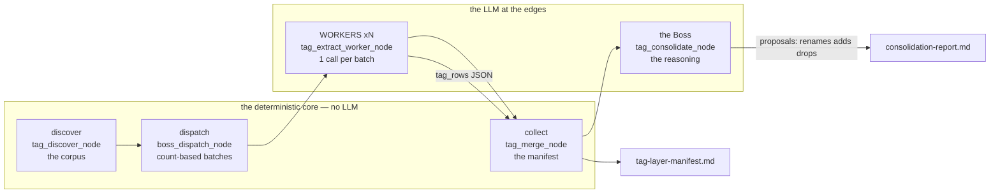

# The Boss-Batching Pipeline (Trickle Mode + the Boss)

> The deterministic batching pipeline that finally made the deep-agent
> sweep deliver. The LLM lives at the EDGES (the workers + the boss);
> the orchestration is pure code. Image: `tag-survey-fanout.svg`.

## The pipeline (the named parts)

## The parts (each swappable)

| part | node | role | the LLM? |
|---|---|---|---|
| **discover** | `tag_discover_node` | the corpus (519 files) | no |
| **dispatch** | `boss_dispatch_node` | the batch plan (44×12) | no |
| **workers ×N** | `tag_extract_worker_node` | one LLM call per batch → rows | yes (Ling / nano-30b / granite4) |
| **collect** | `tag_merge_node` | the manifest + counts | no |
| **the the Boss** | `tag_consolidate_node` | the proposals (renames/adds/drops) | yes (stealth/ox-alpha) |

## The knobs (template config)

| knob | meaning | probe value |
|---|---|---|
| `batch_size` | files per batch | 3 |
| `max_batches` | the smoke gate (limited run) | 2 |
| `max_workers` | concurrency (local GPU: 1-2) | 1 |
| `batch_delay_seconds` + `trickle` | the adaptive pause (halve until booted, restore) | 5 → 2.5 |
| `worker_model` | the extraction brain | `nvidia/nemotron-3-nano-30b-a3b:free` |

## Trickle Mode

The trickle profile (formerly 'probe mode') = batch_size 3 + max_batches 2 + max_workers 1 +
the trickle pause. It tells us in ~40s whether a model/route works
RIGHT NOW — without committing to a full run. The free routes are
availability lotteries; the trickle makes probing safe.

## The dry run (the current state)

Workers extract → collect → **the Ox boss proposes** → the report
(`out/consolidation-report.md`). NO wiki writes — the apply step
(the wet run) is the deliberate next, with review.
