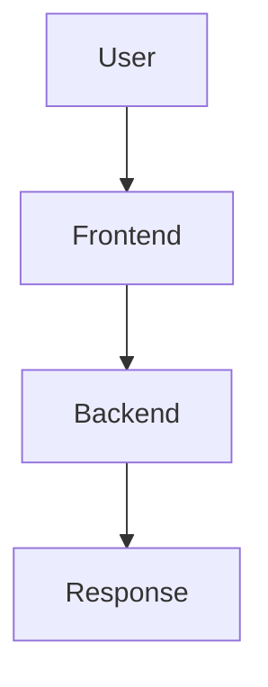
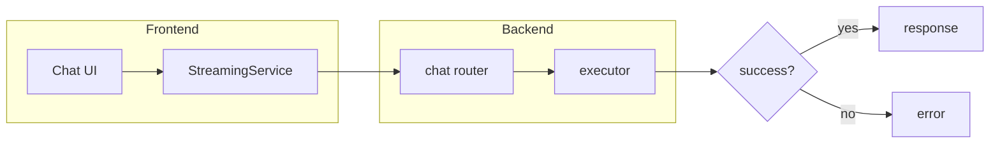
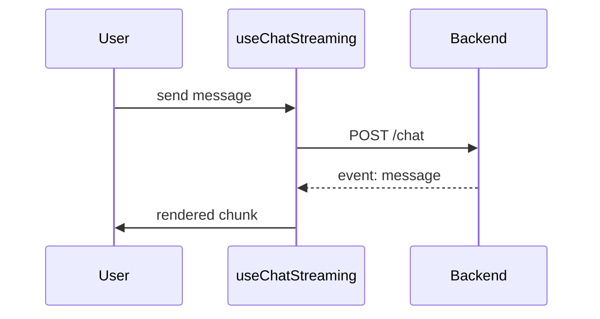
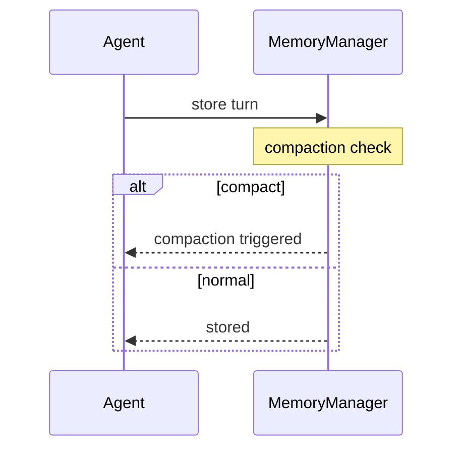
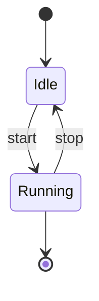
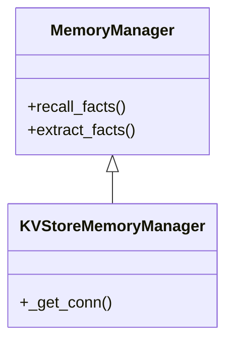

# Diagrams — Numbered Test Blocks

> Report issues by diagram number: "Diagram 2 shows raw code",
> "Diagram 4 is empty".

## Mermaid Flowcharts

**Diagram 1 — simple flowchart (TD).** Should render as a rendered
flowchart, NOT raw code.

**Diagram 2 — flowchart with branches + subgraph.**

## Sequence Diagrams

**Diagram 3 — sequence diagram.** Participants + message arrows.

**Diagram 4 — sequence with notes + alt block.**

## Other Mermaid Types

**Diagram 5 — state diagram.**

**Diagram 6 — class diagram.**

## HTML / SVG Candidates

> **Decision:** SVG used **sparingly, for special
> diagrams only**. Inline raw HTML/SVG (below) renders as escaped
> text — react-markdown sanitizes it. Standalone `.svg`/`.html`
> files DO render (the wiki API serves them natively). But both
> options are **theme-fixed**: the app has 10 daisyUI themes
> (light/dark/night/dracula/...), mermaid is hardcoded dark, and a
> baked SVG stays dark forever. → Prefer mermaid for everyday
> diagrams (can be made theme-aware); reserve hand-crafted SVG for
> the few hero diagrams where the fixed look is intentional.

**Diagram 7 — inline SVG (expected: escaped text).** Raw HTML/SVG
inside markdown is sanitized by react-markdown — this renders as
literal text by design. It is here as the *negative control*.

**Diagram 8 — image reference.** An `` reference — the
wiki viewer shows the image element (broken-image state until the
file exists):

**Diagram 9 — standalone SVG file (candidate).** A real `.svg` file
served by the wiki — this is the "sparingly" path for special
diagrams. (File not created yet — placeholder for the decision.)
