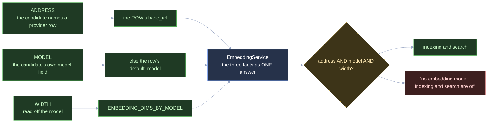
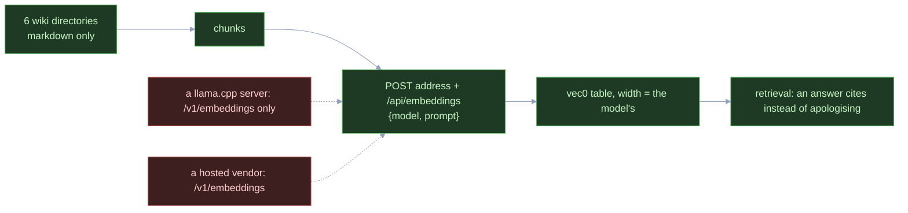
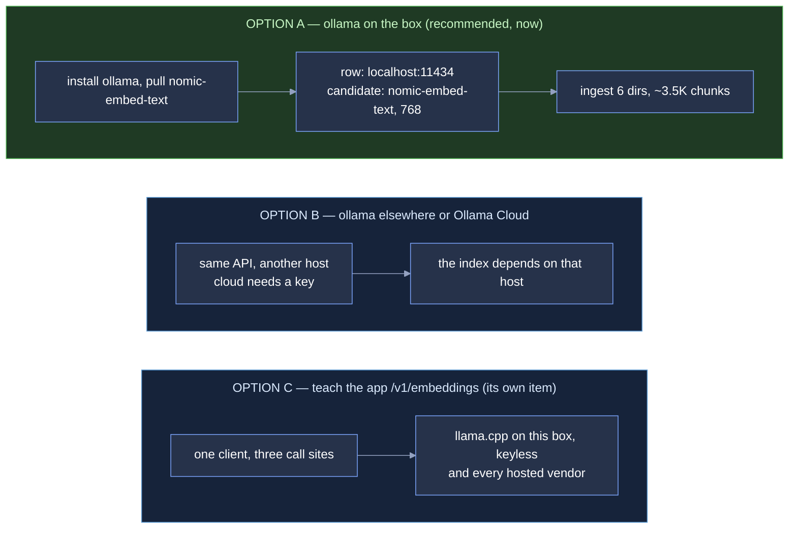

# The embedding model — three facts, one accepted transport, and a choice the install hands to you

**Status**: **OPEN — needs a ruling.** Which model, on which server, decides whether the retrieval leg
works at all; the transport the app accepts narrows the choice more than the provider list suggests, and
that narrowing is what this page prices.
**Found**: 2026-11-26, reading `/rag/status` on a clean install and on a working one, then following every
embedding call site in the tree. Every number below was measured this session.
**Where**: `backend/app/domain/providers/embeddings.py`,
`backend/app/domain/tools/builtin/doc_vector_store.py`,
`backend/app/domain/tools/builtin/code_vector_store.py`,
`backend/app/services/cognitive_pipeline/vector_store.py`, `backend/app/domain/rag/service.py`,
`frontend/src/pages/ProviderCapabilities.tsx`, `frontend/src/pages/RagIndex.tsx`.

## The short version

An embedding call needs **three facts** — an address, a model, and the model's vector width — and this app
resolves them from three different places, so an install that has not been through its own setup reports
`no embedding model: indexing and search are off` and the knowledge surface answers from whatever an agent
can grep. **The choice is real but narrower than it looks**: the app speaks **Ollama's HTTP API**, at two
paths, in three call sites, and speaks nothing else — so a llama.cpp server or a hosted vendor is not
"configure it and go", it is a small client this app does not have yet. For an install that wants its index
today, that leaves **an Ollama-shaped server**, and `nomic-embed-text` (768) is the documented offer.

## The evidence

| # | quantity | value | measured from |
|---|---|---|---|
| 1 | a clean install's index | **0 documents, 0 chunks, 0 bytes**, `index_width: null`, `embedding_model: null` | `GET /api/v1/rag/status` on the test VM |
| 2 | a working install's index | **506 documents, 3,527 chunks, 55,508,992 bytes**, `index_width: 768`, last indexed 2026-08-19 | the same call on the development box |
| 3 | that working install's capability today | `embedding_model: null` — the index outlives the configuration that built it | same call |
| 4 | widths the app knows | **10 models** — 5 Ollama families, 5 hosted | `EMBEDDING_DIMS_BY_MODEL`, `embeddings.py:58-70` |
| 5 | Ollama-API embedding call sites | **3**, at two paths | `doc_vector_store.py:477`, `code_vector_store.py:770` (`/api/embeddings`), `cognitive_pipeline/vector_store.py:171` (`/api/embed`) |
| 6 | OpenAI-API embedding call sites | **0** | `grep -rln "v1/embeddings" backend/app` → nothing |
| 7 | what a current llama.cpp server offers | `/embedding`, `/embeddings`, `/v1/embeddings` — **no `/api/embed` and no `/api/embeddings`** | `llama-server` build 10735, `tools/server/server.cpp:265-267` |
| 8 | the `embeddings` capability row | exists, `enabled`, **zero candidates** | `capabilities` id 9, `capability_services` empty |
| 9 | ingestion surface | **6 wiki directories**, markdown only | `INGESTION_DIRS`, `rag/service.py:59-70` |

**The sentence an unconfigured install says**, once, in code (`embeddings.py:74`):

> `no embedding model: indexing and search are off`

Its longer form — `report()` — names which of the three facts is missing and where to set it: **Providers →
Capabilities** (`/providers/capabilities`).

## Where the three facts live, and why the width matters most

**Figure key** — red: the defect · green: a home the app honours or the recommendation · amber: the decision point.

**Fig. 1 — the three facts and their three homes.** Amber: the one question that decides it · red: the answer
when any fact is absent · green: the homes the app honours, and the resolved state.

The width is the sharp one. A model **not** in that ten-entry table is **reported, not guessed** — the app
refuses to assume 768 because that is what the last literal said, which is how an index gets built at the
wrong width and retrieval degrades silently instead of failing. So *"can I use my favourite embedding model?"*
has a second half: **its width has to be in the table**, and adding it is adding one line (`embeddings.py:56`
says so in the file).

And the index keeps the width it was **born** with — `init_db` declares the vec table `IF NOT EXISTS` — so
so changing to a model of another width is not a settings change: it is a re-ingest, and the app says exactly
that: *"the index is N wide and 'model' is M — re-run the ingest to rebuild the index"*
(`doc_vector_store.py:446` declares the vec table `IF NOT EXISTS`).

## What the index is, and the transport the app accepts

**Fig. 2 — the ingest, and the two servers it cannot dial.** Red: transports this app has no client for.

Both non-Ollama transports arrive at the same missing thing: **one client that POSTs `/v1/embeddings`**.
The dimensions of the hosted models are already written down (`text-embedding-3-small` is 1536, `embed-english-v3.0`
is 1024), so the *definition* half of those options exists and only the call is absent — which is worth
knowing before choosing, because it is the difference between "this box cannot do it" and "this app has not
been taught to".

## The options

**Fig. 3 — the options, grouped vertically with the recommendation marked.**

| | A — ollama here | B — ollama elsewhere | C — the /v1 client |
|---|---|---|---|
| what it needs | ollama + a 274 MB model | a reachable server; a key for the cloud | one client, tested at three call sites |
| keyless | yes | cloud: no | yes, for the llama.cpp half |
| cost | one runtime on the box under test | the index depends on another host or a network | a small piece of work, and its own review |
| unblocks today | **yes** | yes, if the host answers | no — it is the change, not the answer |
| agrees with earlier rulings | yes — the capability names a ROW + a model | yes | yes — it *removes* a limitation, it does not move a value |

**Recommendation: A now, C as its own item.** Ollama on the box is the documented offer — `nomic-embed-text`
weighs **274 MB** on disk — it is keyless, and
it is the exact path a fresh install meets — so landing it does double duty: the index gets built and the
surface a user is asked to walk gets walked. C is real work and it is worth doing, but it is not the thing
standing between this install and a judged answer; scheduling it as the answer to today's problem would be
solving the general case on the customer's time.

**Not recommended:** pointing the `ollama` row at a llama.cpp server. It resolves — address, model and width
all present — and then the call returns 404, because the route does not exist. That failure would look like
a broken install rather than a missing client, which is the worst kind.

## What option A measured, on the box it was taken on

*(recorded after the ruling, 2026-11-26 — the ruling stands; this is what it costs here.)*

- **ollama installs and the row is created in one call.** A fresh install has **zero** provider rows: the
  endpoint that creates the default `ollama` row exists (`POST /providers/initialize-default`, id 1,
  `http://localhost:11434`) and **nothing calls it** — the UI's own Setup → Local LLM tab is instructions
  only, and the Add Provider dialog's type list has no `ollama` entry. Called by hand, the Capabilities page
  then shows every other capability resolving to that row and Embeddings still saying *no embedding model*,
  which is the ruling working as designed.
- **The ingest blocks the whole API while it runs.** `RagIngestService.run` is a coroutine, but
  `DocVectorStore.index_document` makes a **synchronous** `httpx` POST per chunk
  (`doc_vector_store.py:475`), so the event loop is held for the duration of every file: measured
  `/api/v1/health` at `000` (timeout) and the UI's own 2.5-second status poll unable to answer.
- **On a pre-AVX CPU the model is ~16 s per 1,500-character chunk.** The box is a **Xeon X5670**
  (`avx`/`avx2`: **0** flags): one chunk measured **16.99 s**, then **15.96 s**. 623 files were discovered
  for ~3,500 chunks, so the full corpus is a **15-hour** job — on a box whose app is frozen for its duration.
- **`all-minilm` is not the cheap way out.** It is in the width table (384) and pulls in 49 MB, but its
  **256-token context** refuses the app's 1,500-character chunk outright:
  `HTTP 500 {"error":"the input length exceeds the context length"}`.
- **Incremental resume works.** The job was stopped after 5 files; a `restart` left **5 documents /
  28 chunks / 3,215,360 bytes** in the index, and the next incremental run skips them.

## What to do, on an install that has nothing

1. Serve an Ollama API on the box — `ollama pull nomic-embed-text` after installing it.
2. **Providers → Capabilities → Embeddings** (`/providers/capabilities`): the card shows the chain and what
   resolved; name the `ollama` row and the model. Saving resets the two RAG stores, so the next use picks
   up the new answer.
3. **RAG Index** (`/rag-index`): choose *incremental* on a first run, then watch the counters — discovered,
   processed, failed.
4. `GET /api/v1/rag/status` should now name the model and the width, and the ingest's own run is the proof.

## What is already settled (do not re-litigate)

- **The capability ships EMPTY.** The seed writes structure and never a value: a migration cannot be
  declined, so a model name is a setup offer the user accepts, declines or replaces (the 2026-10-10
  three-way split by kind). Measured today: the `embeddings` row exists and has **zero candidates**.
- **Report, never guess.** A model whose width the app does not know is an unresolved answer with a reason,
  never a default of 768.
- **One answer, three facts.** Address, model and width are resolved in one place
  (`resolve_embedding_service`); the stores receive the answer and do not carry copies.
- **Deliberately out of scope:** making a model the default for an install — that is the optional setup
  step's job.

## Where the work would live if C is taken up

A `.env`-free, testable client beside `resolve_embedding_service`, chosen by the provider row's type, with
the three call sites (`doc_vector_store.py:477`, `code_vector_store.py:770`,
`cognitive_pipeline/vector_store.py:171`) reading it instead of building their own URL. The tests belong
beside the existing embedding-store tests; the `EMBEDDING_DIMS_BY_MODEL` table already holds the widths it
would need.
