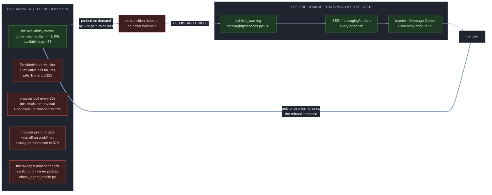
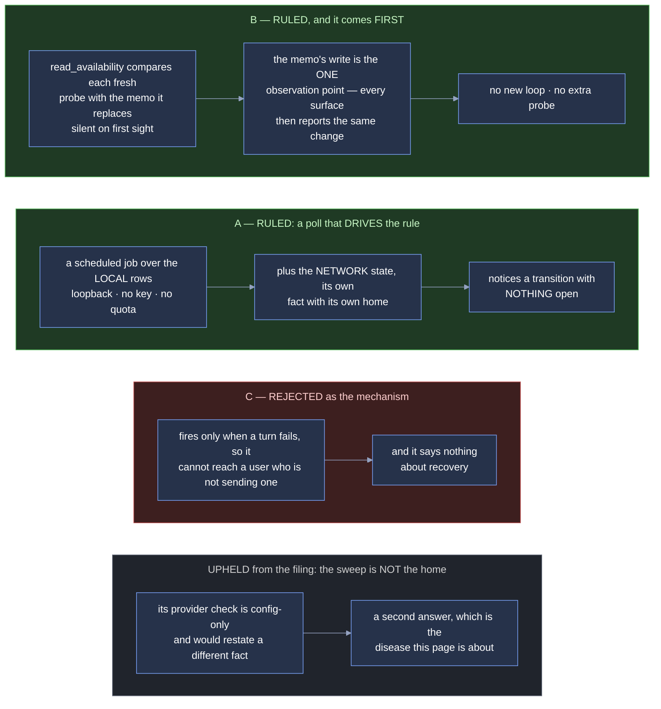
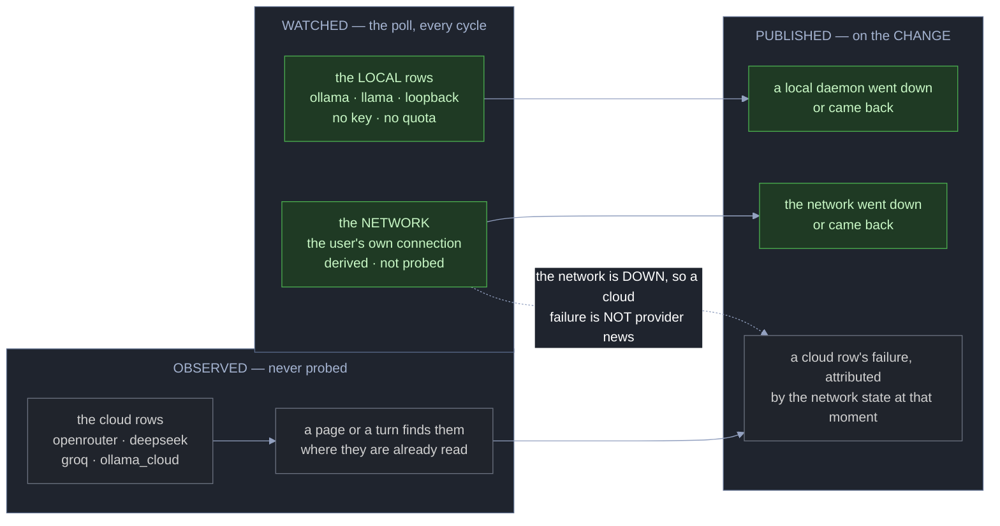
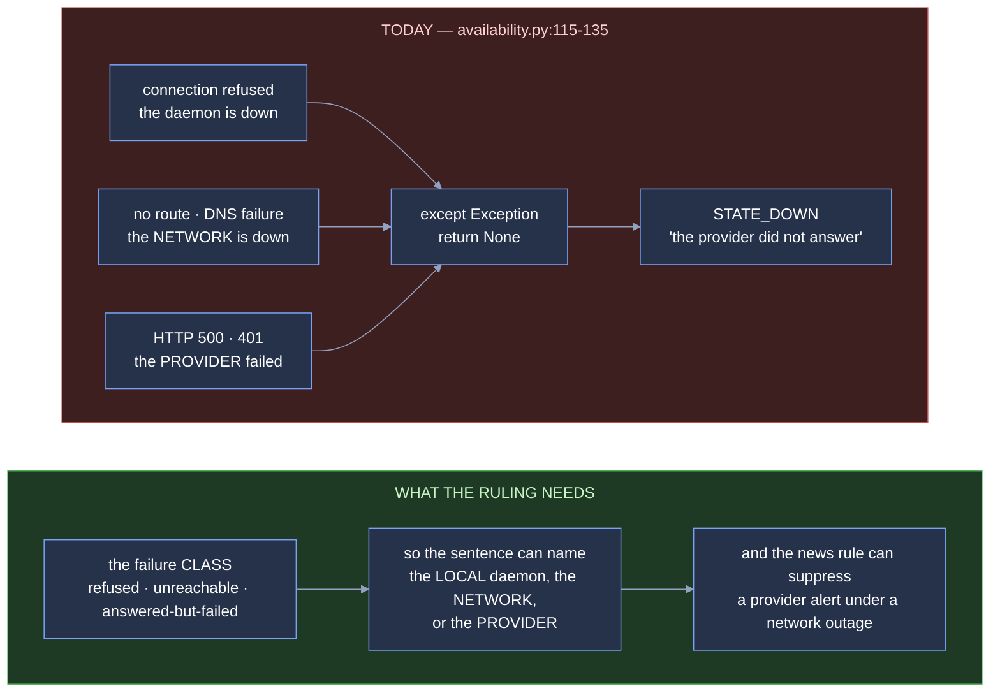
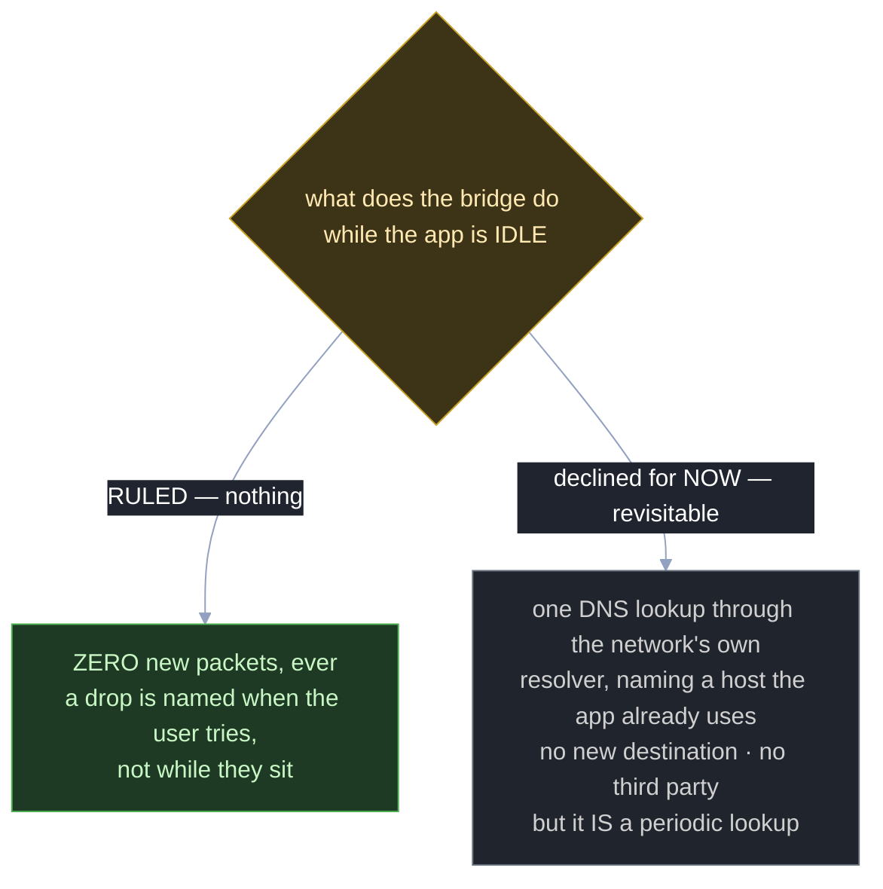

# "Is this provider up?" — five answers, one channel, and no bridge

**Status**: **LANDED — all four seams, no decision left open.** The bridge watches the **local
rows** and the **network**, never probes a cloud provider *(the user, 2026-10-14)*; it adds **zero network
access of its own**, deriving the network verdict from the failure class of calls the app already makes;
and while the app is **idle it sends nothing that leaves the machine**. The four seams have **LANDED**: the
app can name which end a failure came from (`b25b3f17`), holds a derived verdict on the connection
(`f459cedf`), announces a state **change** rather than an observation — from the memo's write, from
a real call, and from the connection itself (`099eea87`) — and watches this machine's own services on a
timer while nobody is looking (`9ee70c74`).
**Found**: 2026-10-14, opening the arc the roll ruled (THE AVAILABILITY BRIDGE); ruled the same day.
Every line number below was re-measured today, not carried over — including two the filing itself had
wrong.
**Where**: `backend/app/domain/providers/{availability,refusal,rate_limiter,completion_service}.py`,
`backend/app/domain/messaging/services.py`, `backend/app/api/v1/{chat,providers,agents}/`,
`frontend/src/{providers/CognitiveHubProvider.tsx,hooks/useAgentInteraction.ts,hooks/useNotifyBridge.ts,services/messagingFeed.ts}`,
`scripts/core/{sweep/backend.py,check_agent_health.py}`.

---

## The short version

The app already answers *"can this provider answer right now?"*, and it answers it in **five unconnected
places**: the probe memo the app's own surfaces agree on (`availability.py`), a cumulative failure-count
monitor nothing in the running app feeds (`rate_limiter.ProviderHealthMonitor`), a 30-second browser poll
of that monitor which mis-reads its payload (`CognitiveHubProvider.tsx`), a browser pre-turn gate that
keys off the resulting `undefined` and therefore can never fire (`useAgentInteraction.ts`), and the
sweep's provider check, which is **config-only** — a configured row that cannot answer reads green
(`check_agent_health.py`). The channel that reaches the user is real and already used:
`publish_warning` → `publish("notify:<kind>")` → SSE → every open tab — but **no site publishes a
provider's STATE**; all seven existing calls are about a turn, run or title that has *already* failed.
Measured live today: `ollama` has **no listener on 11434** while its row is active, and the memo expires
after `DEFAULT_TTL_SECONDS = 60.0`. So the app's knowledge lives 60 seconds past the last page visit, and
a user sitting in a session is told nothing until their own turn breaks.

**The ruled scope, and the seam it exposed.** The bridge will watch the two things it can observe cheaply
and honestly — the **local** daemons (a loopback probe) and the **network** (the user's own connection) —
and it will **never probe a cloud provider**, so no provider is pestered with connectivity tests and no
quota is spent on them: a cloud failure is observed where it happens, at a page or a turn. That framing
rests on an attribution the app cannot currently make: `probe_json` returns `None` for *every* failure
class, so a dead router and a provider outage produce the identical sentence *"the provider did not
answer"*. **The failure class therefore lands before the poll.**

## The evidence

| # | site | what it is | who reaches it |
|---|---|---|---|
| 1 | `backend/app/domain/providers/availability.py:466` `cached()` · `:480` `cached_by_name()` | the memo's only read; `DEFAULT_TTL_SECONDS = 60.0` (`:83`), written at `:565`. Cache-only by ruling — a turn never pays a probe (`refusal.py:25-29`) | `refusal.py:101` (the pre-turn refusal), `refusal.py:249` → `agents/router.py:192,374,581` (the agent "cannot run now" badge) |
| 2 | `availability.py:592` `read_availability_for()` | THE one probe pass (local rows always join; cloud rows join by name) | 5 callers, every one a page or an endpoint a page calls: `refusal.py:249`, `providers/capabilities_router.py:271`, `providers/config_router.py:314`, `providers/router.py:249`, `providers/management_router.py:427` |
| 3 | `backend/app/domain/messaging/services.py:181` `publish_warning(title, message, kind="provider-fallback")` → `:187` `publish(f"notify:{kind}")` | the push surface | 7 app call sites, and only **2** carry the provider fact: `providers/completion_service.py:224`, `services/cognitive_pipeline/executor.py:213`. The rest are `turn-soft-limit` (`chat/router.py:458`), `tool-path-fallback` (`:2128`), `title-failure` (`title/services.py:445`), `workflow-failure` / `workflow-degraded` (`workflow_router.py:598,617`) |
| 4 | `backend/app/domain/providers/rate_limiter.py:325` `ProviderHealthMonitor`, singleton at `:440` | a **second** answer: cumulative call outcomes, a failure threshold and an "unhealthy" set | fed ONLY by `providers/completion_router.py:158,160`, i.e. by `POST /api/v1/providers/complete` — which **nothing in the app calls** (measured: no caller in `backend/app`, only the generated frontend types name the route). Read by `GET /providers/health` (`:174-198`) |
| 5 | `frontend/src/providers/CognitiveHubProvider.tsx:230-258` | polls #4 every 30s and casts `{providers:{…},timestamp}` into `Record<string, ProviderHealthStatus>`; on any error it **fabricates** `{ollama:'up', openai:'up', anthropic:'up'}` (`:242-246`) | nothing reads the map correctly; the vocabulary also disagrees (`stores/types.ts:21` says `'up'|'degraded'|'down'` where the backend sends `healthy`/`failure_count`/`unhealthy`) |
| 6 | `frontend/src/hooks/useAgentInteraction.ts:579-582` | the browser's own pre-turn refusal: `providerHealth[activeProvider] === 'down'` throws | the send path. Since #5 never writes a key at that level, the lookup is always `undefined` — **the gate cannot fire**, and if it did it would refuse on a different fact than the backend does |
| 7 | `scripts/core/check_agent_health.py` (via `scripts/core/sweep/backend.py:545`) | the sweep's provider check: 251 lines of `sqlite3` over `providers` / `provider_model_cache` / `curated_models` / `usage_logs` — **no `httpx`, no `urllib`, no probe** | the sweep. A configured row that cannot answer reports green |
| 8 | `frontend/src/hooks/useNotifyBridge.ts:56` + `services/messagingFeed.ts` | the `notify:*` subscriber → toaster + Message Center, app-wide | any `notify:provider-*` event already renders. Its seen-check keys on **`event_id`** (`:96-110`), so the SAME content at a NEW event toasts again — the reason "publish on every observation" is not an option |
| 9 | `frontend/src/services/messagingFeed.ts:47-55` | the visibility gate: a hidden tab **releases** the feed and reopens it (with the ring replay) when visible | the tab the user is not looking at records the event in the Message Center and toasts when it returns |
| 10 | `availability.py:115-135` `probe_json()` | **the flattening**: `raise_for_status()` at `:130`, then `except Exception` at `:133` — *"any probe failure = the service did not answer"* — returns `None`, which the cloud probe turns into `STATE_DOWN`, *"the provider did not answer"* (`:401`) | every availability read. The identical sentence for a dead router, a dead daemon, a timeout and a provider's HTTP 500 |
| 11 | the class, inspected everywhere EXCEPT #10: `deepseek_client.py:123`, `groq_client.py:75`, `providers/services.py:253`, `ollama_browser.py:293`, `openrouter_client.py:80,182` — all `except httpx.ConnectError`; and `chat/services.py:1053`, which catches it and returns a **mock response** | the vocabulary the one home lacks | the per-provider clients, and a legacy chat path that swallows the failure silently |

**How far the claims actually travel** — checked, because a constant with a caller that overrides it
would be harmless:

- **The memo is warmed only on demand.** All five callers of #2 are pages or endpoints a page calls, and
  `refusal.py:249` reaches #2 through `chat_readiness()`, which the *agent* pages call
  (`agents/router.py:192`). Nothing scheduled calls it — the only two jobs the app schedules are the
  post-startup system sweep (`main.py:425`) and the DB-loaded workflow triggers, and **all five trigger
  rows are `is_active=0`** (measured in `cogitate.db`, including `monitor-rss-hourly` and
  `monitor-market-5min`).
- **The scheduled machinery to reuse already exists.** `workflows/triggers/scheduler.py` is APScheduler
  with `schedule_once()` (`:150`) and `add_job()` (`:192`); the monitors are the workflow `monitor` kind.
  So "a poll" needs no new infrastructure — which is exactly why its *off by default* precedent matters
  (the RSS monitor sat dormant and silent for weeks).
- **A network check would be the app's FIRST — measured, not assumed.** The POST health suite's
  connectivity tier is config-only (its own docstring, `run_post.py:368`: *"Does NOT make an actual LLM
  call"*), the sweep's check (#7) is sqlite-only, and a precise grep across `backend/app` for
  `getaddrinfo` / `create_connection` / `generate_204` / a raw-resolver address returns only false
  friends (an audio file named `gentle-ping.wav`, an LLM message whose content is `"ping"`, a websocket
  keep-alive). Nothing to reuse, and nothing that can drift — but nothing that exists, either.
- **The measured instance is live today.** `ollama` (row id 1, `is_active=1`, `http://localhost:11434`)
  has **0 listeners** on its port, and no capability chain names it (`chat` and `title` are
  `deepseek → llama`). A configured-and-down provider that the app knows about and says nothing about.
  The box's six provider rows are two **local** (`ollama`, `llama` at `127.0.0.1:8080`) and four
  **cloud** (`openrouter`, `deepseek`, `groq`, `ollama_cloud`) — so the ruled scope is a loopback probe
  over two rows plus a network verdict derived from traffic the app already sends, and **zero** requests
  against the four cloud rows.

## The issue, drawn

**Figure key** — red: the defect · green: a home the app honours or the recommendation · amber: the decision point.

**Fig. 1 — the app's knowledge, the app's channel, and the one dotted line that is missing.** Red: the
defect — a monitor nothing feeds, a poll that mis-reads it, a gate that cannot fire, a sweep check that
never probes, and the absent transition. Green: the memo the app's own surfaces agree on and the channel
that already works. The dotted edge is the whole issue: both ends exist, nothing joins them.

## The options, and what the ruling left standing

Option **C** — extend the two existing fallback call sites' sentence — was the tempting minimum, and it
is **rejected**: it fires per turn, so it cannot reach a user who is not sending one, which is the entire
complaint, and it says nothing about recovery. Options **A** (a poll) and **B** (the transition rule at
the memo's write, `availability.py:565`) were recommended **together and staged, B first** — the ruling
keeps both and settles what the poll watches.

**Fig. 2 — the options as the ruling left them.** Green: the two halves that were kept, B first. Red: the
option that lost, and why — its trigger is a turn, and the complaint is a user who is not sending one.
Grey: the filing's own instinct that the sweep should host this, upheld against — a config-only check
would be a sixth answer.

| | A — a poll | B — the rule at the observation point | C — extend the failure path |
|---|---|---|---|
| removes | the "nobody is looking" gap | the transition and the news threshold, from every surface at once | one log line at two sites |
| where it breaks down | **a poll without a rule is a toast every cycle** — the toaster re-toasts the same content at a new `event_id` | fires only for a user already on a page or sending a turn — the very case that is *not* the complaint | repeats per turn, and a provider that comes back says nothing |
| which fact it publishes | whatever the pass reports | the memo — the one the refusal and the badges already agree on | a failure, not a state |
| agrees with earlier rulings | yes (reuses the scheduler and the monitor kind) | yes (cache-only for a turn stays untouched) | partly — it is the wording half only |
| cost | a scheduled job + a loopback probe per local row + one connectivity check | ~one comparison per probe, at the memo's write (`availability.py:565`) | two sentences |

**Ruling (the user, 2026-10-14):** *"We can watch the local rows and the network connection. We are
looking at a few different failure possibilities. If the network is down (failure on the user's end) we
can alert the user. If the network is up and we get a cloud failure, it is likely that comes from a
provider related issue (failure on their end.) We want to avoid pestering the providers with unwanted
connectivity tests."*

## The ruled scope

**Fig. 3 — what the bridge watches, observes, and publishes.** Green: what is watched (two local rows and
the network — the only things observable cheaply and honestly). Grey: the cloud rows, which keep being
observed where they are already read, so no provider is ever pestered. The dotted edge is the news rule:
a cloud failure *while the network is down* is attributed to the network and does **not** publish a
provider incident.

**Why this is the honest shape.** The rule is the user's: an alert is useful when it says *which end* the
failure is on. Probing four cloud rows would spend a keyed request per row per cycle to learn something
the app cannot act on until a turn needs it — and it would answer with the same sentence it answers today.
Two loopback probes cost nothing, and the network verdict rides on packets the app is sending anyway —
together they name the two failures the user actually experiences (a local model that died, a connection
that dropped) and leave the provider-side failures to the moment they matter.

**The news rule, sharpened by the ruling.** A transition is news; a re-observation is not (the toaster
re-toasts identical content at a new `event_id`). And attribution outranks the transition: a cloud row
reading `down` **while the network is down** is the network, not the provider — the network's own
transition is the news, and the cloud row's state is unjudged until it is observed again. Otherwise a cut
cable publishes "deepseek is down" and sends the reader to the wrong end.

## The seam the ruling exposed: the app cannot say WHICH end failed

**Fig. 4 — three failures, one `None`, one sentence.** Red: today's probe collapses a dead daemon, a dead
network and a provider's HTTP error into the same `None`, so the app answers *"the provider did not
answer"* for all three — the identical string the user's ruling exists to separate. Green: the class the
ruling needs, which the tree already knows how to read (`httpx.ConnectError` is caught in five provider
clients, `deepseek_client.py:123` among them) but never in the one home the app's answer comes from.

**This is the arc's FIRST seam, and it comes before the poll.** A bridge built on top of `probe_json`
would publish *"the provider did not answer"* for a dead router — the alert would be correct that
something is wrong and wrong about which end, which is worse than silence because it sends the reader to
the wrong place. The class is a small, testable change (`httpx.ConnectError` / `ConnectTimeout` vs a
response that arrived with a bad status vs a DNS/route failure) and it is what makes the ruled
attribution — *user's end* vs *their end* — actually expressible.

## What "the network" is measured against

**The constraint that outranks the technique (the user, 2026-10-14):** *"The application may run on
someones network having unexplained network accesses could cause concern."* So the question is not only
which check is most accurate — it is which one adds the least that an operator on someone else's network
would have to explain.

**The footprint as it stands (measured 2026-10-14).** The app has exactly one periodic external call of
its own; everything else follows a user action:

| what | destination | when |
|---|---|---|
| model-catalog sync | the `openrouter` row | weekly — `provider_sync_schedules`: 168h, `sync_enabled=1`, next 2026-10-15 |
| the availability pass | a keyed `GET /v1/models` at **every cloud row a chain names** | on **every** capabilities / agent-profiles page load, memoized 60s (`availability.py:390-394`, `:558-563`) |
| inference (`litellm`) | the configured provider | on a turn |
| the `/providers/health` poll | **localhost only** — the app's own API | every 30s (`CognitiveHubProvider.tsx:254`) |

The uncomfortable half of that table: **today's page visits already probe the cloud rows.** A capabilities
page load fires a keyed request at deepseek, openrouter, groq and ollama_cloud. So the ruling's *"avoid
pestering the providers"* also rules out **adding a second, periodic layer** to a footprint that is
already broader than it should be. The bridge adds nothing to this table.

**The page-load row is now retired, which is the ruling applied to itself.** A cloud row is probed only on
purpose — `force` (the providers page's Test and Refresh) or `verify_key` — and every other read answers from
the memo and reports `unknown` when it is cold: *"not checked — a page read does not call a cloud provider;
press Test to check it now"*, with an empty `checked_at`. Local rows still probe (they are this machine, and
the idle poll below keeps their memo warm), and a keyless cloud row still reads `unconfigured`, because that
is a configuration fact that costs no packet. The footprint is then the one this table wanted: the weekly
catalogue sync, a turn, and the loopback poll.

**Ranked by what an operator would have to explain:**

| rank | the check | what a network admin sees |
|---|---|---|
| 1 | **derived, not probed** — the verdict comes from the failure class of calls the app already makes, corroborated across independent destinations | nothing new. Every packet already had an explanation |
| 2 | a DNS resolution through the **system resolver**, naming a host the app is already configured to use | a name lookup to the network's OWN resolver — indistinguishable from the app's ordinary lookups, no new destination |
| 3 | a raw TCP connect to a well-known address | a new destination on a fixed cadence; some networks black-hole it, and it bypasses the configured resolver |
| 4 | a bare HTTP 204 from a neutral third party | a periodic, unauthenticated request to a third party with nothing to do with the app — on egress monitoring, the fixed-interval beaconing signature |

**The first draft's recommendation is withdrawn.** A neutral-host 204 is the *best* answer to the
captive-portal question and the *worst* answer to this one; it was recommended before this constraint was
known. Two requirements conflict and the constraint wins — a check that has to be explained to a network
admin costs more than the misattribution it prevents.

**What replaces it: the verdict is DERIVED, and corroborated.**

- The **failure class** (the arc's first seam, below) already separates *no route / no DNS* from *the
  daemon refused* from *the provider answered with an error* — on packets the app was sending anyway.
- **Corroboration** removes the captive-portal blind spot with no new traffic: one provider failing while
  another provider and a tool fetch both succeed is that provider's end; the same class of failure across
  two independent destinations inside one window is the network's. Stronger than a single canary, and it
  costs zero packets.
- The verdict is **remembered with a timestamp**, and an ambiguous class (a bare timeout) leaves it
  `unknown` rather than guessing — the discipline the availability states already use.

**The honest cost:** a verdict derived from real traffic is only as fresh as the last real call. An idle
app will not notice a drop until the next call — which is also the moment the drop starts to matter.

The one thing left to settle is therefore not the technique but its **coverage**:

**Fig. 5 — idle coverage, ruled.** Amber: the question, now answered. Green: what was ruled — the bridge
sends nothing and refreshes its verdict on the app's next real call. Grey: the option declined **for
now**, left standing because the ruling names it as revisitable (*"we can change it later or make it
configurable"*), with the reason it lost: it is a periodic lookup, and this arc is about the app, not the
network.

**The principle behind it (the user, 2026-10-14):** *"for now we want to concentrate on our application
not diagnose the network. We notify when WE have a problem. We don't go looking for them."* That is a
constraint on the whole arc, not only on this decision: **every fact the bridge publishes must come from
work the app was already doing.** No canary, no health sweep of the world, no diagnostic subsystem — the
app reports its own problems, from its own operations.

## What is already settled (do not re-litigate)

- **The user's ruling, 2026-10-14:** watch the **local rows and the network connection**; network down =
  *"failure on the user's end"*, network up + a cloud failure = *"likely … a provider related issue"*; and
  *"avoid pestering the providers with unwanted connectivity tests"*. Cloud rows are therefore observed,
  never probed.
- **The user's ruling, 2026-10-14 (idle coverage):** *"Zero packets, always. The verdict refreshes on the
  next real call. A drop is named when you try something, not while you sit there."* The network verdict is
  **derived from real calls only** — no probe, no canary, no periodic diagnostic. **And the principle it
  rests on, which governs the whole arc:** *"we want to concentrate on our application not diagnose the
  network. We notify when WE have a problem. We don't go looking for them."* A future session may make this
  configurable; for now it is not configurable, it is absent.
- **The user's ruling, 2026-09-30** (quoted in `refusal.py:6-8`): *"when llama.cpp is up we can use it,
  when it is down the agent is either disabled or uses a fallback … I should get a signal that lois is not
  available and chat should be refused with a message about llm not available."* The **refusal** half
  landed (`refusal.py`, `chat/router.py:1663`). The **signal** half is this page.
- **The user's ruling, 2026-09-01** (quoted at `messaging/services.py:182-186`): *"silent fallbacks are
  bad"* — the fallback toasts landed. This page is the same ruling one degree earlier: the fallback speaks
  when a turn degrades, the bridge speaks when a service (or the connection) goes.
- **The refusal reads the CACHE only, deliberately** (`refusal.py:25-29`): a turn never pays a probe, and
  an `unknown` state never refuses. Do not "fix" this by making the refusal probe.
- **One home per fact.** `availability.py` is the app's agreed answer to "is this provider up?" — the
  capability page, the provider card and the agent badge all read it through `read_availability_for`, and
  the file's own docstring says a second surface must not re-implement the question. The bridge publishes
  *that* answer, or it invents a sixth.
- **The environment-not-the-daemon precedent already exists** (`down-by-occupancy`, `availability.py:73`):
  a silent local daemon is classified by its surroundings rather than called unreachable. Network-down is
  the same shape of fact and belongs beside it — not in a parallel store.
- **Everything must be visible, never hover-hidden**, and the app's error copy names the failing
  provider **and** model, offers no model recommendation, and notes there is no fallback — the warning's
  sentence follows the same contract.
- **Deliberately out of scope (filed, not taken):** the fate of `ProviderHealthMonitor`, the 30-second
  browser poll and its dead gate (evidence rows 4-6), and `chat/services.py:1053`, which swallows a
  `ConnectError` into a mock response. That is a *second* mechanism — a second fact with a second
  vocabulary, in a second process — and it needs its own item rather than being tidied inside this ruling.

## Where the work would live if this is taken up

the queue item *"A SERVICE THAT IS DOWN ALERTS NOBODY"*, which already frames the same four
questions this page answers. **Two corrections to that item as it stands:** it cites
`services/cognitive_pipeline/availability.py`, and the module has lived at
`app/domain/providers/availability.py` throughout; and its *"where it lives"* half is now **settled by
the ruling** — the home is the availability module (the class, the network fact, the transition rule)
plus the message bus; the sweep is explicitly not it, because its provider check is config-only and would
be a sixth answer.

**The order the seams land in:**

1. ~~**The failure class** in `availability.py`~~ — **LANDED** (`b25b3f17`): the probe returns a
   payload plus the class it failed with, the classifier reads the cause rather than the wrapper,
   the cloud sentence names the end, and `Availability.failure` carries it. The API maps fields
   explicitly, so the wire is unchanged until a surface asks.
2. ~~**The network fact**~~ — **LANDED** (`f459cedf`): `record_observation` / `network_verdict` beside
   `down-by-occupancy`, fed from inside `probe_json` (the one place every probe's outcome passes), so
   the verdict costs no new traffic. **The rule is asymmetric**: an ANSWERED call — any status, or a
   refusal — proves the path works on its own, while blaming the connection takes **two distinct
   destinations** silent the same way; twice at one destination is still one destination, and
   anything less stays `unknown`. A stale success cannot mask a live outage and vice versa: only
   observations since the last answer may accuse.
3. ~~**The transition rule**~~ — **LANDED** (`099eea87`): `_announce` is the ONE rule, and the memo's
   write, a real call (`note_call_outcome`, fed from the chat funnel `acompletion_with_retry`) and the
   connection verdict are its three producers. It speaks on the **change**, never on a re-observation
   (the toaster re-toasts the same content at a new `event_id`), and its store is **what the user has
   been told** — deliberately not the memo, which is a TTL'd probe result a turn may not pay for. Two
   readings of *"silent on first sight"* went to the user and one was **ruled**: **the first sight of a
   problem speaks** — the strict reading would have suppressed the first connection-down alert and then
   announced the recovery of an outage nobody had been told about. The news rule is ordered, not merely
   stated: a probe records its observation *before* the memo write announces the provider fact, so a
   six-row page load with no network publishes exactly one toast — the connection's — and accuses no
   provider. Two defects in already-landed work were found and fixed inside the seam (the call
   classifier trusting the wrapper's type where a dead port arrives as a status-bearing
   `InternalServerError`; and loopback counting as evidence about the wire). Known gap, stated in the
   code: a **streamed** call returns its iterator before its chunks, so only a stream that fails to
   **open** is observed here.
4. ~~**The poll**~~ — **LANDED** (`9ee70c74`): `poll_local_rows` on a minute tick
   (`workflows/triggers/scheduler.py`'s `add_maintenance_job`, beside retention and the catalog sync,
   plus a one-shot 10s after boot so the first look is not up to a minute late). It ships **enabled and
   gated by nothing** — a bridge that ships switched off is the defect this page exists to close — and
   the thing that makes that safe is its **scope**, ruled here: **the rows whose address is this
   machine**. `pollable_rows` takes the intersection (LOCAL-class **and** loopback), which is
   deliberately narrower than the news rule's `is_local`: the class seam counts *"any LAN daemon"* as
   local, and a LAN daemon is **never dialled on a timer** — it stays observed by the traffic the user
   already causes, and the app puts no packet of its own on somebody's network. The pass goes through
   **the same read a page makes**, so the memo it warms is the memo the pre-turn refusal reads — which
   is the second-order win: the refusal reads the memo *only*, so before this the cold cache refused
   nothing. The tick and the cache agree rather than argue: the read's own 60s TTL decides whether a
   tick pays a probe.

Tests live in `backend/tests/unit/providers/test_availability.py`,
`backend/tests/unit/providers/test_local_occupancy.py`, `backend/tests/unit/test_turn_refusal.py`,
`backend/tests/unit/test_call_outcome_producer.py`, `backend/tests/unit/test_stream_failover.py` and
`backend/tests/unit/providers/test_availability_poll.py` (the poll's own file carries its three control
runs: the loopback condition, the class condition, and the memo).
