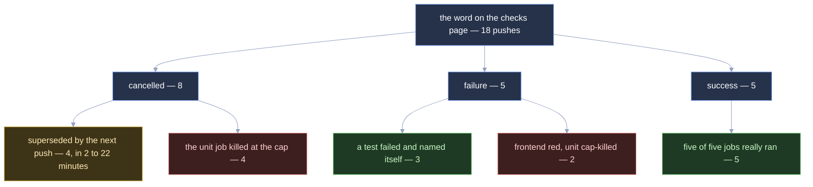
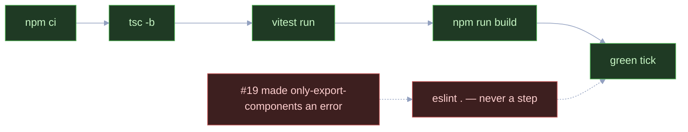
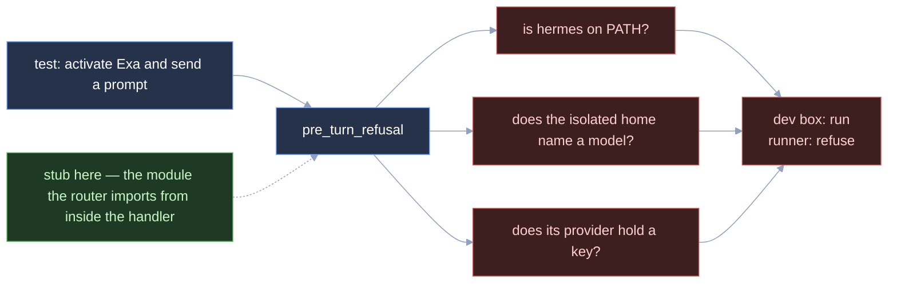
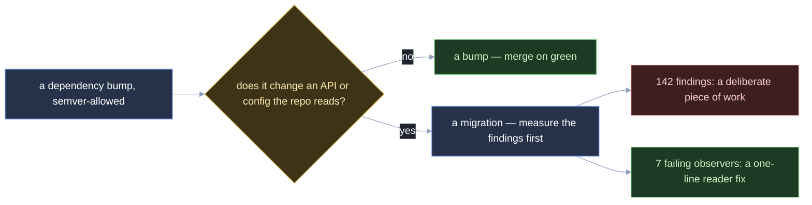

# Seven ways the CI gate lied — the green tick, the cancelled check, and the test that measured the developer

**Status**: **CLOSED — five of the seven are landed; two are measured and banked** (the linter is still not a
CI step, and the runner still prints no failure name on stdout). CI on `main` is green three runs running
(`f387d62`, `c833154`, `4b4ea32`).
**Span**: 2026-11-21 → 2026-11-26 — **18 pushes to `main`**, 5 success, 5 failure, 8 cancelled.
**Where**: `.github/workflows/ci.yml`, `scripts/testing/run_tests.py`,
`backend/app/domain/external_agent/activation.py`, `backend/tests/workflows/`, `frontend/src/`.

This is an **Issue Resolution Report (IRR)**, not an IRW page: an IRW page is one mechanism and one ruling,
while this is the report over a *family* of failures that were met in one stretch of work and share a single
subject — **none of the seven words the gate printed meant what it looked like it meant**. Each is named for
search, and each carries its own measurement and its own fix. The same evidence discipline applies: every
number below was measured in this window, from the runs, their artifacts and this tree.

## The short version

In six days the gate returned **5 green, 5 red and 8 cancelled**, and **not one of those words was a verdict
about the code**. A green tick could mean the linter never ran (it is not a step) or that a Dependabot
workflow finished. A red could mean a promise to a *machine* — `hermes` on `PATH`, a model in a home, a key
for a provider — that a developer's box keeps and a runner does not. **Cancelled** covered three different
events (a superseded push, a job killed at its own 30-minute cap, a test that stalled inside it), and the
word a run reported depended on whether *another* job happened to fail on the same push. The fix for the
largest of them was not speed or retries: it was **making a stalled test fail by name**, which turned two
days of "cancelled" into one filename in six minutes.

## The evidence

| # | quantity | value | measured from |
|---|---|---|---|
| 1 | pushes to `main` in the window | 18 — 5 success, 5 failure, 8 cancelled | Actions API, `branch=main`, `event=push` |
| 2 | pushes whose `backend · unit` job was killed at the job cap | **6** (5 at ~30.3 min, 1 at **138.4 min** before the cap existed) | per-job `started_at`/`completed_at` |
| 3 | the same job outcome reported under two run conclusions | `cancelled` 4 times, `failure` 2 times | run 45212290724 vs 45629509938 |
| 4 | superseded pushes mislabelled `cancelled` | 4 — 2.4, 7.5, 10.4 and 22.4 minutes | run list |
| 5 | tests the stalled unit group never reported | **49 of 2120**, the suite stopping at 95 % | the cancelled run's own artifact |
| 6 | `frontend` steps in `ci.yml` | `tsc -b` (`:82`), `vitest` (`:86`), `build` (`:90`) — **no eslint** | the workflow file |
| 7 | lint on the merged tree today | **0 errors, 3 warnings** | `npm run lint` |
| 8 | lint with `eslint-plugin-react-hooks` 7's config fixed | **142 errors instead of 1** *(recorded on #16)* | the #16 PR comment |
| 9 | `app.routes` readers that break on fastapi 0.165 | **8 sites, all in `backend/tests`; 0 in `backend/app`** | `grep -rn "app\.routes"` |
| 10 | #24's `backend · workflows` failure | **7 failed, 353 passed, 3 skipped in 13.1 s** | the run's `report.md` artifact |

## The seven, drawn

**Figure key** — red: the defect · green: a verdict you can act on · amber: a decision point.

```mermaid
%%{init: {"theme":"base","flowchart":{"subGraphTitleMargin":{"top":12,"bottom":12}},"themeVariables":{"background":"#111726","primaryColor":"#26324a","primaryTextColor":"#ffffff","primaryBorderColor":"#7aa2f7","lineColor":"#93a1c0","textColor":"#e8ecf4","mainBkg":"#26324a","nodeBorder":"#7aa2f7","clusterBkg":"#1f242e","clusterBorder":"#5a6a8a","edgeLabelBackground":"#1f242e","labelBackground":"#1f242e","labelTextColor":"#e8ecf4","actorBkg":"#26324a","actorBorder":"#7aa2f7","actorTextColor":"#ffffff","actorLineColor":"#93a1c0","signalColor":"#c8d3e8","signalTextColor":"#e8ecf4","noteBkgColor":"#3d3418","noteTextColor":"#ffe9b3","noteBorderColor":"#c9a227","sequenceNumberColor":"#e8ecf4","altBackground":"#232936","loopTextColor":"#e8ecf4"}}}%%
flowchart LR
  D1["21 Nov<br/>CI red since the four-group split"] --> D2["23 Nov<br/>one unit job runs 138 minutes"]
  D2 --> D3["23 Nov<br/>the cap: 30 minutes"]
  D3 --> D4["25 Nov<br/>the per-test cap names a file"]
  D4 --> D5["25 Nov<br/>the machine-dependent refusal is stubbed"]
  D5 --> D6["26 Nov<br/>three green runs"]
  classDef bad fill:#3d1f1f,stroke:#c05050,color:#ffd0d0
  classDef choice fill:#3d3418,stroke:#c9a227,color:#ffe9b3
  classDef good fill:#1f3a24,stroke:#4caf50,color:#c8f7c5
  class D1,D2 bad
  class D3,D4 choice
  class D5,D6 good
```



**Fig. 1 — the arc, as the gate recorded it.** Red: no verdict at all, twice for two different reasons ·
amber: the two caps, each of which converted "no answer" into "an answer in minutes" · green: the state that
held.

The first two boxes are the same failure with a nine-hour gap: before `71f4bea` the unit job had no ceiling
and ran **138.4 minutes**; after it, the ceiling was 30 minutes, which is a bound and not an answer — the run
still said only `cancelled`.



**Fig. 2 — one word, five meanings.** Red: the word hides a cause the reader cannot recover · amber: benign,
but indistinguishable from the red cases in the icon column · green: the two verdicts that are about the
code.

Two things are worth reading off **Fig. 2**. The **same job outcome — `backend · unit` concluded
`cancelled` — reached the checks page as `cancelled` four times and as `failure` twice**, because on those
two pushes (`4795ec4`, `783fc08`) the *frontend* job failed for an unrelated reason and the run takes its
word from that. And a superseded push and a 30-minute stall both wear `cancelled`; the only thing that tells
them apart is the duration, which the page does not show.

## 1. Green tick, dead check — the linter is not a CI step

**What the gate said:** a green tick on the frontend job.
**What was true:** `frontend` runs `npx tsc -b`, `npx vitest run` and `npm run build` (`ci.yml:82`, `:86`,
`:90`) and **never `npm run lint`**. Nothing in CI could have noticed a linter that stopped working.

That is not hypothetical: `#19` (`eslint-plugin-react-refresh` 0.4 → 0.5, merged as `27e34cd`) turned
`only-export-components` into an **error**, and `TrashShelfTable.tsx` exported both a component and
`shelfShape`. Every check stayed green on the merged tree while `npm run lint` failed. The regression was
found only by hand-checking `#16`, and fixed in `c833154` — the measurement moved to
`frontend/src/components/features/trash/shelfShape.ts` (the rule's own structural advice), and
`storybook-static/` was added to the ESLint ignores (`eslint.config.js:19`), because that gitignored build
directory was being linted and contributing **13** phantom `Definition for rule … was not found` errors —
noise that reads as a broken config and hides the one real finding underneath. Today: **0 errors, 3
warnings**.

`#16` itself would have merged the same way with **142 errors** behind a green check.

**Also on this page of lies:** the Actions sidebar lists three workflows together, and only one of them is
CI. **19 of the 40 runs** in the window were Dependabot's own *Dependabot Updates* runs (`event=dynamic`,
~1 minute, green) — a green tick in that list is not a statement about the repository.

**Fix:** none yet. The one-step fix (`npx eslint .` in the frontend job, errors failing and warnings not) is
banked; until it lands, a green frontend check says nothing about lint.



**Fig. 3 — the frontend job, and the step that is not there.** Red: the check nobody runs, and the change that
would have been caught by it · green: the three steps that really run.

## 2. Cancelled is not failed — the 30-minute shrug

**What the gate said:** `cancelled`, for 30.4 minutes, on four consecutive pushes; then `failure` twice.
**What was true:** a test hung, the job's ceiling killed it, and **nothing named it**. The word `cancelled`
cannot distinguish "a newer push superseded this run" from "a test is stuck" — and 8 runs wore it, of which
only 4 were supersessions.

The cost was compounding: main was unverified for five days, all five Dependabot PRs sat
`mergeable=True, unstable`, and every dependency update queued behind a word that named no subject. The
cancelled run's own artifact shows why nobody could name it — the suite reached **91 % with 1,954 passing
events and no failure of any kind**; the 49 tests that never reported are simply absent.

**Fix, in two steps** — a ceiling is not an answer, so the second step is the real one:

1. `71f4bea` — `timeout-minutes: 30` on the backend job (`ci.yml:28`). Measured effect:
   `21dfb39` ran **138.4 minutes**; the next push, three minutes after the commit, was killed at **30.3**.
2. `47a6c59` — a **per-test cap** (`--timeout=120`, `COGITATE_TEST_TIMEOUT` to tune,
   `scripts/testing/run_tests.py:539`). The first run with it turned two days of "cancelled" into a filename
   in six minutes: `test_external_agent_tool_cap.py`, both tests, red.

The comment that records the reasoning is in the runner beside the constant
(`run_tests.py:530-539`): a stall becomes `FAILED <nodeid> -- timed out after Ns`, which is an answer.

## 3. The log says nothing, the artifact says why

**What the gate said:** a red job whose entire log is two lines —
`[run_tests] group=workflows parallel=True files=31` then `[run_tests] done in 25.2s — EXIT 1`.
**What was true:** seven tests failed; their names, tracebacks and summary are written to `report.md` inside
the uploaded artifact and printed nowhere the log can see (`run_tests.py:599` prints only the duration and
the exit code).

So every red run costs one extra step, and the step has a trap in it: the artifact download is a **302 to a
signed blob URL that rejects the `Authorization` header**. Follow the redirect *without* it.

```bash
TOKEN=$(cat ~/.config/cogitate/gh_token)
# 1. find the artifact
curl -s -H "Authorization: Bearer $TOKEN" \
  "https://api.github.com/repos/<owner>/<repo>/actions/runs/<run-id>/artifacts" | jq '.artifacts[].name'
# 2. download it, following the 302 WITHOUT the header
curl -sL -o run.zip \
  -H "Authorization: Bearer $TOKEN" \
  "https://api.github.com/repos/<owner>/<repo>/actions/artifacts/<artifact-id>/zip"
```

The upload is `if: always()` (`ci.yml:56`), which is what makes the artifact the *only* evidence a cancelled
job leaves behind — a killed job still uploads its truncated run.

**Fix:** none yet. The one-line version — echo the `-rf` lines from `report.md` to stdout — is banked with the
lint step. Until then, the artifact is the evidence and the log is a pointer to it.

## 4. It passes on my machine — tests that read the developer's box

**What the gate said:** two tests failed on every runner since the four-group split.
**What was true:** the router asks `pre_turn_refusal` whether a turn can run, and that is **three reads of
the machine the test happens to be standing on** (`backend/app/domain/external_agent/activation.py:483-520`):
`hermes` on `PATH`, a model in the isolated home, a credential for that model's provider. All three are true
on the development box and false on a runner — so the test measured the developer.

There is a second layer worth keeping: the runner produced `connecting, ready, error`, **not silence**. The
one diagnostic that broke the case open (`5a7b4b2`) prints the frame's `message`, and it named an
**exception**. A silent socket is a different bug from a socket that answers with an error.

**Fix:** stub the refusal at **the seam the code actually calls** (`f94516f`). The first attempt stubbed
`probe_runnable` on the router and did nothing, because the router imports `pre_turn_refusal` *inside* the
handler; the stub belongs on the activation module. Verified under the runner's own condition —
`PATH=/usr/bin:/bin`, no Exa home — both tests green in 19.7 s. This was the third instance of the class
(`test_exa_activation` in `591ebb0`, the ACP fakes' ordering in `4c9f7e8`), which is why it is a rule and not
an incident: **a test that passes only where a developer's tools are installed measures the developer.**



**Fig. 4 — three reads of the developer's machine behind one test.** Red: the reads, and the verdict they
produce on a runner · green: the seam where the fake belongs, since the fake client *is* the agent.

## 5. The flake that was a bug — a millisecond timestamp is not an order

**What the gate said:** `promptHistoryStore.test.ts:141`, `expected true to be false`, intermittently, on
frontend jobs.
**What was true:** a real defect that two sessions had blamed on a stale base and on a katex/mermaid bump.
`createdAt` is **milliseconds**; a burst of sends lands several inside one, every tie compared equal, and the
cap's `reduce` kept `next[0]` — the entry just added — so it discarded a brand-new prompt while an ancient
one survived.

**Fix:** `bf793e2` — the entry records its insertion order and the comparison uses it, pinned under **frozen
time** so the tie is deterministic and the test fails on the old code every run.

**Rule:** any cap, sort or "oldest" comparison over `Date.now()` needs an insertion counter, or it picks an
arbitrary row exactly when the machine is fast. And the mirror image of §4: **a test that fails on a fast
machine is not automatically the environment** — here the environment was the one thing that was fine.

## 6. A bump that is a migration — two config APIs, one lesson

**What the gate said:** `#16` green-ish, `#24` red in 40 seconds.
**What was true:** both bumped a dependency whose *API the repository reads*, and in both cases the cost of
the bump is a migration, not a version string.

| bump | what changed | measured cost |
|---|---|---|
| `eslint-plugin-react-hooks` 5 → 7 (`#16`) | flat config moved to `configs.flat['recommended-latest']`; the old path returns an eslintrc shape and the config dies | **142 errors instead of 1**, dominated by `react-hooks/set-state-in-effect` on `useEffect(() => { load() }, [load])` |
| `fastapi` 0.136 → 0.165 (`#24`) | `app.routes` now yields `_IncludedRouter` objects | `AttributeError: '_IncludedRouter' object has no attribute 'path'` — **7 failed, 353 passed** in 13.1 s |

The fastapi one is the sharper warning, and the **8 sites are all in `backend/tests` (`0` in
`backend/app`)** — the app works and its *observers* break. A bump can leave a green product and a red gate,
or (worse, and this is `#16`) the reverse.

**Rule:** measure the findings a bump produces before merging it. `142` and `7` are decisions; a version
string is not. `#16` is parked as a migration; `#24` is split — the safe members go separately and fastapi
gets its own item.



**Fig. 5 — the one question a dependency update has to answer.** Amber: the question · green: a merge that
follows green, and a migration whose cost is one reader · red: a migration large enough that merging it as a
dependency update would be a decision taken by accident.

## 7. The rebase nobody answers — Dependabot and lockfile conflicts

**What the gate said:** `#18` and `#20` `dirty`, checks unable to run.
**What was true:** `@dependabot rebase` was commented on `#20` twice and ignored both times — the branch is
not rebased and the checks cannot pass. The branch has to be brought to `main` by hand, and when two
dependency PRs touch `package-lock.json` the conflict is a lockfile: **regenerating it is the fix, hand-editing
it is not.**

The sequence that worked, twice:

1. `git fetch origin pull/<n>/head:<branch>`, merge `origin/main` into it.
2. Resolve the lock conflict by **regenerating from the merged `package.json`** —
   `npm install --package-lock-only` — never by merging lock JSON.
3. Verify locally before pushing: `tsc -b`, the full vitest suite, and a real `npm run build` (the mermaid 12
   bump was proven that way, 1 m 15 s).
4. Push back to the `dependabot/...` branch with `--force-with-lease`; the checks then run and go green.

**Also measured, and it costs a silent hour:** `uv sync --frozen` alone **drops the backend package's dev
group** (mypy, vulture, black), so the local hooks lose their tools and *skip instead of failing*. Use
`uv sync --frozen --all-packages --all-groups`.

## What this report does not fix

- **The linter is still not a CI step** (§1) — banked, one line in the frontend job.
- **The runner still prints no failure names to stdout** (§3) — banked beside it.
- **`#16` is a migration, parked with its measurement on the PR** — not to be merged as a dependency update.
- **`#24` is a batch**: the safe Python members land separately; `fastapi` 0.136 → 0.165 is its own item,
  because its seven failing observers are a fix and its version string is not the work.

## Rules to carry

- **A check that does not run the tool says nothing about the tool.** Prefer a gate that fails to a tick that
  cannot.
- **A ceiling is not an answer.** A timeout turns "forever" into "thirty minutes"; only a per-test cap turns it
  into a name.
- **A test that depends on the machine measures the machine.** Stub at the seam the code calls, and prove it
  under the runner's own conditions.
- **An intermittent failure is a hypothesis, not a verdict.** One of these was the environment; one was a
  millisecond timestamp. Both looked identical from the outside.
- **A bump that changes a config or API is a migration.** Measure its findings before merging; the number is
  the decision.
- **A dependency branch is a branch.** Rebase it by hand, regenerate lockfiles, verify, then push with a lease.
