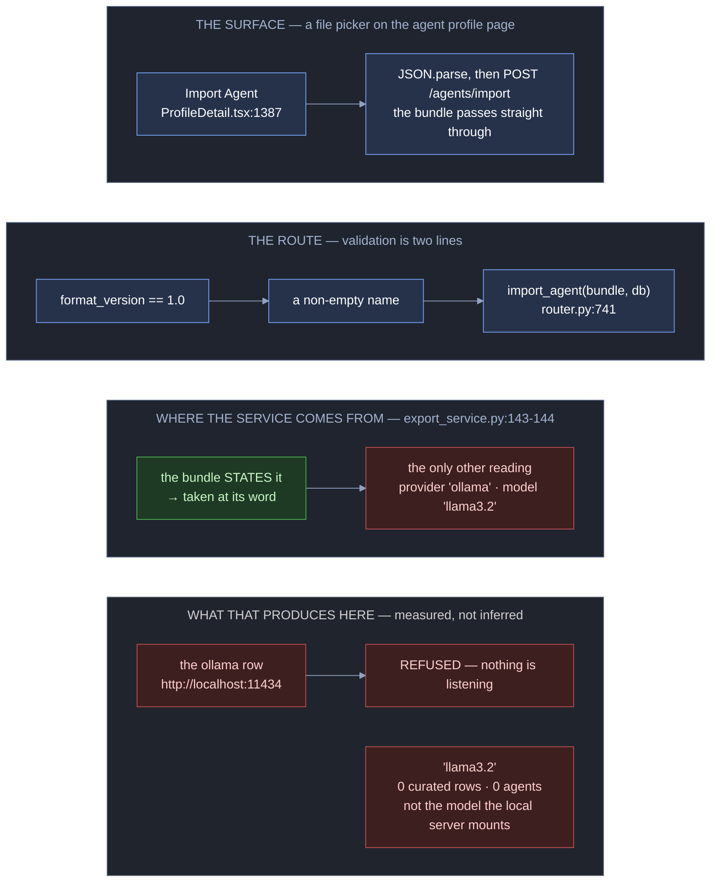
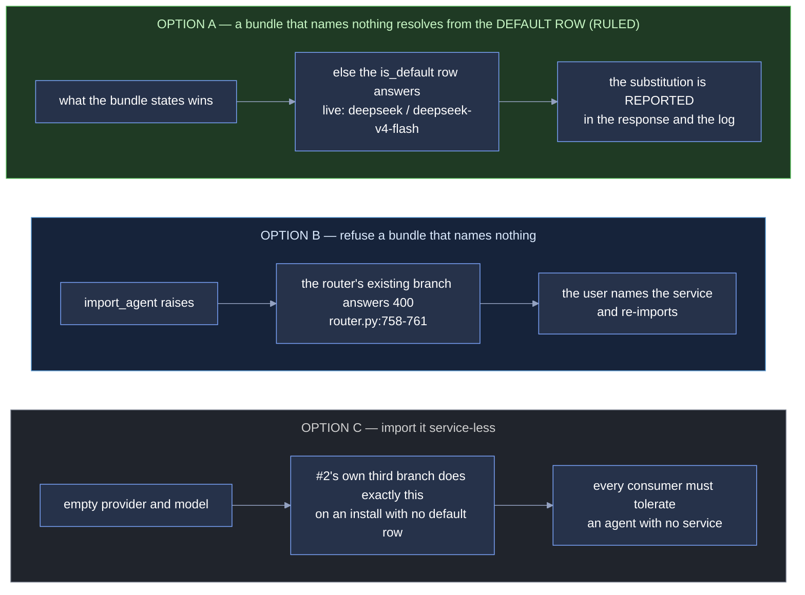
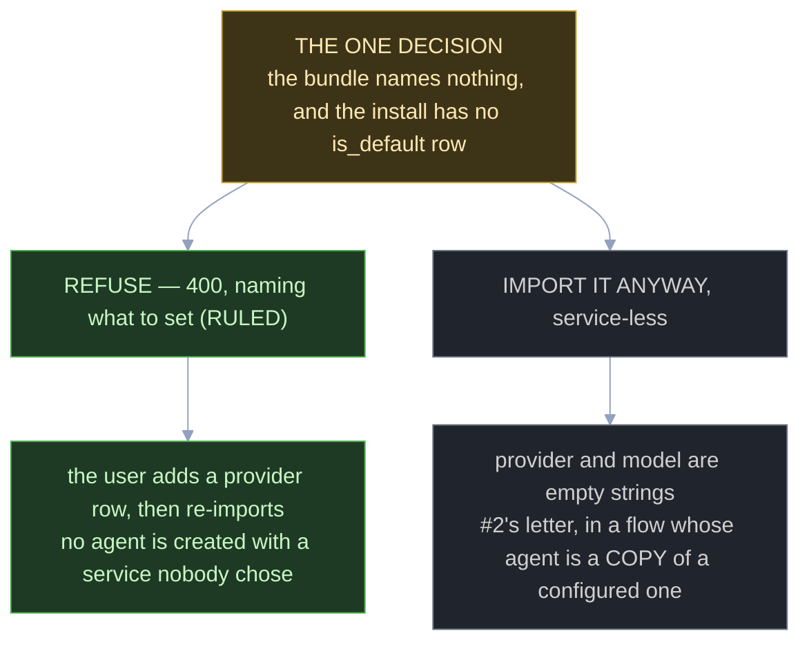

# The agent import — a bundled config that names no service gets one written in code

**Status**: **RULED — option A; LANDED (`d019ba0e`).** The user: *"Let's go with A as recommended — the
import always yields a working agent; the only refusal is for an install that has no default row to answer
with."* A silent bundle's service now resolves from the `is_default` provider row — `#2`'s rule, in one place
(`resolve_imported_service`) — the substitution is **reported** in the response and the log, and the refusal
that stands is the one case where resolving is impossible: an install with no default row, which refuses
before anything is written. Both doors to a service-less agent are closed (the missing key and the empty
string). The rejected options stand below with the reason they lost.
**Found**: 2026-10-11, taking the service-literals arc's last worklist item (`#13`). The worklist — every
entry landed, measured or filed — is archived at
`local/roadmaps/archive/embedded-service-literals/cleanse.md`. Every `file:line` below was re-measured then, not
carried over; the socket probes and every database count are live.
**Where**: `backend/app/domain/agents/export_service.py` · `backend/app/api/v1/agents/{router,provisioning_router}.py` ·
`backend/app/infrastructure/database/models.py` · `frontend/src/components/AgentProfiles/ProfileDetail.tsx` ·
the live `cogitate.db`.

---

## The short version

An agent import builds its row from whatever a JSON bundle says, and where the bundle says nothing **the
code decides for the user**: `provider` falls back to `ollama` and `model` to `llama3.2`
(`export_service.py:143-144`). Two literals, one line apart, on a path a user walks by picking a `.json`
file — the same class as `#2` (a new agent's default) and `#10` (the fresh-install seed), both already
ruled, and the last one of the three that still names a service in code. The fallback fires **only when a
bundle omits the key**: an export always carries both halves (they are read off the row), so the round trip
never reaches it, and what does reach it is a hand-written, trimmed or foreign bundle. What it produces
here is an agent aimed at a service that is **not running** — the `ollama` row is `http://localhost:11434`,
dialled and refused — carrying a model id that exists nowhere on this install: `llama3.2`.

## The evidence

| # | site | what it is | who reaches it |
|---|---|---|---|
| 1 | `domain/agents/export_service.py:143-144` | `provider=agent_config.get("provider", "ollama")`, `model=agent_config.get("model", "llama3.2")` — the fallback pair | the import route, and nothing else: no other caller of `import_agent` exists outside one test |
| 2 | `api/v1/agents/router.py:734-757` | `POST /agents/import` — the body is `bundle: dict`, with no request schema; validation is `format_version == "1.0"` and a non-empty name | the frontend's Import Agent button, or the API directly |
| 3 | `frontend/src/components/AgentProfiles/ProfileDetail.tsx:1387-1424` | the file picker: `JSON.parse(await file.text())` → `POST /api/v1/agents/import` — the file passes straight through, unexamined | the user, from an agent profile page |
| 4 | `domain/agents/export_service.py:59-75` | `export_agent` — the bundle's `agent_config` is read FROM THE ROW, so an export always carries both keys | the export route; this is why the round trip never meets the literal |
| 5 | `infrastructure/database/models.py:50-51` | `Agent.provider` (`String(50)`) and `Agent.model` (`String(100)`) — both `nullable=False` | every consumer of the agent row |
| 6 | `api/v1/agents/provisioning_router.py:79-104` | `_resolve_service` — the rule `#2` was ruled with: what the caller stated wins, else the `is_default` row, else name nothing | the provision route, this one's sibling |
| 7 | the live `cogitate.db` | default row **`deepseek` / `deepseek-v4-flash`**; the `ollama` row at `http://localhost:11434`; **0 of 2** agents carry the fallback pair; **0** curated models belong to the `ollama` provider | — |
| 8 | the live socket | `localhost:11434` → **connection refused** (curl exit 7); the local server is llama.cpp at `127.0.0.1:8080/v1`, serving exactly one model (`Bonsai-27B-Q1_0.gguf`) | the client an imported agent is handed |

**How far the fallback actually travels** — followed, not assumed:

- **Only a MISSING key reaches it.** `.get("provider", "ollama")` reads its default when the key is absent;
  a bundle that states `"provider": ""` puts the empty string into the row instead, and a
  `nullable=False` string column accepts it. So there are **two** ways to arrive at an agent with no real
  service, and retiring the literal closes only one of them — which is what the residual question below is
  about.
- **The round trip is safe.** `export_agent` builds `agent_config` from the row, so every exported bundle
  names both halves, and `tests/unit/cognitive_pipeline/test_agent_export.py:155-162` states them too.
  Nothing in the app produces a bundle that omits them; the reachable case is a hand-made or foreign file.
- **The route validates almost nothing.** Two checks stand between an arbitrary JSON body and the row —
  the format version and a non-empty name. The folder copy the import writes beside the row
  (`agents/{name}-imported-{suffix}/agent.json`) comes from the bundle's own `agent_json`, which a
  hand-made file may omit entirely: then the folder says nothing while the row says `ollama`/`llama3.2`.
- **The import does not ask, and does not say.** There is no confirmation step and no report; the picker's
  success toast is `Agent imported successfully`. The service is discovered by opening the imported agent.
- **What the created row means here.** `ollama` resolves to a row whose address refuses connections, and
  `llama3.2` is not the model the running local server mounts, not an agent row, and not in the curated
  list (0 rows for that provider). Nothing is visibly wrong at import time — the defect surfaces the first
  time the agent is asked to answer.

## The issue, drawn

**Figure key** — red: the defect · green: a home the app honours or the recommendation · amber: the decision point.

**Fig. 1 — the bundle's journey, and the one branch that decides a service.** Red: the fallback pair and
everything downstream of it — the address it dials and the refusal, the model id that resolves to nothing ·
green: the branch that honours what the bundle says.

Three of the four clusters are neutral: the surface validates nothing, the route validates two fields, and
neither of them looks at the service at all. The decision is taken inside `import_agent`, from the absence
of a key.

## The options

**Fig. 2 — the three options, grouped vertically with the ruling marked.** Each box reads left to right:
what it does, where the answer comes from, what the user is left holding.

| | A — resolve from the default row | B — refuse | C — import it service-less |
|---|---|---|---|
| literals removed | both (2 of 2) | both (2 of 2) | both (2 of 2) |
| what the user sees | the agent works, and the service it got is named | a 400 saying what to set, then a working import | an agent that cannot answer until its profile is edited |
| where it breaks down | a bundle written for another install adopts THIS install's default service | a legacy or trimmed bundle must be edited before it will import | an empty service is a hole every consumer has to tolerate; the columns are NOT NULL, so it is an empty string, not a null |
| agrees with earlier rulings | `#2` exactly — stated wins, else the `is_default` row | `#10`'s spirit — choosing a service is the user's job, not the code's | `#2`'s third branch, which exists for a PROVISION |
| cost | one resolver call, the report, tests | one raise, tests | measured against every consumer of `Agent.provider` |

**Recommendation: A, with the report — and B for the one case A cannot answer.** The literal has to go, and
the answer to "which service?" is the answer every other service choice in this app already gives: the
`is_default` provider row (`#2`'s rule, `provisioning_router._resolve_service`). What makes A honest rather
than another silent fallback is the arc's own house rule — a configuration gap must not pass for a chosen
address, so it must not pass for a chosen service either: the import **names the substitution** in its
response and its log. The tempting minimum — swap two literals for a row lookup and say nothing — is
exactly the failure this arc exists to remove.

**RULED 2026-10-11 — A, as recommended.** Why the other two lost, for the next reader:

- **B (refuse anything silent)** lost because an export always carries both halves, so nothing the app itself
  produces would ever be refused: the refusal would fall almost entirely on a hand-trimmed or foreign file
  that A turns into a working agent. The refusal B keeps is the one case where resolving is *impossible* —
  and that case is Fig. 3.
- **C (import it service-less)** lost because `#2`'s third branch exists for a **provision**, whose agent goes
  on to get its service from its profile. An import is a copy of an agent that already had one, so an empty
  service there is not a step in a workflow — it is a hole in every consumer's assumptions.

**Fig. 3 — what A cannot answer, and the two ways out.** Amber: the decision · green: the ruling · grey: the
alternative that follows `#2` to the letter, and the holes it leaves.

An import is a **copy of a configured agent**, so a bundle with no service is malformed rather than
under-specified — which is why refusal does not contradict `#2`: a *provision* creates a new agent in a flow
that goes on to set its service, while an import is handed a snapshot of one that already had a service. The
case is unreachable on this install (the default row exists), so the choice costs almost nothing to
make — but it has to be made deliberately, because it is the branch a fresh install would take. **Ruled the
same day: refuse.**

## What is already settled (do not re-litigate)

- **The arc's rule (2026-10-10, the user).** *The app should never write down the name of a model, an
  endpoint or a service*; a **DECISION** — the app choosing which service does the work — is never a
  literal, *not even as a backup*, while a **DEFINITION** (a vendor-specific utility describing its own
  service) is kept as a named constant with a note at the site. This pair is a decision.
- **`#2`'s ruling (2026-10-09).** A new agent's request schema names neither half; the `is_default` row
  answers; a caller that states both is taken at its word. `tests/unit/test_agent_provision_default_service.py`.
- **`#10`'s ruling (2026-10-10).** The fresh-install seed creates its row with **no model** — *"a place to
  choose one, not a model somebody else chose"* — and setting a curated fresh install up is Exa's and the
  user's job (EXA'S INSTALLATION SKILL).
- **`#4`.** The routing schema's fallback default is EMPTY: a config that declares no fallback now says so
  instead of inheriting a service.
- **F3, landed this session (`7e76783f`).** The three discovery-only clients' roots are DEFINITIONS, and
  they now carry the note saying why — deliberately not this item's business.
- **Deliberately out of scope:** `router_node.DEFAULT_ROUTING_TABLE` (`#3` — measured a dead MATCH KEY that
  resolves nothing, filed separately) · the file-clerk family, whose own banked item covers
  `file_clerk_nodes.py:349-359`'s `llama3.2` then "fall back to the DB default" · the `llama3.2` strings in
  schema examples and docstrings, which are prose.

## What shipped (2026-10-11, `d019ba0e`)

`domain/agents/export_service.py` — `resolve_imported_service` (the rule), `stated_service` (silence is
silence: a missing key and `""` read the same), and `import_agent` returning an `ImportedAgent` (id, service,
source) instead of a bare id. The literals are gone from the row construction, and the resolution runs
**before** anything is written, so a refusal leaves no row and no folder.

`api/v1/agents/router.py` — the response carries `service`, `service_source` and a sentence naming the
substitution, and the route's own log line records it. `frontend/src/components/AgentProfiles/ProfileDetail.tsx`
— the Import toast now shows the backend's sentence (and drops a dead `result.id` read: the route has always
sent `agent_id`).

Tests: `tests/unit/test_agent_import_service.py` (7 — a stated service is copied through · silence resolves
from the default row · `""` is silence too · a partial keeps what it states · no default row refuses · the
refusal writes nothing · no literal remains in `import_agent`'s source), plus
`tests/unit/cognitive_pipeline/test_agent_export.py`, updated for the new return shape.

Verified: full fast suite **2462 passed, 4 failed** (`-n 6`, 3:26 — the two pre-existing
`test_langfuse_v4_adapter` failures and the two `test_retention` xdist-order flakes, which pass in isolation:
10 passed); `mypy app` clean (422 files); `tsc -b` clean. Live: a service-less bundle answered 201 naming
`deepseek/deepseek-v4-flash` and the row carried it; a bundle stating `groq`/`llama3-8b-8192` was copied
through untouched — both driven through the real UI file picker, whose toast read the substitution back.

**Found while landing this — and since FIXED (`34bd0500`).** The verification raised a second defect in the
same function: the import wrote the workspace folder but set no `workspace_key`, so re-exporting an imported
agent lost its `agent.json`, skills and memory, and a hard delete left the folder behind. Taken up on the
user's word, and the root cause turned out to be wider than the symptom: the import **hand-rolled what
`domain/agents/workspace` owns**, and both halves were wrong — no key, *and* a folder named verbatim from
the bundle's name (`agents_dir / new_name`, so a bundle naming `../../x` aimed the write outside `agents/`).
Now the key is minted (`make_workspace_key` — slugified, so the folder is folder-safe by construction) and
the folder is produced by `scaffold()`, with the bundle's payload written on top and its manifest patched to
the row's service. Verified live: the row's key names the folder, the manifest carries the row's
`deepseek`/`deepseek-v4-flash`, `GET /export` returns the folder half again, and a hard delete removes the
folder. The class is not closed — `POST /agents/{id}/duplicate` is a second site (measured: a keyless row
with no folder, while `POST /agents` gets both), filed as a follow-up rather than patched here.
