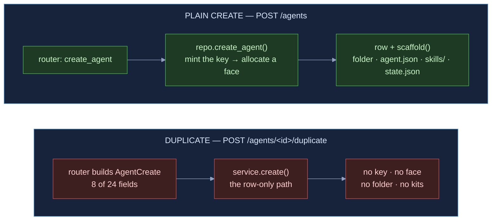
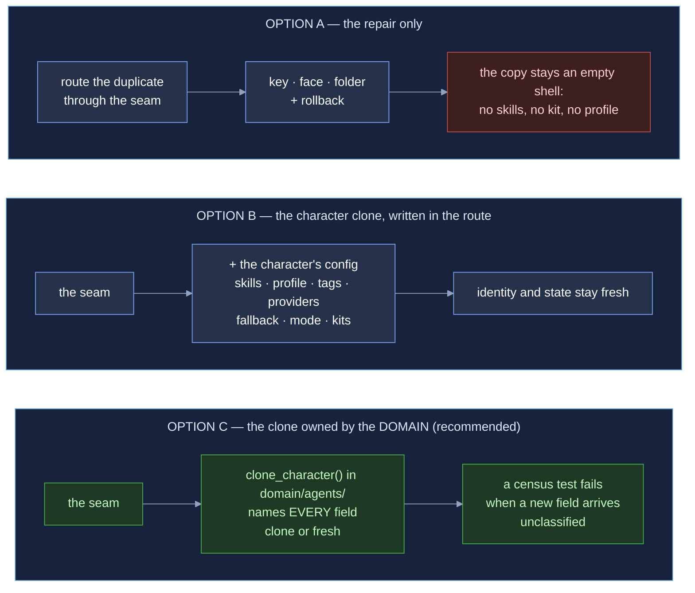
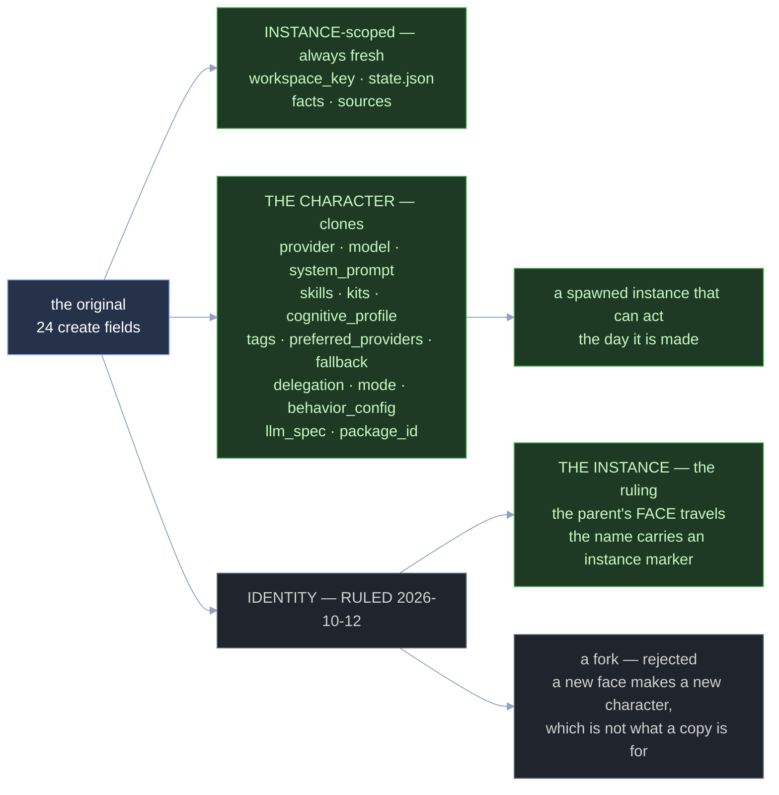

# A duplicated agent is a partial clone — 8 of 24 fields, and no workspace

**Status**: **LANDED — `9fdf1435`** (RULED 2026-10-12: a copy's identity reads as a scoped instance of the
same character). Both stages shipped in one commit: the route goes through the seam, and
`domain/agents/clone.py` owns the field sort with the census test that keeps it honest.
**Found**: 2026-10-11, by the verification of the imported agent's workspace fix — the same class (a row
the rest of the app expects to have a folder). Every line number and every value below was re-measured
**2026-10-12**, not carried over.
**Where**: `backend/app/api/v1/agents/router.py` · `backend/app/domain/agents/{services,repository,workspace,schemas}.py` ·
`backend/app/domain/agent_kits/` · `frontend/src/pages/AgentProfiles.tsx`

---

## The short version

`POST /agents/{id}/duplicate` hand-builds an `AgentCreate` from the original — **8 of the schema's 24
fields** — and calls `AgentService.create()` directly. That service method is the row-only path: it mints
no workspace key and allocates no face. The plain create route does neither of those things: it goes
through `DiskAgentRepository.create_agent()`, which mints a unique key, allocates a face, writes the row,
then calls `scaffold()` — rolling the row back if the folder write fails.

So a duplicate is a row the rest of the app treats as a full agent: no folder, no `persona.md`, no
`state.json`, no skill files, no face, no tool kit — and of the character fields set on the original, the
five that carry behaviour are gone. **A copy of Bob cannot do anything Bob can do.**

## The evidence

| # | site | what it is | who reaches it |
|---|---|---|---|
| 1 | `api/v1/agents/router.py:703-714` | builds `AgentCreate(...)` with 8 fields, calls `service.create(...)` | `POST /agents/{id}/duplicate` ← `AgentProfiles.tsx:223` (Duplicate) |
| 2 | `api/v1/agents/router.py:528-533` | the plain create route → `repo.create_agent(...)` | `POST /agents` |
| 3 | `domain/agents/repository.py:105-162` | the seam: unique key → face → row → `scaffold()` → **rollback** if the folder write fails | the create route |
| 4 | `domain/agents/services.py:945` | the row-only create — no key, no face | `AgentService.create`; the duplicate route is its **only agent caller left** |
| 5 | `domain/agents/workspace.py:78-132` | `scaffold()`: the folder, the derived `agent.json`, `skills/` seeded from the row's list, a fresh `state.json`, `persona.md` | the seam |
| 6 | `api/v1/agents/router.py:971-1001` | the kit routes — `GET/POST/DELETE /agents/{id}/kits` | the tool-surface editor |
| 7 | `domain/agent_kits/model.py:28` | `agent_kits(agent_id, kit_id)` — the tool surface is a TABLE beside the row | the kit routes |

**How far the fields actually travel.** Measured live 2026-10-12: one source agent created through
`POST /agents` with seven character fields set, then duplicated through the real route.

| set on the original | original | the copy | |
|---|---|---|---|
| `skills` | `['greeting']` | `[]` | **lost** |
| `cognitive_profile_id` | `6` | `None` | **lost** |
| `preferred_providers` | `['deepseek']` | `None` | **lost** |
| `tags` | `['irw-probe']` | `None` | **lost** |
| `fallback_enabled` | `True` | `False` | **reset to the default** |
| `execution_mode` | `'hybrid'` | `'llm'` | **reset to the default** |
| `allow_delegation` | `True` | `True` | reads the same only because the default IS `True` |
| `profile_image_url` | `/static/alien-01.png` | `None` | **the copy is faceless** |
| `workspace_key` | `probeirw-fields` | `None` | **and no folder exists** |
| kits (`agent_kits`) | `['Workspace']` | `[]` | **no tool surface** |

The same probe, on the two rows' exports: a created agent returns `agent_config` + **`agent_json`** +
`format_version`; the copy returns `agent_config` + `format_version` only. **The folder half is simply
absent** — which is the shape `GET /agents/{id}/export` then has to tolerate.

**One default that is not an accident.** `fallback_enabled` returning `False` is defensible on its own
terms (the F4 ruling keeps fallback opt-in so a broken provider surfaces instead of being masked) — but
the copy does not *decide* that, it drops the field.

**No live casualty.** Both agents on this install carry keys (`bob`, `reporter-probe`), so this is a
defect in a path rather than a roster problem — today.

## The issue, drawn

**Figure key** — red: the defect · green: a home the app honours or the recommendation · amber: the decision point.

**Fig. 1 — two ways to make an agent, and only one of them writes a workspace.** Red: the duplicate path
— its 8-field payload and the three things that follow from skipping the seam · green: the seam the plain
create route already uses. Both paths end in a row, which is why nothing downstream notices the
difference until something needs the folder.

## The options

**Fig. 2 — the three options, the recommendation marked.** Red: the option that leaves the reader with a
copy that cannot act · green: the option that removes the place a field can be dropped in silence.

| | A — repair only | B — clone in the route | C — clone owned by the domain |
|---|---|---|---|
| what it removes | the keyless, folderless row | + the lost character fields | + the place a field can be dropped in silence |
| where it breaks down | a copied agent cannot act until a human re-attaches its kit and skills | the field list is a route's business — it drifted there once already | needs the field sort ruled before it can be written |
| agrees with | the import fix's workspace half (`34bd0500`) | same | the seam discipline: the repository owns the row + folder transaction |
| cost | one route, ~5 lines | one route, ~20 lines | a domain function + a census test, ~40 lines |

**Recommendation: C, staged.** Stage 1 is the repair — the workspace and the fresh identity, through the
seam, exactly the shape the import fix already proved; it needs no ruling and it is mechanical. Stage 2 is
the clone function plus the field sort, and that is the part to rule. The tempting minimum (A) is the
wrong one on this page's own evidence — it produces a copy with **no tool surface at all**, which is the
defect in the one place a reader will actually meet it — and the intent below removes it from the table
entirely: a spawned instance that cannot act is not a small instance, it is a useless one.

**The page's one open question is now ruled** — the intent settled most of the field sort, and identity is
at the end.

## The use cases this has to enable (the intent)

The intent behind "versioning" is **the sub-agent copy**: an agent spawned as a scoped instance — to work a
second job, to talk to a second party, or as one of a swarm — each with its own state, and each
**reabsorbable** later by whatever spawned it (a person, the system, or the agent itself).

- **The character clone is forced by this, not preferred by it.** A spawned instance that cannot act — no
  tool kit, no skills, no profile — is useless for multi-tasking. Option A on the use case is not a
  minimum, it is a non-starter.
- **"Own state" comes free and must stay.** `scaffold()` starts a fresh `state.json` and `scaffold`-time
  skills come from the row, so an instance is state-separate by construction. The template rule already
  says state does not travel.
- **Spawns may be CONCURRENT** (a swarm), so the copy's key must be minted uniquely — which is
  `make_workspace_key(name, existing)` in the seam, and one more reason the route cannot hand-roll one.
- **Lineage and the return path do not exist yet, and are NOT for this page.** What a spawn needs later is
  (a) a record of what spawned what, and (b) a way for state to come back. Note only that the state format
  is already merge-friendly — `{"facts": {}, "sources": []}` are two flat buckets. Design toward it by
  leaving room, not by inventing the schema now.
- **A caution about which case this route even serves.** *"Two pages open to the same agent doing two
  jobs"* may be **instances of one agent** (its own contexts/sessions), not a second agent ROW. Cloning a
  row clones a character; it does not give one character two simultaneous contexts. If that is where this
  is going, then hardening "more contexts = more agent rows" today would build the feature against the
  wrong grain — so the page takes no position on it and the `(Copy)` rename stays as it is.

## The one decision to take

**Fig. 3 — the sort, with the ruling marked.** Green: what travels — everything that describes the
character — and, separately, what is always fresh (the instance's own workspace and state) · grey: identity,
now ruled, with the fork it beat standing beside it.

**The ruling (2026-10-12, the user's words):** *"I want a copy's identity to read: a scoped instance of the
same character."*

Concretely, two things follow:

- **the parent's `profile_image_url` travels.** An instance of Bob looks like Bob. Note where this lands: the
  seam allocates a face only when the payload does not carry one (`repository.py:141`), so under the ruling
  the payload is the thing that must carry it — the copy takes the face, and the allocator keeps its job for
  genuinely new agents.
- **the name carries an INSTANCE marker, not a copy marker.** `(Copy)` reads as a fork, which is exactly what
  the ruling rejects. The name can never be the parent's own: `AgentService.create` rejects an exact-name
  duplicate outright (`services.py:960` — the Phase A name ban, the ARM addressing precondition), so an
  instance is always `<parent> · <n>`-shaped.

**Why the fork lost.** A new face makes a new character, and a new character is not what a copy is *for*.
The use case is Bob working a second job: a second face would be a second Bob, and a swarm of five would be
five Bobs, none of them Bob. The fork stays reachable the honest way — `POST /agents` with the parent's
fields, or the `(Copy)` name — for the person who wants two characters out of one.

## What is already settled (do not re-litigate)

- **THE RULING (2026-10-12, the user): a copy is a scoped INSTANCE of the same character.** *"I want a
  copy's identity to read: a scoped instance of the same character."* The parent's face travels and the name
  is marked as an instance; a fork — new face, copy name — is the rejected reading.

- **The import fix is this class's precedent, and the shape to copy** (`34bd0500`): the key is minted by
  `make_workspace_key` — unique against the rows and slugified, so the folder name is folder-safe by
  construction — the folder comes from `scaffold()`, and the payload is written on top. The row is also
  authoritative about a service a bundle no longer names.
- **The template rule** (`domain/agents/workspace.py:99-102`, `wiki/dev-notes/agents/agent-identity.md:25`):
  *"A template clones the CHARACTER; the instance starts empty."* `state.json` is started fresh and never
  carried in, and an agent's facts and sources are its own. **Whatever travels, state does not.**
- **The row is the source of truth; the folder is derived** — `agent.json` manifests the row. A copy's
  folder must therefore be scaffolded **from the copy's row**, never copied from the source's folder.
- **`provision_workspace` already exists** (`repository.py:49`, `:164`; idempotent) for a keyless existing
  agent. It is the repair path for any duplicate already in the wild, and the reason stage 1 is small.
- **Deliberately out of scope:** the other half of this class — the import that wrote a folder with no key —
  was fixed in `34bd0500`, and the `(Copy)` name convention is replaced by the instance marker (see what
  shipped).

## What shipped

**Stage 1 and stage 2, one commit (`9fdf1435`).** The route calls `repository.duplicate_agent`; the seam
mints the key, keeps the scaffold's rollback, and derives the folder from the copy's OWN row.
`domain/agents/clone.py` owns the sort — 19 CLONE fields, 3 FRESH (`name`, `is_builtin`, `workspace_key`),
2 DERIVED (the output-only profile readouts) — and `unclassified_fields()` is the census whose test fails
when a new `AgentCreate` field arrives unclaimed.

Measured live after the landing — Bob → `POST /agents/19/duplicate`, the instance then hard-deleted with
its folder verified gone and the roster back to Bob + Lois:

| the instance got | before this landing |
|---|---|
| `name` `Bob-2` — an instance marker | `Bob (Copy)` — a fork marker |
| `workspace_key` `bob-2` + a folder holding `agent.json`, `persona.md`, `skills/`, `state.json` | no key, no folder |
| `profile_image_url` `/static/bob.png` — the parent's | `None` (and no allocator ran) |
| `skills` ×3 and `cognitive_profile_id` 8 | `[]` and `None` |
| kits `['Online Search', 'Workspace']` | `[]` |
| `state.json` `{"facts": {}, "sources": []}` — the instance starts empty | nothing to start from |
| `GET /export` carrying `agent_json` + `skills` | `agent_config` + `format_version` only |

**One rule the tests caught:** a NULL on the source row is ABSENT, not an override — `is_active` and
`allow_delegation` are non-optional bools, so they are omitted (letting the schema's default stand) rather
than sent as `None`.

**A consequence to know about:** faces stop being unique per agent. Every instance of Bob carries
`/static/bob.png` by design, so anything that reads the face as an agent identifier is now wrong about it.

**Still open, and deliberately NOT on this page:** lineage (what spawned what) and the state return path —
the two things reabsorption will need. The `<parent>-<n>` name, the minted key and the empty
`facts`/`sources` buckets leave the room for them; nothing here blocks them.

Tests: `backend/tests/unit/test_agent_duplicate.py` (8) inside the 68-test agent family; `mypy` clean on
the three changed files. Frontend unchanged — `AgentProfiles.tsx:223` calls the route, and the route is
what changed.
