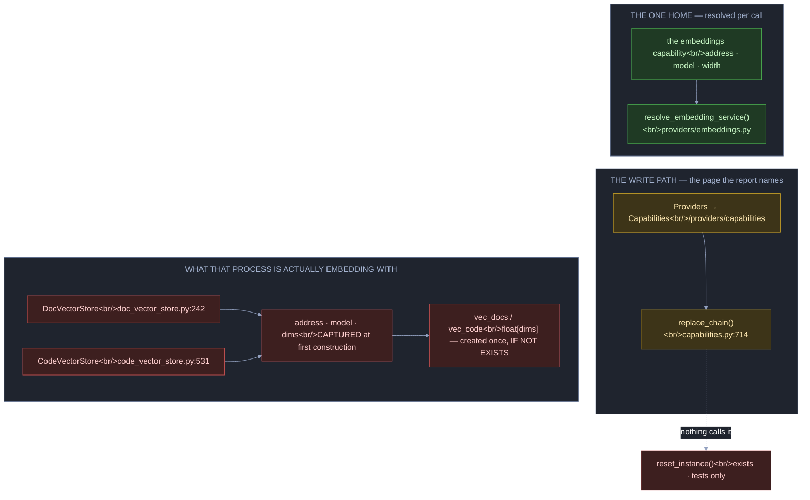
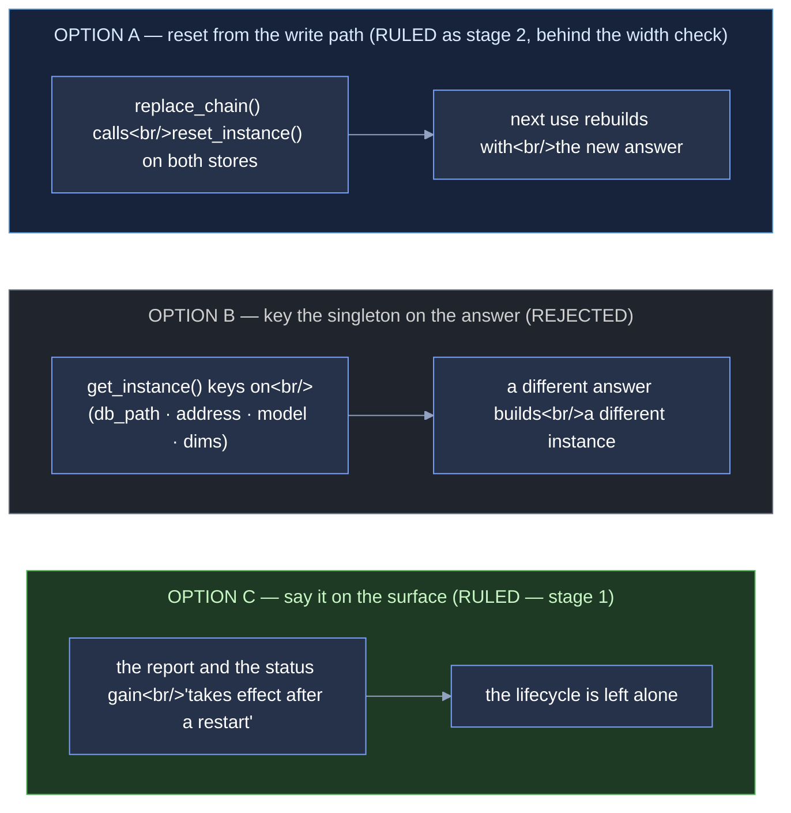
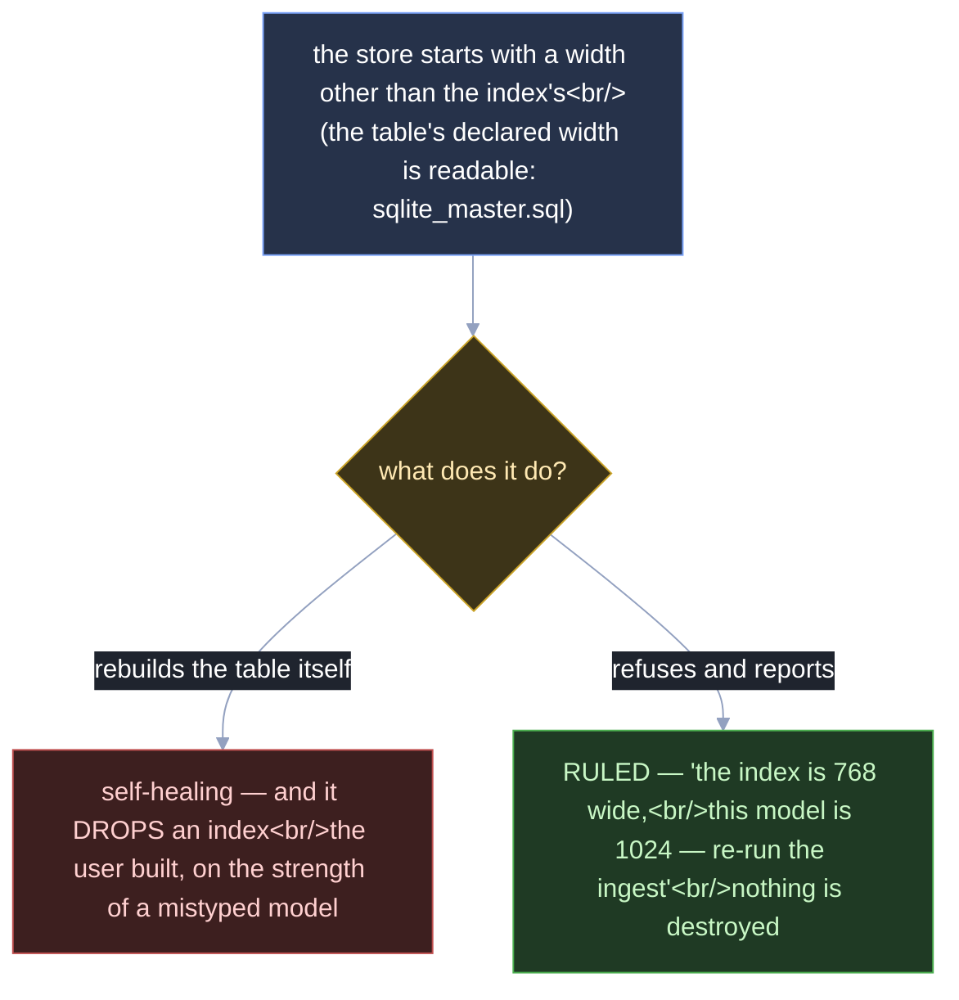

# The embedding configuration does not reach a running process

**Status**: **LANDED — options C and A** (`3e7e067e`, `5508c9a7`). C made the surfaces tell the truth
about a process that would not pick a change up; **A made the change reach the process**, and retired
the sentence C had to write. The user's ruling (2026-10-12): *"your recommendation, C, seems good."* The
measurement moved the decision: the lifecycle was the easy half, and **what a WIDTH change means** was
the half that decided the shape — the green answer in **Fig. 3** is the one taken. Every line number
here was re-measured 2026-10-12, not carried over.
**Found**: 2026-10-10, by the embedding model half's own landing (`70369210`) — the same session that
made the capability the only home of the address, the model and the width.
**Where**: `backend/app/domain/tools/builtin/{doc,code}_vector_store.py`, `backend/app/domain/providers/capabilities.py` and `embeddings.py`, `backend/app/api/v1/providers/capabilities_router.py`, `backend/app/api/v1/rag/router.py`.

---

## The short version

The `embeddings` capability is the ONE home of three facts — the address, the model and the width — and
every consumer resolves it. But the two vector stores are **singletons**, and they capture that answer
in `__init__` at FIRST CONSTRUCTION: `get_instance()` ignores every later argument, so the store a
process is already using keeps embedding with the model it was born with. The single write path that
changes the answer — `replace_chain()`, which is exactly what the **Providers → Capabilities** page
sends — does not touch the stores, and `reset_instance()` (which exists, on both) is called by **tests
only**: nothing in `app/` calls it. So a change waits for a backend restart, and no surface says so.

Two things the filing got wrong, measured here:

- **The unconfigured case is already honest.** All five construction sites resolve first and refuse
  before building, so an install with no model has **no store to be stale**; configuring one takes
  effect on the next use. The defect is only the CHANGE: a store built with model *A* keeps *A*.
- **The width is the harder half.** The `vec0` table is declared from the captured dims with
  `IF NOT EXISTS`, so a move to a model of a different width leaves the old table standing — the new
  instance then believes a width its own index does not have. A restart does not repair that; the index
  has to be rebuilt. **(a) and (b) both fix which model is dialled and neither fixes the index.**

## The evidence

| # | site | what it is | who reaches it |
|---|---|---|---|
| 1 | `domain/tools/builtin/doc_vector_store.py:242-256` | `__init__` captures `address` / `model` / `dims` off the resolved service | the five construction sites below |
| 2 | `domain/tools/builtin/doc_vector_store.py:277-303` | `get_instance()` — first-wins; "a changed capability needs `reset_instance()` (the singleton trap, said out loud)" (`:288-292`) | every caller in the process |
| 3 | `domain/tools/builtin/doc_vector_store.py:306-312` | `reset_instance()` — closes the db, clears the instance | **tests only**: `tests/components/test_doc_vector_store.py:57,200,205` |
| 4 | `domain/tools/builtin/code_vector_store.py:531-545`, `:565-589`, `:592-598` | the same three shapes on the second store | same |
| 5 | `api/v1/rag/router.py:119` | `/rag/search` builds the store (503 when unresolved, `:116-117`) | the HTTP search route |
| 6 | `domain/rag/service.py:492` → `init_db()` | the ingest builds the store, then creates the tables | the ingest job (raises when unresolved, `:397-398`) |
| 7 | `domain/tools/registry.py:1152` | `search_knowledge` builds the store | the internal tool (early return `:1149-1154`) |
| 8 | `domain/tools/builtin/doc_reader.py:737` · `:855` | the doc and code search operations | tool calls (early return `:719-726`, `:845-846`) |
| 9 | `domain/providers/capabilities.py:714` | `replace_chain()` — the capability CHOKE POINT | `api/v1/providers/capabilities_router.py:376` — the page the report names |
| 10 | `domain/providers/embeddings.py:113-121` | `report()`: *"…Choose a model on the Providers → Capabilities page (/providers/capabilities)"* | every surface that reports the gap |
| 11 | `domain/tools/builtin/doc_vector_store.py:371-376` · `code_vector_store.py:662-666` | `CREATE VIRTUAL TABLE IF NOT EXISTS vec_docs USING vec0(embedding float[{dims}])` | the first `init_db()`; live tables are `float[768]` (measured) |
| 12 | `api/v1/rag/router.py:151-165` → `domain/rag/service.py:346-359` | `/rag/status` reports the **freshly resolved** model and address | the RAG page |

**How far the answer travels** — checked at each construction, because a constant with a caller that
overrides it would be harmless:

- **All five callers resolve the capability themselves and refuse BEFORE constructing** (`:116-117`,
  `:397-398`, `:1149-1154`, `:719-726`, `:845-846`), so no store is ever built unresolved — measured.
  The first caller to succeed wins for the life of the process.
- **`/rag/status` does not construct a store**: `get_index_health` opens the index file directly
  (`rag/service.py:308-320`), so viewing the status pins nothing — but it also means the status answers
  from the capability while the store answers from its capture. Right after a change the two disagree,
  and the status is the one a reader believes.

## The issue, drawn

**Figure key** — red: the defect · green: a home the app honours or the recommendation · amber: the decision point.

**Fig. 1 — the answer has one home and two readers, and only one of them is listening.** Red: the store's
captured answer and the table created from it, plus the reset nothing calls · green: the capability, the
one home every consumer resolves · amber: the write path — the choke point where a reset would live.

The store is not wrong about *itself*; it is right about the model it was built with. The page is wrong
about the app: it tells the user to change a setting the process will not read.

## The options

**Fig. 2 — the three options, grouped vertically.** Green: **RULED — stage 1** · blue: **RULED as stage
2**, behind the width check · grey: **rejected** — it builds a second instance against one index file
whose table keeps the old width.

| | A — reset from the write path | B — key the singleton on the answer | C — say it on the surface |
|---|---|---|---|
| what it removes | the first-wins trap, for every capability at once (one choke point) | the trap, plus correctness for a caller that passes different values | nothing — it removes the SILENCE |
| where it breaks down | the capability layer must import `tools/builtin` (a cycle the handlers dodge today with lazy imports, `rag/service.py:487-489`) — and it still does not fix the table's width | builds a **second** instance against one index file whose table keeps the old width; today every caller resolves the same capability, so the correctness it buys is for a caller that does not exist | the process keeps embedding with the old model until a restart, and the page's promise stays false |
| agrees with earlier rulings | the choke-point write (`replace_chain` is the one write path) | none — it is new machinery | **report, never guess** — the arc's own rule, as far as it goes |
| cost | one call in `replace_chain`, plus a test per store | a key, a lock, and the teardown of the previous instance | two strings: the report's instruction and the status line |

**Recommendation: C first, A behind it — and the width is what actually decides the shape.** C is the
honest minimum and it is not cosmetic: the report currently names a page whose change the process will
not honour, and `/rag/status` reports a model the running store is not using. A is the only option that
makes the promise true, and it is small — one call at the choke point — but landing it without the width
answer trades one silent inconsistency for a louder one: a new instance inserting `float[1024]` vectors
into a `float[768]` index.

**Ruling (2026-10-12, the user):** *"your recommendation, C, seems good."* So **C is stage 1**, **A
follows as stage 2** once the width check is in, and **a width change REFUSES and REPORTS** — Fig. 3's
green answer. **B is rejected:** it is the only option that is also correct for a caller passing
different values, and there is no such caller (all five resolve the same capability), so it would buy
correctness for a case that does not exist while building a second instance against one index file whose
table keeps the old width. **A is deferred, not rejected** — it is the option that makes the page's
promise true, and it needs the width answer underneath it, which is why C ships without a half of A.

**Landed — option C.** The two surfaces now say what the process is doing:

- **the capability write** answers with a `note` when the `embeddings` chain is saved, and the
  Capabilities page shows it as a warning beside its success toast;
- **`/rag/status`** reports the configured answer AND the running one — `index_width` (read from the
  index's own `vec0` DDL), `running_model`, `running_address` — plus `note` when they disagree, and the
  RAG page shows the note as an alert with both readouts;
- **the stores refuse** a width the index does not have: `_declared_width()` reads the table's own DDL
  and `_refuse()` covers it beside the unconfigured case, so nothing spends a call inserting vectors the
  table cannot hold.

**Landed — option A, and the sentence C wrote had to go with it.** `replace_chain` is the capability
CHOKE POINT, so the reset lives beside the write: when an `embeddings` chain changes, both RAG stores
are dropped (`reset_instance(close=False)` — an ingest may be mid-flight on that connection, and it
finishes against the service it started with) and the next use rebuilds from what was just written.

That makes **`RESTART_NOTE` false**, so it is retired rather than left standing: the write path now
carries the **width** sentence instead, computed at the save by comparing the newly resolved model's
width with the index's own declared width. `declared_width_of(ddl)` is the one parser, and
`declared_index_width(path)` the one reader, for the store and the status alike. What is left to say is
exactly what neither a reset nor a restart repairs.

**A second defect, found while landing C — in the same function.** `get_index_health` resolved a
RELATIVE `config.doc_index_path` against `data_dir`, so the default `data/system_docs_vector.db` became
`<install>/data/data/system_docs_vector.db` — a file that never exists. The status therefore reported
**zeros for an install whose index is 55 MB**: measured live, `indexed_documents: 0`, `total_chunks: 0`,
`database_size_bytes: 0` before, `506` / `3527` / `52.9 MB` after. Every other reader — the ingest's own
resolution, both search routes, `doc_reader`, the registry — uses `Paths.rag_index_path`; the status was
the one that did not, and now does.

## What a width change means — the one decision left

**Fig. 3 — the remainder inside the recommendation, and what each answer costs.** Red: the app deciding
to destroy an index it was not asked to touch · green: **the answer RULED** — the refusal, which is the
arc's `report, never guess` rule applied to a width instead of an address.

**Refusing is the recommendation**: a width change is a re-index, and an automatic rebuild would let a
typo in a model field drop a 34 MB index. But the refusal has to be visible on the same surfaces as the
rest — the store's log line, `/rag/status`, and the ingest's own refusal.

## What is already settled (do not re-litigate)

- **The capability is the one home of address, model and width** — `e370818b` (the capability +
  resolution) and `70369210` (the consumers). Nothing here re-opens it: this issue is about who reads
  that answer and when.
- **The seed ships structure, never a value**, and a value may only be OFFERED by an optional setup —
  the user's ruling: *"a migration cannot be declined, which is why a model may not live in one."*
  A fix may therefore not write a model anywhere, including into a store's own config.
- **Report, never guess** — an unconfigured install says so instead of dialling a default
  (`domain/providers/embeddings.py:73`, `NO_EMBEDDING_MODEL`). Fig. 3's green answer is this rule, and
  the same rule is why C is a legitimate first stage rather than an embarrassment.
- **Deliberately out of scope, and measured:** the pipeline's `TurnVectorStore`
  (`services/cognitive_pipeline/vector_store.py:87`) takes the same three facts but is built per
  pipeline construction (`pipeline.py:115`), so it is NOT pinned — the singleton trap is the two RAG
  stores. **Extra finding, same area, not measured for intent:** `api/v1/chat/router.py:1613` builds
  `CognitivePipeline()` with no embedding, so the `turn` store is not registered on that path and
  recall skips there.

## What shipped, and what is left

| part | where | state |
|---|---|---|
| the write path's note | `api/v1/providers/capabilities_router.py` (`CapabilityOut.note`), `domain/providers/embeddings.py` (`RESTART_NOTE`) | **LANDED — option C** |
| the status's two answers + the note | `domain/rag/service.py::get_index_health`, `api/v1/rag/router.py`, `domain/rag/schemas.py` | **LANDED — option C** |
| the width refusal | `_declared_width` / `_refuse_width_mismatch` / `_refuse` on both RAG stores | **LANDED — option C** |
| the surfaces that show it | `pages/RagIndex.tsx` (the alert + both readouts), `pages/ProviderCapabilities.tsx` (the warning) | **LANDED — option C** |
| the index path, the locator every other reader uses | `domain/rag/service.py::get_index_health` | **LANDED** (the second defect above) |
| **A — reset from the choke point** | `capabilities.replace_chain` → `_drop_embedding_stores` (both stores, `close=False`) | **LANDED — option A** |
| the retirement A forced | `RESTART_NOTE` removed; the write path carries the WIDTH sentence, computed from `declared_index_width` | **LANDED — option A** |

The tests: `tests/unit/providers/test_embedding_configuration_note.py` (the wording and its precedence),
`tests/components/test_doc_vector_store.py` (the width guard), `tests/api/v1/test_capabilities_write_api.py`
(the note on one capability and not on another), `tests/unit/test_rag_surface.py` (the locator the status
reads). The queue item is **THE EMBEDDING CONFIGURATION DOES NOT REACH A RUNNING
PROCESS**, and the dev note that documents the behaviour is `wiki/dev-notes/system-expertise/rag/rag-system.md`.
