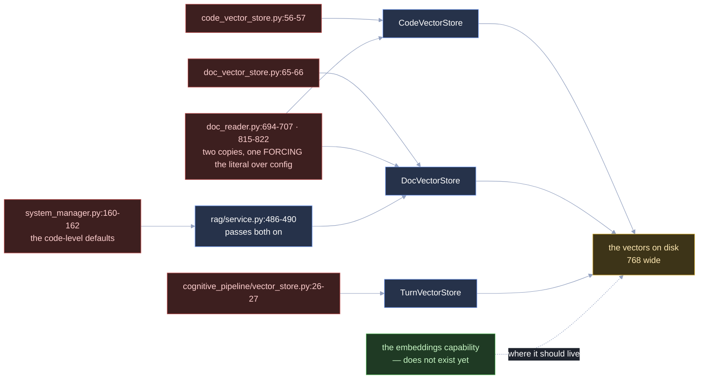
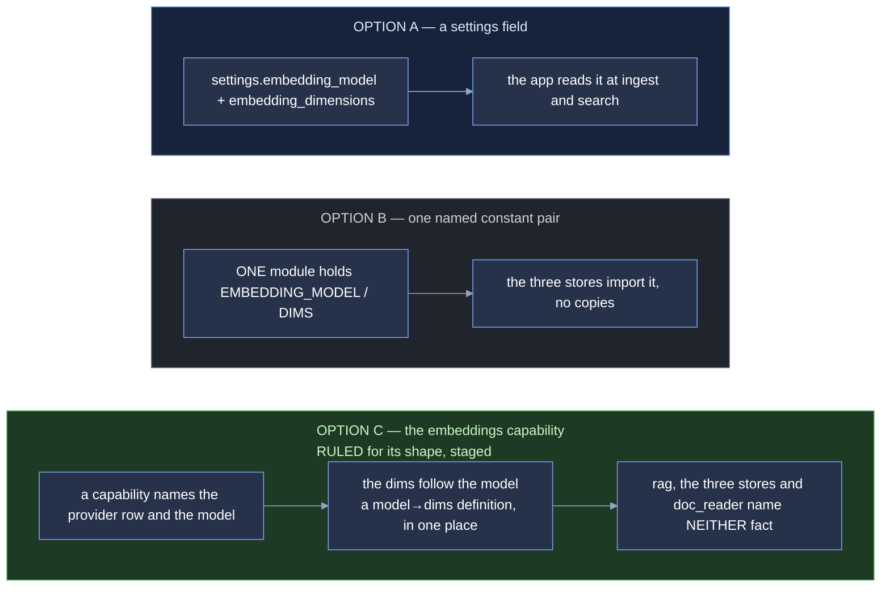
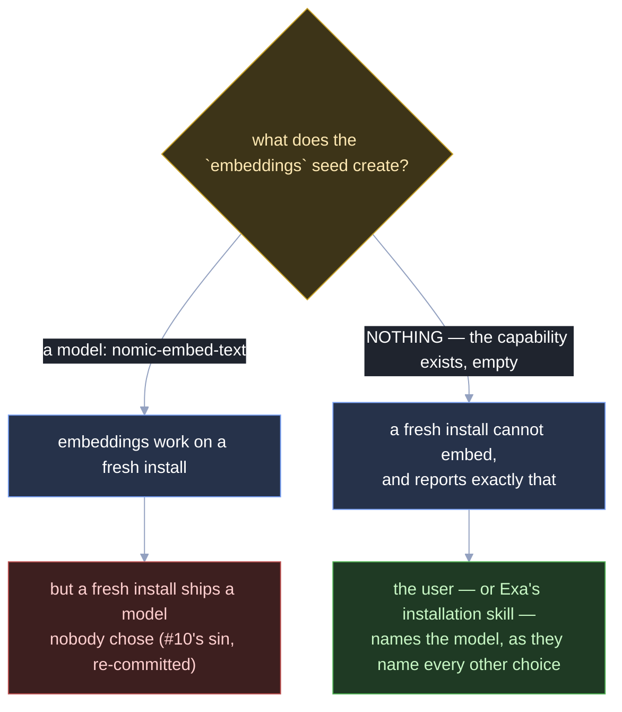

# The embedding model and its dimensions — six writers, and a pairing kept only by convention

**Status**: **LANDED** (2026-10-10) — the ruled shape (option C) is built, the seed ships it EMPTY, and
every consumer resolves through it: `e370818b` (the `embeddings` capability key, `KIND_EMBEDDING`, the
`(address, model, dims)` resolution in `domain/providers/embeddings.py`, the empty seed, the read-out's
kind) and `70369210` (the consumers — the three vector stores, `doc_reader`'s four literals, the
system-manager defaults, the rag service/router/schema). The second half of
`wiki/issues/resolved/embedded-service-literals/local-embedding-server.md` ("option C, staged": the ADDRESS half landed at `3b3421fa`).
**The one decision that was open inside it — what the seed ships — is settled by the consent principle
the user stated:** *structure* in the seed (an empty container is not an opinion, and a migration
cannot be declined), *values* in an optional setup, *rules* in code. So `nomic-embed-text` is a setup
OFFER, and an unconfigured install reports `no embedding model: indexing and search are off`.
**Found**: 2026-10-10, re-measured while the address half was landing. Every site below was measured
then, not carried over; the resolutions are named as the build settled them.
**Where**: `core/system_manager.py`, the three vector stores (`domain/tools/builtin/code_vector_store.py`,
`domain/tools/builtin/doc_vector_store.py`, `services/cognitive_pipeline/vector_store.py`),
`domain/tools/builtin/doc_reader.py`, `domain/rag/schemas.py`.

---

## The short version

Three facts decide what an embedding call is: **which server** answers, **which model** it runs, and **how
many dimensions** the vectors have. The address is settled — a provider row's `base_url`, resolved by one
rule. The model and the dims are not: `nomic-embed-text` is written into code in **six places**, and `768`
beside it in the same six, so the two halves of one fact live apart. Nothing ties them together, and the
dim map that makes them a pair exists only in the author's head: change the model and the dims silently
keep 768, and the stores write vectors of the wrong width into an index that accepts them.

## The evidence

| # | site | what it is | who reaches it |
|---|---|---|---|
| 1 | `core/system_manager.py:160-162` | `embedding_provider="ollama"` · `embedding_model="nomic-embed-text"` · `embedding_dimensions=768` — the "code-level defaults" | `api/v1/rag/router.py:69` (`_load_config` → `SystemManagerConfig.defaults()`), so EVERY rag route |
| 2 | `domain/tools/builtin/code_vector_store.py:56-57` | `DEFAULT_EMBEDDING_MODEL` + `DEFAULT_EMBEDDING_DIMS`, and the defaults on `__init__` (530-531) and `get_instance` (549-550) | the code indexer — and any caller that omits them |
| 3 | `domain/tools/builtin/doc_vector_store.py:65-66` | the same pair, **copied** (also on `__init__`, 240-241) | the doc indexer and the search path |
| 4 | `services/cognitive_pipeline/vector_store.py:26-27` | the same pair, **copied again** (also on `__init__`, 95-96) | `TurnVectorStore` — every cognitive-pipeline turn store |
| 5 | `domain/tools/builtin/doc_reader.py:694-707` and `:815-822` | the pair written out **twice in one file** — and a branch that OVERRIDES config: `if emb_provider != "ollama": emb_model = "nomic-embed-text"` | the doc-search tool (694) and the code-search tool (815) |
| 6 | `domain/rag/schemas.py:29-32` | `embedding_model` as the **health response's** default — the app reports a model it hardcodes | `GET /rag/status`, and the RAG page |

**How far the code defaults actually travel** — checked at each construction, because "a constant with a
caller that overrides it" would be harmless:

- **The rag ingest (site 1 → 3):** `rag/service.py:486-490` passes `embedding_model=config.embedding_model`
  and `embedding_dims=config.embedding_dimensions` — both from `SystemManagerConfig.defaults()`, i.e. from
  site 1's literals. The code default IS the configured value.
- **The code search (site 5):** `doc_reader.py:815-822` derives the pair from
  `getattr(self._system_manager_config, …)` — and then **overrules it** whenever the embedding provider is
  not `ollama`, forcing `nomic-embed-text`/`768` back. A configuration that says otherwise is ignored.
- **The cognitive stores (site 4):** `api/v1/cognitive_vectors/router.py:30,41,59,70` and the registry's
  own `vector_store.py:287` build `TurnVectorStore(agent_folder=…)` and pass **neither** fact, so the
  store's constants are the live values.

## The issue, drawn

**Figure key** — red: the defect · green: a home the app honours or the recommendation · amber: the decision point.

**Fig. 1 — the six writers of one model, and the dims that ride along beside each.** Red: a copy of
`nomic-embed-text` (and `768`) — six of them, two in a single file; green: the home this should have;
amber: the index, which accepts whatever width it is handed, so a model changed without its dims writes
the wrong vectors silently.

Five writers, one fact, and no two of them are obliged to agree: sites 2, 3 and 4 are character-for-character
identical, site 5 overrules configuration, and site 1 is what every rag route actually loads.

## Why the dims are the sharper half

The model and the dims are **one fact** — `nomic-embed-text` IS 768 wide — but the code stores them as two
independent literals in each of the six places. Nothing derives one from the other, so the failure is
silent in the worst way: point the app at a 1024-wide model and it keeps writing 768-wide vectors into the
same table, and the index accepts them. Retrieval degrades instead of erroring, which is why this wants a
ruling rather than a rename.

## The options

The options are grouped vertically with their steps running left to right.

**Fig. 2 — the three options, grouped vertically with the ruled one marked (green).**

| | A — a settings field | B — one constant pair | C — the capability |
|---|---|---|---|
| copies removed | 6 → 1 field | 6 → 1 pair | 6 → 0 |
| where the model lives | `.env` | code, in one module | the capability's config |
| the dims | a second field, still separate | a second constant, still separate | derived from the model |
| agrees with the ruling this arc already made | no — the address half RETIRED the same shape | partly — the duplication goes, the literal stays | yes — the same shape as the address half |
| cost | small | smallest | a capability key, a seed, and three consumers |

**Recommendation: C, staged.** B is the tempting minimum and the wrong one for the same reason it was
wrong for the address: it moves the duplication instead of removing the literal, and it leaves the dims
free to disagree with the model. A re-introduces, for the model, exactly the field the address half
retired an hour ago.

## The one decision that was open inside C: what the seed ships — SETTLED

**Settled by the consent principle** (EXA'S INSTALLATION SKILL): the seed creates
the capability EMPTY. *Structure* belongs in a migration — an empty container is nobody's opinion, and
a migration cannot be declined; a *value* is a setup offer, accepted, declined or replaced. Shipping
`nomic-embed-text` would have re-committed #10's sin one layer down, and an embedding model that is
quietly wrong corrupts the index rather than producing one bad answer.

**Fig. 3 — the seed decision.** Amber: the decision. Red: the outcome that re-committed #10's sin.
Green: the outcome that matched the arc's own precedent — and the one that was RULED.

The address half already settled this shape once: `#10` ruled that a fresh install gets *a place to
choose, not a choice*, and the fresh-install seed was stripped of `llama3.2:latest` for it. Shipping
`nomic-embed-text` in the `embeddings` seed would re-commit that sin one layer down — and unlike a chat
model, an embedding model that is quietly wrong corrupts the index rather than producing a bad answer.

## What is already settled (do not re-litigate)

- **The rule.** A literal that is a **decision** resolves from config; one that is a **definition** is
  legitimate as ONE named constant with a note at the site. The dims are the definition case — they belong
  to the model — but they belong there *derived*, not as a second independent literal.
- **The address half of this family landed** (`3b3421fa`): the `ollama` ROW's endpoint, resolved by
  `resolve_endpoint` / `resolve_named_row_endpoint`. The model half has now landed on top of it
  (`70369210`) — and the ROW is named by the capability, so the address rides the same answer rather
  than a row name written in the caller.
- **The mechanism exists.** `domain/providers/capabilities.py`'s `resolve(db, key)` ladder already answers
  "which service answers?" for `chat`, `title` and `workflow-llm`; `title` is the precedent for a
  capability that names its own model. `EMBEDDINGS_CAPABILITY_KEY` was added for this family
  (`e370818b`). One rung does NOT apply to it: the ladder's last is the global default **provider row**
  — the install's CHAT default — so an `embedding` capability skips it. Letting it answer would be the
  app deciding that whatever chat model is default can embed, and it would read as *configured*.
- **No shipped choices.** `#10`: a fresh install gets a place to choose. Exa's installation skill is the
  intended way a curated install gets its models.
- **Deliberately out of scope:** the address (settled), and the `ollama_cloud` three-values drift
  (`wiki/issues/resolved/embedded-service-literals/local-embedding-server.md`, Fig. 5) — its own issue.

## Where the work lives

`local/roadmaps/archive/embedded-service-literals/cleanse.md` (archived — the arc closed with every
worklist entry landed, measured or filed) — `#11`'s model half, whose scope is written out
there in the order the work wanted, **all of it now landed**. The arc's tests live in
`backend/tests/unit/providers/` (`test_embedding_model_resolution.py` is this page's — the capability
resolves the model, the dims follow it, and an unconfigured install reports),
`backend/tests/unit/test_embedding_address_resolution.py` (the address half, updated where the
capability now names the row) and `tests/components/` (the stores refuse, the tool reports).
