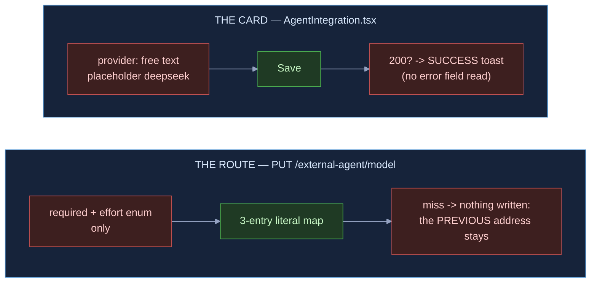
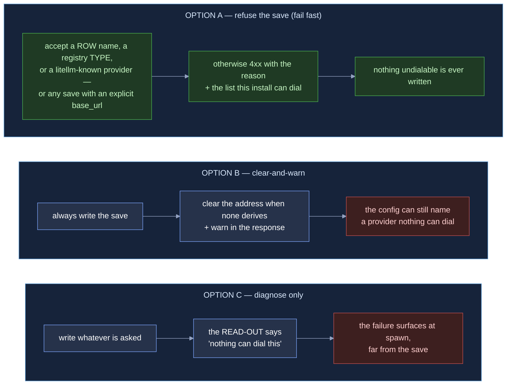

# The Exa model save accepts a provider nothing can dial — and reports success

**Status**: **LANDED — `458d8462`** (RULED 2026-10-12: **option A, refuse the save** — the user's words:
*"Let's go with OPTION A — refuse the save (fail fast)"*). The address rule and the acceptance rule now live
together in `provider_endpoints.address_for_client`; the route refuses with the install's dialable list, and
its rejections are a real 4xx rather than the 200 the model card read as success.
**Found**: 2026-10-12, as the remainder of
`wiki/issues/resolved/embedded-service-literals/provider-addresses-registry-copies.md` (option A, staged — RULED) after the user's read that a
provider with no canonical endpoint and no row *"sounds like an error condition… sweep for it."*
**Where**: `backend/app/api/v1/external_agent_router.py`, `frontend/src/pages/AgentIntegration.tsx`,
`backend/app/domain/providers/provider_endpoints.py`, and Exa's own provider-surface skill.

---

## The short version

`PUT /external-agent/model` checks that `model` and `provider` are non-empty and that `reasoning_effort` is
one of five values — and nothing else. The provider is then whatever the caller typed, and the address comes
from a three-entry literal map. So **a provider string that no client can dial is accepted, written, and
reported as a successful save** — while the address it should have carries the value from whichever provider
was configured before.

The second half is the one that makes this a defect rather than a rough edge: **the failure is invisible.**
The route signals its own rejections with a 200 and an `error` field, and `saveModel` — the only caller the
model card has — treats any 2xx as success, toasting *"Model set to <model> (<provider>)"*. An operator who
typos the provider (the field is FREE TEXT) is told the model was set.

## The evidence

| # | site | what it is | who reaches it |
|---|---|---|---|
| 1 | `api/v1/external_agent_router.py:296-300` | the whole acceptance rule: `model` and `provider` non-empty, `reasoning_effort` in an enum — both failures returned as `{"error": …}` with a **200** | `PUT /external-agent/model` |
| 2 | `frontend/src/pages/AgentIntegration.tsx:272-279` | the provider field is `type="text"` (placeholder `deepseek`) — a typo is one keystroke, not a restricted pick | the Exa model card |
| 3 | `frontend/src/pages/AgentIntegration.tsx:81-100` | `saveModel` never inspects the body for `error`; a 2xx toasts **success** using `updated.model` / `updated.provider` | the card's Save button |
| 4 | `api/v1/external_agent_router.py:311-316` + `:271-272` | a three-entry literal map (`deepseek`, `openrouter`, `ollama`), and `if base_url:` — a miss writes NOTHING, so the previous provider's address stays | the same route |
| 5 | measured 2026-10-12, scratch config dir | after a `deepseek` save, saves for `groq`, `ollama_cloud`, `openai` each left `https://api.deepseek.com` in place | — |
| 6 | Exa's own skill (`skills/exa/…/provider-surface-map.md:150-152`) | `GET /external-agent/model` is the READ — *"read it to know what the chat currently runs; never test against it"* | Exa, for orientation only |
| 7 | `litellm.get_llm_provider`, measured today | the dialability test the acceptance rule can use: `deepseek` → `api.deepseek.com/beta`, `groq`, `mistral`, `ollama` → their defaults; `openai`/`anthropic`/`openrouter` resolve internally; **an unknown name raises** | the app (litellm is already a dependency) |

**A provider string can be any of three vocabularies**, which is why an acceptance rule has to consult all
three rather than one: a ROW NAME (`llama`, whose type is `openai`), a registry TYPE (`deepseek`, `groq`,
`ollama_cloud`), or a litellm-known provider with no row at all (`mistral`).

## The issue, drawn

**Figure key** — red: the defect · green: a home the app honours or the recommendation · amber: the decision point.

**Fig. 1 — the two ends of one save, neither of which can say no.** Red: the free-text provider, the
acceptance rule that is only "not empty", the miss that leaves the old address, and the success toast that
follows any 2xx · green: the two steps that do their job. The save reports success at the same moment it
fails to produce a dialable config.

## The options

**Fig. 2 — the three options, with the RULED one marked.** Red: what each of the alternatives leaves
standing — a config that names a provider nothing can dial, and a failure that surfaces a process away from
the save that caused it · green: option A, which the user ruled — the option that makes the state
unrepresentable.

**The ruling (2026-10-12, the user's words):** *"Let's go with OPTION A — refuse the save (fail fast)."*
**Why the alternatives lost:** B would still leave Exa's config naming a provider nothing can dial — clearing
the address makes the field honest but not the provider — and C moves the discovery to the next spawn, a
process away from the save that caused it, which is precisely how the mis-pipe in the guard's own comment
survived a fix once already.

| | A — refuse | B — clear-and-warn | C — diagnose only |
|---|---|---|---|
| removes | the undialable save; the invisible rejection (see below) | the stale address | nothing |
| where it breaks down | a vendor litellm does not know yet is refused — unless the caller passes its address, which is the escape hatch | the config names a provider with no address and no knowledge behind it | the operator learns at Exa's next spawn |
| agrees with | the name ban (reject *before* the write) and *"report, then offer"* | the app never blocking the operator | the reporting discipline only |
| cost | the acceptance rule (~15 lines) + the response shape + tests | ~5 lines | ~5 lines |

**Recommendation: A — and the response shape is part of it, not a detail.** A refusal that returns
`200 {"error": …}` is refused in name only: the card's only caller would toast success over it, which is the
defect this page measured at site 3. So the refusal has to be a real 4xx (or the caller must read the error
field), and the same fix covers the two validations the route already has — today a missing model name also
"sets" the model as far as the operator can tell.

**What the rule accepts** (all three vocabularies, so nothing legitimate is blocked): a row NAME on this
install; a registry TYPE (`canonical_endpoint` answers); a provider litellm resolves; or **any save carrying
an explicit `base_url`** — the caller is the authority about its own process, and that hatch means a brand-new
vendor is never locked out.

## What is already settled (do not re-litigate)

- **The ruling on the page this one came from (2026-10-12, option A staged):** the registry answers at both
  sites; a type it declines falls back to the install's row of that type; the gap is swept — derive, clear,
  or refuse. This page is that ruling's refusal half, given its own page because it is its own decision.
- **The guard's intent (2026-08-22):** *"the config can never pair a model with the wrong pipe"* — the 401
  mis-pipe is why the literal map exists at all.
- **Exa reads, it does not write.** Its own surface map documents `GET /external-agent/model` as the read,
  *"never test against it"* — so the refusal does not lock Exa out of its own reconfiguration; the writer is
  the model card (an operator) and the API (a script).
- **Deliberately out of scope:** the model string's own coherence (a `provider` that disagrees with the
  model's prefix) — a second rule, worth its own page if it ever bites.

## What shipped

**One commit, `458d8462`.** `provider_endpoints.address_for_client` is the rule — pure, so its five branches
are unit-tested without a database or a client — and the route supplies the row facts plus `client_can_dial`
(litellm's own per-provider defaults, measured). `_write_exa_model_config` gained `clear_base_url`, so a
cleared field is a decision rather than an omission.

**Verified live, with the config's sha256 checked before and after** — the three refusals write NOTHING (the
file is byte-identical), and each answers a real 4xx:

| attempt | the response |
|---|---|
| `provider: definitely-not-a-provider`, no base_url | **400** — *"'definitely-not-a-provider' cannot be dialled: no provider row of that name, no canonical endpoint for its type, and the client does not know it. Dialable here: deepseek, groq, llama, ollama, ollama_cloud, …"* |
| no model | **400** — "model and provider are required." |
| `reasoning_effort: turbo` | **400** — "invalid reasoning_effort: turbo" |

8 new tests (`tests/unit/test_external_agent_address.py`); `mypy` clean on both changed files; `tsc -b` and
`eslint` clean. The frontend service surfaces the refusal instead of dereferencing an undefined body.

**Left to the page this came from:** the registry's deepseek value and the catalog's reading — stages 1–2 of
`wiki/issues/resolved/embedded-service-literals/provider-addresses-registry-copies.md`, which stay in flight.
