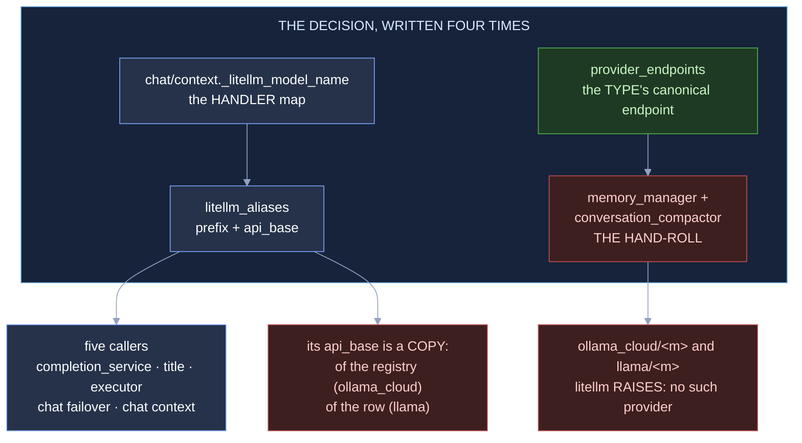
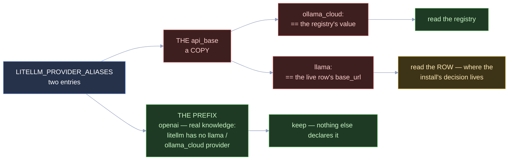
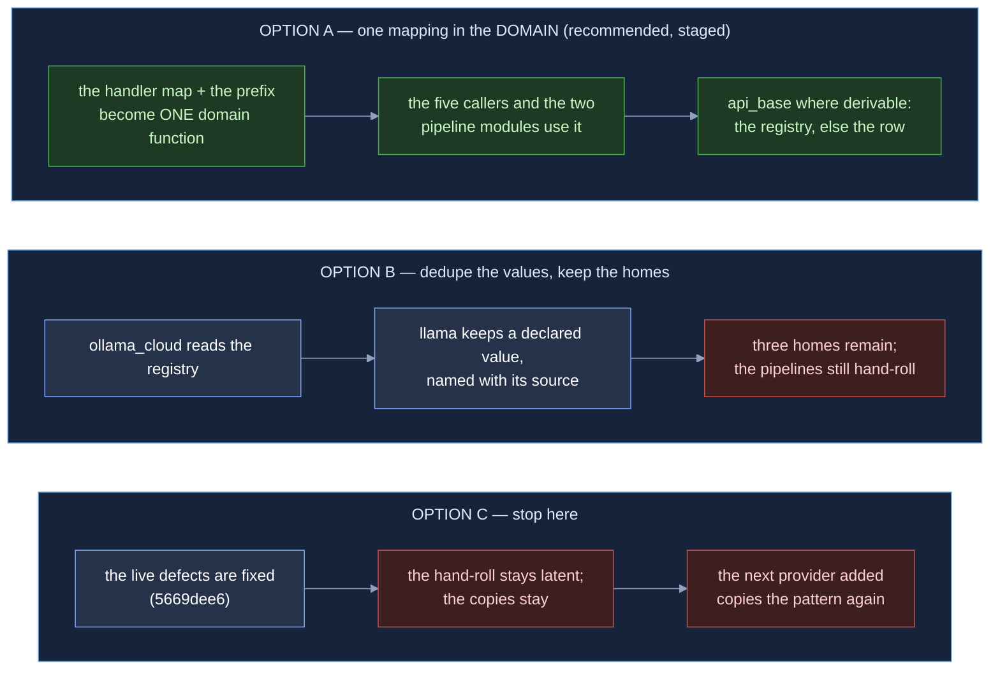
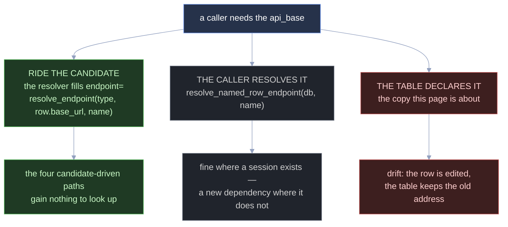

# The litellm provider mapping — four homes for one decision, and two modules that skip it

**Status**: **LANDED — the arc's residue is empty.** Option A (one mapping in the DOMAIN, TYPE-keyed),
both stages in: the string half `0f532be6`, the address half `7990716a`. *Which litellm string does this
provider get, and which root does that handler need?* was ONE decision, written in four places. Measured: the two-entry aliases table
holds **two different kinds of thing** — an adapter PREFIX (real knowledge, no other home) and an `api_base`
that is a COPY (of the registry for one entry, of the live row for the other) — and the two cognitive-pipeline
modules hand-roll `{provider}/{model}` with no base and no handler map, which for either aliased provider
produces a string **litellm rejects outright**.
**Found**: 2026-10-11, the service-literals arc's close-out. Re-measured **2026-10-12** (every line below,
plus the live rows and litellm's own resolution).
**Where**: `backend/app/domain/providers/litellm_aliases.py`, `backend/app/api/v1/chat/context.py`,
`backend/app/domain/providers/provider_endpoints.py`,
`backend/app/services/cognitive_pipeline/{memory_manager,conversation_compactor}.py`, and the five callers
of `litellm_model()`.

---

## The short version

`litellm_model(provider, model)` answers two questions from one two-entry table: which ADAPTER the provider
routes through (`openai`, because litellm has no `llama` or `ollama_cloud` provider) and what `api_base` that
adapter needs. Five call sites use it. A sixth decision — the ollama family's tool-capable handler — lives in
`chat/context._litellm_model_name`, and the type's canonical endpoint lives in the registry. The memory and
summary passes use none of them.

**The table is two facts wearing one coat.** The PREFIX is knowledge nothing else holds (litellm genuinely
does not know these provider names). The `api_base` is a copy: `ollama_cloud`'s value is the registry's
`canonical_endpoint` verbatim, and `llama`'s value is the live row's own `base_url` verbatim. Those copies
are where the drift lives — the row can be edited while the table keeps the old address.

**And the two pipeline modules are a latent hard failure, not a smell.** Their hand-rolled string is
`ollama_cloud/<model>` or `llama/<model>`, and litellm raises *"LLM Provider NOT provided"* for both —
measured today. Nothing is broken only because both the memory and summary capabilities resolve to
`deepseek` on this install; the first candidate of either aliased kind would fail the pass.

## The evidence

| # | site | what it is | who reaches it |
|---|---|---|---|
| 1 | `api/v1/chat/context.py:516-548` | `_litellm_model_name` — the HANDLER map: `ollama` / `ollama_cloud` → the tool-capable `ollama_chat/…`, `llama` → the alias's prefix, else `{provider}/{model}` | the chat path (`generate_stream`), the failover rebuild |
| 2 | `domain/providers/litellm_aliases.py:11-21` | `LITELLM_PROVIDER_ALIASES` — two `(prefix, api_base)` entries (`ollama_cloud`, `llama`) + `litellm_model()` | **five callers**: `completion_service.py:72`, `title/services.py:371` & `:384` (+ the alias checks at `:196`, `:253`, `:528`, `:538`), `services/cognitive_pipeline/executor.py:278`, `api/v1/chat/router.py:3435`, `chat/context.py:548` |
| 3 | `domain/providers/provider_endpoints.py:45-56` | the registry — the TYPE's canonical endpoint | `resolve_endpoint`, `address_for_client` |
| 4 | `services/cognitive_pipeline/memory_manager.py:57-61`, `conversation_compactor.py:230-234` | the hand-roll: `model if model.startswith(provider + "/") else f"{provider}/{model}"` — **no `api_base`, no handler map** | the memory pass and the summary pass |
| 5 | measured 2026-10-12 | `LITELLM_PROVIDER_ALIASES["ollama_cloud"][1]` == `canonical_endpoint("ollama_cloud")` → **a copy of the registry**; `["llama"][1]` == the live `llama` row's `base_url` → **a copy of the row**; both prefixes (`openai`) have no other home | — |
| 6 | measured 2026-10-12 | `litellm.get_llm_provider("ollama_cloud/m")` and `("llama/m")` both RAISE `BadRequestError: LLM Provider NOT provided` | the two modules at site 4, for a candidate of either kind |
| 7 | `chat/router.py:3435-3444` | the failover rebuild: takes the alias's base, then derives the HANDLER's root (`litellm_api_base`) — the `5669dee6` fix, with its reasoning in the comment | every failover attempt |

## The issue, drawn

**Figure key** — red: the defect · green: a home the app honours or the recommendation · amber: the decision point.

**Fig. 1 — the four homes, and the two that cost something.** Red: the hand-roll and the failure it hides,
plus the copy inside the table · green: the registry, which already answers for a type.

**Fig. 2 — the table is two facts wearing one coat.** Green: the prefix, which is genuine and has no other
home · red: the `api_base`, which is a copy in both entries · amber: the one that needs a decision, because
reading the row means a lookup inside callers that have no endpoint in hand today.

## The options

**Fig. 3 — the three options, the recommendation marked.** Red: what each alternative leaves standing —
three homes, a latent hard failure, and a pattern the next provider will copy · green: the option that gives
the decision one home and fixes the hand-roll on the way.

| | A — one mapping in the domain | B — dedupe the values | C — stop here |
|---|---|---|---|
| removes | the handler map's second home; the hand-roll; the copies | the `ollama_cloud` copy only | nothing |
| where it breaks down | the `api_base` for a ROW-NAME entry needs the row, and four callers have no endpoint in hand | the two pipelines still build a string litellm rejects | the same, plus the copies |
| agrees with | the arc's *one home per fact*; the `ollama_cloud` ruling's handler-derived root; the registry as the type's home | the same rulings, less of it | nothing conflicts |
| cost | the map moves out of `api/`; 5 call sites + 2 modules; one endpoint to thread | a few lines + a comment | none |

**Recommendation: A, staged.**

- **Stage 1 — the STRING half, which needs no endpoint at all.** The handler map and the prefix knowledge
  become one domain function (`litellm_route(provider, model)`), and the two pipeline modules call it instead
  of hand-rolling. That alone retires the latent failure at site 4 and gives the decision a single home.
- **Stage 2 — the `api_base` half, now measured (see the decision below).** Every address comes from the
  resolver: the endpoint RIDES the `ServiceCandidate` the resolver already builds from the row, and the two
  paths without a candidate thread it from their construction sites. The table is left holding only its
  prefix half.

Nothing here re-opens the fixed defect: the handler-derived root (`5669dee6`) and the row-is-the-decision
ruling both stay exactly as they are.

## The one decision to take — and the measurement that retired most of it

The remainder is *how a row-name entry's address reaches a caller whose path is pure*. The page first framed
it as "a database lookup in those paths, or a declared copy". **The measurement says neither is necessary**,
because the resolver already holds the row:

- `capabilities.py:255-266` builds every `ServiceCandidate` **from the row** — it reads `provider.base_url`
  to compute `location` — and simply does not carry the endpoint forward;
- `config_service.py:23` is the blessed lookup for anyone outside the providers layer:
  `resolve_named_row_endpoint(db, name)` — *"the lookup that lets a caller outside the providers layer obey
  that rule without writing an address down"*.

So the endpoint can **ride the candidate** (one field, filled where the row already is), and the two paths
with no candidate — the `CompletionRequest` and the failover's kwargs — thread it from their construction
sites, which already hold a session. The table is then left with only its PREFIX half, which is a function of
the row's TYPE, not of a row name: the handler map's own comment says it — *"the provider name alone is not a
LiteLLM provider."*

**Fig. 4 — the three ways an address can reach a caller.** Green: the candidate carries it, so nothing pure
gains a lookup and the table loses its copy · grey: the caller resolves it itself — correct where a session
exists, a new dependency where it does not · red: a declared value, which is the copy this page exists to
remove.

**Ruled (2026-10-12):** *"let's proceed with OPTION A — one mapping in the DOMAIN"* — taken with the
TYPE-keyed reading above. **Both stages are landed** (below).

## What shipped (stage 1, 2026-10-12)

**One home: `backend/app/domain/providers/litellm_route.py`.**

- `HANDLER_BY_TYPE` — the three TYPES litellm has no prefix for (the ollama family → the tool-capable
  `ollama_chat`; the local llama.cpp type → the `openai` adapter), with `handler_for(type, name)`. The
  TYPE decides; the row NAME only stands in where a caller has no type in hand.
- `litellm_model_string(provider, model, provider_type)` — idempotent, and it retires the predecessor's
  doubling for a remapped provider whose model already carried the prefix (`openai/llama/<m>`).
- `api_base_for(model_string, endpoint)` — the root derivation, now READING the string instead of
  re-deciding the handler, which is what keeps the two from disagreeing about the protocol.

**Every caller moved**: the chat path (`context.py` — which now reads its provider row *before* the model
string, because the type decides it — plus the failover rebuild in `router.py`), `completion_service`, the
title service, the cognitive executor, and **the two cognitive-pipeline modules**, which no longer
hand-roll `{provider}/{model}`. The string litellm REJECTS is gone, and those two modules carry the tests
that would have caught it.

**The alias table is down to its address half** (`litellm_aliases.LITELLM_PROVIDER_ADDRESSES` +
`alias_api_base`) — the copy, named rather than hidden. *Stage 2 has since deleted it; the address rides
the resolution that already holds the row.*
`context._litellm_model_name` and `context.litellm_api_base` are gone; 18 tests in
`tests/unit/test_litellm_route.py` replace the 5 in the retired `test_litellm_model_name.py`.

**One bug stage 1's own test caught, in FOUR call sites**: the two pipeline modules, the cognitive
executor and `completion_service` each handed the ollama family the table's COMPAT root instead of the
handler's native root — the same 404 the `5669dee6` fix removed from the failover, reintroduced wherever
the root and the handler are decided apart. All four route through `api_base_for` now, and
`tests/unit/providers/test_completion_service_mapping.py` plus the two pipeline tests assert the native
root. Same lesson as the page's opening: one home, or the copy drifts.

**Two tests pinned the old disagreement and were updated with it** — the executor's fallback chain
asserted the raw `ollama/` prefix (litellm's function-unsupported handler, where the chat path sent
`ollama_chat/`), and `test_completion_service_mapping.py` asserted `openai/…` for `ollama_cloud` (where
the chat path sent `ollama_chat/…`). Both now assert the single answer, and the trace test keeps asserting
`ollama/…` — because `fallback_chain_used` records the CANDIDATE (`provider/model`), not the litellm
string.

## What shipped (stage 2, 2026-10-12) — `7990716a`

**The address rides the resolution, and the table is gone.**

- **`ServiceCandidate.endpoint`** — filled by `_candidate_from_row` with
  `resolve_endpoint(type, row.base_url, name)`. The resolver is the one place that already holds the row
  (it reads `provider.base_url` for `location` today), so the cognitive executor, the two pipeline modules
  and the failover's rebuild take the address from there: no lookup, no copy.
- **The row-driven paths resolve it themselves** — the chat context, the failover's request rebuild, and
  the title service, whose `api_base` now follows the ROW's own `base_url` rather than the table's value
  for its name (in the test, the fixture's 4321 instead of the old table's 8080; that difference *is* the
  point).
- **`CompletionRequest` gains an `endpoint`**, handed in by whoever resolved the chain: `ChatService`
  holds its own session and resolves through `resolve_named_row_endpoint`; `completion_router` builds a
  name→endpoint map from the candidates it already has and passes it down, because
  `ProviderCompletionService`'s per-name loop holds no session at all. A request handed no address gets
  none — nothing is invented, and `test_no_endpoint_means_no_api_base` pins it.
- **The membership test moved to the TYPE**: the title service's *"is this a keyless adapter row?"* keys
  off `HANDLER_BY_TYPE`, the same table the handler comes from, so it cannot drift from it.

`domain/providers/litellm_aliases.py` is **deleted**, and the three tests that had pinned its values now
assert the rows'.

## What is already settled (do not re-litigate)

- **The field's meaning and the root derivation** (`wiki/issues/resolved/embedded-service-literals/ollama-cloud-two-api-roots.md`,
  LANDED `db0f05da`, `bb177a45`, `5669dee6`): a row's `base_url` is the API root the app DIALS; a hybrid row
  carrying the native host is REPORTED, not rewritten; and which root a handler needs is derived from the
  handler (`chat.context.litellm_api_base`).
- **The address ruling** (`wiki/issues/resolved/embedded-service-literals/provider-addresses-registry-copies.md`,
  LANDED `458d8462`, `a7f41276`): the registry is the one home for a TYPE's endpoint, and a save for another
  process refuses what nothing can dial. This page is the last of that residue.
- **The `llama` row is the install's own decision** — type `openai`, endpoint `http://127.0.0.1:8080/v1`
  (the user's Bonsai server); the registry declines `openai` by design, so the row is where that address
  belongs.
- **Deliberately out of scope:** the ollama family's handler choice itself (the 2026-08-14 finding that
  `ollama` is function-unsupported and `ollama_chat` is the tool-capable one) — a settled fact, not a copy.

## Where the work lives (both stages landed)

the queue item **THE LITELLM PROVIDER MAPPING**. **Stage 1** (`0f532be6`): the new
`domain/providers/litellm_route.py`, `api/v1/chat/context.py`, `api/v1/chat/router.py`,
`domain/providers/completion_service.py`, `domain/title/services.py`,
`services/cognitive_pipeline/{executor,memory_manager,conversation_compactor}.py`. **Stage 2** (`7990716a`):
`domain/providers/capabilities.py` (the candidate's `endpoint`), the same consumers reading it,
`app/domain/chat/services.py` and `api/v1/providers/completion_router.py` (threading the requests'), and
the deleted `domain/providers/litellm_aliases.py`. Tests: `tests/unit/test_litellm_route.py` (18), plus
the pipeline, executor, title-capability, mapping and stream-failover tests that assert the new homes —
including the two that would have caught the latent failure.
