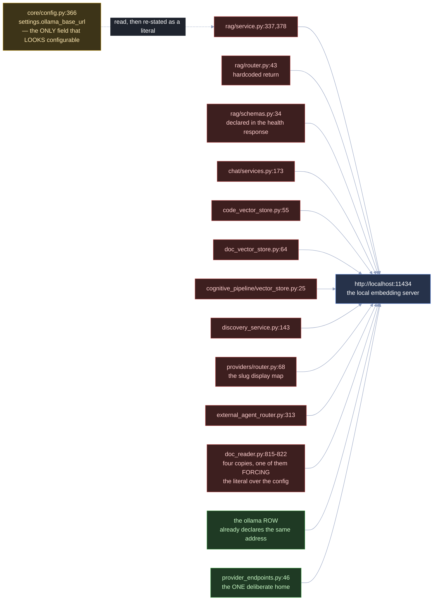
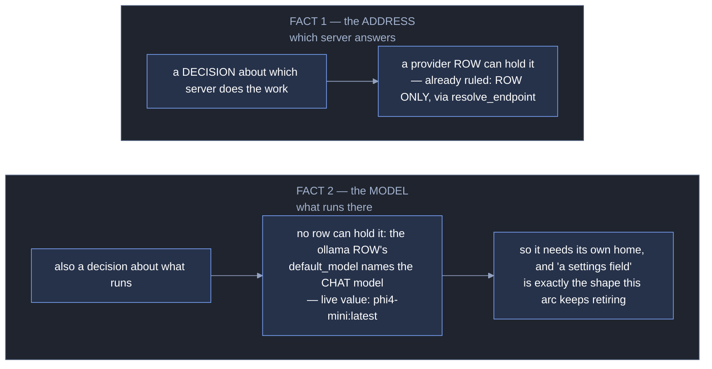
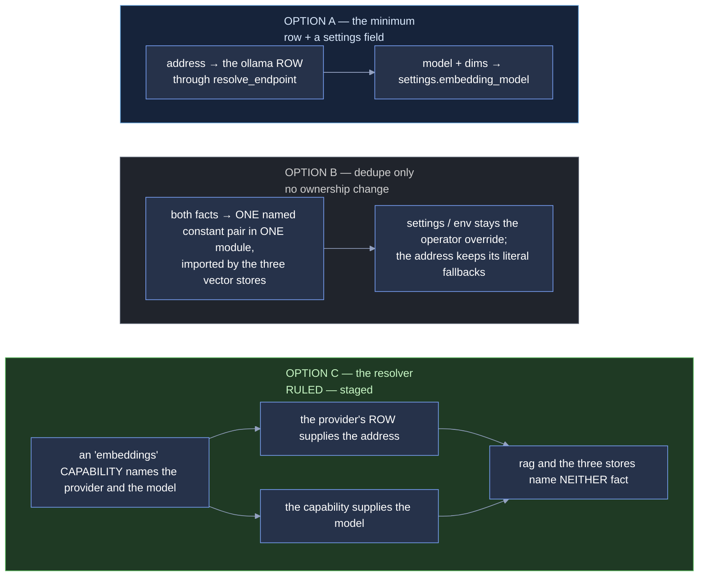
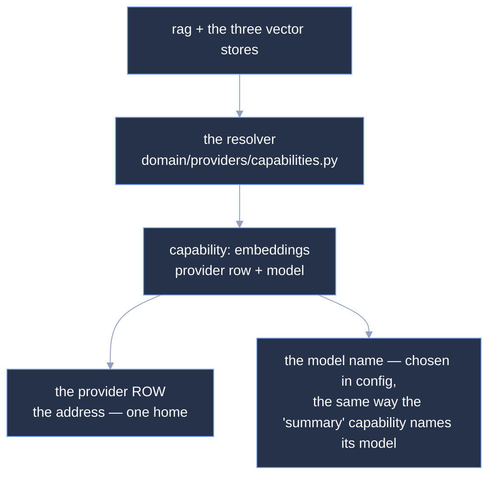
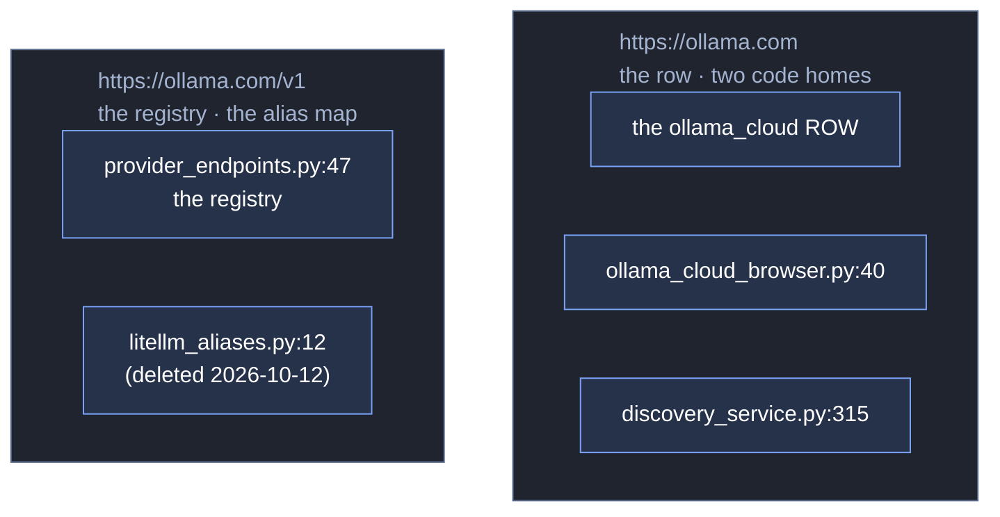

# The local embedding server — one address and one model, written down 12 times

**Status**: **LANDED — option C, both halves** (2026-10-10). **The ADDRESS half landed** (`3b3421fa`):
the `ollama` row's endpoint, via `resolve_endpoint` / `resolve_named_row_endpoint`, with
`settings.ollama_base_url` retired and the health response reporting what is dialled (or null).
**The MODEL half has now landed too** (`e370818b`, `70369210`): the `embeddings` capability names the
provider row AND the model, the vector width is derived from the model
(`domain/providers/embeddings.py`), every consumer takes that one answer, and the capability ships
EMPTY — an unconfigured install reports `no embedding model: indexing and search are off` rather than
embedding with a model nobody chose (the consent split: structure in the seed, values in an optional
setup, rules in code). Its own page is `wiki/issues/resolved/embedded-service-literals/embedding-model-and-dims.md`.
**Found**: 2026-10-10, measuring what the address half left behind. Every site below was re-measured
then, not carried over.
**Where**: `backend/app/domain/rag/`, the three vector stores (`domain/tools/builtin/code_vector_store.py`,
`domain/tools/builtin/doc_vector_store.py`, `services/cognitive_pipeline/vector_store.py`),
`domain/chat/services.py`, and `core/config.py`.

---

## The short version

The app runs its **own** embeddings against a local Ollama server. Three facts decide that: **which
address** it dials, **which model** it asks for, and **how many dimensions** the vectors have. All
three are written into code — as a settings field, a request default, two `getattr` fallbacks, a
hardcoded `return`, a class attribute, and **three identical `DEFAULT_*` constant blocks** — and the
callers never override them, so the constants are the live source. `settings.ollama_base_url` looks
like the configurable home and is not: the one place that reads it re-states the literal as its own
fallback, and the RAG layer's own config loader says out loud that it uses *code-level defaults*.

## The evidence

| # | site | what it is | who reaches it |
|---|---|---|---|
| 1 | `core/config.py:366` | `ollama_base_url: str = "http://localhost:11434"` — the settings field (also settable from `.env`, `case_sensitive=False`) | nothing in this family, directly |
| 2 | `domain/rag/service.py:337` | `getattr(config, "ollama_base_url", "http://localhost:11434")` — reads the setting, then supplies the SAME literal as its own fallback | the rag index path |
| 3 | `domain/rag/service.py:378` | `getattr(config, "ollama_base_url", None) or "http://localhost:11434"` — a second copy in the same file | the rag status path |
| 4 | `api/v1/rag/router.py:43` | `_get_ollama_base(config)` … `return "http://localhost:11434"` — **its argument is ignored entirely**, while the docstring says *"Resolve the Ollama base URL from config or default"* | the rag router |
| 5 | `api/v1/rag/router.py:51` | `_load_config()` → `SystemManagerConfig.defaults()`, per its own docstring: *"the legacy system_manager_config table is retired; the RAG service uses code-level defaults (embedding provider/model, doc index path)"* | every rag route |
| 6 | `domain/rag/schemas.py:29-36` | `embedding_model = "nomic-embed-text"` and `ollama_base_url = "http://localhost:11434"` as the defaults of the **health response** model — the app reports an address it hardcodes | `GET /rag/status` |
| 7 | `domain/chat/services.py:173` | `self.ollama_base_url = "http://localhost:11434"` — a class attribute | the chat service's ollama path |
| 8 | `domain/tools/builtin/code_vector_store.py:55-56` | `DEFAULT_OLLAMA_BASE` + `DEFAULT_EMBEDDING_MODEL` + `DEFAULT_EMBEDDING_DIMS = 768` | the code indexer |
| 9 | `domain/tools/builtin/doc_vector_store.py:64-65` | the same three constants, **copied** (plus `MAX_EMBED_CHARS`) | the doc indexer |
| 10 | `services/cognitive_pipeline/vector_store.py:25-26` | the same three constants, **copied again** | `TurnVectorStore` and the cognitive-pipeline store |
| 11 | `domain/providers/discovery_service.py:143` | a signature default `base_url: str = "http://localhost:11434"` | the discovery probe |
| 12 | `domain/tools/builtin/doc_reader.py:812-822` | FOUR more `"nomic-embed-text"` / `768` literals across its three branches — **and a branch that forces `nomic-embed-text` whenever the embedding provider is not `ollama`**, i.e. configuration actively overruled by a literal | the code-search tool |

**How far the code defaults actually travel** — checked at each construction, because "a constant
with a caller that overrides it" would be harmless:

- **The code store (site 8):** `doc_reader.py:830` calls `CodeVectorStore.get_instance(db_path=…,
  embedding_model=…, embedding_dims=…)` and passes **no address**, so `DEFAULT_OLLAMA_BASE` is the
  address that goes on the wire. The model it passes is itself one of site 12's literals.
- **The doc store (site 9):** `rag/service.py:472-479` passes `ollama_base` and
  `embedding_model=config.embedding_model` — and both come from `SystemManagerConfig.defaults()`,
  which reaches the router's own description: *code-level defaults*. `ollama_base` was itself built
  from the literal at `service.py:337`. So: a literal feeds a code default, which is passed in.
- **The cognitive-pipeline store (site 10):** `TurnVectorStore(agent_folder=…)`
  (`api/v1/cognitive_vectors/router.py:30,41,59,70`) and the module's own registry line pass neither
  address nor model, so its two constants are live.

## The issue, drawn

**Figure key** — red: the defect · green: a home the app honours or the recommendation · amber: the decision point.

**Fig. 1 — the twelve homes of one address.** Red: a duplicate reading site · green: a home the app
actually honours · amber: the field that only LOOKS configurable.

In **Fig. 1** every red box is a **duplicate** and the two green boxes are homes the app does honour;
the amber box is the decoy. Nothing in the figure is authoritative: change the address
(or the model, or the dimensions) in one place and the app keeps dialling from another. That is the
literal class the arc exists to remove — a fact that should be configuration, written into code.

## Why the two facts are NOT the same shape

This is the part that decides the design, so it is worth stating plainly:

**Fig. 2 — the address is a decision a row can hold; the model is a selection no row can.**

`nomic-embed-text` is not a vendor fact (no vendor publishes it — it is chosen), and it is not the
row's chat model. It is a **selection**, which is the class the arc resolves from configuration. The
address, by contrast, is the same fact the `ollama` row already owns.

## The options

**Fig. 3 — the three options, with the ruled one marked (green).**

Option C's end state:

**Fig. 4 — option C's end state: rag and the three stores name neither fact.**

| | A — row + settings | B — dedupe only | C — the resolver |
|---|---|---|---|
| sites removed | 12 → 3 | 12 → 3 (one module) | 12 → 0 |
| the model's home | a settings field (`.env`) | a shared constant | the capability row |
| address fallbacks | gone (row + registry) | **stay** | gone |
| consistent with the arc's rulings | partly — the model gets a field the arc retires elsewhere | no — the duplication merely moves | yes — the project's own "ONE contract + a config flip" |
| cost | small | smallest | medium (a capability row + wiring three stores through the resolver) |

**RULED: C, staged** (2026-10-10). Do A's address half first — it is the `row only` ruling applied to
one more family, and mechanical now that `resolve_endpoint` exists — then move the model/dims to an
`embeddings` capability in its own commit. **A alone** gets the address right and then gives the model a
settings field this arc retires elsewhere; **B** is the tempting minimum — it leaves the address in code
and merely moves the duplication into one module. Neither is wrong about the address; both stop short of
it being the config's business.

## A second, smaller issue in the same measurement — `ollama_cloud` has three values for one address

**Fig. 5 — one address, three values, two camps.**

Two camps, no authority, and both are reachable (the row wins for inference, the registry answers a
row that declares nothing). One of the five is wrong and nothing in the app can say which. This is a
config question plus a one-line code change, not a family — worth settling while the endpoints are
being touched, and cheap to verify (one real ollama_cloud call).

**Measured properly and RULED since — see `wiki/issues/resolved/embedded-service-literals/ollama-cloud-two-api-roots.md`.** The two camps
are not carelessness: they are the two protocol roots of ONE host (`/v1` for the OpenAI-compatible API,
the bare host for the native one, measured mutually exclusive), and the row's bare value dials a measured
**404** on the path that does the work. The ruling (option A) is that a row's `base_url` names the API
root the app dials; that page refines this paragraph's reading, and these evidence rows stand as what was
measured here.

## What is already settled (do not re-litigate)

- **The rule.** A literal that is a **decision** (which service does the work) must resolve from
  config, *never backed up in code*; a **definition** (a provider utility describing its own vendor)
  is legitimate as one named constant with a note.
- **The endpoint rule.** *Row only* (the user, 2026-10-10): the row's endpoint wins; else the type's
  canonical entry in `provider_endpoints`; else a REPORT. `resolve_endpoint` is that one rule, and
  `#11`'s fallback half landed on it (`edc92a80`, 11 call sites).
- **Already cleansed in this family's neighbourhood:** the four in-code `base_url or "<loopback>"`
  fallbacks, the `OllamaService` literal default, and the `/providers/ollama/*` dependency's guess.
- **Deliberately out of scope:** the file-clerk family (`workflows/nodes/file_clerk_nodes.py:354`)
  has its own banked item; the provider-slug display maps (`providers/router.py:68`,
  `external_agent_router.py:313`) are DISPLAY data and want their own ruling, not this one.

## Where the work lives

`local/roadmaps/archive/embedded-service-literals/cleanse.md` (archived — the arc closed with every
worklist entry landed, measured or filed) — `#11`'s model half (the `embeddings` capability)
and the measured-surface tables under `F2`. The address half of this page landed at `3b3421fa`; its
evidence rows stay as the record of what was measured, not as a list of live defects. The arc's tests
live in `backend/tests/unit/providers/`, `backend/tests/unit/test_provider_endpoint_defaults.py` and
`backend/tests/unit/test_embedding_address_resolution.py`. Nothing here is queued; the
arc's roadmap is the worklist until the work is taken up.