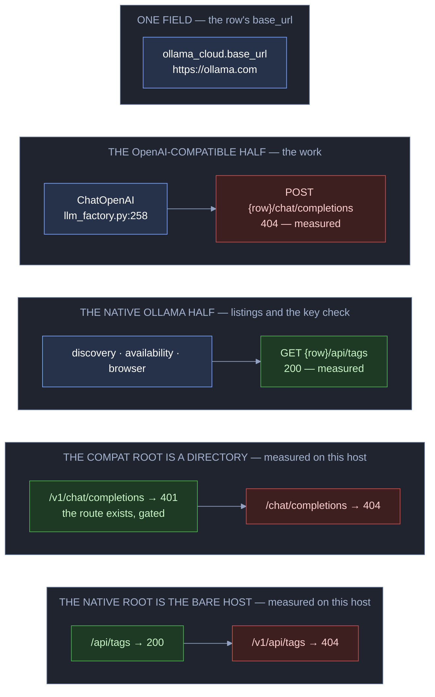
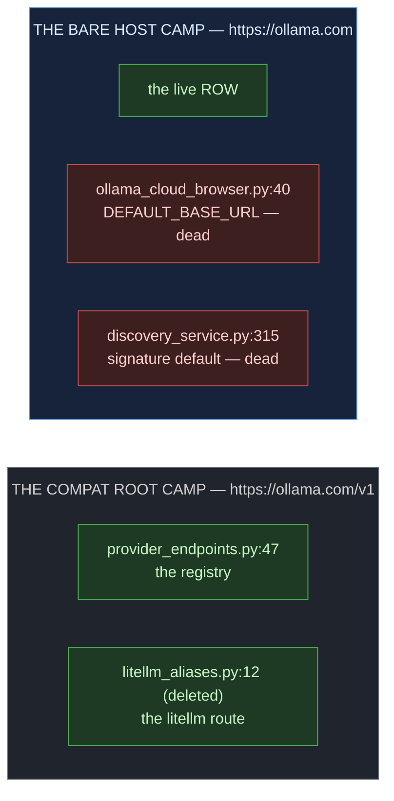
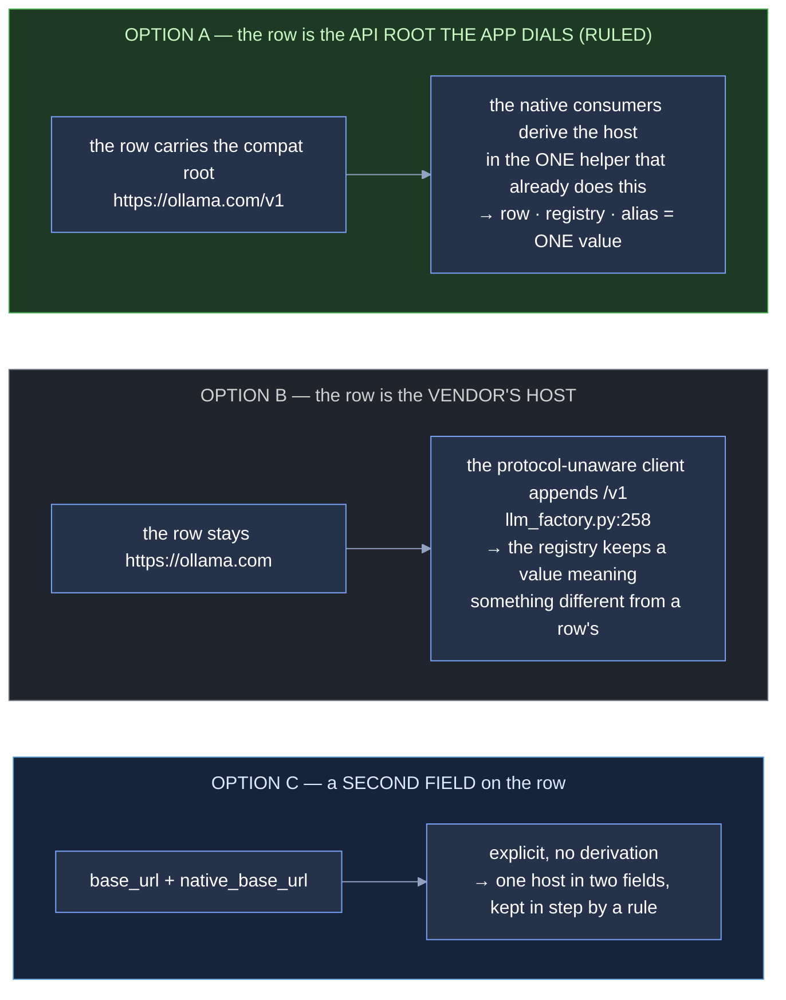
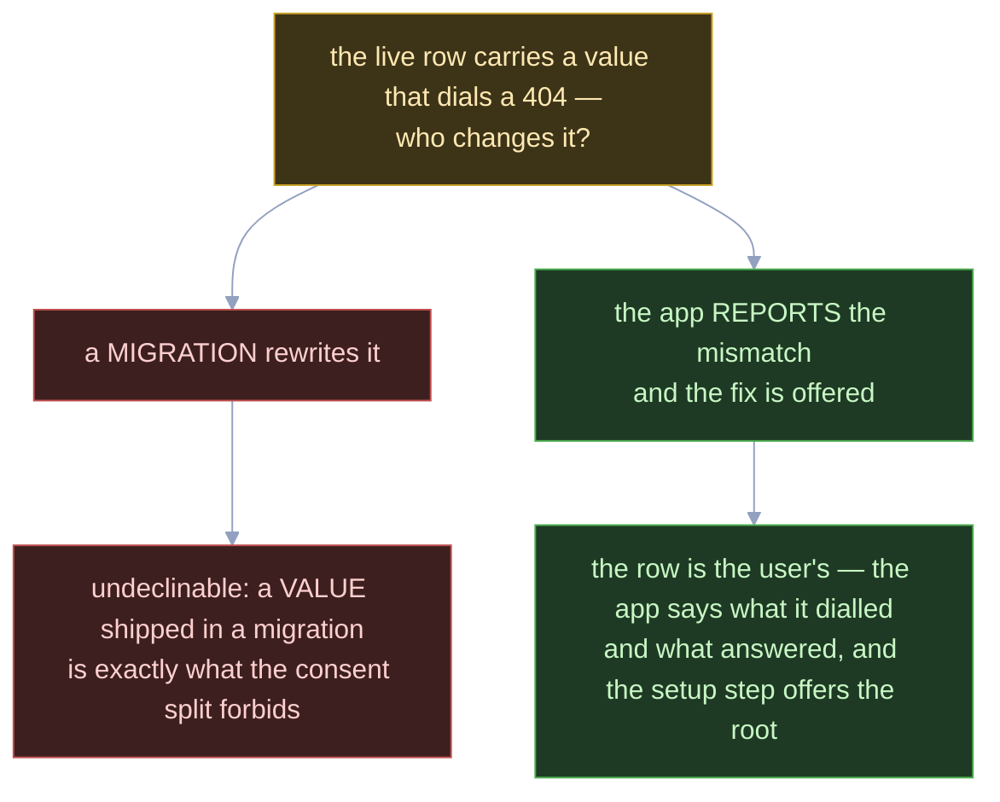
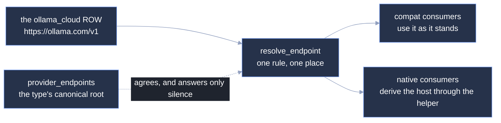

# The Ollama Cloud row — one endpoint field, two API roots

**Status**: **RULED — option A; both landing steps are in, and the row itself is unchanged (which is the
ruling's point).** The user: *"Let's go with option A"* — **a provider row's `base_url` names the API root
the app DIALS**, so an `ollama_cloud` row carries `https://ollama.com/v1` and the native consumers derive
the host from it. **Stage 1** (`db0f05da`): one derivation (`provider_endpoints.native_root`), adopted by
`join_probe_url`, the discovery service and both model browsers, and the endpoint defaults retired.
**The report** (`bb177a45`): a row that carries the hybrid type's native root is now NAMED — what it
would dial, and the value to set — on the provider test card, in the capability read-out, and in the log
at the moment of dispatch. **The app still does not change the row**: the user ruled *"report, then
offer"*, and applying the offer is the optional setup step's job (EXA'S INSTALLATION
SKILL). The remaining consolidation in this family — the alias map's duplicate, its ROW-NAME key, and the
two cognitive-pipeline modules that hand-roll the litellm string — is **FILED as its own item**
(the LITELLM PROVIDER MAPPING item), on the user's ruling of 2026-10-11: *"Stop here and
file the rest as its own item."*
**Found**: 2026-10-11, re-measuring F2's residue (the service-literals arc) after the embedding family
closed. Every line number below was re-measured then, not carried over; the HTTP results are live.
**Where**: `backend/app/domain/providers/` (`llm_factory.py`, `provider_endpoints.py`,
`litellm_aliases.py` *(deleted 2026-10-12 — the litellm mapping's one home is `litellm_route.py` now)*, `discovery_service.py`, `ollama_cloud_browser.py`, `availability.py`),
`backend/app/api/v1/providers/models_router.py`, and the live `providers` table in `cogitate.db`.

---

## The short version

The provider type `ollama_cloud` speaks **two protocols whose roots are different directories on the same
host**: the OpenAI-compatible API at `https://ollama.com/v1` (where a completion is sent) and the native
Ollama API at `https://ollama.com` (`/api/tags`, `/api/chat`). One row field is handed to both, and the
live row says **the bare host** — correct for the native half, and the reason the OpenAI-compatible
adapter builds a client that POSTs to `https://ollama.com/chat/completions`, which answers **404**
(`/v1/chat/completions` answers 401 — it exists and is gated). The address itself is written **five
times**, split into exactly those two camps, so nothing in the app can say which is right: the registry
and the litellm alias say `/v1`, the row, the browser's default and a dead discovery default say the
bare host. The one adapter that cannot tell the difference is the one that dials.

## The evidence

| # | site | what it is | who reaches it |
|---|---|---|---|
| 1 | live `providers` row `ollama_cloud.base_url` = `https://ollama.com` | the decision, as configured | `resolve_endpoint`, which hands it to **both** protocol families |
| 2 | `domain/providers/llm_factory.py:258-293` | `_create_ollama_cloud_client` — its docstring says *"Ollama Cloud exposes an OpenAI-compatible endpoint at https://ollama.com/v1"*, then passes `base_url=base_url`, i.e. the row's bare host | every `get_llm_from_config` caller holding this row |
| 3 | `domain/providers/provider_endpoints.py:47` | the registry: `"ollama_cloud": "https://ollama.com/v1"` — the compat root | only a row that declares none; on this install none does |
| 4 | `domain/providers/litellm_aliases.py:12` *(deleted 2026-10-12; the address comes from the row now)* | `("openai", "https://ollama.com/v1")` — the litellm route's api_base | `completion_service`, the cognitive executor, the chat router, the title service |
| 5 | `domain/providers/ollama_cloud_browser.py:40` (measured 2026-10-11) | `DEFAULT_BASE_URL = "https://ollama.com"` — **no app caller**, and one TEST omitted `base_url` (`test_ollama_cloud_browser.py:91`), whose value never dialled (the key check runs first, so the default was read and never used) | a test path only — **corrected here at the stage-1 landing**; retired |
| 6 | `domain/providers/discovery_service.py:315` (measured 2026-10-11) | signature default `base_url: str = "https://ollama.com"` — **unreachable**: both callers (`management_router.py:607`, `curated_models_service.py:1021`) pass a resolved endpoint | nothing; retired |
| 7 | `domain/providers/availability.py:86-100` | `join_probe_url` — the app's OWN written rule: *"Managed local base_urls carry the litellm-style trailing /v1"*, and a compat probe path's leading `/v1` is dropped against it | every availability probe and key check |

**How far the value actually travels** — followed to the wire, not assumed:

- **The compat half is broken.** `resolve_endpoint("ollama_cloud", row.base_url, row.name)` returns the
  row's bare host; the adapter hands it to `ChatOpenAI`. Rebuilt with the app's own construction and an
  `httpx.MockTransport` (no network), the request URL the SDK composes is
  **`https://ollama.com/chat/completions`**. Dialled live and keyless: **404**. The same path with the
  compat root, `https://ollama.com/v1/chat/completions`, answers **401** — the route exists and is gated,
  so it is the path that is wrong, not the credentials.
- **The native half is right — and only while the value stays bare.** `{row}/api/tags` → **200**;
  `{row}/v1/api/tags` → **404**. So the native consumers (`discovery_service` dials
  `f"{base_url}/api/tags"`, `availability` probes `/api/chat`, the browser) are correct today and would
  break under a naive "put `/v1` on the row" fix. The two roots are mutually exclusive on this host.
- **The dead defaults are still a second answer.** #5 and #6 are unreachable in app code *and* in tests
  (the one test of the cloud discovery passes `base_url` too), so they are backups a reader would take
  for the live value. Their disposition is this page's, not a separate one: they are homes of the same
  fact.
- **The local `ollama` row is bare too, and that is not a precedent.** Nothing hands it to an
  OpenAI-compatible client: local Ollama is reached through `ChatOllama` and through litellm's
  `ollama_chat` handler, both of which compose the native paths themselves. The cloud row is the one
  place a bare host meets a protocol-unaware OpenAI client.

**What stage 1 retired** (`db0f05da`) — the defaults measured above, and the two siblings this
measurement found in the same class:

- **#5 and #6**, the two rows above — the cloud browser's class default and the discovery service's
  cloud signature default;
- **their siblings**: the local browser's `DEFAULT_BASE_URL` (`ollama_browser.py:35`) and the other two
  discovery signature defaults (`discovery_service.py:143`, `:226`) — same class, measured reached by
  no app caller either (every call site passes a resolved endpoint, and the one discovery test passes
  one too).

Both browsers now take the RESOLVED endpoint as a required argument, and the route that calls them
resolves it or refuses with a 409 — `_endpoint_or_refuse` in `api/v1/providers/models_router.py`, the
same shape as that file's discovery branches.

**Who builds a client from this row today** — read off the live database, not assumed:

- **Reached:** `workflows/nodes/agent_nodes.py:88-91` builds its client from the row
  (`agent_nodes.py:63`, `base_url=provider_config.base_url`) — and the live agent **`Lois` (`id=56`,
  `provider='ollama_cloud'`, `model='nemotron-3-super'`, active)** is that shape, so a workflow node
  running her builds the 404 client. `domain/pseudo_agents/spec.py:241` reaches it whenever a chain
  step names such a row.
- **Not reached on this install:** `get_llm_for_capability` never builds one — measured from
  `capability_services`, `chat` and `title` name the `deepseek` and `llama` rows, `workflow-llm`,
  `memory` and `summary` name `deepseek`, and `embeddings` names none.
- **Not affected:** the chat path. Chat goes through litellm, whose alias supplies `/v1` itself — which
  is also why the defect has stayed invisible: the busiest consumer never reads the row.

## The issue, drawn

**Figure key** — red: the defect · green: a home the app honours or the recommendation · amber: the decision point.

**Fig. 1 — one field, two protocol families, and the root each one needs.** Red: the path the row's value
produces and the 404 it reaches · green: the native path it happens to serve, and the compat route that
does exist.

The same value is right for one consumer and wrong for the other, and neither consumer can tell: both
call `resolve_endpoint` and both get the row's own string.

**Fig. 2 — the five homes of one address, and the protocol each camp serves.** Red: the two defaults
nothing reaches · green: the three sites the app does read.

The camps are not a drift between careless writers — they are the two roots of one host, written by
consumers that each knew their own protocol. Five homes, and the one that decides is the one whose
protocol is unstated.

## The options

**Fig. 3 — the three options, grouped vertically with the ruling marked.** Each box reads left to right:
what it does, what it costs, where it ends.

| | A — the row is the API root | B — the row is the vendor host | C — a second field |
|---|---|---|---|
| homes of the address after | **1** (row = registry = alias) | 3 (row, registry, alias stay apart) | 2 (both on the row) |
| the compat path | correct: the adapter receives a `/v1` root | correct once the adapter appends it | correct |
| the native paths | derive the host, in ONE place | untouched | untouched |
| what changes on this install | the live row's value (one edit) + 3 native call sites | one adapter | a column, a migration, a UI field |
| agrees with the app's own written rule | yes — `join_probe_url` already declares the field to be the litellm-style root, and every other live row obeys it (`openrouter.ai/api/v1`, `api.groq.com/openai/v1`, `127.0.0.1:8080/v1`) | no — the field would mean the host on this row and the root on `llama`'s | partly — it is honest but it re-homes one host twice, the shape the arc keeps retiring |
| cost | small; a helper case plus a row edit | smallest; one line | medium |

**RULED: A, staged** (2026-10-11, the user). Stage 1 is mechanical and touches no stored value: give the
native consumers the host through the ONE helper that already owns this normalization (`join_probe_url`
grows the inverse case — a `/api/*` path against a `/v1` base drops the `/v1`), and retire the two dead
defaults (#5, #6) rather than re-point them. Stage 2 is the row's value, and it is the decision below.

**One consequence to write down before it is misread: the local `ollama` row does NOT change.** Under A
the row names the API root the app dials *for that type* — and every consumer of the local row is native
(`ChatOllama`, and litellm's `ollama_chat` handler, which composes the native paths itself), so
`http://localhost:11434` already IS the root it is dialled at. `ollama_cloud` is the type that is dialled
through an OpenAI-compatible client, which is why its root is `/v1` and its listings derive.

**The rejected options stand here, with what they lost on.** **B** — the row as the vendor's host — loses
because it fixes the dial while leaving the field meaning two different things depending on which
protocol reads it: the "second answer to a decided question" this arc exists to remove, and the exact
reason `resolve_endpoint` was given one rule. **C** — a second field — loses because a derived root does
not deserve a stored copy; it is more structure than the fact needs, kept in step by a rule.

## The one decision the page asked — and the answer

The ruling settled the field's MEANING; the one thing it left open was **how this install's row comes to
hold the right value**. The user answered it on 2026-10-11: *"report, then offer"* — the app says what it
would dial and what to set, and never rewrites the row.

**Fig. 4 — the one decision, RULED: *report, then offer*.** Red: the path that re-commits the sin (a value
in an undeclinable migration) · green: the ruled path — the app reports, the row stays the user's · amber:
the question.

The row is user data — no UI preset writes that address, so it was typed. A migration that silently
rewrites it is the app deciding a value for the user, which the arc ruled out when the `embeddings`
capability was made to ship empty. The ruled path is built (see the report section below); the OFFER's
application belongs to the optional setup step, which is its own item.

**Fig. 5 — option A's end state: one value, and the one derivation in the one place that already owns it.**
Stage 1 landed the derivation and retired the defaults; the row's own value is stage 2.

## What stage 1 actually shipped (`db0f05da`)

- **`provider_endpoints.native_root`** — the one place that answers "which root does a NATIVE path
  belong to", beside `resolve_endpoint` in the module that already owns the endpoint rules. A bare host
  comes back unchanged, which is why the local `ollama` row is untouched by the derivation.
- **`availability.join_probe_url`** — grew the inverse case: a `/api/*` path against a `/v1` base
  composes against the native root instead of dialling `…/v1/api/*` (measured 404). The compat case it
  already handled (the `2026-09-09` `/v1/v1/models` find) is unchanged and still covered.
- **`discovery_service`** — the two native discovery paths dial `native_root(base_url)`; all three
  `base_url` parameters are now required.
- **both model browsers** — no `DEFAULT_BASE_URL`; the resolved endpoint is required.
- **`api/v1/providers/models_router.py`** — the four browser call sites resolve through
  `_endpoint_or_refuse` (row → type's canonical → 409), so a row with no endpoint is reported rather
  than dialled.
- **Tests**: `backend/tests/unit/providers/test_native_api_root.py` — the rule, the join in both
  directions, what the three discovery paths actually dial, and the route's refusal (13 at this landing;
  six more came with the report below). Verified: 233 passed in `tests/unit/providers`, `mypy app` clean
  (422 files), the app restarted on the new code, and the cloud browse route answered 200 with 18 models
  **from the cache** (the resolution path ran; no live call was made).

## What the report landed (`bb177a45`)

The ruled path is *report, then offer*, and the report needed one fact the app did not have written down
anywhere: **which types it dials over BOTH protocols.**

- **`provider_endpoints.NATIVE_API_ROOTS`** — that declaration, one entry today (`ollama_cloud`). Without
  it the app cannot tell a row carrying the native root from one carrying the compat root, and the
  tempting cheaper check (comparing a row against the type's canonical endpoint) fires on a row that is
  perfectly fine: the live `deepseek` row says `https://api.deepseek.com` while the registry's canonical
  endpoint for the type carries `/v1` — the same shape, and NOT a defect, because no native API is dialled
  for that type. A check without this table would report the install's DEFAULT row on every single call.
- **`compat_root_offer(provider_type, base_url)`** — the offer: the value to set, or `None`. Deliberately
  silent for a row on a different host (a proxy, a mirror — the app cannot know which root it serves) and
  for a row already on the compat root.
- **`Availability.note`** — the report as its own payload field, because `test_card`'s HEALTHY branch
  builds its own sentence: a report that lived only in `reason` was invisible exactly where everything
  looked fine. The card appends the note; the capability read-out carries it in `availability_reason`.
- **`llm_factory.get_llm_from_config`** — the same report at the moment of dispatch, so a workflow run
  against such a row is explicable in the log.
- **Verified live:** `POST /providers/config/5/test` → `connected`, 18 models, and the message
  *"…— this row carries the service's NATIVE root (https://ollama.com) where the app dials the
  OpenAI-compatible one — a completion goes to https://ollama.com/chat/completions; set the row's endpoint
  to https://ollama.com/v1"*. The `deepseek` row's card (id 3) is **unadorned** — the false positive this
  table exists to prevent. Tests: 19 in `test_native_api_root.py`, 240 in `tests/unit/providers`, 35 across
  the availability/capabilities API suites; `mypy app` clean.
- **What it does NOT do:** change the row, or reach inside the optional setup step that will apply the
  offer. The row still says `https://ollama.com` on this install — by the ruling, that is the user's to
  change.

## The consumer stage 1 missed — the chat path (`5669dee6`)

Stage 1 derived the native root for the discovery service, the availability probes and both model
browsers. It missed the busiest consumer of all, and measuring litellm's own source is what exposed it:

**litellm's `ollama_chat` handler composes its own paths onto whatever `api_base` it is given** —
`{api_base}/api/chat` — and its `get_server_api_base` strips a trailing `/api/chat` and **nothing else**
(`litellm/llms/ollama/common_utils.py`). The `openai` prefix posts to `{api_base}/chat/completions`. So
the root a call needs depends on the HANDLER, and this app picks two different handlers for the same
provider string:

| path | model string for `ollama_cloud` | api_base it was handed | dialled |
|---|---|---|---|
| chat (router + context builders) | `ollama_chat/<model>` | the row's value, verbatim | `/api/chat` — correct only while the row stays bare |
| completion service · executor · title | `openai/<model>` | the alias map's `https://ollama.com/v1` | `/v1/chat/completions` — correct |
| **the chat FAILOVER rebuild** | `ollama_chat/<model>` | the alias map's `https://ollama.com/v1` | **`/v1/api/chat` — measured 404** |

That last row was a **live defect, not a future one**: any `ollama_cloud` BACKUP candidate in a chat
failover dialled a path that does not exist. And the first row is why the report's offer needed this
before it could be acted on — the same derivation, at the third consumer:

- **`chat/context.py` `litellm_api_base(provider, model, endpoint)`** — the ONE place that reads the
  handler `_litellm_model_name` chose and answers the root it needs: the native root for the ollama
  family, the endpoint as it stands for everything else. Passing the RAW model is deliberate —
  `_litellm_model_name` is not idempotent for a remapped provider whose model is already prefixed, and
  one function deciding the handler while this one only reads that decision is what keeps the two from
  disagreeing about the protocol.
- Adopted at the three sites that hand an endpoint to litellm: `chat/context.py`'s context builder,
  `chat/router.py`'s `build_llm_request`, and the failover rebuild.
- **Verified on the live rows** (no network): every row's pair is now consistent — `ollama` gets
  `ollama_chat/… + http://localhost:11434`, `ollama_cloud` gets `ollama_chat/… + https://ollama.com`,
  `llama` gets `openai/… + http://127.0.0.1:8080/v1`, and the compat families get their own roots
  unchanged. Re-run with the row set to `https://ollama.com/v1` (the offer taken) and the chat path
  still dials `/api/chat`.
- Tests: `tests/unit/test_litellm_model_name.py` (12 — the mapping, the root, and the failover rebuild
  both ways). Full fast suite after it: **2465 passed, 2 failed** — the two pre-existing
  `test_langfuse_v4_adapter` failures that reproduce on a clean tree.

**Still a home of the same decision, filed rather than fixed:** the two cognitive-pipeline modules
(`memory_manager._ask_service`, `conversation_compactor._summarize_with`) hand-roll
`f"{provider}/{model}"` with NO `api_base` and never consult the alias map — for an `ollama_cloud` or
`llama` candidate they would send a provider prefix litellm does not know. On this install both
capabilities resolve to `deepseek`, so nothing is broken today.

## What is already settled (do not re-litigate)

- **The endpoint rule.** *Row only*: a row's `base_url` wins; else the provider type's canonical entry in
  `provider_endpoints`; else a REPORT — and a row that declares none is logged (`cdaf0eb8`, and the
  discovery half at `edc92a80`). `resolve_endpoint` is that one rule.
- **A single-model local server names itself** (2026-10-09): the loopback probe takes what the server
  reports; it does not change this issue, which is about a hosted row.
- **The consent split** — structure in the seed, a VALUE in an optional setup it can be declined from,
  rules in code (the `embeddings` capability ships EMPTY, `e370818b`). Fig. 4 is that ruling applied.
- **This issue's predecessor, and what it did NOT establish.** `wiki/issues/resolved/embedded-service-literals/local-embedding-server.md`
  notes the same five homes as *"one address, three values, two camps"* (its Fig. 5) and reads it as a
  question of which value is right, settleable by one real call. The measurement here refines it: the two
  camps are **the two roots of one host**, each correct for its own protocol, so "one of the five is
  wrong" is not the frame — the field's MEANING is. The predecessor's evidence rows stand; this page
  replaces that paragraph's reading of them.
- **Deliberately out of scope:** the file-clerk family's own literal
  (`workflows/nodes/file_clerk_nodes.py:354`, its own banked item) and the two provider-slug display maps
  (`api/v1/providers/router.py:68`, `api/v1/external_agent_router.py:313`) — display data, their own
  ruling. Neither dials anything this page is about.

## Where the work would live

**The rest of this family is FILED, not open here** — the LITELLM PROVIDER MAPPING item
(the alias map's duplicate of this address, its ROW-NAME `llama` key, and the two cognitive-pipeline
modules that hand-roll the litellm string), filed 2026-10-11 on the user's ruling. The arc's own worklist,
with the residue marked, is archived at `local/roadmaps/archive/embedded-service-literals/cleanse.md`. Tests belong beside the
existing endpoint tests: `backend/tests/unit/providers/` (`test_endpoint_resolution.py`,
`test_native_api_root.py`, `test_ollama_cloud_discovery.py`) and
`backend/tests/unit/test_litellm_model_name.py`.
