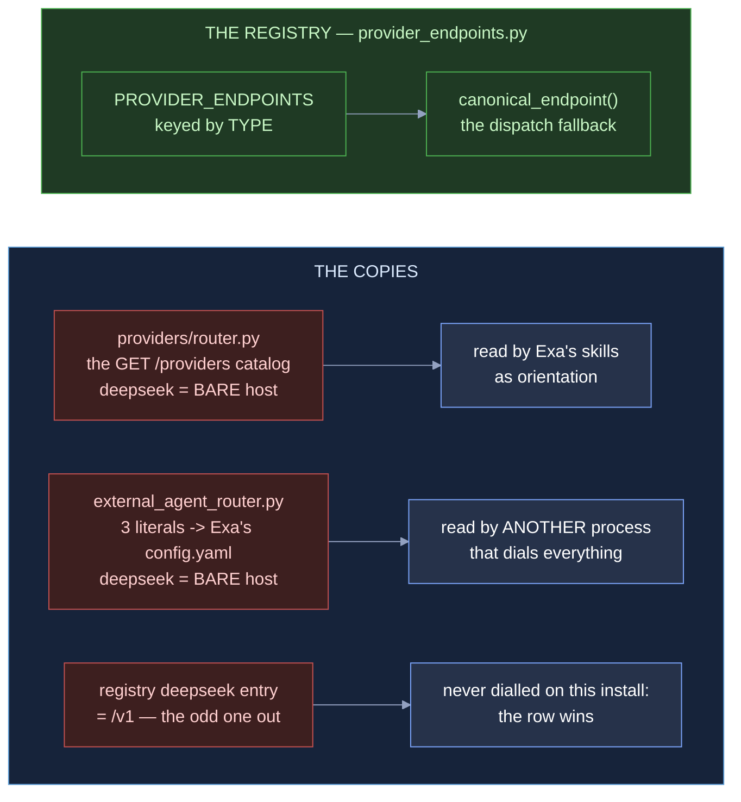
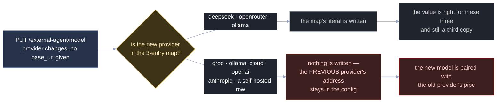
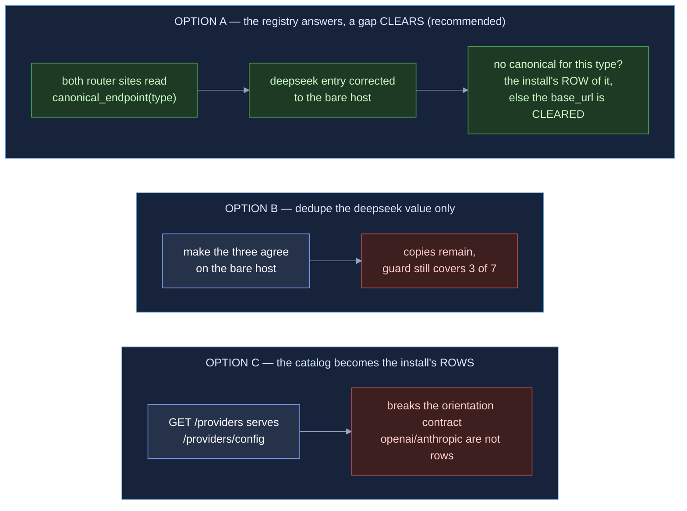
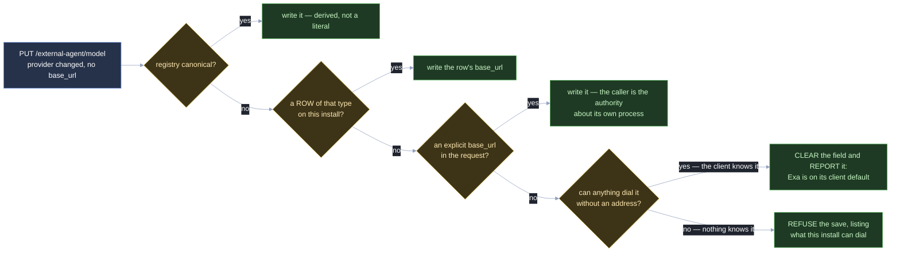

# The provider addresses — one registry, three copies, and a guard that only covers three types

**Status**: **LANDED — `458d8462` (the refusal) and `a7f41276` (the value and the catalog).** RULED
2026-10-12: option A, staged — *"Let's go with Recommendation: A, staged."* The registry is the one home; the
catalog reads it instead of repeating it; Exa's address derives through `address_for_client`, which refuses a
provider nothing can dial; and the registry's deepseek entry now carries the value its own documentation
names.
**Found**: 2026-10-11, the service-literals arc's close-out, re-measured **2026-10-12** (every line number
and every value below is from today, plus the live row, Exa's live config, and the vendor's own docs).
**Where**: `backend/app/domain/providers/provider_endpoints.py`, `backend/app/api/v1/providers/router.py`,
`backend/app/api/v1/external_agent_router.py`, `backend/app/api/v1/chat/context.py`, the live `providers`
table in `cogitate.db`, and `Paths.exa_home/config.yaml`.

---

## The short version

**One fact — where does this provider type live — is written in three places, and they disagree.** The
registry holds the vendors' published endpoints keyed by TYPE (`PROVIDER_ENDPOINTS`: ollama, ollama_cloud,
openrouter, deepseek, groq — and deliberately NOT openai/anthropic, which must be declared by a row). A
five-entry dict in the providers router repeats four of them for the `GET /providers` catalog, and a
three-entry map in the external-agent router writes a third copy **straight into Exa's `config.yaml`**.

The deepseek value is the one that disagrees: the registry says `https://api.deepseek.com/v1`, both router
copies say the bare host, the LIVE ROW says the bare host, Exa's live config says the bare host — and the
vendor's own current documentation names `https://api.deepseek.com` as the OpenAI `base_url` and does not
mention `/v1` at all. That is the question the 2026-10-11 probe could not settle: unauthenticated, all four
paths answer 401.

**And the map's coverage is the defect the filing did not measure.** Only `deepseek`, `openrouter` and
`ollama` have a value; a save that switches Exa to `groq`, `ollama_cloud`, `openai`, `anthropic` or a
self-hosted row passes no `base_url`, and the writer only writes when one is given — so the previous
provider's address survives, pairing the new provider's model with the old provider's pipe.

## The evidence

| # | site | what it is | who reaches it |
|---|---|---|---|
| 1 | `domain/providers/provider_endpoints.py:45-51` | the registry: `PROVIDER_ENDPOINTS` keyed by TYPE — `deepseek: https://api.deepseek.com/v1`, `ollama_cloud: https://ollama.com/v1`, `groq: …/openai/v1`, `openrouter: …/api/v1`, `ollama: http://localhost:11434`; `openai`/`anthropic` absent ON PURPOSE | `canonical_endpoint` — the dispatch path for a row that declares no endpoint |
| 2 | `api/v1/providers/router.py:64-91` | the `PROVIDERS` catalog dict — five types with `name`, `base_url`, `type`, served by `GET /providers` | Exa's own skills (`cogitate-provider-health`'s surface map calls it *"Catalog (informational/UI)"*), and any UI list |
| 3 | `api/v1/external_agent_router.py:311-316` | the literal map written into Exa's config when no `base_url` is passed: `deepseek` → bare host, `openrouter` → `/api/v1`, `ollama` → `localhost:11434` — **three of seven types** | `PUT /external-agent/model` → `_write_exa_model_config` → `Paths.exa_home/config.yaml` |
| 4 | `api/v1/external_agent_router.py:271-272` | `if base_url: cfg["model"]["base_url"] = base_url` — a None writes NOTHING, so the old value stays | the same route |
| 5 | live `providers` row 3 | `deepseek` → `https://api.deepseek.com` (bare) — and this install runs its agents and Exa on it | `resolve_endpoint` (the row wins over the registry) |
| 6 | live `.hermes/config.yaml` | `model.default deepseek/deepseek-v4-flash`, `provider deepseek`, `base_url https://api.deepseek.com` | Exa's Hermes process |
| 7 | `api/v1/chat/context.py:554-577` | `litellm_api_base` — the app's OWN ruled answer to *which root a litellm handler needs*: the ollama family gets `native_root(endpoint)`, everything else the endpoint as it stands | the chat failover, the cognitive executor, the title service |
| 8 | vendor docs, read 2026-10-12 | `base_url (OpenAI) = https://api.deepseek.com` — `/v1` does not appear on the page | — |

**How far the value travels, followed to the wire:** the app's own dispatch reads the ROW first
(`resolve_endpoint(type, row.base_url, name)`) and the registry only for a row that declares none — which
is why the registry's `/v1` has never dialled on this install while the router copies and Exa's config have
both been live. The catalog's dict is read by nothing that dials; Exa's config is read by another process
that dials everything.

**The guard's gap, measured** (a scratch copy of Exa's config directory, never the operator's):

```
save provider=deepseek      base_url written='https://api.deepseek.com'   -> config: that value
save provider=groq          base_url written=None        -> config STILL: https://api.deepseek.com
save provider=ollama_cloud  base_url written=None        -> config STILL: https://api.deepseek.com
save provider=openai        base_url written=None        -> config STILL: https://api.deepseek.com
```

The guard's own comment explains why that matters: *"a model-only save used to KEEP the previous
provider's base_url — the deepseek key went to OpenRouter → HTTP 401 Missing Authentication header"*. The
fix covered the three types it enumerated and left the mechanism (`only write when given`) in place for
every other type — including the two the app gained later (`ollama_cloud`, `groq`).

## The issue, drawn

**Figure key** — red: the defect · green: a home the app honours or the recommendation · amber: the decision point.



**Fig. 1 — one registry, two copies, and the value that disagrees.** Red: the registry's deepseek entry
(the only one of the three that neither the live row nor the vendor's docs agree with) and the two copies
that repeat an address the registry already owns · green: the registry itself, which the dispatch path
honours.



**Fig. 2 — the guard covers three types and silently fails the rest.** Red: the stale address and the
mis-pipe it produces — the failure the guard's own comment was written about · amber: the branch that
decides · grey: the covered path, which is correct but still a third copy of the address.

## The options



**Fig. 3 — the three options, the recommendation marked.** Red: the consequences that keep the class ·
green: the option that gives the fact one home and makes the gap impossible.

| | A — registry answers, gaps clear | B — dedupe the value | C — the catalog becomes rows |
|---|---|---|---|
| sites removed | both copies; the guard's dead branch | none | the dict, but not the class |
| where it breaks down | needs one decision: what a type with NO canonical endpoint gets | nothing improves for `groq`/`ollama_cloud`/`openai` — a stale address survives | the catalog stops listing types this install has no row for, which is its orientation job |
| agrees with earlier rulings | the row-wins/registry-fallback pair, the `ollama_cloud` root ruling, `litellm_api_base` | nothing conflicts | conflicts with `ollama_cloud`'s *"the row is the decision about which server answers"* only by accident |
| cost | ~15 lines in three files + tests | ~2 lines | a contract change |

**Recommendation: A, staged.** Stage 1 is the value and the gap, in one commit: the registry's deepseek
entry corrected to the bare host (the docs, the live row and Exa all say so), and Exa's write derived —
`canonical_endpoint(type)`, else the install's row of that type, else **clear** the field instead of leaving
a stale one. Stage 2 gives the catalog the same reading, keeping its declared values only for the two types
the registry declines by design, marked as display defaults.

## The remainder: an error condition, not a default

The user's read, and it is the right one: *a type with no canonical endpoint and no row on this install is
not a case to invent a value for.* And **whether anything can dial it is answerable at the write**, because
the client that dials Exa — Hermes, over litellm — carries its own per-provider defaults. Measured today
with `litellm.get_llm_provider`:

| provider | litellm's own `api_base` |
|---|---|
| `deepseek` | `https://api.deepseek.com/beta` — its own third root |
| `groq` | `https://api.groq.com/openai/v1` |
| `mistral` | `https://api.mistral.ai/v1` |
| `ollama` | `http://localhost:11434` |
| `openai` · `anthropic` · `openrouter` | none returned — resolved inside litellm, still dialable |
| a name litellm does not know | **raises** — *nothing can dial it* |

**How the error condition can even arise:** the model card's provider field is FREE TEXT
(`AgentIntegration.tsx:272-279`, placeholder `deepseek`), so a typo reaches this path from the app's own
surface — one keystroke, no picker. It is also reachable by Exa itself, a script, or a hand-made request. The
refusal, the response shape and the acceptance rule are their own page:
`wiki/issues/resolved/embedded-service-literals/exa-model-save-undialable-provider.md`.



**Fig. 4 — the sweep: fix it, or remove it.** Green: every path that ends in a config something can dial —
three that FIND an address, and two that decide what happens when none can be found · amber: the questions
that route it. Red is absent on purpose: this figure is the treatment, not the defect.

**Fix it, or remove it — both, split by what the client can do:**

- **fix** = derive the address from the registry, else from the install's ROW of that type; and when neither
  exists but the client knows the provider, **clear the field and report it** in the response — Exa is on its
  own default and this app names no address for it. *"Report, then offer"* is the `ollama_cloud` discipline,
  and it applies verbatim.
- **remove** = **refuse the save** when there is no canonical endpoint, no row, no explicit address, and no
  client that knows the provider. Nothing can dial it, so a save cannot produce a working config — and
  writing one anyway is how a stale address survives, which is the defect this page exists to remove.

**Why refuse rather than clear-and-warn in that last case:** clearing still leaves Exa naming a provider
nothing can dial, and the Hermes process fails at spawn — far from the save that caused it. The house shape
for this is the name ban: an exact-name duplicate agent is rejected *before* the row is built, with the
reason and what would work instead.

**Settled since:** the refusal is a behaviour change on Exa's surface — ask-first in this house — and it was
ruled and **LANDED on 2026-10-12** (`458d8462`), its own page now resolved. The escape hatch holds either
way: an explicit `base_url` in the request is always honoured, because the caller is the authority about its
own process.

## What is already settled (do not re-litigate)

- **THE `ollama_cloud` RULING (2026-10-11, option A).** *"A provider row's `base_url` names the API root the
  app DIALS"* — the registry holds the type's canonical root, native consumers derive it
  (`provider_endpoints.native_root`), and a hybrid row that carries the wrong root is **reported, not
  rewritten**: *"report, then offer."* Its docstring in `provider_endpoints.py` is the statement of the rule.
- **`litellm_api_base` (2026-10-11, `5669dee6`).** Which root a litellm handler needs is derived from the
  HANDLER, not decided twice: the ollama family gets the native root, everything else the endpoint as it
  stands. Exa's Hermes process is a litellm client, so this is the app's own answer to the question the
  literal map answers badly.
- **The sanctioned pair.** A row's own `base_url` WINS and the registry answers only for a row that declares
  none — the same row-wins/registry-fallback shape the arc closed as *measured, not a defect* for
  `config_service.py:633`.
- **The guard's intent stands.** *"The config can never pair a model with the wrong pipe"* (2026-08-22) —
  this page keeps that promise and extends it to the types the map never covered.

## What shipped

**Stage 3 — the refusal first (`458d8462`), because it was the user's go.** `provider_endpoints.address_for_client`
decides what goes into another process's config; the route refuses a provider nothing can dial and answers
4xx rather than the 200 the model card read as success. Its own page is
[[issues/resolved/embedded-service-literals/exa-model-save-undialable-provider|the save that could not say no]].

**Stage 1 — the value (`a7f41276`).** `PROVIDER_ENDPOINTS["deepseek"]` was `https://api.deepseek.com/v1`, a
value no source in this install could point at; it now carries the bare host its own docs name and that the
live row and Exa both use. **This was urgent, not cosmetic:** stage 3 writes the TYPE's canonical endpoint, so
the next deepseek save would have overwritten Exa's working bare host with the un-sourced `/v1`.

**Stage 2 — the catalog (`a7f41276`).** `GET /providers`'s dict repeated four of the registry's addresses; it
now reads them, keeping a declared display value only for the two types the registry declines by design.

**Verified:** the endpoint's live response is **byte-identical before and after** the catalog change — a
de-duplication with no observable behaviour change — and `address_for_client("deepseek")` now derives the same
value Exa's config already holds (so the next save does not churn it). 417 provider/endpoint/catalog tests
pass; `mypy` clean. The tests stopped being a second home too: three places held a copy of the deepseek value
(`ADAPTER_CASES`, one of this arc's own new tests, and the dict itself), and all three now read the registry,
whose CONTENT is pinned once, with its sources, in `test_provider_endpoint_defaults.py`.
