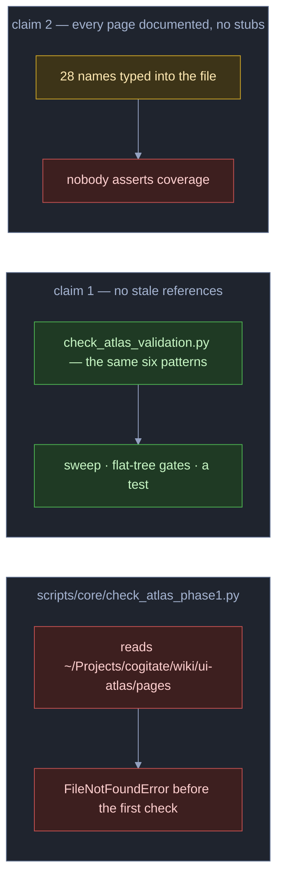
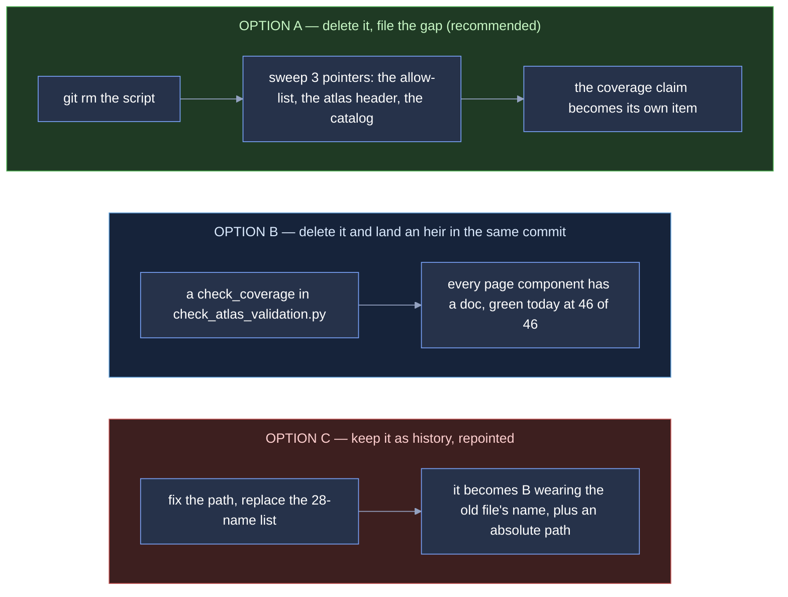

# The atlas Phase-1 gate cannot run, and the claim it made has no heir

**Status**: **LANDED — `7fc54da2`** *(ruled 2026-11-18: "we can go with both recommendations")*.
Option A, staged: the script is deleted and its three pointers swept; the coverage claim is filed
as its own item.
**Found**: 2026-11-18, ruling on the release plan's two open items. Every line number and every count
below was re-measured today, not carried over.
**Where**: `scripts/core/check_atlas_phase1.py`, `scripts/core/check_atlas_validation.py`,
`scripts/core/check_stale_references.py`, `scripts/testing/verify_flat_tree.sh`, `wiki/atlas/ui/`,
`wiki/docs/script-catalog.md`.

---

## The short version

`check_atlas_phase1.py` is a one-off gate for the UI atlas's Phase 1 (*"all 28 page docs filled, no TODOs,
no stale refs"*), and it is **inert**: it hardcodes this machine's path and a directory that stopped
existing when the atlas moved (`~/Projects/cogitate/wiki/ui-atlas/pages`), so it dies with
`FileNotFoundError` before checking anything — measured today — and no hook, sweep, test or structural
gate calls it. Its stale-name half is genuinely covered elsewhere: `check_atlas_validation.py` carries
**the same six patterns** and runs in the sweep, the flat-tree gates and a test. Its other half — does
every page have a doc, and is any doc still a stub — was never carried anywhere, and the tree has moved
under the list it used: two of its 28 names no longer exist and 21 real docs are not on it. So the ruling
is a deletion, and the second question is what, if anything, inherits the claim.

## The evidence

| # | site | what it is | who reaches it |
|---|---|---|---|
| 1 | `scripts/core/check_atlas_phase1.py:7-8` | `project = os.path.expanduser("~/Projects/cogitate")`, `pages_dir = …/wiki/ui-atlas/pages` — an absolute path to this machine, and a directory that does not exist | nothing |
| 2 | `scripts/core/check_atlas_phase1.py:26` | `os.listdir(pages_dir)` — the crash site, before a single page is read | any manual run |
| 3 | `scripts/core/check_atlas_phase1.py:51-59` | `expected` — 28 page names typed into the file, compared against doc **filenames** (`:61-62`) | nothing |
| 4 | `scripts/core/check_atlas_validation.py:34-41` | `STALE_PATTERNS` — **the same six patterns**, verbatim (diffed against `check_atlas_phase1.py:11-18` today) | the sweep (`sweep/backend.py:891,909`), `verify_flat_tree.sh:39`, `backend/tests/test_atlas_validation.py` |
| 5 | `scripts/core/check_atlas_validation.py:110-134` | `check_frontmatter` — asserts the `confidence:` **key** exists; never its value | every gate run |
| 6 | `scripts/core/check_stale_references.py:53` | the script is in `ALLOWED` because it names the removed system — the stale-reference gate skips the file | the stale-reference gate |
| 7 | `wiki/atlas/ui/UI Atlas.md:51-53` | *"**Gate check**: `scripts/core/check_atlas_phase1.py` verifies pages are filled + no stale references"* — a maintenance note describing a gate that crashes | a developer reading the atlas header |
| 8 | `wiki/docs/script-catalog.md:91` | a generated row for the script, from its own docstring (*"Phase 1 gate check…"*) | readers of the catalog; regenerates automatically |

**Measured this session:**

- `python3 scripts/core/check_atlas_phase1.py` → `FileNotFoundError: …/wiki/ui-atlas/pages`, **exit 1**.
  The atlas lives at `wiki/atlas/ui/pages` (**47** docs).
- `git grep -n "phase1\|phase_1" -- backend/tests` → **nothing**; no test in the tree names it.
- Its history is three commits: created at `d7ad3a72` (*"docs(atlas): Phase 1 — document all 28 pages"*),
  then touched only by the two removed-system cleanups (`c36c268c`, `cb1e148c`) — which is why it sits
  in the stale-reference allow-list.
- Repointed to the real directory, its hardcoded list no longer describes the tree: **2** of the 28 names
  have no doc (`Configuration`, `SystemInfo` — the pages became `Settings`, `SystemConfigs` and
  `SystemHistory`), and **21** real docs are not on the list. It would fail on a rename, not on a gap.
- Its stub scan (`TODO`, `confidence: stub`) reads `pages/` only, where **1** doc is a stub (the index) —
  while the atlas holds **39** `confidence: stub` docs, all outside that directory. The claim was never
  pointed at where the stubs are.
- The claim it was built to make now *holds*, and nothing asserts it: all **46** `frontend/src/pages/*.tsx`
  components have an atlas page doc whose frontmatter `path:` names them, and no doc's `path:` is
  missing (measured by resolving every doc's `path:` against the tree: 0 missing, 0 orphans).
  `check_sync` (`check_atlas_validation.py:178`) asks the reverse question only — that a doc's `path:`
  exists — so a **new** page component ships undocumented and every gate stays green.

**How far the assumption travels** — the tempting reading is *"a broken script harms nothing"*, and it is
almost right: the harm is the two places that describe it as live. The atlas header tells a developer the
gate is the gate check, and the generated catalog repeats the script's own claim that it checks 28 pages.
A dead checker documented as live is worse than no checker, because it answers a question nobody asked.

## The issue, drawn

**Figure key** — red: the defect · green: a home the app honours or the recommendation · amber: the decision point.

**Fig. 1 — one claim was adopted, the other was never given a home.** Red: the crash, and the coverage
claim that nothing carries · green: the stale-name scan that really does run, three ways · amber: the
hardcoded list, which is the part that turned out to be wrong about the tree.

The asymmetry is the whole page: **the half that survives is the half that was written twice.**

## The options

**Fig. 2 — three dispositions, grouped vertically, the recommendation green.** Red: keeping the file —
the only outcome that preserves the machine-specific path and a second copy of the stale-name scan.

| | A — delete, file the gap | B — delete + heir now | C — keep, repointed |
|---|---|---|---|
| what it removes | the crash, the false "gate check" in the header, the allow-list entry, the catalog row | all of A, plus the coverage question gets a gate | nothing: the file survives, one claim still double-covered |
| where it breaks down | coverage stays unasserted until the item is taken | the heir has a scope decision of its own — pages only (green today) or the component sections too (a much bigger question, and no measurement yet) | a hardcoded `~/Projects/cogitate` in a repository about to be cloned by a stranger |
| agrees with earlier rulings | *"a gate asks git, not the filesystem"* (`0302e278`), the as-is docs policy | the same, plus the precedent that a derived catalog is checked where it is rendered | contradicts both |
| cost | one deletion + three pointer fixes | A, plus ~20 lines and a scope ruling | A's pointer fixes are still needed, plus a rewrite of the check itself |

**Recommendation: A, staged.** Stage 1 is mechanical and can land today: delete the script and sweep its
three pointers — `check_stale_references.py:53` (the allow-list entry exists only because the file names
the removed system), `wiki/atlas/ui/UI Atlas.md:51-53` (restate what the atlas's real maintenance gate is), and
`wiki/docs/script-catalog.md` (regenerates itself). Stage 2 is the heir, as **its own item**: whether
"every page is documented" is asserted, and over which sections. It is not a reason to delay the deletion
— the script has never answered that question, and today's answer (46 of 46 pages covered) came from a
measurement, not from it.

Why not C: repointing the path and replacing the list produces exactly option B's gate inside the file
that already has an absolute path and a duplicate stale-name scan. Delete first; if an heir is wanted,
write it where the other atlas checks live.

## The ruling

The user, 2026-11-18: *"we can go with both recommendations."* **Option A, staged**: the script is deleted
and its three pointers swept; the coverage claim is filed as its own item rather than riding this one.

Rejected: **B** is deferred, not refused — the heir needs a scope ruling of its own (pages only is green
today; the component sections are a much larger question with no measurement yet), and a deletion should
not carry a ruling it did not ask for. **C** keeps a machine-specific path in a repository about to be
cloned by a stranger, and a second copy of a scan that already has a live home.

## What is already settled (do not re-litigate)

- **The as-is policy for current docs** — the atlas describes what is, not its own construction; the
  issues section is the sanctioned history surface, so a page like this one is where the Phase-1 story
  belongs, not in the atlas header.
- **A gate asks the repository, not the checkout** (`0302e278`, `7df02325`). The corollary here: a gate
  that hardcodes one machine's home directory asks neither.
- **A page is one decision thread.** The heir is a different mechanism — code→doc coverage — so it does
  not ride this page's ruling; it gets its own item and, if it needs a choice, its own page.
- **Deliberately out of scope:** the 39 `confidence: stub` docs, and whether the component sections
  (202 docs) cover the 238 component files. Both are real, neither is this script's business — it never
  scanned outside `pages/`.

## Where it landed

One commit, `7fc54da2`. The script is gone; its allow-list entry is gone from
`scripts/core/check_stale_references.py`; the atlas header's Maintenance section now names
`check_atlas_validation.py` and what it checks; and `wiki/docs/script-catalog.md` regenerated itself
(103 → 102 scripts) — which the new catalog gate checked on the way through, since a deletion and a
stale page would have travelled in the same commit.

**Still open, filed rather than taken:** the coverage claim. Whether "every page component has a
doc" is asserted, and over which sections, is its own decision — pages only is green today at 46 of
46; the component sections are a larger question and nothing has measured them yet. It is the
`DOCS & WIKI` item **THE ATLAS CANNOT SEE AN ABSENCE** (`todo/master.md`, `needs-defining`).
