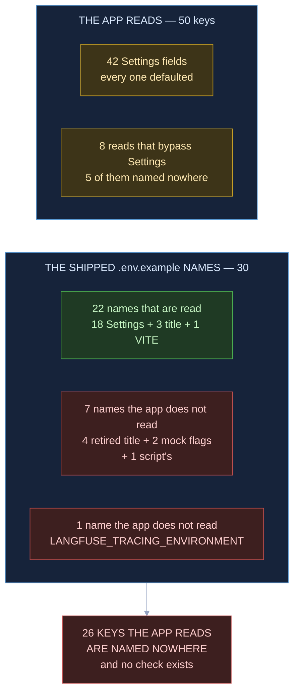
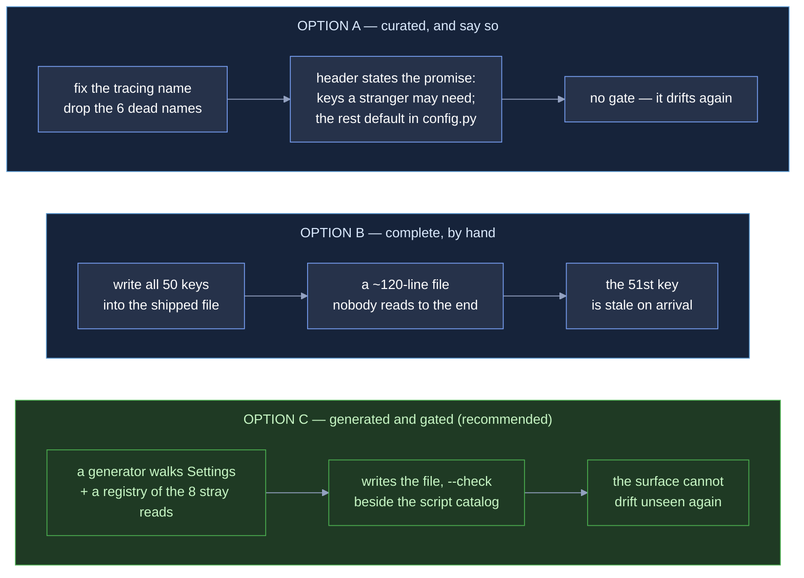
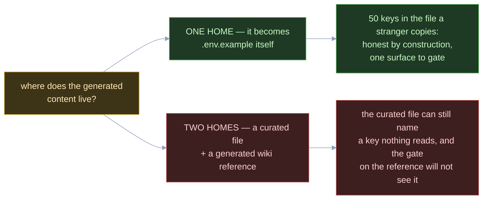

# The example environment file names 30 keys against a surface of 50 — 26 the app reads are unnamed, and 8 of its names are dead or misspelled

**Status**: **LANDED — `a77ea63e`** *(ruled 2026-11-18: "let's go with C")*. The example file is generated from
`Settings` and gated in the pre-commit hook and the flat-tree checks; the names that were dead, misspelled or
over-claimed were corrected first. The landing's own verification raised a **second defect in the same seam** —
which `.env` file the process actually reads — fixed in the same commit and recorded at the foot of this page.
**Found**: 2026-11-18, re-verifying the launch checklist's item 6 (".env.example complete — all env keys
documented"), which was marked ✅ in August. Every count, line and probe result below was measured today.
**Where**: `backend/app/core/config.py`, `.env.example`, `backend/.env.example`, `frontend/.env.example`,
`README.md`, `scripts/core/sweep/backend.py`, `scripts/dev/`.

---

## The short version

The app reads **50** environment keys: **42** `Settings` fields and **8** reads that bypass `Settings`
altogether — and every one of the 42 is defaulted, so an unnamed key never fails loudly, it silently takes a
default. The shipped `.env.example` names **30**; **22** of those names are keys something actually reads, so
**26 keys the app reads are named nowhere in the shipped tree**, and **8 of the file's names are dead or
misspelled** — including `LANGFUSE_TRACING_ENVIRONMENT`, which the app does not read, while the key it does
read (`LANGFUSE_ENVIRONMENT`) is absent (measured side by side, Fig. 2). Nothing checks any of it: no sweep
check, no test, no hook. And the README does not merely suggest the file — it states the claim outright:
*"See the file for a complete list of all configurable settings including LLM provider API keys and
**encryption configuration**"* (`README.md`, Configuration) — while `COGITATE_ENCRYPTION_KEY` appears in none
of the three example files.

## The evidence

| # | site | what it is | who reaches it |
|---|---|---|---|
| 1 | `backend/app/core/config.py` — `Settings` | **42** fields, **0 required** (`is_required()` false for all 42): every key has a default | `init_db`, every service, `alembic/env.py` |
| 2 | `.env.example` (root, tracked) | **30** keys; **18** are `Settings` names, **12** are not | README Quick Start step 2: `cp .env.example .env` |
| 3 | `.env.example:68` `LANGFUSE_TRACING_ENVIRONMENT` vs `config.py:410` `langfuse_environment` (env `LANGFUSE_ENVIRONMENT`) | **the documented name is not read** — probed: setting it leaves `Settings.langfuse_environment` as `''`; setting the real name yields `'production'` | `workflows/observability/langfuse_config.py:191` — `environment=_setting("langfuse_environment") or "development"` |
| 4 | `wiki/dev-notes/tracing/langfuse.md:120` | the same non-key name, documented a second time | a reader of the tracing note |
| 5 | `.env.example:15-16` `VITE_DISABLE_MOCKS`, `VITE_USE_PROVIDER_MOCKS` | **0 readers** in `frontend/src`, `vite.config.ts`, `index.html`, `package.json` | nobody |
| 6 | `.env.example:76-82` the seven `TITLE_LLM_*` | **3** are read (`domain/title/services.py:132-137`: `ENABLED`, `MAX_TOKENS`, `TEMPERATURE`); **4** have 0 readers (`PROVIDER`, `MODEL`, `BASE_URL`, `API_KEY`) and `services.py:339` records that universe as retired | the title service, for 3 of the 7 |
| 7 | `.env.example:48` `OLLAMA_BASE_URL` | read by `scripts/core/ingest_code_for_rag.py:330` — **never by the app** | one ingest script |
| 8 | `backend/.env.example` **23** keys · `frontend/.env.example` **3** keys | the same surface split three ways; the frontend file names 1 key that is read (`VITE_API_URL`) and 2 that are not (row 5) | a reader who opens the wrong one |
| 9 | `README.md` Configuration — **4** rows, `3` of them `Settings` keys (`APP_NAME`, `DEBUG`, `DATABASE_URL`), and its copy says *"See the file for a complete list of all configurable settings including LLM provider API keys and encryption configuration"*; `COGITATE_ENCRYPTION_KEY` is in **none** of the three example files | the README reader |
| 10 | env reads **outside** `Settings` — 8 keys | `COGITATE_BACKEND_URL` (`domain/tools/registry.py`), `COGITATE_DECLARATIVE_TOOL_TOKEN` (`domain/tools/declarative.py`), `INBOX_PROCESSOR_INTERVAL_SECONDS` + `SYSTEM_SWEEP_DELAY_SECONDS` (`app/main.py`), `WORKFLOW_DB_URL` (`workflows/checkpointing/config.py`), `TITLE_LLM_{ENABLED,MAX_TOKENS,TEMPERATURE}` (`domain/title/services.py`) — **5 of the 8 documented nowhere** | those five subsystems |
| 11 | `scripts/core/sweep/backend.py:873-893` | the sweep's **15** checks; **none** compares the config surface against any document | whoever runs a sweep |
| 12 | `scripts/dev/generate_script_catalog.py` · `.pre-commit-config.yaml:38-44` · `sweep/backend.py:892` | the generated-and-gated pattern, twice over: a catalog generated from `git ls-files`, its `--check` as a pre-commit hook, the test catalog in the sweep | every commit |

**How far the defaults actually travel.** Every `Settings` field carries a default, so a key the file never
names still arrives — with the default, silently. That inverts the usual doc-staleness risk: nothing here
fails a launch, which is why the gaps survived three months of green runs. Two concrete consequences measured:

- **A documented name that is not a key** (row 3) — the operator sets `LANGFUSE_TRACING_ENVIRONMENT=production`
  and every trace is tagged `development`; the one thing an environment tag exists to separate is the thing
  that silently collapses.
- **A key with no name at all** (row 10) — `WORKFLOW_DB_URL` and `COGITATE_DECLARATIVE_TOOL_TOKEN` are read by
  the app and appear in no shipped file, so the only way to learn they exist is to read `main.py` and
  `checkpointing/config.py`.

**The count, reconciled.** 30 names in the shipped file (root `.env.example`; the backend copy adds 3 more
`Settings` names, the frontend copy none) = **18** `Settings` keys + **3** live `TITLE_LLM_*` +
**1** `VITE_API_URL` + **1** `OLLAMA_BASE_URL` (a script's) + **1** misspelled tracing key + **4** retired
`TITLE_LLM_*` + **2** dead mock flags. Read by something: **22**. The app does not read: **7**. Right name,
wrong owner: **1**. Against that, across all three example files the `Settings` surface is named **21** of
**42** times — so **21** fields and **5** stray reads, **26** keys, are named nowhere; the README's four-row
table adds no key the examples lack.

## The issue, drawn

**Figure key** — red: the defect · green: a home the app honours or the recommendation · amber: the decision point.

**Fig. 1 — the surface against the file.** Navy: both sides are real · amber: the keys the app reads · green:
the names that land on a real key · red: the uncovered 26 and the names that land on nothing. The file is not
short of keys; it is short of *the right* keys.

```mermaid
%%{init: {"theme":"base","flowchart":{"subGraphTitleMargin":{"top":12,"bottom":12}},"themeVariables":{"background":"#111726","primaryColor":"#26324a","primaryTextColor":"#ffffff","primaryBorderColor":"#7aa2f7","lineColor":"#93a1c0","textColor":"#e8ecf4","mainBkg":"#26324a","nodeBorder":"#7aa2f7","clusterBkg":"#1f242e","clusterBorder":"#5a6a8a","edgeLabelBackground":"#1f242e","labelBackground":"#1f242e","labelTextColor":"#e8ecf4"}}}%%
flowchart LR
  E[".env.example:68<br/>LANGFUSE_TRACING_ENVIRONMENT=production"] --> O["the operator expects<br/>production traces"]
  O --> S["Settings reads langfuse_environment<br/>env name LANGFUSE_ENVIRONMENT"]
  S --> R["unset → ''"]
  R --> F["langfuse_config.py:191<br/>'' or 'development'"]
  F --> B["every trace tagged development<br/>measured: the documented<br/>name yields ''"]
  classDef bad fill:#3d1f1f,stroke:#c05050,color:#ffd0d0
  classDef good fill:#1f3a24,stroke:#4caf50,color:#c8f7c5
  class B bad
  class E bad
```

**Fig. 2 — one misspelling, end to end.** The file's name, the operator's intent, and the fallback that
silently wins. Renaming the key on the page is not the fix: `LANGFUSE_TRACING_ENVIRONMENT` is the SDK's own
convention, which is exactly why it was written down — the app passes the value explicitly
(`langfuse_config.py:191`), so the SDK's environment fallback is never consulted.

## The options

**Fig. 3 — the options, grouped vertically with the recommendation marked.**

| | A — curated, and say so | B — complete, by hand | C — generated and gated |
|---|---|---|---|
| removes | the false promise, the misspelled key and the 6 dead names | every gap, for as long as someone maintains it | the gap AND the maintenance |
| where it breaks down | nothing notices the next drift — this issue recurs | 50 keys × three files × a README table, all hand-edited; the surface is 42 fields and grows | the 8 stray reads live outside `Settings`, so the generator needs a small registry, and a new `os.getenv` bypasses it until someone adds it |
| agrees with earlier rulings | the "docs say what IS" rule | — | the house pattern twice over (row 12): the script catalog and the test catalog are both generated and checked |
| cost | one file, one commit | ~a session of transcription now, recurring after | one script + a pre-commit hook + a sweep row; the registry is 8 lines today |

**Recommendation: C, staged.**

- **Stage 1 — stop the file lying (one commit).** Rename the tracing key to `LANGFUSE_ENVIRONMENT` in
  `.env.example:68` and the tracing note (`wiki/dev-notes/tracing/langfuse.md:120`), delete the 6 dead names,
  and replace the implicit "this is everything" with one explicit line naming where the defaults live
  (`backend/app/core/config.py`). This is mechanical and needs no generator.
- **Stage 2 — the generator, as its own commit.** Walk `Settings` for name, env name, type and default; carry
  a small registry for the 8 stray reads (each with its `file:line` in a comment); write the file. A `--check`
  runs in the pre-commit hook beside the script catalog (0.8 s measured for that one, row 12) and gains a row
  in `verify_flat_tree.sh`.
- **Why not B:** the surface is 42 fields and grows; a hand-maintained list of it is the thing this page is
  about, wearing a longer hat.

## The one decision to take

**Fig. 4 — the decision this page leaves open.** Amber: the question · green: one home, gated where it ships ·
red: two homes, one of which stays unguarded — the same shape this issue already has.

## What is already settled (do not re-litigate)

- **The app runs keyless out of the box.** A launch with no `.env` at all reaches a first-run screen, so the
  file must never read as "these are required". Whatever the file becomes, it says *optional* where it is.
- **`.env` never ships; the examples do.** Three separate ignore rules (`/.gitignore`, `backend/.gitignore`,
  `frontend/.gitignore`), all measured green in this session's checklist pass.
- **Generated-and-gated is the house pattern**, twice: the script catalog's `--check` became a pre-commit hook
  and a flat-tree row (`ee422bfa`), and the test catalog is a sweep check.
- **No dates inside shipped files.** Release docs describe the system as it is; a changelog belongs in git.
- **Deliberately out of scope:** what the defaults *should* be (a value question, not a naming one), and the
  keyed-tier onboarding flow — both live outside Phase C.

## Where the work would live if this is taken up

Launch Phase C owns it (`local/roadmaps/launch-roadmap/c-brand-and-repo.md`, and checklist row 6 of
`local/roadmaps/launch-roadmap.md`). The generator belongs beside `scripts/dev/generate_script_catalog.py`;
the docstrings it would read are on the fields in `backend/app/core/config.py`; the gate is
`.pre-commit-config.yaml` and `scripts/core/sweep/backend.py`; the three shipped files are `.env.example`,
`backend/.env.example`, `frontend/.env.example`. No test: the check is the `--check` exit code, like the
catalog's.

## What landed (C, staged — 2026-11-18)

`a77ea63e` (stage 1 + 2: the generated file, the gate, the anchored `.env` path), `16dbc192` (the tracing note's
key), `750579dc` (the suite fixture the verification needed — unrelated to this seam's code, committed first
because it was the tree's other open red).

**Stage 1, the names and the claims.**

- `.env.example` no longer names `LANGFUSE_TRACING_ENVIRONMENT`; the key the app reads is `LANGFUSE_ENVIRONMENT`,
  and the same correction went into `wiki/dev-notes/tracing/langfuse.md` with the trap spelled out (the SDK's
  own name is never consulted, because the adapter passes `environment=` explicitly).
- The 6 dead names are gone (`TITLE_LLM_{PROVIDER,MODEL,BASE_URL,API_KEY}`, `VITE_DISABLE_MOCKS`,
  `VITE_USE_PROVIDER_MOCKS`), and so are two commented `VITE_*_API_KEY` lines that invited provider keys into
  the browser.
- The README's over-claim is replaced with what is true: the file is generated from the settings the app reads,
  lists every key with its default, and every key is optional.
- `backend/.env.example` became a pointer stub — it had been deprecated in its own headers while still listing
  the retired keys; `frontend/.env.example` keeps only the browser's build-time variable.

**Stage 2, the generator and the gate.**

- `scripts/dev/generate_env_example.py` renders `.env.example` from `Settings` plus a 9-line `REGISTERED` list of
  the keys read outside the model. Rules: env name = field name upper-cased; a project-root-derived default is
  written commented out (a machine path never ships, an empty value breaks the URL parse); a secret gets an empty
  assignment; everything else carries its default. The file it writes has **no clock in it**, so `--check` is a
  plain compare.
- The check runs as a pre-commit hook (beside the script catalog) and as a `verify_flat_tree.sh` row. A hand edit
  fails, and so does a new `Settings` field nobody regenerated for.
- The how-to lives in [[dev-notes/configuration/configuration-surface|Configuration Surface]]: the rules table,
  the add-a-key order, and where the values are read from.

**The second defect the landing raised — the load path.** Reading "where do these keys come from" to write the
note exposed that `Settings` declared `env_file=".env"`, which resolves against the process CWD; `cogitate.sh`
changes into `backend/` before uvicorn, and `backend/.env` does not exist. Configuration arrived anyway — through
a side effect: **litellm calls `load_dotenv()` at import**, which walks up from the cwd to the root `.env` and
puts every key in `os.environ`, where pydantic reads it first. Measured: importing `app.main` from `backend/`
added all **25** keys declared in the root `.env` to `os.environ`; a bare `Settings()` before that import saw
none of them. Silent and order-dependent — every field has a default, so a lost `.env` boots a keyless app
instead of failing. Fixed in the same seam: `env_file=str(BASE_DIR / ".env")`. Re-measured after the change, a
bare `Settings()` with litellm **not** imported reads **9** keys from the root file (the provider keys, tracing
keys and encryption key that differ from their code defaults). Full suite after the change: **2,662 passed /
26 skipped / 0 failed** (`--group all --parallel --no-live`, run `20261118-092521`), no `<failure>` or `<error>`
in the XML.
