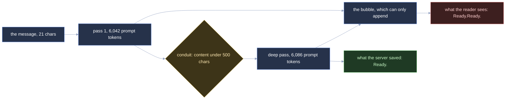
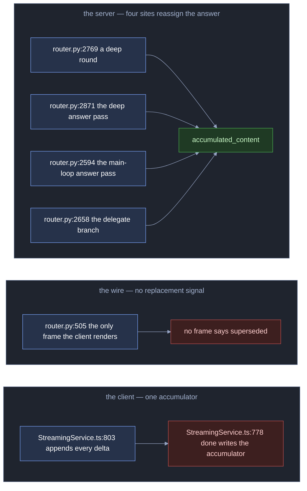
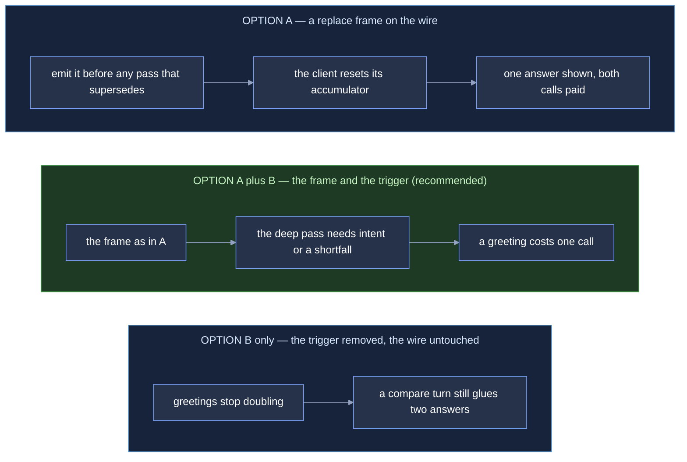
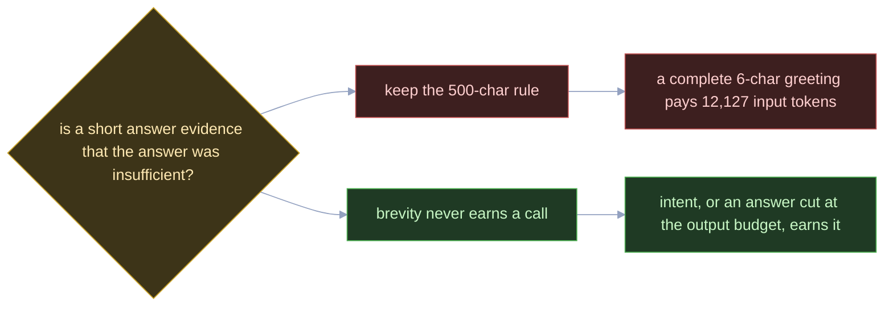

# One turn answers twice — the server replaces the answer, and the wire never says so

**Status**: **LANDED — `3737198`** *(ruled 2026-11-20: "let's go with A+B", and on the one decision inside
stage 2, "brevity never earns a call")*. Both halves shipped together: the replace frame on the wire, and
the deep pass earning its call on **intent** or an **answer cut at the output budget**.
<!-- the status line tracks the issue: OPEN — needs a ruling → RULED — <the ruling> (date) → LANDED — <commits> -->
**Found**: 2026-11-20, reading the two chat turns in the live backend log after the user reported
`"Ready.Ready."` and `"…What's on your mind?Yes, I'm here…"` on screen. Every line number below was
re-measured that day, not carried over. Log line numbers are quoted for the moment of reading only — a
rotating log moves them, the quoted text does not.
**Where**: `backend/app/services/cognitive_pipeline/conduit.py`,
`backend/app/api/v1/chat/router.py`, `backend/app/api/v1/chat/finalization.py`,
`frontend/src/services/domain/StreamingService.ts`.

---

## The short version

A turn makes **two provider calls and both answers reach the screen**. Measured: the message *"Bob, one
word: ready?"* produced `Ready.` in the first pass, and the conduit routed **HYBRID** because the answer was
under 500 characters — `reason=short=True, deep_keywords=False, content_len=6` — so a second call with a
**6,086-token prompt** answered `Ready.` again. The bubble reads `Ready.Ready.`.

The server is not confused: the deep pass's answer **replaces** the first (`accumulated_content =
deep_content`), which is why the **saved row holds one answer while the bubble holds two**. The client is
what has no way to subtract — it accumulates `+=` and the stream carries no frame that says *the answer you
have is superseded*. Four server sites replace the answer; none of them tells the wire.

## The evidence

The rows below were measured **at filing (2026-11-20, before `3737198`)**; the landing section at the end
of the page says where each site stands now. Two of them no longer exist: the second read of the
500-character threshold (row 2) and the brevity trigger itself (row 1).

| # | site | what it is | who reaches it |
|---|---|---|---|
| 1 | `conduit.py:116-131` | `executor_strategy == "hybrid"` **and** `len(content) < 500` **or** a deep keyword → `Route.HYBRID` | every agent on a `hybrid` profile — measured **6 of the 8** profile rows; Bob is `chat-skill` |
| 2 | `router.py:2674` | the same 500-character threshold read a **second time**, for the branch's log line only | the HYBRID branch — a threshold that moves in one home leaves this one lying |
| 3 | `router.py:2761-2769` | replace-over-append: the deep answer **is** the answer, the first pass is only a fallback | every HYBRID turn |
| 4 | `router.py:2594` | the main loop's answer pass replaces `accumulated_content` too | a tool loop that spent every round on tools |
| 5 | `router.py:2871` | the deep pass's own answer pass replaces | a deep loop that spent every round on tools |
| 6 | `router.py:2658` | the delegate branch streams `{'content': text}` — a shape the client **ignores** | the delegate route, disabled today (`conduit.py:98-104`) |
| 7 | `router.py:505-514` | `_content_frame` — `choices[0].delta.content` is the **only** shape the client renders | every frame the server writes |
| 8 | `StreamingService.ts:783-820` | `accumulatedContent += contentChunk` — append only; nothing in the file subtracts | every stream |
| 9 | `StreamingService.ts:778` | on `done` the bubble is written from the **client's own** accumulator | every stream |
| 10 | `finalization.py:270-303` | the done frame carries counts, flags and reasonings — **not the answer text** | every stream |
| 11 | `finalization.py:246-266` | the saved row carries the server's (replaced) answer: `content=final_content` | a page reload |
| 12 | `test_conduit.py:77-85` | `test_hybrid_short_response` asserts `"Hello"` → `"Hi"` → HYBRID, i.e. brevity alone | the suite |

**The two turns, measured end to end.** Both are the whole population of the current log.

| | session 244 | session 243 |
|---|---|---|
| the message | `Bob, one word: ready?` (21 chars) | `Hi Bob. In one sentence: are you there?` (39 chars) |
| pass 1's prompt | 6,042 tokens | 6,046 tokens |
| pass 1's answer | `Ready.` (6 chars) | 111 chars |
| the conduit's reason | `short=True, deep_keywords=False, content_len=6` | `short=True, deep_keywords=False` |
| the deep pass's prompt | 6,086 tokens | 6,145 tokens |
| the deep pass's answer | `Ready.` — **identical** | 117 chars — **different text** |
| the turn's account | `provider_calls=2 paths=deep:1,pass1:1 tokens_in=12127` | `provider_calls=2 paths=deep:1,pass1:1 tokens_in=12176` |
| the saved row (measured in `cogitate.db`) | `Ready.` — 6 chars | 117 chars (the deep answer) |
| the bubble (from the streamed frames) | `Ready.Ready.` — 12 chars | 111 + 117 = 228 chars |

The two prompts account for the whole turn exactly: 6,042 + 6,086 = **12,128** against the turn's reported
`tokens_in=12127`; and 6,046 + 6,145 = **12,191** against `12176`. **The second call is not an extra slice of
the turn — it is half of it.** A 6-character answer was bought with twelve thousand input tokens.

**The cost line under-reports this**, which is why the duplication survived unnoticed: the same turn logs
`💰 Usage logged - Cost: $0.000053, Tokens: 2513` — one call's figures against a turn that made two
(`usage_logs` carries one row per turn with one call's tokens; `tokens_in` on the turn account is the only
per-turn figure).

**How far the rule actually travels** — checked at each construction, because "a constant with a caller that
overrides it" would be harmless:

- **The strategy:** `router.py:1833` takes `executor_strategy = pipeline_config.executor` from the agent's
  cognitive profile. Measured rows: `conversational=default`, `quick-response=fast`, and **six** `hybrid` —
  `research-std`, `balanced-chat`, `code-gen`, `research-pro`, `system-admin`, `chat-skill`. Bob is agent 19
  on `chat-skill`. Nothing in the chat path overrides the profile's value.
- **The threshold:** the 500 lives in `conduit.py:117` and is re-read at `router.py:2674`. The second read
  feeds only a log line, so the two would drift silently.
- **The replacement:** no caller overrides it — sites 3, 4 and 5 are the three ways a turn can be given a
  second answer, and each reassigns the one variable the row and the memory manager read.

## The issue, drawn

**Figure key** — red: the defect · green: a home the app honours or the recommendation · amber: the decision point.

**Fig. 1 — one greeting, two calls, two answers and one row.** Red: the bubble, which keeps both passes ·
green: the saved row, which the server already reduced to one answer · amber: the brevity test that starts
the second call.

The figure's point is **which store is authoritative**: the row, the memory manager and the trace all read
`accumulated_content` after the deep pass replaced it — only the bubble is built from what the client
happened to receive, and the client received both passes.

**Fig. 2 — the class, not the symptom.** Red: the missing signal, and the append-only bubble · green: the
single variable the server already keeps correct.

This is why fixing greetings alone would not close the issue: **any** legitimate deep pass — a real
"compare these two" — replaces its answer the same way, and the wire is silent in all four cases.

## The options

**Fig. 3 — the three options, grouped vertically with the recommendation marked.** Green: the recommended
pair · navy: the two partial takes.

| | A — the frame | A + B — the frame and the trigger |
|---|---|---|
| what it removes | both answers on screen, in every case | both answers **and** the second call on short turns |
| sites touched | one helper + 3 emit sites + 1 client branch + tests both sides | the above + `conduit.py:116-131`, `router.py:2674` and one rewritten test |
| where it breaks down | the deep pass can come back **empty** (`router.py:2874-2878` keeps the first pass) — a reset then leaves the bubble blank where the row holds an answer, so the frame must be followed by a re-send of the kept text | it changes behaviour a test defends; a genuinely stub answer ("I'll look into it") no longer gets a second chance |
| agrees with earlier rulings | replace-over-append (`2761-2769`), and `_content_frame`'s "the only shape the client renders" | the tools-trigger removal (`conduit.py:108-115`) — a trigger that fired on insufficient evidence was deleted before |
| cost | small, mechanical, no behaviour change | small, but it is a ruling about what the conduit is FOR |

**Recommendation: A + B, staged.** Stage 1 is the replace frame, and it is mechanical because the server
already decided which answer wins — the work is telling the client, at the three sites that stream (the
delegate branch stays as it is: it is off today and its frame is a different defect). Stage 2 is the
trigger, and it needs the ruling because brevity is not a bug in a line of code, it is a claim about
evidence.

**RULED — A + B, staged** *(2026-11-20)*. The user's words: *"let's go with A+B"*, and on the decision in
**Fig. 4**: *"that 'brevity never earns a call…' branch"*. A alone lost because it leaves every short turn
paying twice for one answer; B alone lost because a genuine compare-or-explain turn still glues two answers
into one bubble — the display defect is the wider one, and it is the half that is mechanical.

**The one decision left inside stage 2** — what replaces brevity as the signal:

**Fig. 4 — the decision stage 2 actually asks.** Amber: the question · red: the outcome that re-commits the
defect · green: the outcome that matches the tools-trigger precedent.

The recommendation is the green branch: the deep pass fires on **intent** (`DEEP_KEYWORDS`) or on a
**measured shortfall** — `finish_reason == "length"`, the signal `finalization.py:230` already reads as
`truncated`. A stub that the tool loop produced is already answered by gap L's answer pass
(`router.py:3466-3481`), so the case brevity was invented for has its own instrument now.

## What is already settled (do not re-litigate)

- **The deep answer replaces the first pass, server-side.** Replace-over-append semantics, the Bob
  DOUBLE-glitch fix (2026-09-02, `router.py:2761-2769`): *"the deep answer IS the answer; the first pass
  survives only as a fallback when the deep pass came back empty."* This page does not reopen which answer
  wins — only whether the client is told.
- **`tools_were_used` is not a trigger** (2026-09-02, `conduit.py:108-115`): the tool loop already
  synthesised, so a tools-trigger glued two full reports together. The precedent for deleting a trigger that
  fires on insufficient evidence.
- **`choices[0].delta.content` is the only shape the client renders** (2026-09-23, `router.py:505-514`): a
  frame written any other way renders nothing at all, which is measured, not assumed.
- **The done frame is not an answer channel.** It carries counts, flags and reasonings; the bubble's text is
  the accumulator's (`StreamingService.ts:778`). Adding the text to it would be a second home for the answer.
- **Deliberately out of scope:** the `usage_logs` under-count (`2500` tokens against a turn's `12127`) is a
  measurement defect with its own record, not a cause of this one; the delegate branch's ignored frame
  (`router.py:2658`) is off today and belongs with whatever turns delegation on; and the empty-completion
  fallback (`router.py:2155`, `:2425`) replaces the answer without streaming it — a sibling of this class,
  filed here and not fixed here.

## What landed (`3737198`)

**A — the frame.** `_replace_frame()` (`router.py:517`) writes one delta — `{'choices':
[{'delta':{'replace':True}}]}` — the only shape the client parses. `_stream_llm_response` gained a
`supersedes=` argument and spends it LAZILY: the flag is armed when the call starts (`router.py:3828`) and
the frame is yielded (`:3981`) immediately before that call's first content chunk. It is armed at four call
sites — the deep pass's rounds (`:2782`), the deep answer pass (`:3543`, through `_stream_answer_pass`), the
main loop's rounds from the second on (`:2025`), and the main loop's answer pass. The laziness is what keeps
the empty-deep case correct with no re-send: a pass that writes nothing clears nothing, so the answer on
screen survives exactly when the server keeps it.

**B — the trigger.** `conduit.py:132` is `needs_deep or answer_truncated`; `is_short` is gone, and with it
the second read of the 500-character threshold in the router. The router computes the shortfall once
(`router.py:2642`, `_answer_cut_at_budget`) from the answer on screen and passes it at `:2655`; the HYBRID
branch's log line names the keyword set from `DEEP_KEYWORDS` instead of carrying its own nine-word copy.

**One site beyond the filed evidence — the main loop's rounds from the second on.** The filing named the
answer passes and the deep rounds. The same reassignment also happens on every main-loop round
(`accumulated_content = result.accumulated_content`), so a tool-using turn's narration was glued to its
answer in exactly the same way, and a reload dropped the narration. Fixed with the class, not the symptom:
the narration clears when the answer arrives, which is also all the row keeps. It is the one visible change
this landing makes that the filed evidence did not list.

**Verification.** 2064 backend unit tests and 1066 frontend tests green; the `workflows`, `api` and
`components` groups green. The tests discriminate rather than merely pass: a control run with the frame's
emission disabled fails exactly three of them — the deep-pass supersede, the answer-pass supersede, and the
intent test whose two passes both answer `Blue.`, which reproduces the reported `Blue.Blue.`.

**Where the tests live.** `backend/tests/unit/test_answer_replace.py` drives the REAL `generate_stream` and
replays the frames the way the client does — `_client_bubble` is the contract in four lines, so the two
halves cannot drift apart silently again. `backend/tests/unit/cognitive_pipeline/test_conduit.py` holds the
trigger's rule, including the test that used to assert the opposite (`test_hybrid_short_response`).
`frontend/src/services/domain/__tests__/StreamingService.test.ts` holds the reset, beside a reference test
that shows the append-only accumulator producing `Ready.Ready.` without the frame.

**Filed, not taken.** The delegate branch's ignored frame, the empty-completion fallback that replaces the
answer without streaming it, and the `usage_logs` under-count stay out of scope, as recorded above. None of
them is touched by this landing.

