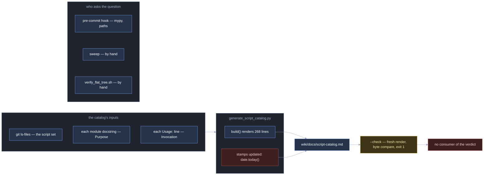
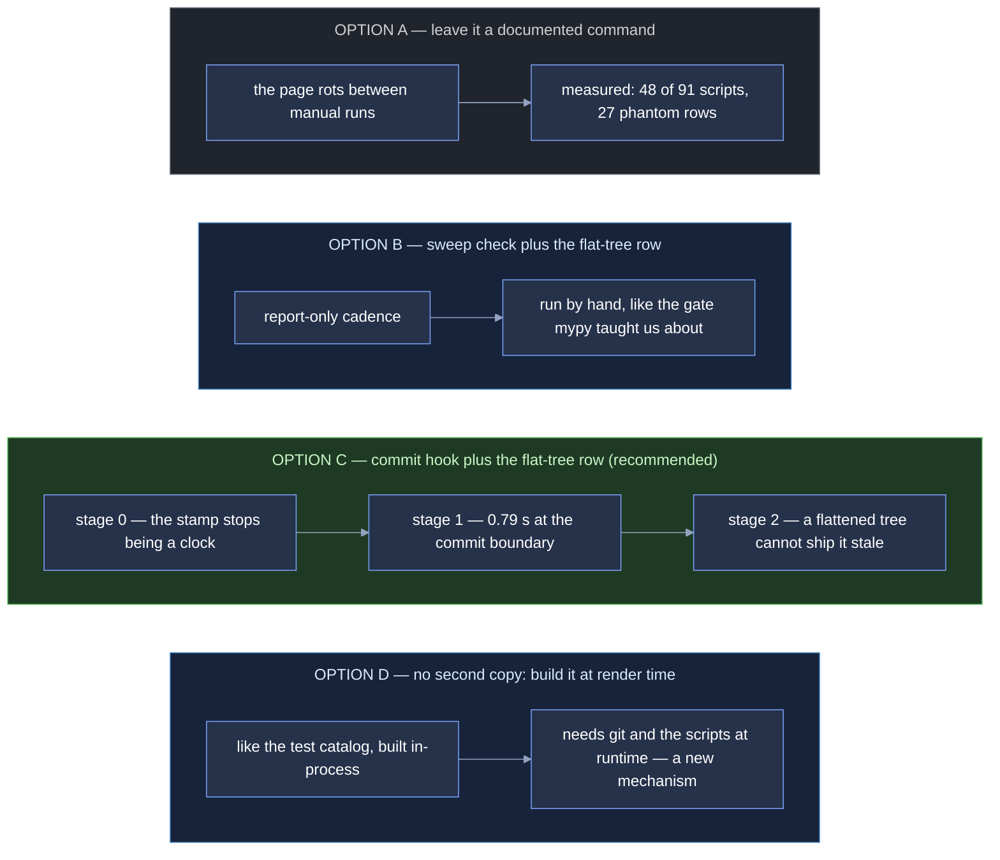
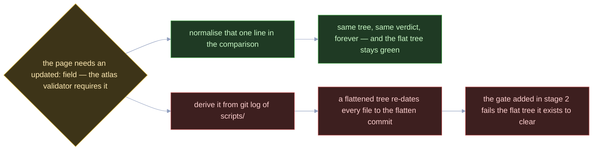

# A generated catalog, a checker with no cadence, and a stamp that would fail it every day

**Status**: **LANDED — `ee422bfa`** *(ruled 2026-11-18: "we can go with both recommendations")*.
Option C, staged: `normalise()` in the comparison, the `script-catalog` pre-commit hook, the
`verify_flat_tree.sh` row.
**Found**: 2026-11-18, ruling on the release plan's two open items. Every line number and every
measurement below was re-measured today, not carried over.
**Where**: `scripts/dev/generate_script_catalog.py`, `wiki/docs/script-catalog.md`,
`scripts/testing/verify_flat_tree.sh`, `.pre-commit-config.yaml`, `scripts/core/sweep/backend.py`.

---

## The short version

`wiki/docs/script-catalog.md` is generated from the scripts themselves, and `--check` compares it with a
fresh render in **0.79 s** and exits 1 when they differ — a correct, cheap, content-level check that
**nothing runs**. So the page is true only on the day somebody remembers to regenerate it, and this
repository has measured the result twice: the page documented **48 of 91** scripts and named **27** that
do not exist (found last arc, fixed at `c466cfe3`), and on today's clean tree it is stale **again** —
with a one-line diff, because the builder stamps `updated: datetime.date.today()`
(`generate_script_catalog.py:198`). Wiring the check is therefore two decisions, not one: the cadence
(it belongs at the commit boundary, not in a by-hand sweep), and the stamp (a comparison against a clock
is not a gate).

## The evidence

| # | site | what it is | who reaches it |
|---|---|---|---|
| 1 | `scripts/dev/generate_script_catalog.py:290,300` | `--check` — renders the page in memory and byte-compares it with `wiki/docs/script-catalog.md`; exit 1 when different, exit 0 with `CURRENT` when equal | **nothing**: no hook, no sweep check, no test, no structural gate |
| 2 | `scripts/dev/generate_script_catalog.py:27` | `OUTPUT = wiki/docs/script-catalog.md` — the page is a committed markdown file, a second home for facts that already live in the scripts | every reader of `/wiki/docs/script-catalog` |
| 3 | `scripts/dev/generate_script_catalog.py:198` | `today = datetime.date.today().isoformat()`, written into the frontmatter as `updated:` | every render, so the comparison changes at midnight whether or not a script did |
| 4 | `scripts/testing/verify_flat_tree.sh:33-40` | the six structural gates run against a flattened tree — object scan, path checks, stale references, commit citations, atlas validation, dangling links | run by hand before a flatten; **no catalog row** |
| 5 | `.pre-commit-config.yaml:24-37` | the commit-boundary gate: mypy (2.3 s) and the path checks (0.8 s), installed at `.git/hooks/pre-commit` | every commit |
| 6 | `scripts/core/sweep/backend.py:517,892,910` | `check_test_catalog` — the precedent: a **derived** catalog's checker wired into both sweep check lists | every sweep, by hand |

**Measured this session, on the clean tree at `843a0f3e`:**

- `python3 scripts/dev/generate_script_catalog.py --check` → **`STALE`, exit 1.** The entire difference
  between the committed page and a fresh render is one line: `updated: 2026-11-17` → `updated: 2026-11-18`
  (verified by diffing both files with that line normalised — the rest is byte-identical, 268 lines).
- Regenerate, then `--check` → **`CURRENT`, exit 0.** The check is sound; only the clock is not.
- One word added to a script's module docstring (`scripts/core/check_agent_health.py`) → **`STALE`,
  exit 1** (file restored). The catalog's Purpose column IS the docstring, so the check catches the class
  it exists for.
- **Cost:** 0.79 s wall, against a hook whose two current checks measure 3.1 s together.
- **Friction, upper bound:** 94 of the 1,740 commits in the last 90 days touch a catalogued script file —
  i.e. at most one regeneration per day, and only docstring or `Usage:` edits actually change the page.

**How far the assumption travels** — the tempting reading is *"it is only a docs page"*: the page has no
consumer but the wiki viewer (checked: no code reads `wiki/docs/script-catalog.md`), which is exactly why
nothing caught it rotting for months. Its drift is silent by construction: nothing downstream breaks.

## The issue, drawn

**Figure key** — red: the defect · green: a home the app honours or the recommendation · amber: the decision point.

**Fig. 1 — the checker is correct and unwired, and the page it compares against moves at midnight.**
Red: the stamp that changes without a script changing, and the verdict no gate reads · green (absent
here — no home honours the check today) · amber: the check itself, which is the decision point.

The important asymmetry: **the inputs are the scripts; the page is a second home for them.** Regenerating
is free and mechanical — remembering to do it is the whole problem, which is what a cadence is for.

## The options

**Fig. 2 — four cadences, grouped vertically, the recommendation marked green.** Red is absent because no
option here is broken — the question is where the check runs, not what it does.

| | A — command only | B — sweep + flat tree | C — commit hook + flat tree | D — render-time build |
|---|---|---|---|---|
| drift it removes | none | the stale page, at sweep cadence | the stale page, at the edit that caused it | the second copy entirely |
| where it breaks down | the page is true only on the day it is regenerated | a gate nobody runs on a schedule — the sweep is by hand | a docstring edit fails the commit until the page is regenerated (0.79 s, ~once a day) | the wiki needs the repo at runtime: `git`, `scripts/` and their docstrings in a deployed tree |
| agrees with earlier rulings | contradicts *"a catalogue is generated or it lies"* | half of it | all three (generated · cadence · ask the repository) | the test-catalog precedent, at a much higher price |
| cost | 0 | one function in `sweep/backend.py`, one row in `verify_flat_tree.sh` | the same two rows, plus a hook entry (~0.8 s on 3.1 s) | a new wiki render path, and the page leaves the markdown tree |

**Recommendation: C, staged.** Stage 0 is the prerequisite and the only non-obvious part: **`--check`
must ignore the `updated:` line** — one line of comparison, because the alternative (deriving the stamp
from git) breaks in exactly the tree the gate exists to clear (see **Fig. 3**). Stage 1 wires the check
into `.pre-commit-config.yaml` as a third hook, so the failure lands on the commit that caused it.
Stage 2 adds the row to `verify_flat_tree.sh`, so a flattened tree cannot ship a stale page.

Why not B: the sweep is run by hand, and this repository already wrote that lesson down in the hook's own
header — *"mypy ran only in the sweep, which is run by hand, so the gate was real but its cadence was
unbounded"*, after 70 errors went to 0 and back to 16. The catalog is the same shape one layer down.

Why not D: the test catalog can be built in-process because it derives from **imported Python**; the
script catalog derives from *file text plus git*, and a deployed tree has neither reliably. It buys the
same guarantee for a new mechanism, which is the trade the ruling should refuse.

**Fig. 3 — the one decision that remains: how the comparison stops depending on the clock.** Red: the
derivation that looks more honest and breaks
on the flatten — the same trap the link gate hit one arc earlier, in reverse (there, asking git was the
fix; here, git answers differently *after* a flatten, because the new repository has one commit).
Green: one normalised line in the comparison; the page keeps its stamp, the gate ignores it.

## The ruling

The user, 2026-11-18: *"we can go with both recommendations."* **Option C, staged**, all three stages:
`normalise()` in the comparison, the `script-catalog` pre-commit hook, and the `verify_flat_tree.sh` row.

The rejected options stay on this page with the reason they lost, because the next reader is deciding a
level down: **A** leaves the page true only on the day somebody regenerates it — the state that produced
the rot this page was written from. **B** is a real check on a by-hand cadence, and the hook's own header
records what that costs (*"the gate was real but its cadence was unbounded"*). **D** buys the same
guarantee with a new render path and needs `git` and the scripts at runtime.

## What is already settled (do not re-litigate)

- **A catalogue is generated or it lies.** The finding filed at the 2026-11-17 roll: an enumerable thing
  is emitted from the source, with its prose in the builder so a regeneration cannot revert a hand edit —
  landed as `c466cfe3`.
- **"Exists" is not "ships".** A gate asks the repository, not the checkout (`0302e278`, `7df02325`); the
  corollary here is that a gate must survive being asked in a **different** repository, which is why the
  stamp is normalised rather than derived.
- **A gate is only as good as its cadence.** `.pre-commit-config.yaml`'s header, written after the mypy
  regression; it is the argument against the by-hand sweep as the sole home.
- **Deliberately out of scope:** `wiki/docs/factsheet-metrics.md`, the sibling generated page. It carries
  a `Generated: <timestamp> UTC` line in its body and has **no** `--check` at all, so it is the same class
  one step further along — its own item, not this page's ruling.

## Where it landed

One commit, `ee422bfa`. `normalise()` sits beside `main()` in
`scripts/dev/generate_script_catalog.py` and blanks the `updated:` line on both sides of the
comparison; the hook is the third entry in `.pre-commit-config.yaml` (`script-catalog`, ~0.8 s,
firing on commits that touch a catalogued script or the page); the row is the sixth gate in
`scripts/testing/verify_flat_tree.sh`.

Verified by running the gate three ways: `CURRENT` on a tree whose page is stamped yesterday,
`STALE` after a one-word docstring edit, `CURRENT` again once restored — and `MISSING: …` with a
clear message when a script is tracked but absent from disk. There is still no unit test over
`build()`; `backend/tests/` holds no reference to the generator, and the hook is the gate.
