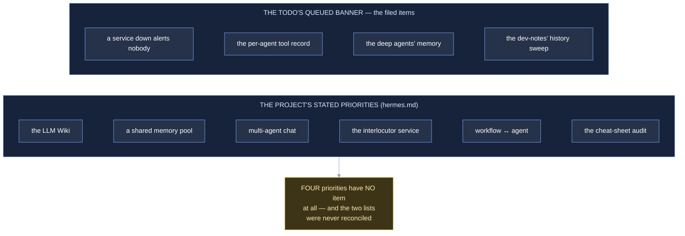
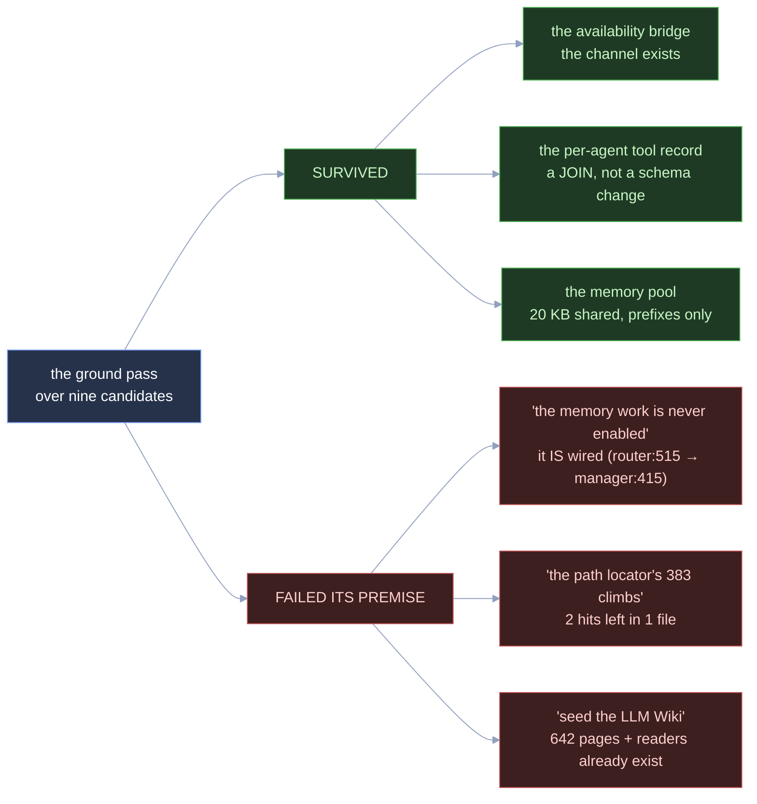
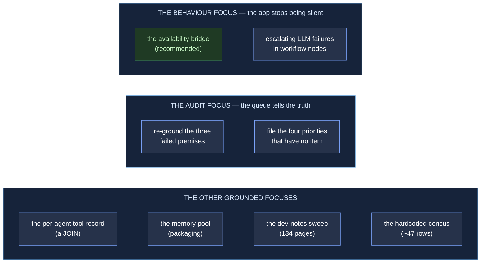
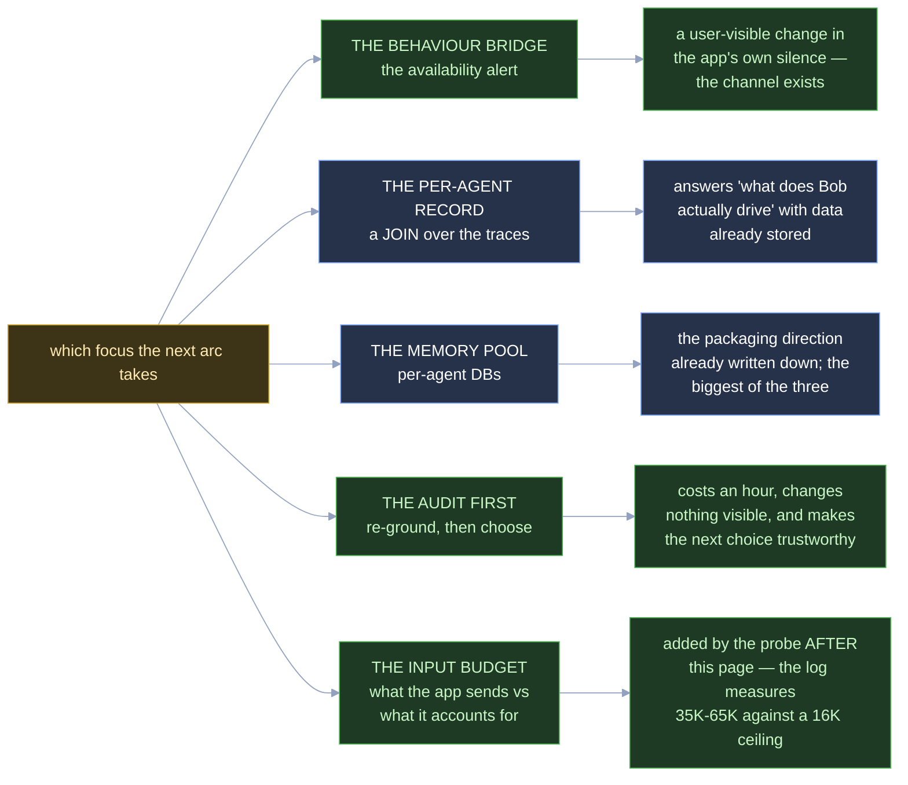

# The next focus — two lists that disagree, and three candidate premises that did not survive measurement

**Status**: **RULED — the next arc is THE INPUT BUDGET** *(the user's words: "The input budget vs what the
app sends", 2026-10-12)*. The embedded-service-literals arc is closed and nothing is in flight, so the next
arc was a free choice. The candidates came from **two lists that do not agree** — the backlog's QUEUED
banner and the project's *Current Backlog Priorities* (**four of the six have no item at all**) — and
grounding nine of them falsified **three premises**: one is already wired, one has no work left, and one
needs defining before it can be an arc. A probe **after** this page was written then added the focus the
ruling chose.

**Found**: 2026-10-12, at the session roll, after the arc closed.
**Where**: measured across the backlog, `.hermes.md`, `backend/app/domain/providers/availability.py`,
`app/domain/messaging/services.py`, `app/services/cognitive_pipeline/{memory_manager,trace_store}.py`,
`app/api/v1/agent_chat/router.py`, and the tree itself.

---

## The short version

Two lists name the work and they disagree, so a focus chosen from either alone is chosen on a filing that
may be stale — and three of them are. The availability candidate survives grounding best and is the
cheapest real behaviour change: **the app knows a service is down and tells nobody**, while the push
channel it would use (`publish_warning`, whose default kind is literally `provider-fallback`) already
exists and is already used by the fallback points.

## The evidence — each candidate, measured (not quoted)

| # | candidate (source) | what the tree says today | verdict |
|---|---|---|---|
| 1 | **A service that is down alerts nobody** (todo) | `availability.py` computes the state on demand (`cached(provider_id)` at `:466`); a grep for a monitor/interval/periodic loop in it finds **none**. The push surface exists: `messaging/services.py:181 publish_warning(title, message, kind="provider-fallback")` → the SSE bus → **every open tab**, and the fallback points already call it. | **GROUNDED** — the app has the answer and the channel, and no bridge |
| 2 | **The deep agents' memory work is never enabled** (todo) | `agent_chat/router.py:515` **does** populate `capability_chains={MEMORY_CAPABILITY_KEY: memory_chain.candidates}`, and `memory_manager.py:415` reads that chain. | **PREMISE FAILS** on the agent-chat path — the claim needs re-grounding (which path was meant?) |
| 3 | **The per-agent tool record** (todo) | `trace_store.py`'s `cognitive_traces` table has `session_id`, `message_id`, `trace_json`, `metrics_json` — **no agent column**; but `models.py:238` gives a chat session an `agent_id`. `metrics.total_tool_calls` is already aggregated per trace. | **GROUNDED, and cheaper than filed** — it is a JOIN, not a schema change |
| 4 | **A shared memory pool for agents** (`.hermes.md`) | The shared `data/cognitive_memory.db` is **20 KB**; the separation is the `agent_{id}:…` prefix written in 4 places (`memory_manager.py:195`, `:365`, `:443`, `:508`) plus a purge `LIKE` (`purge.py:209`); **no** per-agent `cognitive_memory.db` exists on disk. | **GROUNDED** — a real packaging change, modest in size |
| 5 | **The path locator sweep — "383 hand-computed climbs"** (todo) | `grep -rn '\.\./' backend/app --include=*.py` → **2 hits in 1 file**. | **THE WORK LOOKS DONE** — the item's measure is stale |
| 6 | **The LLM Wiki** (`.hermes.md`, first priority) | The corpus is already large: **642 wiki pages** (134 dev-notes); the agents already have readers (`doc_index`, `doc_reader`, `doc_vector_store`, `document_manager_handler`, `wikipedia_handler`); a **34 MB** `system_code_vector.db` exists. The user's own note: the RAG ingest is *"an end user Exa based functionality… not currently being used much if at all."* | **NEEDS DEFINING** — as stated it is not a build task, and its ingest half is parked by the user's word |
| 7 | **The dev-notes' own history sweep** (todo) | `wiki/dev-notes/` is **30 entries / 134 pages**, essentially all carrying dated narrative. | **GROUNDED and large** — a mechanical sweep, sized by sections not by a grep |
| 8 | **The hardcoded-values sweep** (todo) | The archived census is ~9.7 KB, ~47 rows. | **GROUNDED and modest** |
| 9 | **Exa's installation skill · editing the curated lists** (todo) | Both touch the external agent's surface. | **ASK-FIRST** — a behaviour change there needs the user's go |

## The issue, drawn

**Figure key** — red: a premise that failed or work already done · green: a home the app honours or the recommendation · amber: the decision point.

**Fig. 1 — the decision's two sources.** Navy: the two lists as they stand · amber: the gap — four stated
priorities were never filed as items, so the queue is not the priorities.

**Fig. 2 — what the measurement changed.** Green: candidates whose claim holds and whose size is now known
· red: three premises the tree contradicts — one is already wired, one has no work left, one needs
defining.

**Fig. 3 — the options, grouped by what they buy.** Green: the recommendation. The audit focus is the one
that costs least and pays immediately — it is what this page's own ground pass proved necessary.

| | the behaviour focus | the audit focus | the other grounded focuses |
|---|---|---|---|
| removes | the app's silence about a service it knows is down | three stale premises + four unfiled priorities | one of: an unknown per-agent picture · the shared-prefix scheme · a docs doctrine breach · the literal census |
| where it breaks down | the detection half is on-demand today, so a monitor has to be designed | it changes no behaviour for the user | each is real work with no user-visible change |
| agrees with | *"silent fallbacks are bad"* (2026-09-01) and the notification subsystem's own skill | the roll's standing ruling (correct items to match what landed) | the arc's just-closed discipline |
| cost | contained: one bridge + a monitor decision | an hour, no code | hours to a session each |

**Recommendation: the behaviour focus, staged — and the audit focus is cheap enough to do first anyway.**

- **Stage 1 (an hour, no code): the audit.** Re-ground the three failed premises (re-file them with what
  the tree says), file the four priorities that have no item, and mark the path-locator item done. This is
  the roll's own ruling applied to the queue, and it is what makes the next arc's filing trustworthy.
- **Stage 2: the availability bridge.** The push channel exists (`publish_warning`, kind
  `provider-fallback`); the missing halves are (a) *when* to publish — availability is computed on demand
  today, so a transition has to be detected somewhere — and (b) *what counts as news* (a service going
  down vs still down, and per provider). Its own page, its own ruling.

Nothing here re-opens a settled question, and nothing in it touches Exa's surface.

## The one decision to take

**Fig. 4 — the decision, and what the probe added to it.** Amber: the decision · green: what the ruling took
(the input budget) and the audit that rides along · the bridge, the record and the pool stay available and
are not argued against.

**Ruled (2026-10-12):** *"The input budget vs what the app sends"* — the arc takes **the input budget**:
what the app accounts for against what it actually puts on the wire. It arrived by probe **after** this page
was drawn (the user's own chat warnings) and it wins on the same test the others were measured by — it is
grounded, it is ONE mechanism, and it is the only candidate the user *experiences* every turn: the log
measures **35K–65K** tokens against a 12,800 threshold and a 16,000 ceiling, while the budget counts each
history message's `content` alone.

**The rejected foci, and why they lost** (they stand, un-rejected as candidates — each is a future arc):

- **the availability bridge** — contained and ready, but it tells the user something they cannot act on
  differently today; filed, not taken.
- **the per-agent tool record** — a JOIN over data already stored; nothing is blocked by its absence.
- **the shared memory pool** — the largest of them, and it would rather follow this work than compete with it.
- **the audit first** — the roll's own pass (re-grounding the three failed premises, filing the four unfiled
  priorities) rides along with whichever arc is taken; it does not need an arc of its own.

## What is already settled (do not re-litigate)

- **The RAG/ingest half of the LLM Wiki is parked by the user's word**: *"it takes a long time… the feature
  is not currently being used much if at all. It is an end user Exa based functionality."* Rebuilding it is
  a testing exercise, not an arc.
- **The embedded-service-literals arc is closed** (`wiki/issues/resolved/embedded-service-literals/`, nine
  pages, residue empty) — its pages are history, not a plan.
- **Exa's surface is ask-first**: its installation skill and the curated lists both change an external
  agent's behaviour, so neither starts on an agent's initiative.
- **The queue is the backlog's banner**, and the roll maintains it (correcting items in place, filing
  findings) — removing or renaming items is the user's call.

## Where the work would live

`local/roadmaps/<arc>/` for the chosen focus's roadmap (roadmap FIRST, archived on closure), the arc's
pages in `wiki/issues/` (one decision each, moved under `wiki/issues/resolved/<arc>/` as they land), and
the backlog for the audit stage — three items re-grounded, four filed, one marked done.
