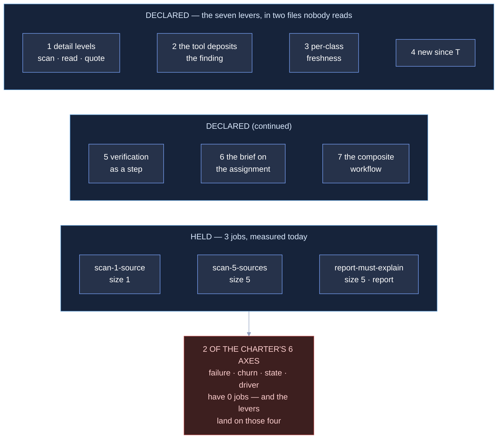
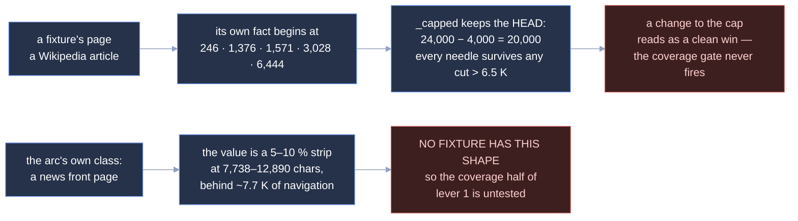
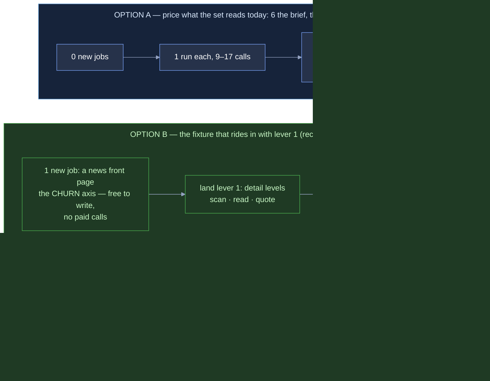
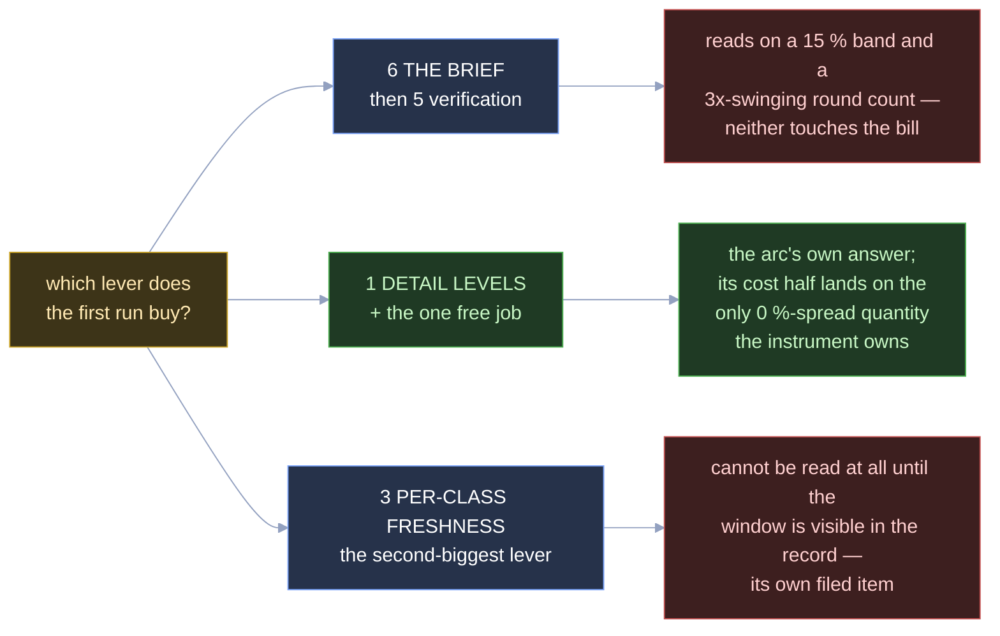

# Seven parked levers, and the set holds one stable reading for them — the other six land on a gate that swings, or on an axis with no job

**Status**: **OPEN — needs a ruling.** What is open: which of the arc's seven parked levers step 4 prices
first, and whether the first change is read on the set as it stands or with the one job it needs. What
constrains it: the instrument prices a lever only where a gate holds still, and four of the charter's six
axes have no job at all.
**Found**: 2026-10-15, reading the seven parked levers against what the set actually holds, on opening step 4
of the bench arc. Every line number and every count below was re-measured today, not carried over.
**Where**: the backlog (the reporter item's lever list, the bench item), `local/roadmaps/research-run/`
(the arc), `scripts/bench/` + `data/bench/` (the instrument and its six runs), `local/sessions/session_plan.md`
(step 4's framing).

---

## The short version

The reporter arc parked **seven** levers as its next work. The bench — the instrument built to price them —
holds **3** jobs covering **2** of the charter's six axes, and the levers land squarely on the four axes with
no job: two of the seven (the brief, the repository's own depositing) read on a gate that holds; the rest read
on quantities the instrument's own band shows swinging **3× to 10×** on unchanged jobs, or on the freshness
window whose fetches the cost record **cannot see at all** (3 of the six runs already read `fetched_chars 0`
while the turn billed 50,658–79,161 tokens). And the lever step 4's plan proposes — **the cap's size** — is
not on the list: it landed as the tool contract (`fab3f6b3`), and this corpus cannot move its coverage half
(measured: every fixture's fact begins within the first **6.4 K** of its page, and `_capped` keeps the head),
which is exactly what the arc concluded a week ago — *"the lever is not a smaller cap: it is returning the
FINDING instead of the page."*

## The evidence

| # | site | what it is | who reaches it |
|---|---|---|---|
| 1 | the backlog item | the seven levers, numbered **1–7**: detail levels (`scan`/`read`/`quote`) · the tool deposits the finding · per-class freshness · "new since T" · verification as a step · the brief on the assignment · the composite workflow | the reporter item; **no code reads this list** |
| 2 | `local/roadmaps/research-run/roadmap.md:7-9` | the same seven, in the park banner, in the same order | a reader of the arc |
| 3 | `scripts/bench/`, grepped for a lever (`lever` · `detail level` · `churn` · `freshness`) | **0 hits** | nothing |
| 4 | the backlog item | the charter's six axes — **size · kind · failure · churn · state · driver** | the charter only |
| 5 | `scripts/bench/jobs/*.json`, the `axis` field, read now | **3** fixtures: size 1 · size 5 · size 5 + kind report → **2 of the 6 axes**; failure · churn · state · driver have **0 jobs** | `run_bench.py --list` |
| 6 | the same three files, the `state` field | every fixture declares `{"assignment": "fresh"}` — the driver supports the other value (`run_bench.py:687-708`) and no fixture uses it | the driver's state check |
| 7 | `run_bench.py --list`, run today (free mode) | prints `3 job(s)` and one ceiling line each | anyone |
| 8 | `data/bench/band.json`, six runs | `capped_per_fetch` 24,302 at **0 % spread** · `schemas_max` 3,560 at **0 %** · `system` 2,206–2,542 at **15 %** — against `provider_calls` 2–6 (**3×**), `tool_results_max` 4,017–44,533 (**10×**), `tokens_in` 45,959–260,447 (**4.7×**) | the gates below |
| 9 | `run_bench.py:740-772` (`budget_verdict`) | the gates: rounds · tool schemas · system · cap per fetch — and `tokens_in`, a labelled ALARM | every run |
| 10 | the reader's markdown, one free read per source, **no LLM** (measured now) | every fixture's own fact begins inside the first **6.4 K**: Douglas 6,444 · Lancaster 3,028 · Sarpy 1,376 · Hall 246 · Buffalo 1,571 | the coverage check |
| 11 | `backend/app/domain/tools/builtin/jina_reader_handler.py:119-136` | `_capped` keeps the HEAD — `24,000 − 4,000 = 20,000` chars — plus the tail | every fetch |
| 12 | `data/bench/*/rows.json`, six runs | one run of the set is **9–17 provider calls** (11 · 15 · 13 · 17 · 14 · 9 = **79**) | the cost column of every option below |
| 13 | the backlog item | the charter's own estimate: *"one bench run is ~25–40 calls"* — **2–4× the measured** | whoever announces a run |
| 14 | runs `20261014-191256` (report) · `-192425` · `-192553` (scan-5) | **3 of 6 runs read `fetched_chars 0`** while the turn billed 50,658 · 57,554 · 79,161 tokens — a fetch served from the 30-minute window logs no size | the same rows the gates read |
| 15 | `local/sessions/session_plan.md:22-25` | step 4's framing: *"the lever this instrument measures best is **the cap's size**"* | step 4 |
| 16 | `local/roadmaps/research-run/roadmap.md:121-122` | run 5, the cap live: a fresh gather cut **~40 %** (`tokens_in` 86,568) and the soft still fired (34,551 · 37,529); *"**the lever is not a smaller cap: it is returning the FINDING instead of the page**"* | a reader pricing the cap |
| 17 | `fab3f6b3` | the cap **landed** as the tool's own deposit — head + tail, a notice naming the true size, `truncated`, `shown_length`, `max_chars` raisable per config | the tool |

**How far the declarations actually travel** — the check this page owes, since a declaration a caller overrides
would be harmless:

- **The seven levers** live in exactly two files (rows 1–2) and **nothing** in `scripts/bench/` reads them
  (row 3). The list is a plan, not a contract: `run_bench.py --list` (row 7) cannot tell you which lever a job
  prices, and no fixture names one.
- **The six axes** live in exactly one file (row 4). Each fixture declares its own `axis` and **nothing
  requires the set to cover the table** — so "two of six" is invisible from inside the instrument. The driver
  prints the axis (`run_bench.py:184-188`) and never counts them.
- **The gates, by contrast, do travel** — declared in each fixture's `budget`, enforced in one function
  (`budget_verdict`), their spread recorded in `band.json`. That is the asymmetry this page is about: the
  instrument can price a lever only where a gate holds still, and it holds still only for the quantities the
  fixture was written to pin (rows 8–9).

**What each lever would move, and whether a gate reads it** — the mapping, one row per lever:

| the lever | what the change moves | the quantity that would read it (band) | a job for it? |
|---|---|---|---|
| **1 · detail levels** (`scan`/`read`/`quote`) | which fetches meet a cut at all, and the tool result per call | `capped_per_fetch` / `capped_chars` — **0 % spread, the one stable reading** | **cost half: yes** (all 3 jobs) · **coverage half: no** — every fact sits above the cut (row 10), and no fixture is a page whose value sits behind navigation |
| **2 · the tool deposits the finding** | the notebook's content, and the next turn's digest | nothing — the driver fingerprints the notebook and counts its notes and fetches (`run_bench.py:700-703`); it never reads what a note says | **no** (state axis: 0 jobs) |
| **3 · per-class freshness** | whether a fetch is served from the window at all | nothing — the record cannot see it (row 14) | **no** (churn axis: 0 jobs) **and** blind until that filed item lands |
| **4 · "new since T"** | what a repeat run returns instead of a re-read | a repeat run — no job runs twice | **no** (state axis: 0 jobs) |
| **5 · verification as a step** | +1 round and an evidence record | `rounds` — **2–6 on an unchanged job, 3×** (row 8), so a ceiling, not a cost | readable as a **ceiling only** |
| **6 · the brief on the assignment** | the system prompt's size | `system` — 2,206–2,542, **15 %** — readable when the change beats the band | **yes** |
| **7 · the composite workflow** | who orchestrates, and what the run's nodes cost | the `driver` axis, and D3 — **B vs C is still open** (`roadmap.md:98`) | **no** (driver axis: 0 jobs) |

So the instrument prices **one** lever (6, and only if the change beats a 15 % band), a **second** on its
ceiling (5), a **third** on half its effect (1), and **four** not at all (2 · 3 · 4 · 7 — which are exactly the
four axes with no job).

## The issue, drawn

**Figure key** — red: the defect · green: a home the app honours or the recommendation · amber: the decision point.

**Fig. 1 — what is declared against what is held.** Navy: both surfaces are real · red: the gap — not "the set
is small", but that the seven levers land on the four axes the set has no job for.

**Fig. 2 — the corpus, and why the coverage half reads green whatever happens.** Red: the clean win a cap
change buys on this corpus, and the source class this set does not have. The arc's evidence for the detail
level is the shape on the right; all three fixtures are the shape on the left.

**Fig. 3 — the options, grouped vertically with the recommendation marked.** Green: the staged route — the
fixture first because it is free and mechanical, the change second, the reading third.

| | A — price the readable pair | B — one free job + lever 1 | C — the axis table first |
|---|---|---|---|
| removes | nothing about the bill: it prices the two levers that touch prompt text and round count, while the census says the bill is payloads (6.79 M input tokens; 87 % of tool use is the reader + search) | the arc's own answer, priced — and the half of it this set cannot currently see (Fig. 2) | the coverage gap in the charter |
| where it breaks down | `system`'s band is 15 %, so a brief under ~375 tokens is a re-roll (row 8); `rounds` swings 3× on an unchanged job, so verification reads only as a ceiling | the new job must be written so its fact genuinely sits behind navigation, or the row measures nothing — one page, one class, **n=1** | 63–119 paid calls and several sessions before any lever is priced, for axes chosen by the census rather than by the lever list |
| agrees with | the gates' own definition (price only what holds still) | `roadmap.md:122` — *"returning the FINDING instead of the page"* — and the user's framing that a lever is a **process** change, not a prompt tune | the charter's axis table |
| cost | 2 runs, 18–34 calls | 1 job (no paid calls to write) + 1 run of 4 jobs — **9–17 measured, plus the new job's 3–6** | 63–119 calls, several sessions |

**Recommendation: B, staged.**

- **Stage 1 — the one job, written for free.** The `churn` axis: a news front page whose value is a strip
  behind its navigation — the class the arc's own measurement came from and the only shape where a detail
  level can lose the fact. Its needles come from the page's own headline lines, the way the twelve existing
  ones do; `--check-fixtures` reads the sources with **no LLM** (`run_bench.py:1166`), so this stage costs
  nothing.
- **Stage 2 — lever 1, as its own commit.** `scan` / `read` / `quote` beside `_capped`
  (`jina_reader_handler.py:119`), the parameter on `arguments_schema` (`:211`). It is the lever the arc names
  and the one the instrument's 0 %-spread quantity is made of.
- **Stage 3 — one announced run of four jobs.** The reading splits cleanly: the three Wikipedia rows are the
  **control** (cost falls, coverage holds — and `tool_schemas` moves by exactly what the new parameter costs,
  against a 3,560 gate at 0 % spread inside a 4,200 ceiling), the front-page row is the **measurement**.

**Why not A first, and why not the cap.** A prices the two levers that cannot move the bill. The cap is a
different thing altogether: it **landed** (`fab3f6b3`), it is not on the seven-lever list, and no fixture's
fact sits past a head window of 6.4 K (rows 10–11) — so pricing it here would produce a clean reading of a
decision already taken.

## The one decision to take

**Fig. 4 — the decision this page leaves open.** Amber: the question · red: the routes that spend a run on a
reading that cannot move the bill, or that the record cannot produce at all · green: the lever the arc names,
with the one free job it needs.

## What is already settled (do not re-litigate)

- **Not a pytest test, ever.** Neither deterministic nor free; opt-in, announced, `--go` is the consent, and one
  run of the set is **9–17 paid calls** (measured over six runs — the charter's "~25–40" is 2–4× high).
- **The gates are the per-call composition** (`1d495d59`): `tool_schemas` 3,560 at 0 % spread, the cap per
  fresh fetch 24,302 at 0 %, `system` 7–15 %; `tokens_in` is a labelled ALARM. **A value inside the band is a
  re-roll, not a result** — which is why Fig. 4's red routes are red.
- **The cap landed on the tool's side** (`fab3f6b3`) and is not one of the seven levers: head **and** tail with
  a notice naming the true size, `truncated` and `shown_length` on the result, `max_chars` raisable per config.
- **The levers are process changes, in the user's own framing** *(2026-10-13)*: *"not to optimize for the
  current prompt, but to create a more general system that can handle an arbitrary but reasonable number of
  sources"* — a lever holds for 1 source or for 40.
- **The research run's phases 2–3 are PARKED by the user's word** (*"anything that requires more advanced
  agentic rewrites we can park for now"*), and the bench runs before them. Nothing here re-opens either.
- **Deliberately out of scope:** the freshness window's invisibility in the cost record (its own filed item —
  cited here only as the reason lever 3 is unreadable), and D3's B-vs-C question, which gates lever 7.

## Where the work would live if this is taken up

`scripts/bench/jobs/` (the one new job, the `churn` axis), `local/roadmaps/research-run/roadmap.md` (the arc's
own banner, so the lever list stops being a list and starts being a ledger with a priced column),
the backlog (the reporter item's seven levers and the BENCH item's step-4 line), and — in Stage 2 — the
change itself in `backend/app/domain/tools/builtin/jina_reader_handler.py` (`arguments_schema` at `:211`, the
detail level beside `_capped` at `:119`). No tests: it is not a pytest test, and the fixtures' own checks are
the fixture suite.
