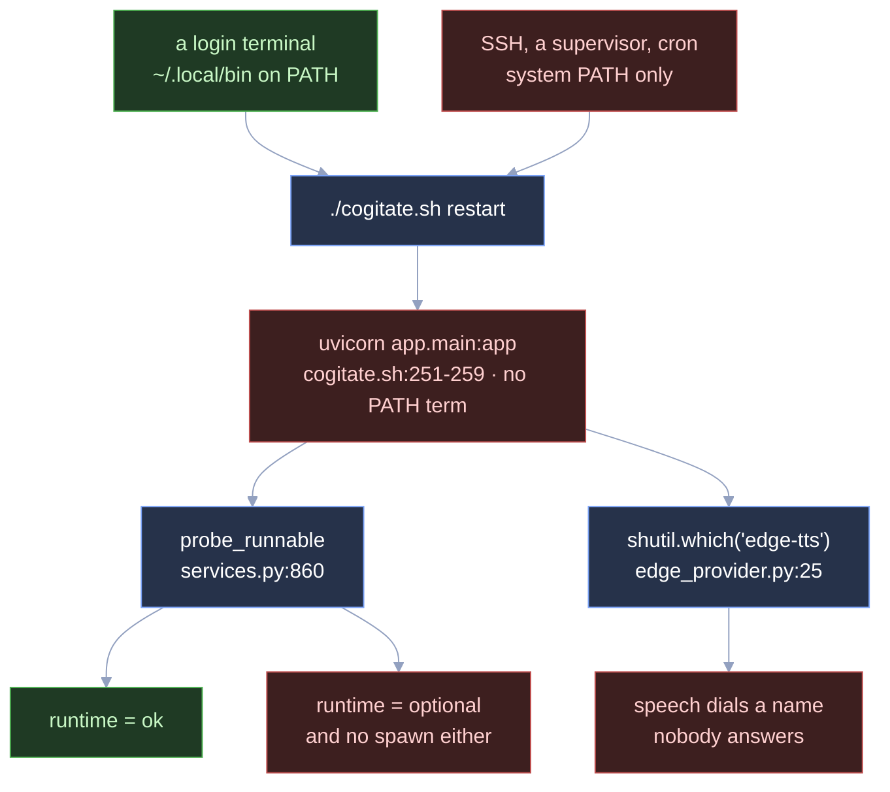
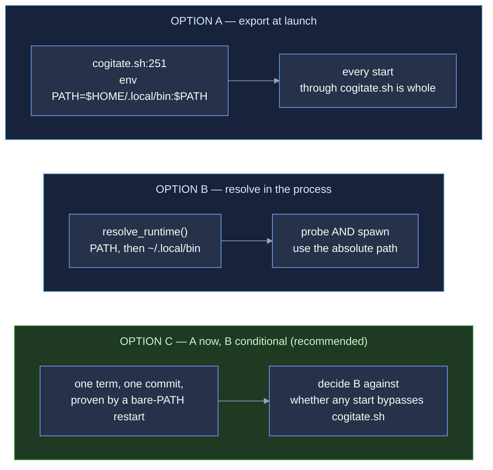

# The check reads its own process's PATH — one install, two verdicts, and two capabilities that vanish

**Status**: **OPEN — needs a ruling.** What is open: which layer owns the backend's environment — the
launcher that gives it one, or the app that resolves binaries without it. What constrains it: the verdict
is already correct about the process it runs in, so there is nothing to "fix" in the check itself.
**Found**: 2026-11-21, breaking one fact on the frozen guest (`a3e1ccc`) and restarting its backend over a
non-login SSH shell. Every line number below was re-measured today, not carried over.
**Where**: `cogitate.sh`, `backend/app/domain/providers/readiness.py`,
`backend/app/domain/external_agent/services.py`, `backend/app/domain/tts/providers/edge_provider.py`.

---

## The short version

The app resolves **two** external binaries **by name** — `hermes` (Exa's runtime) and `edge-tts` (speech) —
and on a working install both live in **`~/.local/bin`**, a directory that never reaches the backend's
environment. `cogitate.sh:251-259` launches uvicorn with `setsid env -u CORS_ORIGINS …` and **no PATH
term**, so the process inherits whatever PATH started it: from a login terminal the acceptance check reads
Exa's runtime **`ok`**; from an SSH non-login shell it reads **`optional`** with *"'hermes' is not on PATH
… nothing answers to it here"* — and that same process **cannot spawn Exa at all**, because the spawn gate is
the same `shutil.which` (`services.py:860`). Measured on **one clone at `a3e1ccc`**: two verdicts, one
restart apart, every file unchanged. `ready` never moves — the runtime item is `counted: false` — which is
exactly why the install's headline number stays silent about a capability it has lost.

## The evidence

| # | site | what it is | who reaches it |
|---|---|---|---|
| 1 | `cogitate.sh:251-259` | `setsid env -u CORS_ORIGINS INBOX_PROCESSOR_INTERVAL_SECONDS=20 SYSTEM_SWEEP_DELAY_SECONDS=15 ../.venv/bin/python3 -m uvicorn app.main:app …` — **no PATH term**; the child inherits the caller's | every `start` and `restart` |
| 2 | `cogitate.sh:770`, `cogitate.sh:907` | `export PATH="$HOME/.local/bin:$PATH"` — twice, both for **cogitate.sh's own** preflight (the install's `uv` check) and a tool check | cogitate.sh, never the backend |
| 3 | `grep -n hermes cogitate.sh` · `grep -n edge-tts cogitate.sh` | **0 hits** each; `edge-tts` is in neither `pyproject.toml` nor `uv.lock` and does not import in `.venv` (*measured*) | — |
| 4 | `/proc/<uvicorn pid>/environ`, host (*measured*) | `PATH=$HOME/.local/bin:$HOME/.local/bin:$HOME/.local/bin:/usr/local/sbin:…` — the login shell's, **appended three times** by nested starts | this box's backend |
| 5 | `/proc/<uvicorn pid>/environ`, guest after `./cogitate.sh restart` over SSH (*measured*) | `PATH=/usr/local/sbin:/usr/local/bin:/usr/sbin:/usr/bin:/sbin:/bin:/usr/games:/usr/local/games:/snap/bin` — **no `~/.local/bin`** | the guest's backend |
| 6 | `/api/v1/setup/readiness`, same clone `a3e1ccc`, before the restart (*measured*) | `runtime → state: ok`, *"Exa's runtime is on PATH. Activation is still your decision."* | the Dashboard card and the Setup checklist |
| 7 | the same endpoint, after the restart (*measured*) | `runtime → state: optional`, *"Exa needs an external runtime: 'hermes' is not on PATH — Exa runs on an external agent runtime (the command is 'hermes acp'), and nothing answers to it here"* | the same two screens |
| 8 | `backend/app/domain/providers/readiness.py:232-263` | `_runtime_item` → `probe_runnable`; `None` → `OK`, a reason → `OPTIONAL`; `counted=False` in both branches | `measure()`, `readiness.py:271` |
| 9 | `backend/app/domain/external_agent/services.py:849-865` | `probe_runnable` — `shutil.which(parts[0])` against **this process's** PATH, returning WHY NOT as a sentence | readiness |
| 10 | `backend/app/domain/external_agent/services.py:104` | the spawn default `["hermes", "acp"]` — the same name, resolved the same way, in the same process | every Exa activation |
| 11 | `backend/app/domain/tts/providers/edge_provider.py:25` | `shutil.which("edge-tts") or "edge-tts"` — falls back to the bare name, so the dial fails later instead of here | the speech provider |
| 12 | `ls -l ~/.local/bin/` (*measured*) | `hermes` (70 bytes, `#!/bin/sh` → `~/.hermes/hermes-agent/.hermes/bin/hermes`) · `edge-tts` · `uv` — **all three user-local, none in `.venv/bin`** | the installer's convention |
| 13 | `grep -rn "on PATH" README.md wiki/dev-notes/` (*measured*) | **0 hits** — nothing tells a user the starting shell matters | a reader following the docs |

**How far the defaults actually travel** — the check this page owes, since a resolver a caller overrides
would be harmless:

- **The probe and the spawn are one gate.** `probe_runnable` (`services.py:860`) is what readiness asks
  (`readiness.py:237`), and the same `shutil.which` guards the spawn (`services.py:860` — the function the
  ACP client uses before starting `hermes acp`). So the verdict is not *lying*: it reports the world its own
  process lives in, and in that world Exa genuinely cannot be started. The defect is that the install
  created a process smaller than the install.
- **Nothing overrides the command.** Both callers pass `cfg.command` (default `"hermes acp"`,
  `schemas.py:85`), so a user who set an absolute path is already immune — the exposure is the default,
  which is what a fresh install has.

## The issue, drawn

**Figure key** — red: the defect · green: a home the app honours or the recommendation · amber: the decision point.

**Fig. 1 — one launcher, two environments, one process that cannot tell which it got.** Red: the inherited
PATH and the two capabilities it removes · green: the environment the installer actually created.

The two starters run the **same** script and the same command; nothing downstream records which one it was.
The verdict is authentic in both cases — which is what makes the install's own acceptance check the wrong
place to look for this.

## The options

**Fig. 2 — the options, grouped vertically with the recommendation marked.** Navy: what each option
changes · green: the recommendation. No amber — nothing is being decided here beyond the staging.

| | A — export at launch | B — resolve in the process | C — A now, B conditional |
|---|---|---|---|
| sites removed | every start that goes through `cogitate.sh` — including the SSH case that produced this page | every probe **and** every spawn, whatever started the backend | A's today, B's if it is earned |
| where it breaks down | a start that bypasses `cogitate.sh` (a hand-written unit file) still inherits — but nothing in the tree documents such a start | teaches the app a **second PATH authority**: unless probe and spawn share the one resolver, the check can find what the spawn cannot run — a *worse* defect than the one it fixes | the second stage may never be needed |
| agrees with earlier rulings | provisioning merges, never truncates (`0df7318`): the launcher hands the app the environment the installer assumes, and changes nothing the user set | the verdict has one home (`064b5cb`): the resolver becomes that home's input, not a second answer | both, in order |
| cost | one term on one line; proven by one restart from a bare PATH | a resolver, its tests, and an audit of every shell-out | one commit, then a measurement |

**Recommendation: A now, B only on a measurement.** A is mechanical and it fixes the case that raised the
page. B is the half that survives someone else's supervisor, and it is worth its cost **only if** a start
that bypasses `cogitate.sh` is a shape to support — measured today: **0** docs mention PATH, **0** tests
touch `cogitate.sh` (`scripts/testing/generate_report.py` mentions it, nothing exercises it), and the
guest's only starts are `cogitate.sh`. So the second stage is a decision, not a default.

**The page's own lead, which is NOT this defect:** the provider keys arrive the same way — `readiness.py:101-106`
reads `settings.*_api_key`, and pydantic loads `.env` at process start (*measured* today: blanking
`DEEPSEEK_API_KEY` changed nothing until the backend restarted). A different mechanism, the same restart
boundary; it belongs on its own page if it is taken up.

## What is already settled (do not re-litigate)

- **One readiness verdict, one home** (`domain/providers/readiness.py`, `064b5cb`) — and it is right about
  the process it runs in. Nothing here asks the check to guess a machine it is not running on.
- **`optional` is a decision, not a failure** — `counted: false` in both branches (`readiness.py:245`,
  `:255`), so the Exa runtime never moves `ready`. That ruling stands; this page does not propose counting it.
- **`probe_runnable` returns a reason, not a boolean** (`services.py:850`) — the copy naming the cause is
  settled and is what made this page possible.
- **Provisioning merges, never truncates** (`0df7318`); activation provisions Exa's home before it flips
  (`b8d181a`). A launcher that adds `~/.local/bin` adds a directory, it does not replace an environment.

## Where the work would live if this is taken up

`cogitate.sh:251` for stage A (the same block carries the two `export PATH` lines at `:770` and `:907` that
already prove the convention). Stage B would live beside `probe_runnable` in
`backend/app/domain/external_agent/services.py`, with the edge-tts caller (`edge_provider.py:25`) audited in
the same pass. Nothing in `todo/master.md` carries this yet.
